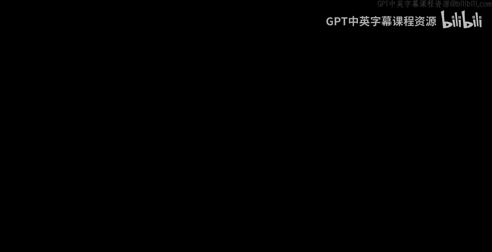
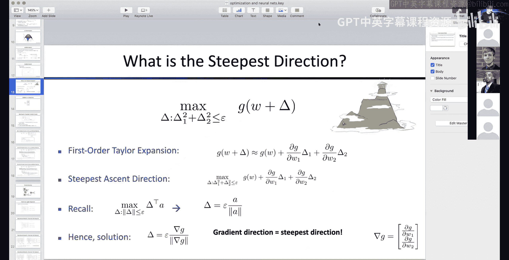
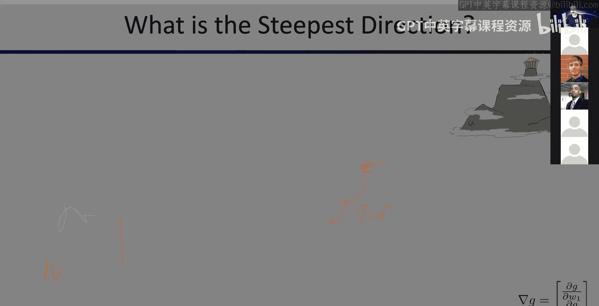

# USC《机器学习系统｜CSCE585 Machine Learning Systems 2020》中英字幕（Claude-3.5 p07 -07-Lecture 4.2 - Optimization and Neural Networks.zh_en -BV1Xc9bYVEC6_p7-

Okay， hello everybody let's a stop， sorry for the delay I keep struggling with this screen sharing apparently doesn't work after。

The new version of the OS on my iPad so if you remember we discussed about gradient As in the last lecture and it was a very simple procedure for optimizing the type of classifier that started basically we discussed about binary classification and multiclass classificationifiers and this gradient as was a way to find optim parameters in order to give us the right model that provide a decent classification based on our training data and the idea was very simple we started by a random initialization in a space of。

啊。The weights right here， we have two dimensions here， x1 and x2。

 we initialize from somewhere and we follow the direction of the gradient。

So it is an iterative approach in the first step step。

 we calculate the gradient at this point and then we find the next point in this space of weights and then we do the same procedure at each point we calculate the gradient with respect to。

The current point in this space and we follow this iterative approach and we repeat it until we converge somewhere and we call it dumb so it is very simple approach we discuss it in detail how it looks like and。

What are those reasonable stopping point then when when we can call it them。

 Do you have any question about this。I hope you can hear me the。

And then we discuss about this idea of why taking the steps toward the gradient is a reasonable or the optimal choice here。

 we discuss about if we have a constraint， So in this case。

Can you can you see the the right slide here。I'm looking at the gradient descent slide。

 the one that shows the concentric like ellipses。嗯。Why it was not updated。Let me see。

Yeah。

So。Here we are given a specific function。 I'm not sure why a still is not。打。Updating the site。

There is something rock。Is this supposed to be showing all the formulas right now Yeah you don't see it right now I just see like the bottom right corner like I see deelta G equals like the partial derivatives。

 but that's it Yeah I'm not sure what's going on let me see let me see how can I fix it。

Sorry about that。Now seems to be working。 Let's see。Yeah。So okay。

 so we discussed about this situation where we are given a function G here。And we have a constraint。

 so we can change the weights， so W is the input for this function or itss in weight and we can move or change weights according to a certain constraint。

And then we expanded this GW plus delta according to the first order tailored expansion。

 and you know that in this case you can change。G here。When you're given a delta here。

 you can expand it based on G of W， the initial bes plus the amount of change according to the first coordinate of deelta 1。

Multiplying by the gradient of G with respect to the W1 and the second coordinate of deelta2 deta is basically the amount of change that we are adding to the W multiplying by gradient of G with respect to the second coordinate of thes and then we looked at the steepest a direction so this is we want to maximize because that was our goal we wanted to maximize amount of G the target function when we make a change to the W and then。

We know that in calculus， when we have a direction and we know by default， then we want to。

Maximize the inner product between two vectors。 We better to align them completely together。

 And this is the very how we can make this alignment when we have this constraint with respect to the amount of change we want we want to we want to make according to this and we can based on the construction。

 we can do the same we can here in this case，A is this vector。

 so we can construct this vector and we know that by construction。

 this is the steepest direction in the。Basically for making the change in the weight vector。

 so basically gradient ascent give us the right direction to move forward and that's the proof by construction why this algorithm gradient ascent or disscent depending on the target function makes sense and give us the right direction to move iteratively do you have any question about this。

So that was basically showing why your gradient accent makes sense and why it is making the right direction at each iteration of the algorithm。

记两咯，拜。I need to learn how to remove these annotations。And if you want to do that for。

For the functions with a larger number of dimensions， for example， in this case， n dimensions。

 we can do the same。So basically， the gradient is a vector of N dimension。

Very similar to two dimension and we can do the same procedure as we move forward accounting to the algorithm so in this case we have a very simple iterative algorithm we initialize the weight。

And then we have a loop to infinity， obviously we need to stop somewhere。

 we discuss when we can stop。Or when it makes sense to a stop。

 so we add to the initial weights based on the learning rate which could be a small amount and multiplied by the gradient of our objective function。

 G of w at each at each point in the space of weights。

 so this is very simple procedure and for choosing the learning rate we discuss that this is a reasonable choice a very small amount。

 this learning rate could be fixed。Or could be also adjusted during the learning。 Typically this。

 there are algorithms an extension of gradient a that。Update the learning rate。

 according to a simple rule as we get closer to the target value to the optimal value。

 we make Al the learning rate is smaller because we don't want to jump around the optimal point in in the beta space。

 So this is a rough estimation about。What kind of value we need to consider for for alpha in this case。

So roughly at most 1% of。Of the function value in this case。Any question about this Albert？

So that this gradient accent。Is an optimization algorithm that could work could work for any optimization。

 any maximization or minimization that we have for classifier， We know that the。Function G。

 in this case， is large likelihood of the。Labels are given。The input。And the rate。

We discussed extensively about this lag likelihood we want to maximize this log likelihood in order to give us the right prediction。

 at least for the training set that we have and this is some overall training examples。

 so we have a set of examples。1， why 1。Plus， x 2。喂超。嗯。Ex and。我听。So these are given。 So these are。

You can represent it as D。Your training set。These are given to you so you know what are the ground rules data？

So you you know the YI and you can calculate this probability for all training examples that you have in D D again is your training set。

Typically， you want to split your training sets into two different sets。

You want to use one set for using in this procedure and another set heldout data in order to check when it makes sense to stop。

And we discussed that how you can make that decision in the previous lecture。诶。So again。

 we do really the same procedure as you know in your gradient as。

 you start by an initial weight and then you plug in this function into your procedure for each。

A step， you take one example， you select one of these， you plug it in here。

 and then you calculate the log likelihood of the labels given the input and the current weight that you have and you need to know that this is again。

 this weight is updated so for the next examples that you select you're calculating this log likelihoodlihood on a new weight so basically when you started by W0。

 the next step。Then you calculate for the second example。You calculated。

L probability of the second example in this case， why。2 given X to。W 1 in this case。

 So in the previous one was differently。 the previous one was the log。Llihood of probability。Of Y 1。

G X1。And W0。 So make sure that you understand the difference。The condition part。

Was different in terms of。Not only the example that you use， but also the weight that was。

Used previously。 So these are the two essential differences in this update rule for debate。

And at each it here， according to this。You select。One example at a time。

 and you make the update to debate。Do you have any question about this？Yeah。

 I was just wondering now， why log？Whyhy log likelihood？Yeah， that's a very good question。

This log likelihood is mainly a mathematical trick。

 so it's for convenience when you want to do this optimization。嗯。Essentially。

 you could do calculation based on only the conditional probability， but this like likelihood。

 when you want to calculate the gradient， it makes it simpler in your optimization procedure。

So is it mathematical， convenient transformation and in calculus in other form of mathematics。

 these kind of transformations。Basically， make this calculation alone。More convenient。 What down。

Do you see that slide or not？Now I see the slide， I'm not sure what you're talking about。

Like as in like what's go on on。Are you seeing something different or oh， now I'm seeing？

I'm seeing some formula soon。I'm seeing the formulas disappear。Or half of them anyway。Yeah。

 I'm not sure what's going on Oh we're back on the original slide now。Okay。

 very well so basically this log is mainly out there for making the calculation of the gradient a lot simpler in the optimization process。

 I hope this makes sense for now but considered as a mattermatic country。😊，Any other question？

By about。Okay， so。Now， you may want to think that maybe。If you have so many examples。

So many training example。Sometimes， Im。In most of the cases。

 if you think that you might be able to do a lot of these calculation in parallel。

 maybe then you may want to take advantage of these parallel computation that you have sometimes。

You know that， like。InsteadInstead of calculating the gradient with respect to all examples that you have。

 you may want to pick a few examples and then calculate the gradient with respect to these few examples in your training set。

 and then next time when you want to make a change update to your weight then you pick another set of random examples and you do the same procedure gradient and again。

 so this is called a stochastic gradient ascent or stochastic gradient descent。

And the reason why he call it the stochastic here is that in instead of calculating。

This log likelihoodli or gradient with respect to this conditional probability for all examples in your training set。

 you pick some random examples at each iteration， right。So at each iteration。

 you pick some example depending on the amount of computes that you have。For example。

 imagine that you have hundred0 GPU course。 Then you want to calculate all of this in in parallel。

 Then you can pick0 example。 You calculate this conditional。Probability。

 although this is not the exact gradient because you haven't used all example in your procedure。

 but this gives you a noisy version of the gradient still useful as a signal and you want to make the update to your weight according to this noisy estimation of the gradient that you have。

And for the next point， so imagine here you started from W0。

 you selected 100 example and this 1 hundred0 example give you an estimate of the gradient now here your W1。

Then whatever you want， you select another random。Sex， right， And then。Basically。

 you do the same same procedure again and again right， So at each iteration。

 you select a different set of from your training example in order to calculate this。Log probability。

 even though the gradient estimation is noisy for the state useful and this algorithm still has the convergence property if。

If you make sure that you select these examples。In a really random way and there is no correlation between the examples that you pick at each iteration。

Do you have any question about this？So this is very similar to the。

A stand up version of gradient ascent， but we call it the stochastic because instead of using all example in your training set。

 you select a batch of batch of random variables or。F you depend， depends on on。On the number of。

And the number of compute that you have， if you only have one one， for example。

 core maybe you want to use only one example if you have multiple core you want to to use more number of examples from your training example right so it really depends on the amount of compute which are given to you and you can vary this mini batch differently right could be as small as one example could be as large as the whole training data that you have so you have。

And this again really depends on the amount of compute that you have。So。

You can make this procedure a lot faster。 Obviously， if you。 So there is a trade off here going on。

 if you select this。Butuch larger for for this procedure， you calculate this gradient。

 obviously more accurately， if you。If you select the smaller batch， this calculation would be noisy。

 but would be a lot faster， so you have a tradeoff between converging faster or you want to pay off more compute here to get calculation more accurately。

But obviously you need more computes and you may need to have to use。

To use more compute here at each it in order to do this optimization procedure。So the。

 the selection of。This mini batch， the size of this mini match matters and。

And this really depends on the amount of compute and the amount of noise that you can afford for this calculation。

Now that we have learned about this optimization procedure。

 we know how to optimize a multiclass regression model。

Right so now we know how to optimize this multiclass logistic regression。

 we want to extend it to a neural network。How to do that。

 this is really simple and that was the key reason。

That we are started by this multious logistic regression to build the intuition behind。

The our network。It could have started well by a simple version of neural network。

 but this way you can see that neural network are a special case of logistic regression。

Where the set of features that you use in your model are given in this case。

 So you have a set of feature， and then you have a set of activation， Z I， H Z I。

Is a weighted vector of the features， So for example， W1。I believe to。right W。你。So， this啊。

In a vector of W。By your feature vector。Is basically。啊。Is the activation that that we can get here。

 right， So you calculate the activation based on the given feature values we discuss this extensively previously。

 and then you pass it through a layer soft mask in order to calculate these probabilities。 So again。

 to repeat here， these activations。Are not probability distribution。

 These are real numbers from minus infinity to positive infinity。

The reason we did this transformation was， again。Make it mathematically more convenient in order to give us the flexibility of distinguishing between different。

 for example， classification right so we discuss this case where where we have different example right。

 positive cases right and negative cases。We might have a different decision boundary right this is one decision boundary。

 this is another decision boundary， both of these are correct。This is also the center force。

 We might have many decision boundaries here to to choose to。

To classify these two sets without such transformation， without having these probabilities。

 it was impossible for us to distinguish between these different decision boundaries and we discuss after doing these transformations since we have these conditional probabilities then we could reason about what conditional probabilities give us the highest likelihood of the data at least for the training sets that we have so with these reasoning based on probabilities we could reason about the goodness of these different decision boundaries and then we could pick up the best one to according to this so we have this softmax transformation。

Where we use these activations here， we assume that we have three activations， Z1， Z2 and Z 3。

 and then。With this simple soft max transformation， we get this probability distribution。

Any question about this。The important。Think that you need to know in this logistic regression that we discuss is that these future vectors are given to you。

Right。It started。By assuming that we know what are these feature vectors。

And the learning part here was to learn these weights， right。

 So we did not did not want want to learn these feature vectors is feature vector。Were given to us。

 We just wanted to learn these ways that。Maximizes these conditional probabilities after we do this of max transformation。

So these probabilities somehow were connected by with these weights。 So obviously。

 the different choice of weights， these conditional probabilities would be different and then be sum over these P Y I given。

X， I。And W U eyes。This sum would result in different value。

 And we wanted to select the extent of this link that make these sum。Maximal way， right。

 So his large likelihood， we wanted to maximize。This given given the training examples that we have。

 that was really the mechanism or the mechanics behind this learning procedure that we discussed。

Any question about this？So now since we know， this multiclass logistic regression。

Then turning it to neural network is really simple。 And the question is that。

Can be instead of assuming that we know these feature vector。

 Can we learn these feature vectors as well。 And the answer is that， yes， you can。

 And then you need to think about what are given to you and what needs to be learned， right。

 So you can assume that you have some magics here。 Obviously。

 you have some input And this inputs are。Already in your。In your input vector， your x， right？

For example， if you have an image， you know already this X value。For example， is X 1 to X。

 N could be。PigPixel value in your image， right， So in in a digital image。

 you have different pixel values。 These are already given to you。

 You see what is the strength of each pixel in your image for example， any value between 0 and 256。

 you can extract this。 So assuming that you know this X 1 to X is obvious。

 And then you need some magic to transform this pixel value to。To some feature vector automatically。

 obviously in instead of handwriting it， and then the rest， you already know how to do that。

So in traditional machine learning， you write program。In order to do this transformation for you。

 for example， you look at the image and you count how how many loops you have。

 how many edges you have in your image， how many maybe corners you have in your image。

So you count the number of you calculate the important features。By writing some programs。Right。

 so you need to do some calculation and this calculation。

Are really based on the intuition that you might have。

 What are the important features that you might have。 So you write some program to。

 to do this transformation from the。The raw data， the raw input to some higher order representation in the input as space。

With neural network， we would like to learn this program using the data。

 And that's the key difference between traditional machine learning and a neural network。

 You might have heard about。Suffer。1。0 and 2。0 and this is essentially the difference between two in software 1。

0 you write programs such as C plus plus P code or something like that that transform these features into transform these inputs to to your feature space by writing explicit programs that exploit the knowledge inside your head what is important for this learning task in software 2。

0 you just。Use a magic of black box that we will describe shortly in order to only use your training example in order to learn that program。

 so you learn this program in a sort of explicitly writing this program。

I hope it does make sense here。And the way how you do it in neural network is really through some again。

 repeating the same the same sort of transformation that you saw here。

 so here you have some transformation going on from your feature space to your activation。

 you repeat the same but now multiple times。So you have different layers， you start by your input。

 which are already given to you and then you repeat this transformation several times depending on the depth。

In your network that you want to get。So obviously， if you increase the depth， maybe this magic。

Become。Better somehow， if you decrease the weight， the depth of your network。

 maybe this magic becomes less effective or it becomes synized， right？

So it's really a set of transformation that you do in order to transform your input to these features and then the rest you already know。

 and here you have again similar thing think about each of these ZI again very much similar to these two things。

 but now so each of them represent a set of features， but with different complexity。

But for now again， each of these links represent weights， so they have at different S strengths。

 So each ZI here。Is a weighted song。Of previous the previous example that the previous input that you have right and then you calculate this inner product between the input and weight and you pass it through some non linearity in order to transform each layer to the next and next and next until until you get the right feature vector in the last layer。

 then you can transform it to your activation function and then you can calculate this conditional problem。

So we repeat the same procedure several times with the hope that we get the whole end to end network correctly。

So here again， some mathematics， linear and algebrabra。In order to make a sense out of it。

 So you have some weight。So in order to calculate the activation for layer K。Right。

And each of them are indexed over I。嗯。You need to have the weights for。

You need to have these weights that connect the previous layer。

 the nodes in the previous layer to each of the nodes to each of these ZIs。

And then multiplied by the activation in the previous layer， right， So for example。

For calculating this guy， you need to have each of these activation that belongs to the previous layer。

 right， and each layer here。So here， for example， you have how many you have。K，1 number of nodes。

Here in this layer。You have。K。2 number of nodes。 And this could be different， right。

 maybe here you might have。10 nodes here， you might have0 nodes and difference so you might have different neurons。

Or notes in the network at each layer。So for calculating this guy。

 you need to have these 10 activations， for example。

 and you need to have some weights associated to this and the weights again is a similar notion determines the strength of this connection if a weight is higher means that this connection is。

Is more important， more values going from this node to this node。 And if the node is is this link is。

Tinner means that the connection is。Les important right comparing with the other connections and then you pass it through some non nonlinearity in order to to calculate the activation for each of these nodes and the reason that that you need this nonlinearity is very simple if you do not use this nonlinearity。

 this inner product between the activation and the weight vector is linear so。

It keeps everything linear and if we have a linear function and the data in your training set is not linearly separable。

 this doesn't work like whatever number of neurons you want to use whatever number of layers you want to use。

 as long as you don't have this non nonlinearity，This transformation。Stay linear。

 So if you are millions number of layers since this calculation is linear。

 everything will stay linear and if your examples are not linearly separable。

 then then even such complex network cannot classify your examples properly。

So you need some nonlinear transformation in order to make it to make。This happen to make this。

Separation between London near example happened。 Any question here。嗯。So again。

 a very simple extension of multiclass logistic co。Tranforming you to a deepep neural network。

So its deep neural network art not really magic， simple extension of。

Of what we already know in a multi class classification。

So some of how this nonlinearity looks like right， it's very simple。

 we have different functions like sigmoid function。

 hyperbolic tanggent re function and so many other type of nonlinear function with different type of transformations。

 right？So again， for example， in the sigm function you see that we have this sigmode function before transforming the for using it in multiclass logistic regression so it has a very simple formulala。

 and the gradient of the sigmode itself is very simple to calculate，So big。

So it transform the input from minus infinity to positive infinity between zero and1， right。

 the hyperpoic tangent is centered around zero so as you go to positive infinity get closer to one。

 the other very around get closer to minus1 in a set of zero in sigmmas function。And in。

Is a simple switch on an of。Everything negative will be turned off and everything positive。

 you use the same value as your input test right so the calculation is really simple and that's why。

It makes sense to use value in。In neural network， because， first of all， calculating。

This transformation。Requires less computation as opposed to hyperbolic tangent and sigmoid in hyperbolic tangent you need to calculate。

诶。Exponential of E Z E minus D in sigmoid， only minus D here。You do not need any calculation。

 you either switch off。Use zero， or if it's positive， you use the same value。

So no calculation is just only checking whether it is positive or negative say if if then kind of code。

 one line of code， you can calculate GZ and。It's。Basically， for calculating the。

The gradient of G is so simple， so it either one if this is positive or zero otherwise。

 so there are some certain reason why someone might prefer a value function over other type activation functions in this case。

Any question about this？I had a question。Is there any reason someone would choose the sigmoid or hyperbolic over the Raylu function because I mean I see that I've read something about the raylu function。

Avoiding something called the vanishing gradient problem。

 And so I've got some vague understanding of what that is。

 but I also see that it's easier to compute。 So I was just wondering if there was any advantages of the others。

 Yeah， there are some reasons， right So you see that for example，Around 0。嗯。The gradient。

The gradient of this function， hyperbolic tangent， you can calculate it， right？

Here here is also the same right， but for this right you have like you have right hand side or left hand side gradient but not exactly in zero right so you have this property of value that causes for example。

 this vanishing gradient in the optimization，So you have some trade off for these choices， right。

 It really depends on。あね。Type of data that you have on the type of optimization that you have。

 whether this is， for example， you're classifying images or text or some other path， right。

 So you may want to prefer one activation or the other or the amount of computes that you have。

So there is a trade of a space here， but really depends on the classification problem。

 type of data and the amount of compute that you have。There is no hard rule for each。

 typically people， they start with some default choice revenue if that doesn't work。

 then people may try different choices of activation function。

 whether they get better accuracy or better generalization on different tasks。

I hope this answers your question。Yeah。😊，So you select activation function by graduate descent。嗯。

I don't know if you heard that joke or whatever it。Graduate descendcent。 G descend。 Yes， yes， yes。

 yeah， yeah， yeah。 yes， exactly。 So is's a， yeah， again， is， is's a simple。😊，Tri and error， right。

 So there is no hard rule for choice for this choice of activation function。That's right。Okay so。两先。

I think we can stop here。 What something to mention about neural network is that we have this universal function approximation。

 This is a very longorium。That there is a proof of any any neural network。

 any even two layer neural network， two layer means that you have some input。

 you have one hidden layer and you have output right so。Basically， you need to at least have one。One。

 he then。Layer here。And in this area， basically。The only variable that you have is the amount of neurons that you use in this hidden variable。

 right？You can increase or decrease and。 this storyium says that if。

You have a function and if you want to approximate it with a certain accuracy， right？啊。

Then there exists。Such neural network。嗯。That can approximate this function。With any design accuracy。

What it means。It doesn't tell you how many neurons you should use right so thisisterium is not practical in the sense that it doesn't give you at all how many neurons you need for approximating this。

The only thing that it says that。There exists such neural network。Guan find it。Right so。And that's。

 that's why it's not really usefulterium， or it's not an actionableterium。

 but is a toium that you can approximate any function to any desired accuracy。

 even with this simple neural network， as long as you use you use enough number of neurons。

 And maybe let's， let's look at one。One example here。There are some papers about that， but this。

 let me see。Let me share this with you。This playground is really useful to look at it。

But I'm sure you。You look at this before as well， but let's play around with it together。

Because this is cold。Do you see these playgrounds now。一。Okay， cool， so。

This is very simple and very cool。 Let me see what we have。

Right let' let's start very simple we have two input x1 and x2 and this is very simple data that is linearly separable right you can choose your learning rate。

 you can choose your activation function， you can change it to linear。

Any regularization if you want to use you can change your batch sizes batch sizes again is what we discussed today。

 the number of examples at each iteration of your optimization you can change it to one or all level to the number of examples that you have and then you see that for this。

Linear kind of this， this the dataset that we have is linearly separable， right。

 So even a very simple linear model。 So you see that this activation that we use is linear。

 So you see that this。This model was able to find a decent model to classify these examples。

For example， if we change the data to something which is not linearly separable。

Then this linear model probably doesn't work， right， So you see that there is no in this case。

The model is not really converting or as the training goes on。

The the probabilities over the grassasse are equal。 So the model is not really confident。

Which how to classify this example and most of the cases when this is the situation。

When you saw in your model such situation， you should peek inside and find out the reason why that was the case and most of the cases there is something wrong with your model and you see that even as we train this model for millions iterations。

 nothing will change and。And simply， this tells us。We don't have enough。

Nonlineality in the model to separate this because we know that we need a nonlinear decision down there in order to classify this training example。

 but let's try with different sort of model when we add a kind of hidden layer。

Then let's let's assume that we want to use a linear activation function by default we discuss， okay。

 if we even have。Numerous number of layers。 Let's start with this simple right This probably should not work because we use linear activation and if we increase then the hidden layers。

 right。See， nothing will change still the model is not giving us a reasonable。A reasonable。

Model in order to caaxify these examples， because even if we increase these hidden layers to many and even if we increase the number of neurons to many since we use linear activation。

The model。I is not giving us a decent decision boundary to classify this right so this was connected to the reason why we need this nonlinear activation。

 something beyond linear right why we need re tangent or sigmoid in order to classify this right so let's try for example as simpler right so this model is very complex right。

And if you peek inside each neuron， each neuron thinks very differently from the other neurons。

 how how this classification should work， let's make it a lot simpler。

 right in a cell of very complex let's。Let's use something like this， right and very simple。

 but in a of linear like let's use sigmoid right， And then you see that the model is stuck to giving us a reasonable decision boundary。

You see that the decision boundary in this case is nonlinear。

 obviously we need some nonlinearity in the model in order to classify this example， right？So。

We can obviously change sigma to Re。See that still it would give us some decent decision boundary to classify this steam model useful looks different generalizes differently with re function but the still is able to classify this example right。

 let's increase the number of neurons like to six and do the same。

One thing noticeable in this case is that you see that。With four neurons， you had。

So if you look at these weights， right， look at the values of these weights， right， 1。6。us1。6。-1。6，1。

7。 But you have some smaller rates， right。Even though these are useful。

 but when you decrease this to four。See， you have。You have different weights。

 maybe in this case three neurons might be enough right。

 see that these values are somehow closer to each other， right？Still。

You see that this model is not able to distinguish between。The two classes that you have properly。

 but but maybe something this is too much for the model。

 and these are reasonable way that you can think about how you can have different model that give you different。

Accuracy as well as different simplicity and generalization power for different different type of task right you can obviously change this to different activation and do the same procedure you need different number of epochs each epoch represent。

Each different iterations that you need to go through through your to your optimization procedure that we just learned today date。

 the stochastic version right and you can change the parts sizes。

And do the procedure until it converges， right？嗯。Do you have any question about this？None here。

 but I guess I was just going to mention how that does answer my question about the selection between the activation functions。

Yeah大家。Clearly tanH or the hyperbolic tangent is better than the raylu here。By a little bit anyway。

 yeah it depends， it depends on what do you call better， right？

For this data might be the case as long as your testing example will stay similar and you do not observe any distribution shift between your training and your testing。

 right？But yes， there are certainly some inherent characteristic in your activation function that makes。

The difference in convenience in your training and optimization as well as your generalization over your testing examples。

And this is a cool tool you can select different complexities so obviously this example like this example is very complex right so you see that how how how complex these examples are maybe this this even this。

This model would not be sufficient to learn this to train a model reasonable well enough to classify these right so you see that this doesn't work right so it stops there and it is not giving you a good classifier to to do the task for you right even if you change your activation to something different see the decision and boundary would be different but still is not converging to to the model that you want maybe that's increase the number of。

Layers， it got a little bit better， right， but not quiet， right。And let's。

 let's increase these number of layers try again to see whether it works or not。Try it it it。

It is trying hard。To find these decision boundaries， right， still is not able to converge。

 give us the right。呃。Right model。 Let's， let's try this。嗯。It stand the same， right？

So how we can fix this， What do you think？Could we have some kind of like transformation of the input data that would unswil。

 I mean I feel like we could only arrive in that solution by looking at it and only in a situation where it's like simple enough。

ToTo visualize right， but then you use the intuition， how the examples looks like， right？See。

 it is trying hard to find these boundaries， right？

So is getting there by making it a little bit more complex， right？呃。And then。

Right so here we wanted to really use the raw features。

 you could use this transformation as code dimension mentioned， right？Let's maybe try them。

You could use this transformation and see whether。It finds anything there。See， it is。

It is converting faster than not using them， right？

But you saw that sometimes maybe it's not really stable。我得嘅。

The more complex feature you use as your input， the more domain knowledge that you use for your training example and probably this is not what you want to use right you want to use only raw features and then let your complex network to find these nonlinearities in your data in order to。

In order to。Classify this。 So basically， this is a matter of Tro and error on over different architecture。

 different linearity and so on。 see， even we make it more complex with the sigmoid function。

It is not really doing well right so here the choice of activation showed itself why it makes sense for certain models to use some sort of activation over other type of network。

 but this is a good。Good tool to use to learn about the interplay between activation between the model complexity between。

Between the number of training epos and so on in order to learn a reasonable classifier and this problem。

 finding the right architecture， finding the right activation function。

Could be formulated as a learning program itself right and there is active research in neuro architecture search。

Basically啊。It is a hot and very important area in machine learning where people try to formulate this。

 the kind of play that。We did just now to formulate it as a search problem。

And find the best architecture or the optimal architecture with the right parameters in order to to。

To do the learning task。Okay， let's stop here and。

And then talk to you on Thursday。买。