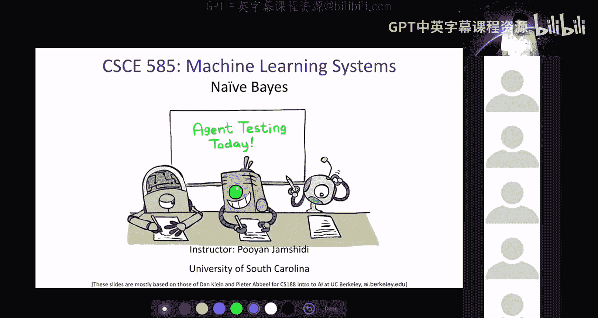
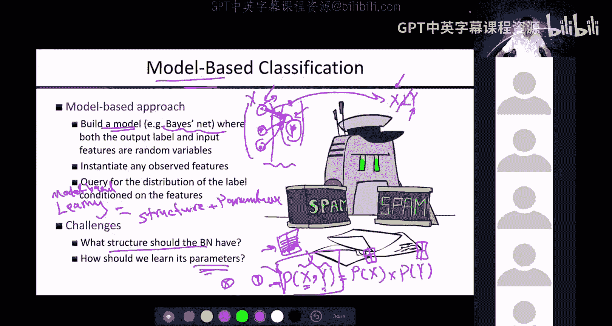
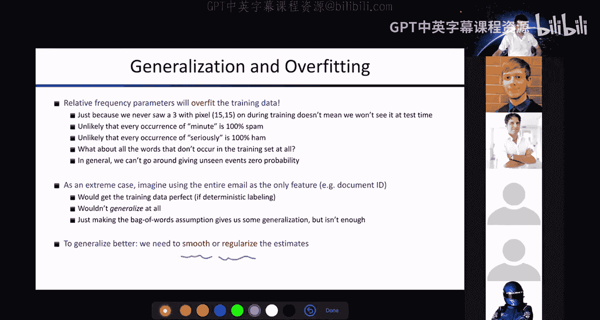

# USC《机器学习系统｜CSCE585 Machine Learning Systems 2020》中英字幕（Claude-3.5 p08 -08-Lecture 5.1 - Learning_ Naïve Bayes.zh_en -BV1Xc9bYVEC6_p8-

Very well， hello， everybody， let's a start。So today。

We have again one interesting topic to discuss which is about naiveb this is a new somehow different type of machinery models and for some very specific reason I choose to discuss about this because it gives a different perspective toward another type of ML technique that I hope you learn about specifically the foundation of naive base is base nets which we discuss extensively in the AI graphs 58。

 but for this lecture today you definitely do not need。The key concepts in basement。

 hopefully if you have this intuition that would help you to understand this a lot better。

 but it's definitely not necessary and if you have any question about that。

 please let me know I'm happy to explain。So before we start， do you have any question for me？

I hope you can hear me vote。Well。

Okay。有咩事啊。

Let me turn this off。 This is。Right。So。Difference between the type of model that we discussed so far。

 especially about perceptone， is maybe about the the type of model that we have。

 so both of these model， both perceptone， neural network and deep neural network。嗯。

As well as these naive based models， you can consider them as some sort of classifiers。

So you have some classes。You have data and you want to build some model that give you some prediction over the labels that you have。

 So the same very same procedure， noting new except the internals of the model。

 and this internal boils down to the type of structure that we have in naive base。

Which makes it interesting and makes it and that's why I choose it specifically to talk about it because again。

 this is very much different from something like neuraleth or preceptone in preceptor you remember you had some。

Feature value。 So this was a vector youre represented by F of x x was your input。Okay。

And then you had some。Activations right， you had some activations Zs which you calculated based on these feature vectors right and based on this Z once you activate them。

 then this provided that some sort of reasonable value based on which you could decide what is the right label for a specific inputs that you have okay。

And then we looked at it and realized that if we could somehow turn these activations。呃。

Some probabilities， This gives you a much better。Veryvo to reason about right we discussed that if we only have these activations。

 this would not be sufficient for us。To distinguish between different。Different。classification。

 specifically when we have some specific reason why we prefer one decision boundary over another type of decision boundary。

 so we talk about transforming this to some probabilities。

Here we want to turn the forecast whether we can really。Make the whole model。

 including these feature values。Probabilistic， so in instead of just changing the output to some probabilities that we could reason about。

 can we make the whole thing here。Something probabilistic that we could reason about the whole thing right So if we have some probabilities since these are feature values。

 like what we can do with these feature values， there are some numbers we cannot really reason about So if we change our input these values would be totally different so we cannot rely on these specific values and we cannot do any probabilistic reasoning based on these values So and that's why that's the key reason why you hear these discussion that why some models like neural networks are just black box because you cannot peak inside if you can look at these values。

 these values doesn't mean anything to you。RightAnd and for deeper network。

 you saw that like you have different layers right all the way down to inputs your inputs。

 each of these layers where point of neurons and give you some activations which could be from minus infinity to positive infinity。

 so you cannot really do anything with these values。

 these not just simple sum values but if you have some probabilistic models。

 you know that with principles that you know from probabilities。

 you can reason about the structure of the model you can you can do some changes structurally you can learn some parameters for the model right and you can also learn some hidden concepts right so these probabilities are interesting in a sense that。

These do some。Intuition， what it means and what model has learned from the data in a probabilistic sense。

The internal of model you can reason about the internal of model。

 not just the output of your model does it make sense because this is important to distinguish and I hope that you see the reason why I picked this na base to discuss today what is the keyism behind this。

Do you have any question about that。啊 these。Ty of model as are called。

 as you see from this discussion， is called model based， right， So we have a particular model。

 a probabilistic model， probably a better name is。呃。Probabilistic。妈的。

Is a better name for for this type of classifiers because the whole thing。

 the whole model is probabilistic for deep neural network。

 we could not say that the internal of the model are just activation are not probabilities。So again。

 the same sort of classification as you know so I'm not going to talk about the detail because we discuss it extensively。

 this could be a sort of email that you get from text， so you look at the text。

 you extract some features right some patterns from the data and your model find these patterns from the data。

 exploit the feature values and learn from the data。

 how this looks like and decide whether the text could be associated to span or or hand or be you could say so it's typical classification problem。

Or could be a kind of digit recognition where the only difference is that you have more labels。

 you have labels from zero to9 and based on the feature that you have typically in features features in for digit classification or。

Or basically the raw features in the image， whether a pixel value is zero or one for this。

Black and white digits， you could reason only based on01。

 but for color based you have flat three channels and you have values from zero to 256 right so there are some differences but essentially you're talking about feature value or even some high level features like the number of components that you have。

The aspect ratio number of loops that you have and so on。

 So these are some high level features besides these raw features that you can expect from your data。

And these high level features are also extractable from data。

 Like you can look at the image and you can see， okay， how many loops it has， it has one。

And when it looks it as zero， right， so these are some high level features that you can extract from the data。

And then you can decide about the label， the true label。

And you have some other type of classification， like for medical diagnosis， right。

 you want to look at the image and see whether this image is about the cancer tissues of the human tissues and then whether you want to identify whether it is cancerous or not。

For fraud detection you want to look at the account activities and based on the activities you want to associate whether there is some fraud going on or not for exaggerating is the same for customer service email routing is also the same。

So these days， so many of these tasks， which was impossible to think about it as a sort of ML task now is really possible to to recognize them and do them as a classification task right and classification again。

 you know that is not the only type of machine learning task， but boy the most popular。

So let's jump into the modern based classification。Again。

 we want to build a model some sort of base nets where in Bnet。

We have nodes and connection between nodes， so we have bunch of nodes and nodes are connected， right。

 and these nodes are。Probabilities， right， or either probabilities or conditional probabilities。

 And then we could reason about the joint distribution of all of these variables and the connection is the dependence between two variables。

 So， for example， this variable if this is like Y and this is x。Y is dependent on x。

 This dependence could be just correlation or could be causation。

 but there are some dependence so we cannot So in basenet， you know that if we have this connection。

 this means that。X。And why。Are not dependent。So if x and y are dependent or depend independent mean mean。

 this means that。TheThe probabilities for the values that can be assigned to each of these variables are not really dependent on what value is assigned to each other variables right so and this gives us some flexibility。

 you know that by probability， if we want to if we want to calculate the joint probability of x and y。

By default， we know that for maintaining this probability of x and y。

 this is joint probability distribution， we require a table of like。

Like a large table that consider all combination of the values between x and y。

 So this is a large probability tables。 But if we assume that these x and y are dependent， so。

If the model is looks like this， this is x and Y， and there is no connection between them。

 We can calculate this very easily。 We can calculate this P of x multiply by P of y。

 and basically for。Calculating this joint probability， we do not meet such large table。

 We only need to maintain a small table for X。 and y。

And then whoever asked about this joint probability。

 we could look at different rows in each table and calculate this joint probability。

 And that was the key power beyond a model like base net that enabled us to reason about this joint probability and。

The whole power beyond these model based approaches is this kind of reasoning that we could do based on mathematics behind this right do we have any question about this？

But this is really the only thing I assume you need to know about。Basedase that the rest。

 there are some details， obviously we talk about but much more detail in the AI course。

 but for naive base， this is pretty much what you need to know。

And then now for for this is that you need to decide about the structure of the model and and as well as the parameters that you need to consider for this model。

 So these two challenges。Or what you want to learn for this type of model based classification。

By structure， we mean that what are these。What is the label， how these are connected。And so。

And parameters means that。What is the probability distribution of each of these variables。Right。

These are pretty much what's what you need。To know。So， the structure。Plus。Himeters。嗯。

This is what you can。You can call a model。Ft。对。

Let me say I can see some noises here。

Yeah， it sounds like some feedback。Is it better。Yeah， well。How about it seems to be。

Is there feedback。Yeah， it seems to be coming in intermittently。

Maybe maybe your microphone is too close to your speakers。冇逼。Yeah。Its a strange。

I hope it's not too bad。Is it。😊，Yeah， it's's not great yeah it's like a mosquito hovering in my ear。

😊，SoDo you have a to have headphones， maybe that would probably solve it。

Yeah， I can put my headphone。

How is it now。Not hearing anything， so yeah， sounds great。嗯。But I can't hear myself。Thats这。

Maybe just maybe just switch back for the moment， I guess it seems kind of intermittent and maybe it wasn't going on。

I don't know when you last。Right before you put in the headphones。Can you hear me。Yeah。Is it better？

Yeah。

Okay， let' let's do that way。Okay， at least yeah， let me know wherever the voice comes back。

Not so yeah thanks so yes， so this is about the model based approach right so we want to learn this structure and the parameters of the model and this is pretty much what we need to know。

For naive base which is a specific type of model based classifiers and again we have different type of model based classifier but this na base is the most probably interesting one and the type of model that is somehow related to what you have seen so far perceptor on a neural network has a specific structure so this Y is the the variable that determines the label and these Fs are variables that are associated to the features right and again。

😊，U。So these all of these variables are you can think about these as some sort of probability distributions right so this has the structure that we can reason about these connections。

 we can reason about each variable and we can calculate these conditional probabilities the。

The joint probability distribution of the model and many more right so now I have one question for you that for those。

Those of you who know about Bsnet。Why we want to have such a structure。Why for example。

 we do not consider a structure like。Like this where the connections are the other way around。

Why this structure makes more sense and what is what is really bad about this structure。

 what is good about this structure。Can you can you give me some intuition？

Because you want to infuse and。Conditional probability。Okay， tell me more。Yeah。嗯。How to explain this。

If we use them the upward point in arrows。Why would depend on so many variables？

Is that going from weight to other variables。I think。

It makes makes more sense easier can you tell me why it makes more sense in what sense？Yes。

If y depends on lots of variables。We need to determine all those variables F1 to FN。Would more work。

But if。Those variables if all some set of variables depend on just one variable。

 we only need to determine just that one variable。Yeah that's that's that's good I like it so let me clarify a little bit right so for example。

 if we want to calculate the joint probability of based on this structure right based on this structure where so what do we mean by joint probability by joint probability we mean let me whether I can open。

Right so by joint probability if we have such a structure we want to calculate something like this probability of y F1 all the way to fn so this is a joint probability we want to have right so if we have this connection the other way around by rules or probabilities we know how to calculate this right how we calculate this we start from the nodes without any par right so we start from these f so we say that probability of F1。

Multiply by probability of F2。Probability of FN， right， multiplied by probability of bo。

Why given all of those exactly， Why given all of these F1。All the way to F N。Right。

So we know that how large this probability distribution is。2 n plus one。Exactly。

 so this this is too large so if we we have n variable already in the conditions。

 we have one variable here， so we have two over n if these F and y only have two values each like if we have 10 values would be 10 over n okay。

So if we assume they have two possible values like zero and one right for all of them now this is the total size of this table right what are the size of each of these this is like two two two right the whole thing to calculate the whole thing this is too much right again we have the curves of dimensionality。

嗯。And again， for calculating this， this is no good， this structure didn't help us to save the space。

 we still have the curse of dimensionality。But if we have the other way around。

 so if we have this relationship， the other way around now this probability distribution of y F1 and F and this factorizes to something very simple we start again by these node because it has no parent P of y we know what it is。

 it is very small right so it has a table with two rows right。

 if it only has two values right multiplied by probability of what probability of these guys right。

 given its parent what is its parent probability of F1 is only y it has only one parent right？

Probability of F1， given it all of its parent， which is only one Y， right。

 multiply by probability of F2。Even and its parent， why again。Multipied by F。A probability of FN。

Given why， right？So what we have seen here is that how large this probability distribution is。

So this probability distribution。Is not really large， right？Has only how many values tell me。

How large this is。And plus one。Y N plus one。Well， there's the value of y probability of y and then multiplied by the probability of each of the individual conditional probabilities。

Right so so this is at most like we have like one variable if it has two values right this is also two values this could get get to to over two right sorry two over two so this is this is really a small table right it is only dependent on two variables right so this factorizes into something very simple right we have a lot of simple structure so。

If we have limited memory。Like this is a lot better so how many how many how much a space do we need like we have n of these right so we have N。

2 over2。And we have。We have two， right？诶。For this guy， right？

So it is a lot simpler than this guy right for this guy we had we needed to have a lot of a space for as storing this simple guy right so。

This structure， even though we assume something about the。

Independence or dependenceence of different variables it makes much more sense in terms of simplicity of the calculations that we need right and that's why we have such a structure in the model and that's why it makes a lot more sense for doing so right do you have any question about this。

Yeah， I just wanted to make sure I understood so the two two and two for each of those。

Conditional probabilities that's referring to the。F like combinations with the four possible like。

These discrete fun these are discrete variables they can be on or off I guess yes these are discrete variables they can be on and off right that's that's correct right so that's what you mean might have values is there there's two possible for each of them and there's for the condition exactly exactly so for example。

 why could be like you remember for a spam and hand was like a spam。Right。These could be like。

Whether we have a loop or not， right， so discrete variables right。I mean。

 like it depends on these the notion of each variable so it could be two possible values or more。

 but still these are discrete variables。Right， and。So for this for having such a structure。

 we only really need to maintain this amount of parameters at the end。

 which is a lot more simpler than having a large model that we cannot keep track of so that's why to we want to。

To have such a structure and that that is the reason why why I base is based on such such。

A structure。Could you elaborate on the meaning of the errors？

The meaning of the errorss is the dependence between two variables。

 so this means that the y is dependent on F1。F2 and F and so meaning that y is not so in probably six sense。

 Y is not。Independent is so this is the notation that we have like so if we have this notation means that y and F1 are independent from each other but here the presence of this means that these are dependent with each other so we cannot we cannot have independenceencies between between two variables and in A of course we discuss extensively okay how we can test about the independence from the data and so on so there are some statistical test you can do on the data to reason about these dependence you could also have conditional independence right so you could reason that you may have。

dependpenence between x and y， given some other variables right。

 and we discuss about type of a structure that gives you this type of inencies between two or more number of variables。

So for example， when we have x， when we have。A， then we have。喂。嗯。So。We know that like this is。

By looking at this structure， we know that x and y。Are really dependent right。

 so because of this a structure implies that x and y。Are not independent， right。

 because their dependent through a， right， But if we know about a， So， for example。

 if somebody tells us that a is like。Raiiny today， right， if this is about the weather condition。

Right， then we know that x and y are independent， right？That makes sense。Yeah， so this is this is。

The implication of。The structure of the model。And what we know about the particular observation from the data。

 what we assume that we know about the the data and based on this knowledge about what we know what we don't know what we can assume what is the structure of the model we can reason and okay。

 whether we have independenceencies or not， so in this case， we can say that X and y or。Independent。

Given in。A， right。Because if we know about the A， then x and y become independent but if we don't know about anything about a。

 x and Y we cannot say that these are independent， right？嗯。

So that's the kind of reasoning we can have。So would I be correct to say that the direction of the arrow notally。

 at least determines。The relationship of cause and effect in a correlation， but what to your side。

Yes， yeah the direction matters the type of a structure matters as well right so if you look at the details of base nets we have like a structure like common cause structure where we have a X and y right we have V structure where we have X and y and then these are connected through a in this way so we have different sort of a structure and based on each of each we can reason about the independence or。

The dependence between two variables， x and y in this case， right？嗯。So for example。

 if we know about a in this case， then x and y become independent。

But in this structure is totally different in this structure。

 we can say that x and y are independent。But if we know about a， these， these two become dependent。

 right， So if we know about a then。诶。There is no so these x and y become dependent。

 so different structure implies different dependencies between different variables。

But we are not going to detail but you can find much more information about base nets in the AI course。

 this is beyond the topics of this course， but hopefully this gives you some intuition about these sort of models that we have。

Yeah， thank you。Sure。Thanks for asking。嗯。So lets let's look at some more details about this type of model so again we have this kind of joint probability distribution right so these are feature values and this is your label so this again this joint probability distribution you can think of because these are a specific values for this feature so more explicitly you can think of PY。

F1 is equal to F1， right？And Fn is equal to Fn。So you know that like。These are variables。

 these are specific values。That is as sign。 And that's why this is a kind of vector the for different values of y。

 So in this case， this is like。This is probability of why。Is equal y1。F1 is equal to F1。And so。Okay。

And the same for the rest so the goal is really to compute this posteriial distribution over over the label what it means is that so let's think what what do we expect from any classification right what what needs to be learned here what kind of probability we want to predict can anyone elaborate on that？

What is the goal here， what do we want to get？We already discussed that before。

Conditional probabilities， exactly， what is that conditional probability？Can you specify？

Like the probability of Y given F1 and then the probability of Y given F2。

Exactly so so the goal is is to calculate this posterior probability distribution and it means that we want to calculate probability of why。

Which is the label， given。All of the feature values， right， given F1。Or better to say， given。F1。FN。

 right？So this is the model we want to we want to build and once we have this conditional probability as a model。

 once we get a data， we can say that。We can say that what is the probability ofvo？Is a spam。Given。

F1 is。Particular value for these features and fN is particular values for these features and these are from coming from your data。

 this data point that you give to the model right so this is your X。So in general， you want to。

 you want to。You want to have a conditional probability， probability of y。Given X。

 this is the thing you want to construct。Right。U。And so that's the goal we want to get at。

And that's why you might。Think okay， if you think about like the perceptron， you remember what。

 how we constructed the person and that's that's an。Nuance that I would like you to think about。啊。

And that's why I mentioned about this naive base， again， this is yet another reason。

Distinguishing between discriminative models and generative models， right？

So in discriminative models like。U。Like what we。What we had for perceptron and neural network。

 you saw that like we had the data and we extracted these activations right we extracted these activations from the features that we had。

Right and that was the discrimination between so these activations provided the discrimination between what label we want to decide about this particular input right so we had a discriminative model that either based on the activation so we had ZI we looked at arc maxax。

Of these ZI and we decide， okay， what is the label we want to assign for this particular input。

 right？And that was like a specific a specific label that we could assign to this。To this model。

 right order we had this。Transformation to probabilities there we could decide based on the probability distribution。

 what label we want to assign。But here you saw that like the first step you want to calculate this joint probability distribution。

 this joint probabilityography distribution is a sort of generative model so you can generate really data based on this type of model。

 this joint probability distribution and that's why it is a different type of model rather than discriminate these are more generative model right。

And then you know how to calculate each of these right so first you need to calculate this joint priority decision how to do that this is the way how to do that you know from the structure because wise are dependent on。

On these Fs， right？And then for each of these， we know that for this for y1。

 we can multiply our prior to these conditional probabilities。

 this is what we already we just discussed in the previous slide right so we calculate this。

 and then once we have these。呃。Probabilities， we need to normalize that。

Right so these probabilities because it's the multiplication of several probabilities。

This vector doesn't add to one， so is this vector is not a probability distribution these are actually very small numbers because we multiply probabilities which are between zero and1。

 many of them。And you know that by the laws of numbers。

 if you multiply many numbers between zero and one at the end， what you get is a very small number。

 no matter what， how to do that we know by calculus right if we know if we add all of these。

 and if we normalize basically dividing each of these entries based on sum of all。

 then we get some problem distribution right？So basically this is the normal procedure and then we can we we have this discriminative model so so we get this probability distribution because this is what。

What we wanted to get or what we wanted to construct so based on this normalization we could construct this discriminative model or posterior distribution of all these label variables Any question about this。

This is Scia。If it's not， please ask because that was the most important procedure you needed to know for this。

So the mechanics of na base is really simple。嗯。You start with bunch of probabilities。

Specifically these prior and these conditional probabilities。

And then you do this inference for computing this conditional probability， this discrimate model。嗯。啊。

Right。So we discuss about this， so let's have some example for digits。

What is this prior this is your prior right typically PR Y this is what you call prior and the reason why you call it prior because。

This is the probability distribution over your label data this is coming from your data really so and this means that prior means that what so let's clarify what is what is prior prior means that。

What is your belief。Or assumption。About what is probable or what is not before even looking at any data point。

Right， so。Imagine that you're given no data point。系。Imagine that。嗯。

Imagine that you came into the world right and you have no zero experience。ok。嗯。So。

With zero experience。Like you have no experience， meaning that it really depends on。

How much you want to trust others， right？So this is like about your prior or beliefs some unknowns right so if you want to distinguish between a bad person or good person this is your prior some people are pessimistic meaning that they assume everyone is bad unless the otherwise is proven other people they assume that everyone is good unless basically the the other way around what's shown right so this is what we call prior and and typically。

For many of these machine learning models， we start by uniform prior。

 we assume that all of these digits are the same。Probable so you start off by this uniform distribution and this is probably again。

 for your prior， you need to have a probability distribution and that's。

Means that if you sum all of them， they have to sum to one。

And then we have this conditional probabilities。 What are this conditional probability means that。

 for example， what is。嗯。The value of F3。One， this is the third row。1， right， so this is zero。0ero，1。

1，2，3， Okay， so what is the what is the picks and value of this。嗯。

So it means that what is the probability？Of this pixel value is on。Given a particular label。Right。

 so this pixels a value。We knew that we assume this is structure。ok。So if we have this。

 we need to look at。All possible values of why。So。If this is on。what is the。

What is this conditional probability。So for label 1。With this probability 0。01， it is on with 0。09 t。

来。This is off right so when you have this situation on and off。

 you only need to know about one of those right？And you can deduce the other one。嗯。

And this is more probable， five times more probable for two。🤢。

And a lot more probable for five right so because for five you have something like this and that's why this is most of the cases。

 this is on for five and for six as well right。So you see this conditional probability。

How you need to make sense out of it。You have this similar conditional probability for other features right for F5 and5 and so on and then once you have this。

These data， these little structures， and again you saw that these are little structures。

These are not large stable because of this structure， we made them as small。

Then you can calculate this generative model， you only multiply P of Y to these conditional probabilities right and then you get this generative model and then you do the same procedure as you know。

嗯。You can do the same for text as well right for the text you can look at okay， what is the word。

 a specific word in a specific position in the text and that's how the features looks like but again nothing unusual here are more less the same。

Again， let's go through one example， this is the your prior， your prior assume that。Mmhmm。

Two third of your emails are probably benign， one third might be as spaM。

And then you have this condition of probability， meaning that。嗯。Given P of w， if the W is D。

Given it is a spam， what is this probability？And the same for ham， so you have these sort of tables。

 this is these entities because you need them to construct this joint property distribution。U。

And obviously these tables come from your data right so you have a corpus of data and you can construct this conditional property based on your data。

And your start by your prior prior tells that right meet out so this is。

This is really without seeing any data， this is what you can rely on most probably this is going to be a benign text rather than。

Rather than a hand and then you see one word in your text Gary， for example。

 Gary so this means that probability of Gary if this is a spam is this probable and is a lot more probable if this is a hand because this a particular name and it is your name and then this is the probability distribution so so far meaning that。

Given that we only saw one word Gary， this is what the model thinks。

 the model thinks that this is a ham。And then you see another word the wood。

Based on your conditional probability， this is more probable slightly more probable this is ham again your model thinks that this is a ham given this data and then you see you this is a lot more probable。

To be a spam and then you incorporate this conditional probability to your generative model as still your generative model thinks that this is going to be ham given。

Your mother has seen three words。And then as you observe more data。

 this probability distribution would change and note that these probability distribution these are after transforming to log probabilities right that that's why you see so if you remember log would like looks like something like this。

Right。嗯。So unlock transformation would be helpful if you have a small properties so you can distinguish them better。

嗯。So。As you observe these words， you see that the model thinks that still at this point thinks that。

Still is a ham。Still after seeing glues， the sing that the ham， it is a ham。

 but you saw that it's getting closer to each other right and at this point when it soates it minds that this is going to be a spam probably。

And then while and then you are asleep and at the end you saw that this this is a lot larger than this one so in log so this is。

This is more probable。呃。As a true label for this particular example。Does it make sense？Actually。

 I'm just in time bit confused。 Why do they use negative numbers to quantify whether I think it's spam or ham。

As I mentioned， these are log transformations right so if you have a small probabilities after you log transform the probabilities log P。

Right。So you。So basically your numbers， right？Lise here。 So you。

They're talking about negative numbers。Does it make sense now？Yeah， that makes more sense。

So basically these are， again， is a mathematical trick when you're having a small probability numbers。

 it is a trick to transform them to log probabilities rather than just probabilities。

There are some computational reason because these probability gets as small。

Most probable it is the case that your computation would underflow so we don't have the capacity to represent very。

 very a small number in some computers and that's why you want to transform them into log probabil。

Because obviously you can represent this minus number rather than like something like 0。

0000000001 right this has a chance to be overflown but not these。

And that's why you typically transform them to log probabilities。

These are simply just some transformation， but some I get an idea it's pretty simple。

And there not the end。You calculate what is the probability of a spam？

Given like these particular words， right？And then you calculate back all of them two probabilities and you get this probability。

 this probability value that with 98%。9 this spa。And with 1。1% is。

So that was all about really about this type of。Geneneerative model。

 this type of classifier or model based classifiers， which again。

 I would like to emphasize that this is a probabilistic model。

 so you had a structure and you learned about the parameters of of your variables this structure and then。

This。This basically。Give you。Give you this。This reason why you want to。

What you want to and what kind of difference you see between this type of model and some model。

 like not probabilistic version of this in what you have seen in neural network or etctera。

So there are some。Details about like empirical risk minimization and what is the best model based on your training data。

 we discuss about some of these and what is overfitting。

What is hypothesis a space what is regularization these are again some of which we discuss but lets let's also maybe have some conversation about this right because these are again important right what do we mean by generalization what do we mean by overfitting。

Overfitting is really simple concept， but yet very important concepts in machine learning right if this is for example。

 your data one may say that okay。I want to。Seeed the best model in the data and like one may try polynomial of degree5。

 but one may say why not a simpler model like a linear model right this is a lot simpler model than than this polynomial even though。

The empirical risk minimization。Based only on your training data would prefer this model over this。

 but the simplicity of this linear model is appealing。

When you want to get a better generalization and actually this would happen in practice in several different contexts。

 right？So you might have heard about the simplicity of a model and generalization。

 typically we know that simpler a model would generalize better and that is basically pretty much an intuitive notion as you see here。

Another type of overfitting is specifically for this type of modern based classifiers where really you only rely on data to estimate this conditional or probability distribution。

 right？These probability or prior come from your data。If。You do not have any data。

That represent one of these features then your poverty becomes zero and that's bad right so for example in this case like if you only rely on your data the probability of this pixel is on right is 80% right for example two for example three is also 80% for this case for this particular pixel for example two is。

Very different probability from example three， but for something like this。

 for example two is also different。Well， maybe you have some cases that the probability of one of these pixel for particular example is really zero。

 you do not have any example。Any example in your data。That this pixel is on。four。Label 3。Right。

For none of your example， this pixel set is on， so what you can infer from data is maybe this probability is zero。

Right， so this conditional poverty is zero。And then in this case right so if you look at this right so if you look at what would happen so far like up until here。

Up until here before you see the last one right before you see the last one。1。嗯。

Was much more probable， right here so far was equal here was equal here it becomes much more probable。

For this case also become much more probable so far。3 was winning。

But only because one of these was zero， this was also very small， but not zero。 these make it。

Zero probable because you multiply these together， right？

So everything was turned the other way around as a result of this value become really zero in a set of。

0。00，0，0，1， right。And that is called again overfitting there are some solutions for these so this probability becomes messed up if some of these are zero。

 then these are infinite。And and these。Techniques， like there are some techniques for smoothing and regularization。

Which later on， we will discuss in more detail， but in order to。

What time is it maybe maybe let's stop here to discuss this in detail later on because maybe it requires more example to discuss but typically these are some techniques that enable you to。

To reason。And select the parameters of your model that。That gives us a better。

Generalization power and while its it's still simple and also avoid such problem of overfiing as well。

嗯。So let's stop here and。Talk to you next week。Thanks。A you。😡，第。Thank you， professoror。开工。You two。

