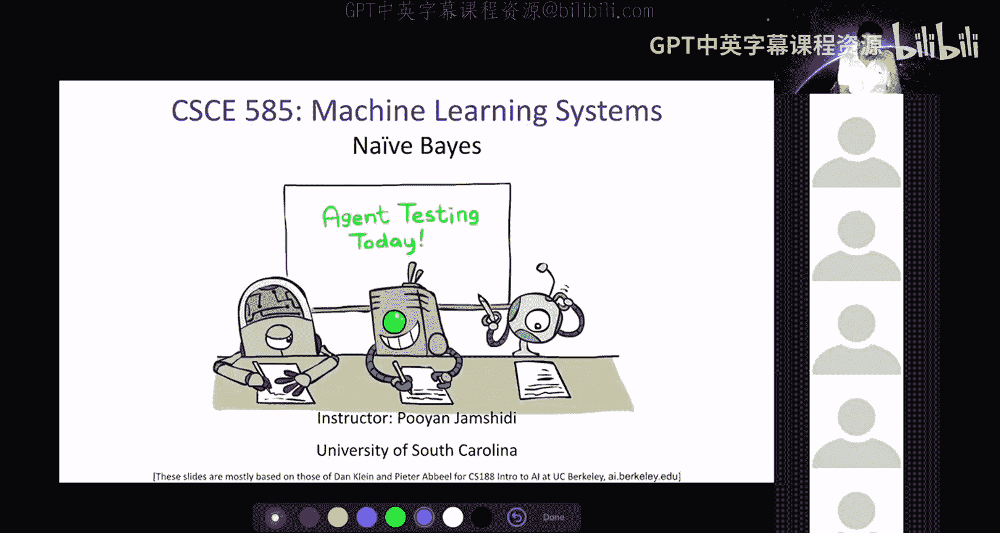
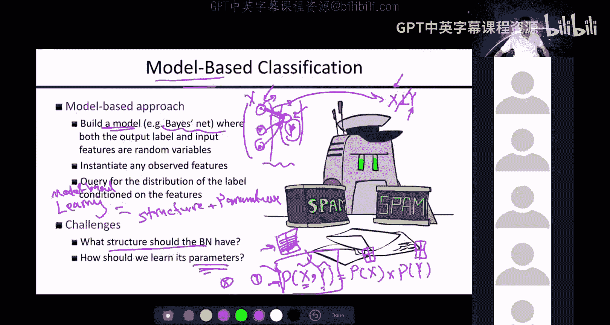
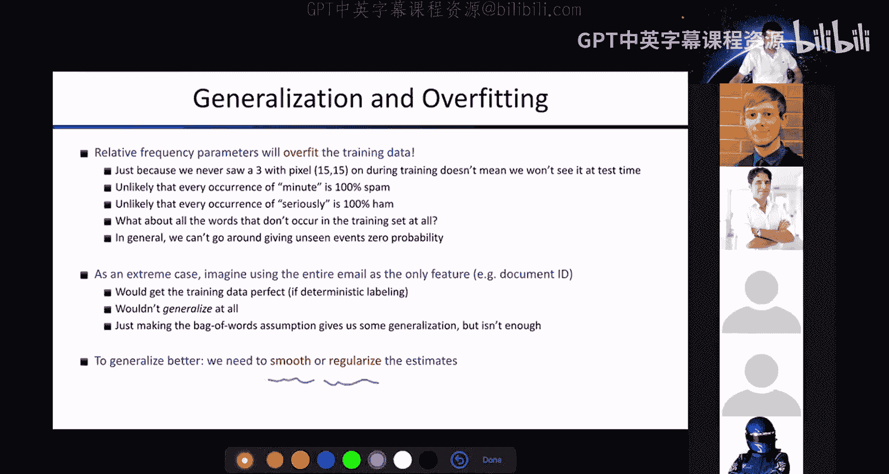

# 机器学习系统：5.1：朴素贝叶斯学习 🧠

在本节课中，我们将要学习一种新的、不同类型的机器学习模型——朴素贝叶斯。它与我们之前讨论的感知机、神经网络等模型有本质区别，因为它是一种**基于概率的模型**，为我们提供了理解模型内部工作原理的视角。

## 模型概览：从判别式到生成式

上一节我们介绍了基于激活函数的判别式模型。本节中我们来看看生成式模型。

到目前为止，我们讨论的模型（如感知机、神经网络）都属于**判别式模型**。它们的工作原理是：输入特征向量 `F(x)`，经过一系列激活函数 `Z` 的计算，最终输出一个用于决策的标签。我们可以将这些激活值转换为概率，以便更好地进行决策。

然而，朴素贝叶斯是一种**生成式模型**。它的目标不是直接学习从特征到标签的映射，而是学习数据的**联合概率分布** `P(Y, F1, F2, ..., Fn)`。这个联合分布描述了数据（特征和标签）是如何“生成”的。有了这个生成模型，我们就可以通过贝叶斯定理来计算给定特征下标签的**后验概率** `P(Y | F1, F2, ..., Fn)`，从而进行分类。

生成式模型的核心优势在于其**可解释性**。因为模型内部是概率结构，我们可以基于概率论原理来推理模型结构、学习参数甚至发现隐藏概念，而不是像神经网络那样被视为“黑箱”。

## 贝叶斯网络基础

要理解朴素贝叶斯，需要一点贝叶斯网络的基础。贝叶斯网络是一种用有向无环图表示变量间依赖关系的概率模型。

在贝叶斯网络中：
*   **节点**代表随机变量（可以是概率或条件概率）。
*   **边**代表变量间的依赖关系（如相关性或因果关系）。
*   如果两个变量间没有边连接，则意味着它们在给定其他变量时可能是**条件独立**的。

这种图结构的关键优势在于它简化了**联合概率**的计算。如果没有独立性假设，计算所有变量组合的联合概率表会非常庞大（面临“维数灾难”）。而利用图中的条件独立性，我们可以将复杂的联合概率分解为一系列更小的、易于管理的条件概率的乘积，从而大幅减少计算和存储开销。

## 朴素贝叶斯模型结构

理解了贝叶斯网络的优势后，我们来看朴素贝叶斯采用的特定结构。

朴素贝叶斯模型的结构非常简单，它做了一个很强的“朴素”假设：**在给定类别标签 Y 的条件下，所有特征变量 F1, F2, ..., Fn 都是相互独立的**。

这个假设对应以下贝叶斯网络结构：
*   有一个父节点，代表类别标签 **Y**。
*   有 n 个子节点，分别代表特征 **F1, F2, ..., Fn**。
*   所有特征节点都只依赖于类别节点 Y，并且彼此之间没有连接。

以下是两种结构的对比，说明了为何朴素贝叶斯的结构更优：

1.  **低效的结构（特征决定标签）**：
    如果箭头从各个特征指向标签（`F1, F2, ..., Fn -> Y`），那么计算联合概率 `P(Y, F1, ..., Fn)` 需要估计 `P(Y | F1, ..., Fn)`。这是一个巨大的条件概率表，大小随特征数量指数增长，无法解决维数灾难。

2.  **高效的结构（标签决定特征）**：
    朴素贝叶斯采用的结构是标签指向各个特征（`Y -> F1, Y -> F2, ..., Y -> Fn`）。基于此结构，联合概率可以分解为：
    `P(Y, F1, ..., Fn) = P(Y) * P(F1|Y) * P(F2|Y) * ... * P(Fn|Y)`
    现在我们只需要存储：
    *   一个先验概率表 `P(Y)`，大小是类别数。
    *   n 个条件概率表 `P(Fi|Y)`，每个表的大小是（特征Fi取值数 × 类别数）。
    这比第一种结构所需的存储空间小得多，计算也高效。

因此，朴素贝叶斯模型需要学习两部分内容：
*   **结构**：即上述的图结构（通常是固定的）。
*   **参数**：即先验概率 `P(Y)` 和所有条件概率 `P(Fi|Y)`。

## 模型推理：如何进行分类

学习了模型的结构和参数后，我们来看如何进行预测（推理）。

分类的目标是：对于给定的特征值 `x = (f1, f2, ..., fn)`，计算后验概率 `P(Y | x)`，并选择概率最大的类别作为预测标签。

根据贝叶斯定理和朴素独立性假设，后验概率的计算如下：

1.  **计算未归一化的联合概率（生成模型）**：
    对于每一个可能的类别 `y_k`，计算：
    `P(y_k, f1, ..., fn) = P(y_k) * P(f1|y_k) * P(f2|y_k) * ... * P(fn|y_k)`
    这个值正比于我们想要的后验概率。

2.  **归一化得到后验概率（判别模型）**：
    由于上一步得到的值可能非常小（多个概率相乘），且所有类别的这些值之和不一定为1，我们需要进行归一化：
    `P(y_k | f1, ..., fn) = P(y_k, f1, ..., fn) / Σ_j [P(y_j, f1, ..., fn)]`
    其中分母是对所有可能类别 `y_j` 的求和。这样就得到了一个标准的概率分布。

3.  **做出决策**：
    选择后验概率最大的类别作为预测结果：
    `预测标签 = argmax_{y_k} P(y_k | f1, ..., fn)`

在实际计算中，由于概率连乘可能导致数值下溢（得到极小的浮点数），我们通常对概率取对数，将连乘变为连加，这在数学上是等价的，但计算上更稳定：
`log P(y_k, f1, ..., fn) = log P(y_k) + log P(f1|y_k) + ... + log P(fn|y_k)`
然后比较各个类别的对数概率大小即可。

## 应用示例

以下是朴素贝叶斯在两个经典问题中的应用。

### 示例一：数字识别

假设我们要识别手写数字（0-9）。

*   **特征**：可以是图像的原始像素值（例如，28x28的图像有784个特征，每个特征表示一个像素是黑还是白，或者是灰度/RGB值）。
*   **标签**：数字0到9。
*   **模型参数**：
    *   **先验 P(Y)**：可以假设均匀分布（每个数字概率为0.1），或者从训练数据中统计每个数字出现的频率。
    *   **条件概率 P(Fi|Y)**：对于每个像素位置 i 和每个数字 y，从训练数据中统计：当真实标签是 y 时，像素 i 被激活（是黑色/白色）的概率是多少。
*   **预测**：当一张新图片输入时，模型根据其像素激活模式，利用上述公式计算它属于每个数字的概率，并选择概率最高的那个。

### 示例二：垃圾邮件分类

假设我们要区分垃圾邮件（Spam）和正常邮件（Ham）。

*   **特征**：可以是将邮件文本分词后，每个词是否在邮件中出现（词袋模型）。
*   **标签**：Spam 或 Ham。
*   **模型参数**：
    *   **先验 P(Y)**：例如，根据历史数据，可能60%是正常邮件，40%是垃圾邮件。
    *   **条件概率 P(单词|Y)**：例如，统计在垃圾邮件中，“免费”、“获奖”、“立即点击”等词出现的概率；在正常邮件中，“会议”、“项目”、“问候”等词出现的概率。
*   **预测过程**：对于一封新邮件，模型依次查看其中的每个词。每看到一个词，就根据该词在垃圾邮件和正常邮件中的条件概率，更新对邮件类别的判断（通过连乘或对数连加）。看完所有词后，比较最终两个类别的（对数）概率，概率高的即为预测类别。这个过程直观地展示了证据（词语）如何一步步影响模型的判断。

## 过拟合与平滑技术

任何机器学习模型都需要关注泛化能力，朴素贝叶斯也不例外。

朴素贝叶斯可能遇到的一种典型过拟合问题是**零概率问题**。如果某个特征值在训练数据中从未与某个类别同时出现过，那么根据最大似然估计，条件概率 `P(特征|类别) = 0`。这将导致在预测时，只要这个特征出现，整个类别的联合概率就会变成0（因为连乘中有一项为0），从而完全否决这个类别，即使其他特征都强烈支持它。

为了解决这个问题，我们需要使用**平滑技术**（或正则化）。最常见的方法是**拉普拉斯平滑**（加一平滑）。

其核心思想是：在计算条件概率时，为每个特征的每个可能取值的计数都加上一个小的常数（通常是1），然后再进行归一化。公式如下：

`P(Fi = v | Y = y) = (count(Fi=v, Y=y) + α) / (count(Y=y) + α * |Fi|)`

其中：
*   `count(Fi=v, Y=y)` 是训练集中特征Fi取值为v且类别为y的样本数。
*   `count(Y=y)` 是训练集中类别为y的样本总数。
*   `|Fi|` 是特征Fi所有可能取值的个数。
*   `α` 是平滑参数（α=1时即为拉普拉斯平滑）。

平滑确保了即使某个特征-类别组合在训练集中未出现，其条件概率也不会是零，而是一个很小的正数，从而避免了零概率导致的预测失败，提高了模型的泛化能力。

---

本节课中我们一起学习了朴素贝叶斯分类器。它是一种基于概率的生成式模型，通过“给定类别下特征条件独立”的朴素假设，简化了模型结构，使联合概率的计算变得高效。我们了解了其模型结构、参数学习、基于贝叶斯定理的推理过程，并通过数字识别和垃圾邮件分类的例子加深了理解。最后，我们探讨了零概率问题及其解决方案——平滑技术，这是保证模型泛化能力的关键。朴素贝叶斯虽然“朴素”，但其原理清晰、实现简单，在许多任务中仍然是有效的基线模型。