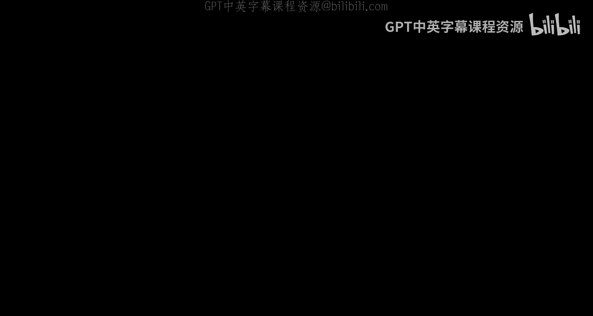
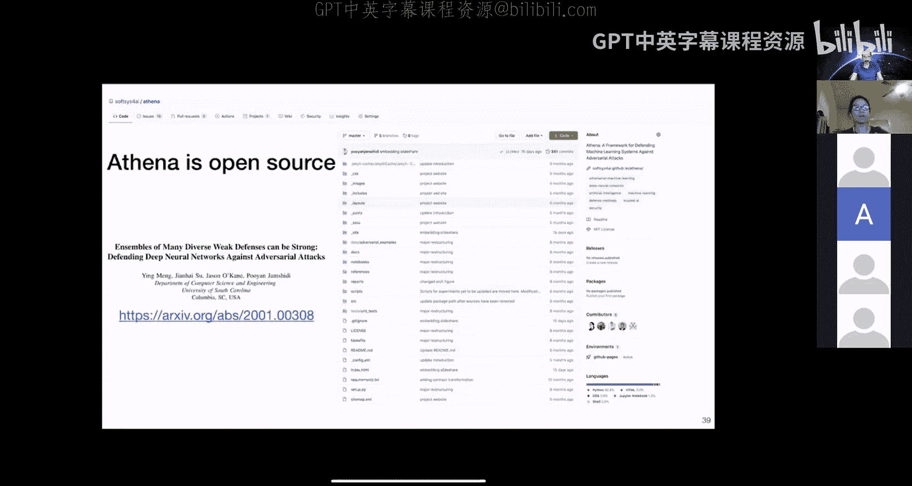
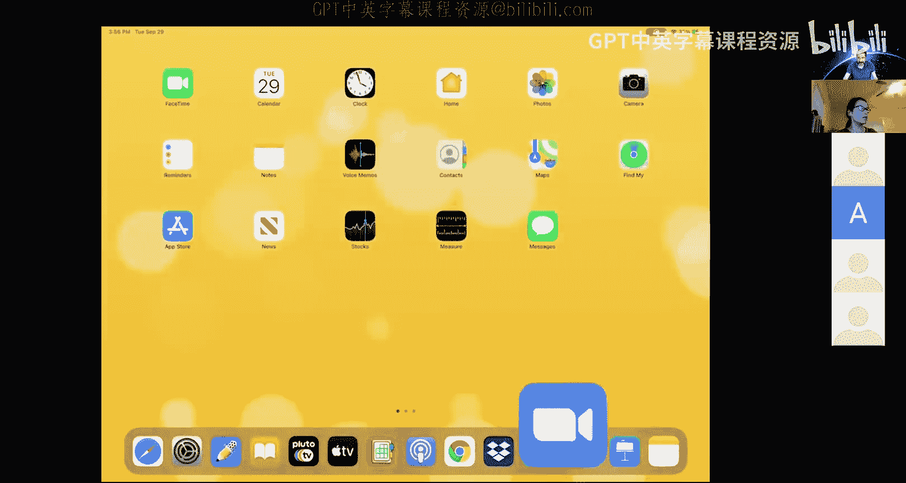
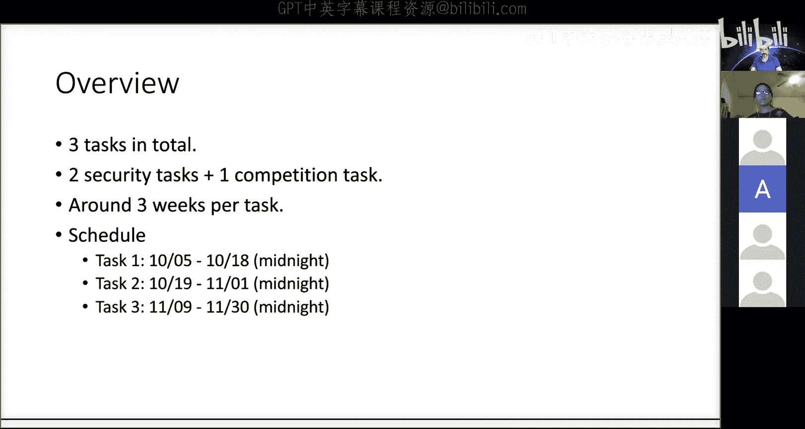

# USC《机器学习系统｜CSCE585 Machine Learning Systems 2020》中英字幕（Claude-3.5 p09 -09-Athena_ Ensembles of Many Diverse Weak Defenses can be Strong.zh_en -BV1Xc9bYVEC6_p9-

Okay， hello， everybody。So today we have， as you know。

 we are going to change the focus a little bit more。

And we are going to mainly talk about the project this week would be the project week。U。

And the plan is to first start giving you a high level project description。

 so you already know much more detail because we share with you the paper beforehand。

But Yin and I wrote a project description as we shared today on Giub and we plan to， first of all。

 walk you through the high level presentation about the overview of the book and please make sure that you ask your questions because it is important to fully understand the approach and the details that you recall。

And also the plan is to also on Thursday， Yin is going to walk you through some code。

 some details of the framework from the implementation perspective。

 so you get a better understanding how to start how to approach this project。So before we start。

 do you have any question？I hope my。So is clear。Yeah， your sounds good。ok。Is there any question here？

Or I can I have I did have one I didn't I didn't see any deadlines for the tasks yet I didn't know if those just hadn't been made yet yeah that's a very good question so Ying is going to share with you the deadlines either today probably she's going to share today or on Thursday so yeah yeah I will share the the deadlines for for each task today。

Yeah， after the presentation， I think。Yeah， taxi。Is there any other questions？Okay， let's start。

Today， it's my pleasure to talk about our work on AtheA， which is ensemble defense。

 consists of many diverseers。Weig defenses and here， diversity。And also。

 the several weak defenses are two。Most important aspect of this framework。

 which this defense is built upon。And this work is collaboration between several fantastic people。

 this work as you know， is led by my student Ying， who is also a TA for discourse Jianhai is also helping a lot with this project。

We started actually this project in collaboration with Jason and recently Forrest and people have also joined this endeavor。

And I will also play a very， very responsive part of this。And to B Ki。

 I gave this talk initially to Google several weeks ago so I'm going to use the same slide。

So I will escape this。 We don't need to talk about those， but basically。

This for is about the security of M。And work oncurly the security of deep learning， but in general。

 this framework and the topic of adversarial machine learning is not only about deep learning systems。

 but in general for any machine learning system and the reason that。

It got the attention as you know many deep learning systems are being deployed and is already deployed on real world scenarios and that's why showing that they could be attacked and they could be defended so this makes it a lot more concrete and more interesting and that's why the scenarios that we are going to discuss is about deep learning。

So we talked about aversly example， I'm not going to spend much time on this so we can escape probably most of this。

 but to give you again some idea， we discussed that。Typically when we talk about adversarial example。

 we have a particular input， this input could be an image in this case。

 but it is not as specific to image at all。And then we generate some perturbation based on two aspects First。

 the input itself。 So you see the input appears as a part of the the generation process。

 but also we need the correct label of the input as well as some information that we can get from the model。

 This is mainly the gradient of。Of the loss function。

 so basically intuitively this optimization moves in what direction if somebody added some small interpretation。

 you can change the decision that has been made made by the model， in order to track it。Intuitively。

 we talk about。Classifier so already you have some intuition what is a classifier。

 what is a decision boundary， but sheically you remember we had， for example。

 in the case of wider classifier， we have some examples， right。

Based on this example that you build a decision boundary。

 what's going here is that you have one of these example in order to trick it。

 you want to add some perturbation in order to basically change the decision boundary in order to classify this as a negative example。

 So the trick is to fool the model by moving。The example throughout the decision boundary in order to trick the model and it's the same people haveve shown that even you can trick the model even by flipping to  certain degrees also people have tried to use 3D printer in order to show that it is not necessary to be digital image but could be physical。

Physical things as well， so you could print out thister tube be can as a right。嗯。

We have some several other fantastic work showing that you can also 3D print out these。

Ide ask in order to identify。In order to fully classify as well as drawing with different voice recognition systems。

 the same for RL and NLPta， so it's the same sort of idea。And this could be a really。

 we discuss about this as well， this could be really important because if we deploy such systems in practice for self driving car。

 this could be really dangerous if somebody could fool these models。

In order to get a driving car so that。That should be any bath。

We now discuss some intuition where these earlier example come from， so basically this is。

These are sort of foundation that you already have about classifiers machine learning models。

 so typically we start by some data represented by D and then some of these might be related to different classes right in this case we have three classes of examples。

 some oranges， some palm trees and some chimpanzees。And then we have a model， in this case。

 a neural network that we talk about， and you know that these neural networks are parameterized by some weight values。

So these are the fates or parameters of the model。And then we could try， right， We could select。

After re the model， you could select some example， some input example with its true label。啊。

We tried one version of the model and that's why we have Teta one means that we use one specific version of the model to see what we get right so this version of the model classifiedifyifies this as enre which is obviously incorrect。

Maybe we want to return in your model or add more example and maybe now try the different model and see whether the prediction has been。

Has been corrected or not， I in this case， yes， it classified this example as orange。

 So this means that this model is good enough。 And the overall approach， again。

 we discuss about all of this now， a little bit more abstract is to find some optimal parameters。诶。

That be expected。Loss。So this loss is the expected error that they。That the model mate。

With respect to。The example that comes from a specific distribution， right。

 so this is the distribution D， and we need to plug in these optimal parameters in order to calculate loss so basically this is a search problem so we are seeing here that we need to find the optimal parameters in order to minimize these expected loss over all examples that are coming from this distribution。

And more specifically， even though the aim of the trading is to find these parameters that minimize this loss。

 we already know how to do it right， we discussed extensively about gradient descent that is an algorithm a creative algorithm that find these parameters for us。

 but on the other hand， you could think about this as a game。

 where the adversary of goal is on the total different direction， the adversary tries to。

 and this is a specific adversary， right？To be killia， in this case。

 the adversary can change the input we assume like by this formulation。

We are talking about very specific assumptions in this problem。We are assuming that the adversary。

For example， cannot change the parameters directly， right otherwise would。Safety。

 we assume that the address can change the input data to a certain extent， right。

And that is defined by this LP norm of these perturbration。

 so the adversary tries to find some small perturbation where on the other hand maximizes the loss in this case right that's the key objective of the adversary so it's working on the other direction。

 which is you can think about it as a game kind of situation。

Which both have different different objectives。 Do you have any question about this。

So I presume this should be really familiar with you already。

 and that's why we specifically try to build this foundation for you that you will be able to do the project at this point。

That you already have of these。Foundation。So I'm going to talk specifically about Athena。

 which is this framework you are talking about。And this is really based on the intuition of input transformation。

 meaning that we want to make some changes to the input example somehow and to give you the idea of why it works and the idea of using input transformation as a defense mechanism has been out there before this work。

And the key idea is that。Let's imagine the adversary found some small perturbration that could treat。

That could change this input。 You see that some noise has been added， okay。カ回行ってです。

That could treat this。Classifier this model that classify this example as known with certain confidence。

 And this is the probability that the classifier puts。For digit nine。

So you see that previously model thought that。TheThe input is7 by relatively high confidence。

 now the model thinks that it is non but somehow moderate confidence。

And the role of this transformation is change to add some noises in the input。It discussed like this。

These perturbations are not random。 On the other hand， this comes from an。

A specific formulation as an optimization maximizing the loss right。

 so this is not just random perturbation， random perturbation doesn't work。

These are some very carefully crafted perturbations and the adverse and this rotation in this case basically misplaced these noises。

 so we expect that these noises these perturbations are not as effective as before and that's why in most cases。

Like these transformations， in this case， this is a geometric transformation more specifically rotations can change the decision has been made by the classifier that now thinks。

That it is seven with some relative moderate confidence。ok。

So that's the key idea behind why transformation works in the first place to be chill。

 like people have shown it previously。But what is the key insight of this fork。

 The key insight is on the。Complimentary aspects of many transformations or many weak defenses。

 as we called them。So here what you see is that you see different adversial attacks。

 different names right， so these are the names of different adversaries。And here on each row。

 you see different transformations， right， so you see compression， denoising， filter。

 geometric transformation， morphology and so。So let's see what we got。

 so this is some empirical understanding of what's going on here。

So if you notice some transformation theory like compress is able to recover the label。

Quite correctly， right？ So you see that like these attacks were able to to trick this model。

In all situations， right in。This FTSM changes that it thinks it is 9，9，9，8，9，2，9，9，9， right。

 So in all cases， the model， the undeended model has been tricked。

But here you see that like compression， we're able to recover the true label in all cases。

 except these ones。Except one pixel， examples that has been generated by one pixel。

But some other transformation like geometric transformation in this case were not as effective。

 so it was able to recover few， but again， it was not effective for some other attacks。

And if you look at here， we have some different transformations。The interesting part here is that。

 for example， in this case， knowledge were able to recover。Relatively okay。

 especially with able to recover this one pixel cell that was not able to be recovered by this compression。

 so you see that some transformation complement each other。

Already based on this so we see that the effectiveness of defenses varies across different attacks and also they have this tendency to complement each other and like you can look at it from the column wise so based on this intuition。

 we thought at the beginning of the project when we were like two years ago almost two years ago。

 we thought， okay， maybe if we put together。Some of these transformations create an ensemble of weak。

 weak defenses in this case。The same transformation。

 but we been the model based on the transformation。

 I'm going to describe how then then this could be potentially a strong difference because he did not assume any particular information。

From that I。So we did not build this defense based on some preassumption about the attack here。

 and that is important when we want to deploy such defect in the wild because inside cyberse work if we consider some assumption this typically would not generalize and someday a new attack comes that totally behave differently from previous attacks and that could change the whole thing。

So this is about the inside， but more specifically we looked at the quantity and quality of the VI defenses in this plot you see that we increase the number of weakI defenses so on particular。

Access， you see that， for example， in this each point。Here shows the。Test accuracy。

Of the defended model， right？In this case， this blue line shows the case where we select。

These weak differences in a worst possible case， right。

 what would happen if we select them in a very bad way。

 meaning that we have some alternative we select the worst one。

This is the best scenario where we selected them very carefully and this is the random case where。

Basically， we select this from the pool randomly to see what we get。So we observe that really。

 So in this case， quantity as you increase the number of good defenses。

 no matter what we increase the test accuracy， even in the worst case， but also quality matters。

 right， So you see like quite a。Vide gap between divorce case and best case， right？

So both quality and quantity of the big defenses matters， and most importantly。

 diversity was something which is super important。So in this case， we conquer the， the error rate of。

Of the differencess that comes from that that。The attack comes from one pixel a particular type of attack and we compared this with two different defense one is basically the baseline defense this is PGDA that is one of the best defense out there in the literature is based on adversarary training which people have shown that is really effective and the adversary training is the case where you generate some adversarary example with a specific type of attack and then you mix it with the training example and once you have the model the model is really effective so you cannot really fool the model unless you have very clever attack mechanisms so this。

This has already been shown to be a state of the art attack and then we try it and also compare it with some version of antennana。

 but in this case in a of putting together a diverse set of weak differences we select different variation of shift。

Meaning that we put together ensemble， but in a of having a diversity。

 we put together an homogeneous ensemble model to compare how important diversity is for building such effective defense for us and we saw that diversity matters in this case you see the error rate of the diverse。

On sample quite much better than homogeneous as well as the state of the art baseline attack。

 baseline defense， so as you increase the number of weak defenses。

 this gap also tends to tends to increase as well。Izaia。

 do you have any question about this because this is important。

 so already Ill show you the quantity quality as well as diversity is important for building such。

Kind of adverse effects。Do you have any question about this？I'm sorry， can you hear me？

In the last slide， the key， it mentioned a high K， low K and a random average K。

 sorry this slide before， Yeah this one right here。It shows top K， bottom K， random K average。

 what does K exactly mean again？So， here。いいですか？We have a certain number of weak defenses， right？啊。

And。So imagine that we have7 TV defenses， right？呃。And here we need to select 10。Right， okay， so。

You can select P for entry right， so you want to select 10 out of 7， right。

 So you have quite a number of selection alternatives。

So basically we tested out all possible scenarios the worst case， this is reported as a worst case。

 best case， this is as the base case and random is when we randomly select from this does it make sense。

Yeah， yeah， that that clarifies it。 Thank you sure。Very good question。Any other question here？

Where go？Make sure you ask your question， right？This is the time because these questions matters for your project。

 but also we observed the same on like this one was about one pixel。

 but we also tested out with different type of attacks， EIM， MIM。

 PGD and most importantly if you look at PGD， PGD was the attack that has been used。

For adversial training， PGD ADT and you saw that even in this case。

 Ana was able to get better results reducing the error rate。

 even with the scenario of PGD attack and that was why，Important result。

So let's discuss a little bit about the architecture and especially what do we mean by VD。

 V defense is simply a name for the model that we trained on the transformed input。

The way how it works is that we have some。Test examples。We used the transformation， for example。

 Philippi so we fill all of the example in our test set in our training set and then we feed it to a classifier this could be a neural effort。

 but not necessary， could be a classifier。It could be a neuro metaphor， could be a naive base。

 could be a linear caifier water。I already know about this。呃。

And then you build a classifier that is able to classify Philip images。

 you do the same for like geometric transformation。

 you do the same for whatever transformation that you have。

So you build different classifier on the transform images。 and the key reason is that。

One may ask why I don't use the original model well you could use。

 but typically when you flip or do some changes to the input example if you try to classify the example by the original model。

Maybe even this transformation may fully the model， which this is not what we want to do right。

 we do not fool ourselves， we want to have some mechanism that data to block adversarial examples。

So that was about the design time now this is the way how the difference works at deployment time make sure to fully understand this because this is really really important。

 right so。At deployment， we use several of these weak defenses and this is。What we call ensemble。

So we put together several these weak defenses and once an input。Come to the。To this defense。

What happened is that。It gets。Transform differently by different。F defenses internally。

And then each of these transformation generates some labels right。

 so this transformation thinks that this is7。7， this transformation。

 as we expect may be some of them。Not produce the correct input correct label right and that is expected actually and then we have ensemble a strategy to decide about the final label and ensemble a strategies for example。

 you can consider majority voting right so what is the majority of the label in this case set。

You could come up with some other adversarial some other ensembleist strategy。

 if you know about ensemble machine machine learning， you can consider many， many different。Type of。

On sample especially in our framework， we already have implementeded some of those right。

 for example， averaging across the probability distribution that we get from each of these models。

 So if these are more network each will produce a probability distribution after the soft map right so each of these give you some probability distribution。

And you get this label called maximizing for or maxing。Right。By maxing this。

Probable distribution of x right this is the how we did it right then in instead of using the label。

 you may want to average all of these probabilities and produce a final probability distribution right and then decide the label based on this final list probability distribution that might be that different from the majority voltage or maybe you want to produce the activation just before you feed it to the soft max。

And take the average over that。 well， that's yet another ensemble strategy。

Or some other like you could even use。The internal layers in a set of the last layer。

 maybe you want to pick internal layers to decide maybe you want to pick random layers right each of these could be a potential ensemble like even you may want to learn the ensemble strategy based on some past behavior all of these is possible。

And we in this project， we're really looking forward that you come up with some interesting even extension of these ensemble strategies if you can come up with。

You can get a。Right so some data evaluation。Results it got dark here。Okay。

 some evaluation results about antennana。喺一边。It is important to understand this。

In cybersecurity research。Or any evaluation。You need to basically consider a specific scenario。

 and that's really important。This scenario are called T model。ok。

What we mean by threatread mother is really is the case where。嗯。Is the case where。呃。We need to。

 We need to。Itar。What at very scary。Knows about the model。

What a person knows about the internal of the model as well as the defense and pretty much anything。

And what are the flexibilities in this setting right to be clear that we evaluated under four different assumption or threats model and in the project we also need to do the same zero knowledge is the case where。

The adversary， this is the role of adversary doesn't know that any defense is in place。

 doesn't know about weak defense as an ensemble strategy。

 but definitely knows about the parameters of the model right this is one thing that the access study definitely knows about it。

So， I'm。By this， we mean that the a knows these parameters。

 so it can calculate the loss over these parameters with any specific example if she wants。

A black box attack the。Adversary knows that there exist defense in place。

 but doesn't know the internal。Of the ca lawyer， as well as this anything about the internal of the defense。

 but knows that there is a defense in place。And in gray box the。

The attacker knows pretty much everything just doesn't know about the ensemble strategy white knows about everything。

So that's the kind of assumption we are talking about。Some results is for yes。

 go ahead on the previous slide。My group was talking about this。

 we were trying to figure out exactly with the zero knowledge understanding of what the target class like what does knowledge of the target classifier mean because。

In the case of Athena， we train usually， like you said， like an ensemble。

 we have an ensemble of many， many classifiers， each of them that have been trained with some different transformation。

So we were wondering what does it really look like。

 I believe the paper mentioned it was the undefended model， but I really wasn't。

Certain what it meant exactly so so the the adversary knows the exact parameters of the so knows about anything about the model right。

 so knows。The weight of the model knows the architecture of the model。

 So imagine that it has the model， right？It can， but it cannot change the mother， right。

 it knows everything about the mother。So we can try to give input and get the output。

That's the thing she can do with the model。Does it make sense？

Perhaps so so like a model a model for this could be a model for image recognition right and before。

You could imagine we could create some model do this image recognition with no particular thought of adversarial attacks。

 we could just create a fairly normal， I guess model。And it is and。And then。

We could consider another。Scenario where we create this ensemble of weak defenses。

 the way it's described with Athena。Is the first scenario I described。

Where we have the parameters that we and the architecture。

 the knowledge that would have been done without the context of an adversarial model。

 is that what like the attacker would believe the situation is？啊。Right， right， exactly。

 exactly the way how you describe it， right。 So in this scenario。Right， let me clarify better。

 maybe in this scenario。It knows that it knows everything about this model， right。

 so it can keep input and gets out。But， obviously。This model is consumed by a， right。

That we put some summer stuff。Before this， right， so we basically shield the model by our defense。

 but the advertiser doesn't know that there is a defense in place， right。So， maybe generate some。

Adversial example based on the model itself， but obviously there is no guarantee that this adversarial example can fool the system。

Right， because it uses the knowledge of the model itself， but we shield the model by something else。

 So we somehow change the model to certain specific。To some extent。

 right by the how our defense works。嗯。Right， does it make sense？Perhaps a bit more。Yeah。

 but it it will。be more clear once you look at the code and Ynk will explain in more detail。

About the code and everything。 But when you look at the code。G to， right。

So here what we see is that we use FGSM as one of those at we use a specific type of neuralarchitect ResNe and the data is for C400。

啊。In this case。If the address I notes everything about this model， renet model。

 and here you see some result in terms of error rate。Let's get I5 what。Do they show here。

 you see some。Different in instanttaniation of Athena with different ensemble strategy where we use majority voting。

 this top two majority voting average of output and random defense and Ying will explain。

 but for example， top two majority voting is that we， when we。Select the。

Top 2 top two labels and decide based on that average of output when we average over the either property distribution or the。

Or the logics or the logics it was the logics， right， yes。Right， it was the logics， but technically。

 we could take average over any。Any activation， any output outputs from any activation layer yes right and you know that like when we talk about neurals。

 each of these layers， you had some ZI associated to layer K。

So you could use any of these vectors if you want， right。

 But then you get close to the end of neural network， probably these are。

More information is in there， that are more meaningful， you could say。And for these results。

 we use the logics， logic is basically they layer activation just before they soft mark。

Just before we pass it through the soft。And the baseline。

We already know PGD ADT that the training random and smoothing is one certified defense。

 which is also a strong defense。Certified defense water is those kind of defenses where you have certification is that。

You have some guarantees about this defense， basically no matter what the a cannot。You know。

Make this defense the error rate goes to above a certain  threshold shot， right。

 So you have some certification about it。 And you see in the result that right。

 no matter what kind of perturbation， the of be the effectiveness of this certified defense would remain the same。

So the result and also this poll line disorders， this poll line showed the performance of un defendended model。

 So for example， in this case， you see that with this perturbration， this is the parameter of the。

Of the attacker， meaning that how powerful， for example， is the attacker。

 you see that the error rate of the undefeended model is quite high。Around 80%。呃。

The error rate of these defenses is also。Not that impressive， but。

But this is the error rate of our defense， you see that most of these ensemble strategies did quite well even comparing with these state of the art defense mechanism。

And this is thanks to the power of， you know， diversity as well as。Quality of this transformation。

 as we discussed。But we really observe also a similar thing for different type of attacks。

 different type of zero knowledge attacks， similar result， don't want to go into the detail。

 but yeah。Let's move on to the black box scenario threat model。

 and again to clarify the black box only knows about the existence of the model but doesn't know anything about the target model。

I have one question。ahead could you describe how you differentiate between a weak defense and a strong defense。

 is that a formal definition or kind of an informal definition based on how effective they generally are？

Very good question。 So somehow you could think about informal， but basically。

When we talk about one specific attack， right， when we talk about this attack， it has a parameter。

 right these attackers are parameterized， when we increase the epsilon。

 meaning that how much perturbation the attacker can do。

 or in other hand how much changes they can do inside the image， obviously the more changes。

The stronger they could get and the stronger meaning that they could increase the error rate。

 That's somehow the way how you could define it。 But if youre talking about different attacks across。

For example， if you are talking about these cases， like which one of these is stronger is really there are different types。

 There is no， you know， it， it really depends。 Some of them are as showing。

Some of them are able to full。Some sort of model。Quite well。 in certain scenario。

But some others maybe even works better with different data sets。

 so it really depends on some parameters， right， the data set， the model architecture。

 the assumption that we have the specific parameter of each attack。I hope this answers your question。

 does it？Yes， I think sir， thank you。嗯。So it bought black boxs。

We tried with two different black box and the first one is transferability based approach。

In this case， again， this guy that girl started。As I know， the the model obviously can。

Approximateimate your mother， it can。Create a substitute model that emulates the actual model， how。

Not it's easy， right。You can start training a new model。

 you can give some input to the model that you don't know， get some output。

 use this input output to train a new model， new architecture， new internal， whatever you want。

 and then this new model。ul be a sub model， and then you could use this sub model to launch adversarial example with the same approach that you knew before like FTSM and then use this adversarial example。

 hopefully they transfer to the actual model and by transfer meaning that they could fool the target model to。

Right， is that clear。Yes。So this is， I mean， identifying this is quite。Important。

 because that that might be confusing at the at the beginning voice it's really simple approach。

 So basically use some。Example。To build a model to emulate these targets。

Target model and for really creating as I earlier example。

 you need some model because you need to calculate the loss function。

And hopefully with this averss example that you create for this model。

 they transfer back to here as well， that's the way how it works。Here are some results on thevo axis。

 you see some transferability rates。And on the X axis， you see different budgets。

Ws indicate that how many example the adver used。To create。And your mother， right。

1K mean use  1000 example to feed to the actual model。

 get the output and use the same example to build the emulated model。

Interesting result is that compared with antenna。Compared on the that model。When we used Athena。

 we were able to decrease the transferability rate comparing with not using Athena。

 meaning that the defense。啊。Decrease the transferability rate， which is good。

 This is what we want to get， right， We want to decrease the transferability of。😊。

Of the example that the adversary can generate， based on the。Emulated model。Back to the target model。

 this is what we wanted to achieve and this is what we got from antennaon each of these shows different you know。

 different scenario with different epsilon in this case， this is for BIM attack。

 but really we saw the same different。Be different the study of attacks too。

Besides this transferability based scenario， we also tested with some optimization based black box attack in particular。

 Hopper skip jump， which is a very new attack that appeared this year into 2020。

 it tested with ResNe again， we see 400， a different budget level， this is the distance between。

The address area examples and the。I mean。And they I an example， right？So。

You see that when we deployed antennaA to defend the model。Be。Hoペ skip。Jump needed to perturb。

The example， a lot higher。In order to fool the model。And that's bad boy。Because look at the example。

The adversary was able to fool the model with this example。😊，But with antennana in place。

 it was able to fold the model with this example and look at this。

 anybody can see that this is a thirdtu image right this is not real。And here are more example。

 so basically it means that in order to fool the model adveral needs to protect more。

 which is bad because any， any detection mechanism can identify these that is coming from an adversary。

This is not something that the adversary wants。Right。Any question about this？

Let's move on to the whitepo scenario this is basically the case that the advisor knows pretty much everything about the model and the defense in place obviously in this case no defense has a chance because advisorver knows pretty much anything so we expected to see some high error rate event for defend model and this is what we got right。

This is performance of antennana， meaning that the error rate as the max normalizedize the similarity would increase。

 this is the difference between the pertuurrb images and normal images。Average across all examples。呃。

And you see that as increase， as this increases， the error rate of the defend model also gets increased。

 So the error rate is quite high， which is what we expected to see。

But it comes from some so when we look at the example， I mentioned like this is not easy。So。

 for example， one test that we did was that we we。Use the detection。

 so you see that here like you have no chance right as we increase the strength of the adversary。

 the accuracy would decrease a lot。But we train a detection mechanism。

And we were able to identify or flag these examples as。Adverarial example。

 before even feeding to the。To the system。So and you see that this is obvious from the example right。

 so this become obvious that these are coming from an adversarial attack。

 so with the mix of post detection and the defense mechanism。

 we were able to build a relatively good defense mechanism that maintain the accuracy across different different strengths of the adversary。

Beside that， it comes with some cause。The the time that it takes for generating one。

 I will show your example， it increased as the strength goes。呃。Increases， so that's one thing。

 but also so。So means this means that this is for one example。

 so if it wants to generate a lot of example， it takes really long time and when we talk about real time scenario。

 so it takes a long time so the adversary don't have enough time to fool the system on real time so that's one scenario of why the time is important because the adversary doesn't have like much time to generate these examples and within in short time it is impossible to generate with these certain scenarios。

ですか。Also this antenna， again， this is back to the case that we did not assume anything about attacker。

 journalist as well， meaning that we can change the discuss about this the resnet architecture。But。

We could change the type of architecture。The type of classifier to SPVM or random forest。

 and we were able to get similar results to some extent with some nuances right in this case。

 for example we changed the architecture to Resnetshack regularizer with FgSM and C400 as a data set。

啊。And is again， different。On some of the strategies and by the way。

 each of these represent the performance of one of those big defenses， right？So you see that。

The result is more or less similar different to certain extent。

 also the same for different type of attack， we also tried with SVM models with SVM somehow in some cases the difference between undeefended model and the defended model was marginalized so basically some scenario。

It doesn't show the benefit as before， but it's still a little bit better than the onlyfended model。

 so this shows us that this is quite generalized across different type of class but is not very specific to to deep neural network what could be extended to other type of classification。

😊，て管じさ。Also， the other aspect is that obviously it comes with a cost。

Both in terms of memory and inference time。In terms of memory。

 since we need to deploy multiple weak differencess。啊，imagine that these。

Each defense means we have a model with some parameters， we need to store these barmeter somewhere。

Right， and if we have。Hundred of these models you need to and each model。

 let's say if if they take 00 megabyte， you need to increase that ball 100 times right So obviously they take n times more memory than before in order to to use this defense But the good news is that it doesn't increase the latency or。

And first， aren't， because。They can work independently。

 so there is no dependencies between these V defenses， which is good。

 So this means that you can be the example at the same time。

 you can process and get the results obviously some of these results come at different time。

 So this is like each weak difference comes at different times。 some of them are quicker。

 some of them are little bit slower， but all of these at this case for the case of M C400 sorry。

The transformation process。Took less than inference time of the original model。

 so you can expect to receive this label。Quite。Before before any one shot of prediction。

 so dismiss means that we don't increase the inference time because they work in parallel right。

 but obviously you need to increase the memory size for this case。So to summarize。

 we show that antenna ten is。啊。Is somehow a good defense mechanism， it is flexible， extensible。

 right， you can change the V defenses， can change the architecture， it's general defense。

 so meaning that it works with different type of classifier。

 obviously it comes with some memory overhead as well。And you know about this， right？

 So the code is there。呃。So Ying， are you ready to to share some slide about the project description。

 So basically Y will present you some。This basically talk about some of these project description。

 but she will continue on Thursday about more detail walking you through the code and everything。

But thanks， I will to stop sharing now。

Okay， let me share my screen。

Okay， so today I will。Quickly， go through this。Project descriptions with you can you please make it scary。

哦，要说。Like this。O。Okay， I will， I will go through this project with you。

 So maybe will help you to understand what you need to do。In this project。 So basically in this。

 in this project， we will， will separate the students into 10 groups。

 Each group may consist of 3 to 4 students。 And so each group will build their。

We willll build an adversarial machine learning system on top of Athena， so。

By calling the APIs we provided or extending this etthena， you will need to complete some tasks to。

 for example， generate adversarial examples or build some ensemble based adversarial defenses。嗯。So。

 this ethena。I just refactor it last week on top of IBM arts。 So make it make make it much easier to。

 to use。嗯。I provided。Rpers for， for cars based classifiers and pie torch based classifiers。

 So if you are comfortable to use cars， you can change your model in in cars and then。And then when。

And we can load your classifier and wrap it into the classifier we recognized。so。🎼So， currently。

It only saw cars and。Okay， and in this new structure。

I make theemble ensemble will be treated as a single classifier。

TheThe usage of ensemble will be very similar to a single classifier。And we have implemented7。

11 adversarial attacks。Okay。So。I will push the source code to， to our project， Github。

So you will get the source code。 You can。You can walk from the Gith。liple。

And we will provide a vanilla version of Athena。 This version of AEna consists of 72 CNN week defenses。

And I forgot one。 and one unefended model， also。In CNN architecture。Yeah， yeah here。So， for。Almost。

All the tasks， you only need this， the vanilla version of ethena。And that's it。

 and I will provide baseline adversarial examples we generated for you to evaluate or compare with your approach or results to see whether your output is I mean make sense or something like that。

Oh。And。I will provide some tutorials， some simple tutorials tell you how to how to use the APIs to call to load a single model to load an ensemble or to apply these transformations or do the prediction。

Or use it to generate an avers examples。 So basically， currently， you only need to。

To write a proper configuration file。We will provide a tutorial as well。

So we also provide S BN weak defenses。 So this is， this weak defenses are only for。

 for this hybrid etna task。I remember I have trained random forest as well。 But last night。

 I cannot find those。I cannot find those models。 So if I， I will。

 if I find that before the task to begin， I will also provide those random forest models。

So you will have more options。Yeah， so we will to clarify to clarify your if you are willing to train model as weak defenses。

 even with new transformation， you're free to do that right， unless you you can use the architecture。

You have access to the training data， you can train a new model， a new V defense。

 even based on totally new transformation， and you would encourage that。Yes。

 and currently so in previous version the transformation， I mean。

 the the parameters are are hard coded and I have refactor that show all the parameters are tuable and you all you have to do just to to write the configuration file so。

So you can generate， for example， for the rotationPrevious， we only allow we only。

Support rotate 90 degree， 180 degree to 70 degrees。Currently， theoretically， you， you can。

 you can rotate by any degrees by any angles。 So just， just con that angle in the， in a confi file。嗯。

Yes， so for the teenth。teachinging will allow3 or four students。And。We expect all the students。

Will participate in this project， so。So。We think don't be。So everyone should contribute to your task。

We only require one submission，13。是。🎼Yeah， since we have multiple options for。大 to show you。

task to for the， I think it's October 15。So the submissions。

 basically you need to submit all the materials。That can。 So I can。

Repllicate your results without doing any extra work。So basically， maybe the code。

 the the experimental results， for example， the trained the generated advers examples， the。

The trained models， the。Defenses you built。So anything you think is is required to。

 to run your experiment。AndTo be here。We in tried to specify how。You need to deliver。

Everything should be through Ti top， so I mean， if you send us email that like here your the code。

You get no point， sorry。Basically follow the instruction and if any part is not clear create an issue。

 we will address it right Yes， yes so so basically the code and project report will be submit you can submit to the to your Github report and for example。

 the generated adversarial examples and trained models we might need this。And annual your code， we。

 we need this on on a server。 so I can run the cross evaluation for you。

Before before the task3 begin。So I I will， I will let you know the。The server。

 after I set up the environment。So for the， for the reports， for task 1 and task task 2。

You need to introduce the approaches that you are used in the task and you need to describe the experimental settings。

 for example， for example， the for AE generation， if you are using FGSM， you need to。

You need to provide the value of the EPson you are using。Something like that。And if you are。

If you evaluate the overhead of your approaches。You need to you need to tell us the hardware on which you。

 you run the experiment。All these slides is available on the on the GiHub project Github。

 I just uploaded。So， you need to cite。The previous works。

You need to write the report in your own words。 Don't， Don't just copy paste。And for task 3。

 because this three this。In this past， we aim to analyze。

And investigate the insights of this of your approaches。So basically， you need to in involve the。

Method you used to analyze the data。And in any observations。 And here。

 this should be insights and insights。You， you can draw from your。

Analyse results and any possible enhancements， future works。 So basically for task 3。These are the。

Discussions， yeah。And you need to provide an architecture of your system， because this is a system。

Class。Yeah， in any citations you think it's necessary。So， we will have。3 tasks for each。

 for each group。You will have around three weeks for each task。 So here， here is the schedule for。

 for the tasks。And for task 1 of。It weighs，30%。Of the， of the project。You will have a。Additional，5%。

If you are using， if you generate the AEs using the per methods。That is not provided in the。

 in ethena。So if you are， if you are using the APIs we provided。That's fine。 You。

 You can also get the full credit。 So for each team， we aim to generate。We aim to use。

Two to three different attack methods。For example， when when we mention attack methods。

 we mean C W or FGSM， something like that。 And for each attack。For each attack。

 try to generate around five variants。For example， if you are using FGSN。

So make the epsilons equals to five different values。嗯。We encourage you to。

To use different configurations we used in the， in ethena。可以。So。🎼After you January the evaluate。

Basically， when we evaluate some adversial examples or any adversarial attacks we。We evaluated。

 in terms of success。Of this adversarial example。This is the successful。

 how successful this attack for to for the model， to for the yeah。

 to for the target model or or any other defenses。So you need to evaluate your adversary examples on the target。

 the targeted model。So this is the， the unefended model。

So basically sorry basically aim to generate similar plot right。

 but more important if we expect you to explain what。You see in the plot right， try to interpret。

 write your observation in a scientific way， right？What you observe in the data briefly。

 but understandable for anyone just do not just plot the result and that's it。

 you need to also write about it。诶。Yes。So， the。Undefended model， the。vanilla。诶Sner。You can。

 you can simply evaluate the majority voting in avers。OfPro。Average probability strategies， so。嗯。

But we also encourage you to to extend these， as I mentioned， right， extend these ensembler strategy。

 come up with some sophisticated ensembler strategy to report the results。 These are like。啊。

Whatever you do beyond what we provided here， you will get additional point and that's what we are looking for right right and these are not really difficult right if you are able to do this basic。

 you should be able to take and come up with some interesting you extensions。Yes， actually in this。I。

 after I refactor this antennathena。I allow different weighted for each weak defenses。 So basically。

 in Ethena， we use a。Equal weight for， for the with defenses。 So in here you， it's very easy to。

To extend it， to use a different weighted for， for for each weak defenses。嗯。Yeah， I。

 I will also provide this P GD aversar trained classifier。 So。

 so you need to evaluate your AEs on this model as well。So the you can plot something like this。

And so for the task， too， this is the most important part task in in the project。

 So it weighs 50% with。Around 10 through 20 percentage bonus。So we have four options。

You need to claim your task on Piazza before October 15。I。

 I limited the the numbers of group as three at most three for each options。 So， so basically。

 every option will be selected by at least one group。So you， if you really want to do any task。

 please claim first。 So first come first served。Yeah， and to clarify。

 please follow the same issue that I that code be created on on Gith so put put your team there and the task that you selected there in the same issue。

 so use the same issue as follow up comments and。We kept track of this over there。Yeah， yeah。

 I think it's easy。 I can show you one example here。Second。So here， I， I think。

It's better for you to just。I mean。Write down the。The options you want and the most。 so in the order。

 you want it。Most， for example。We are in this SNR team。The team members Puyang me and Shanghai。

 And we want this task the most。 And then this is our second option and something like this。

 So if your first priority is full， I I will， I will try to check this for you， and so on。Yeah。

And okay， so。The option option 1 for task 2。This task will have。 You will get a。

Yeah do you want since we are going beyond the class time Do you want to continue on Thursday， Yeah。

 I think we can continue on Thursday this yeah， this slide has been uploaded to the GiHub so you can download it from there。

Yeah。Yeah and lets let's continue on on Thursday Ynk will have more information about these tasks can also walk you through some code and discuss some detail。

 but make sure that you ask all questions because you need to respond the right away right you have almost around two months to deliver everything。

Yeah， so task  one。 Yeah， T one will start next week。October 5。So， so next week， now on Thursday。

 I will go through this with you， and then I will work with you with， with some tutorial。Work works。

 yeah。 show you the codes and show you some tutorial， some samples， how to， how to play with Athena。

Okay， sounds was good thank you very much。 Thank you。 See you on Thursday， thanks。

Thanks。