# USC《机器学习系统｜CSCE585 Machine Learning Systems 2020》中英字幕（Claude-3.5 p10 -10-A Demo of Athena for CSCE 585 (Course Project Overview).zh_en -BV1Xc9bYVEC6_p10-

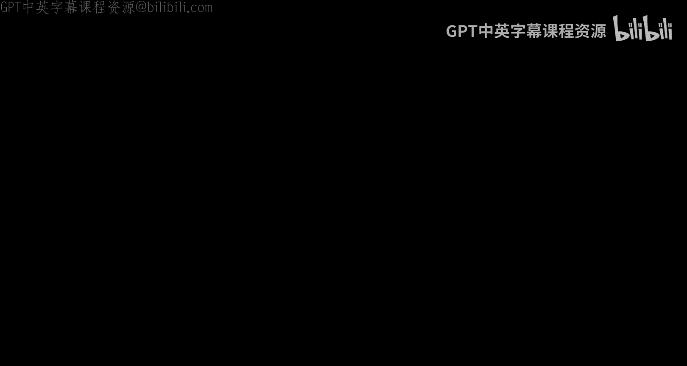

Okay， I guess we can start， hello everybody。Today we have the pleasure to have Y to discuss about this project in more details。

 so basically the plan for today is that she will walk you through some code to get you familiarized with the framework overall and help you get us started with this project hopefully as quickly as possible I'm very much looking forward to this thanks please a start。

Thank you， Professor。 Okay， so just one update。 I just push the source code to the Github so you can。

 you can get the。Cold from here， but in May。In the weekend there will be some updates in the source code。

Yeah so one maybe that let's go through with maybe you should look at the updates in the infrastructure and the code from time to time and pull the latest push into this repository as often as possible right there might be some changes as we go on but we try to also update you through Piazza as we do。

Thanks。Yes， yes。Thanks， professorfessor。Im sorry if you have any question throughout this presentation。

 please feel free to ask Y， it is the time to make clear about everything。Yeah。

 because the project will start next week。 Actually， although we give you three weeks for each task。

 if you wanted to， I mean。Come out some great results。 Actually， it might take time。

 and it also take time for you to， to do the experiment， to analysis the， the the results。

 and it will take you some time to work on the report。 so。So。🎼Yeah， we ahead。

Let's go through the requirements first。 So basically。Yeah， I have some updates in the。Yeah。Here。

 yes。So this bonus， basically， we will consider additional credits for any new approaches that has not been implemented by Athena for task 1 and task 2。

 so you can。You can dig deeper， you can Google or if you found some interesting resource researches in in this I mean yes。

 in this adversarial machine learning， you think it may be interesting or possible to implement。

To here。 and then you can， you can try that， but。But don't don't spend too much time on trying new approaches because the time limit。

 so。You need to plan， it's a trade off。Yeah， so。For these new approaches in your report。

 you need to introduce the approach and you need to sign the work and you need to explain what what it is。

 how it works something like this， but don' you don't have to spend much space on this you just explain concily。

Yeah， conscily that that will be fine。 Yeah and you to this basically。

 you can think about like one paragraph description and a few equations underlying the equations that explain the work right and some estimates of the code and。

That should be fine。Yeah。Yeah， so if you can provide the slow code of the algorithm with some explanation。

 that would be good。 you need to。 So whenever you implement some， some new approaches。

 try to compare the approach with the。With the baselines we provided， so。

The we will provide adversarial examples we generated as the baseline for you to compare with the adversarial examples you generated。

 and you can use the vanilla version of Ethena and the PGD trained model。

 I will provide both of this to you as the baseline defenses。

 and you can also implement some other base baseline defenses。 if you have time。

 and you think it's interesting or want to compare with。 So that's a good point。 yeah。

 so beside the description more important I should emphasize that this inside the the results that you get special explanation。

おワユがデスなわに。And the in of that and contrasting with the current approaches with Ana。

 if it is especially around the defense mechanism， if it is an alternative defense mechanism that you want to work you want to compare with antennaA as well as the other baseline。

 which is necessary it。イベント。I mean， like any contrast would be useful to explain。

 these are what we are looking for really。Insight， whether it is positive or negative。

 that doesn't matter， whether it is successful or not successful doesn't really matter。

 but you' are looking for some insight that you could explain。 And there is one interesting question。

 thanks for asking。So the question is could we use athena research journal as a model for our report。

 Yes， definitely， we are going to also give you and publish actually the new version of this paper in。

Maybe two or two weeks time so。We send you。Bas updated version as soon as possible and you can definitely use the current version as well as a kind of template。

 it's dense you don't need to write as much obviously。

 but you could definitely reuse if you want for example。

 you could reuse part of the paper if you want， you can also think about the visualization that we put in there as a template for the kind of visualization you want to have。

即过。Yes。Thank you， Professor for this explaining this。 We， we aim to look at the insights and。

F your results， so。Even if your approach doesn't work well， don't worry about this。

 Just try to find the reason why it doesn't work or something like that。Yes。And yes， so we have。

 we have talked about this。 And I think， maybe。嗯。Maybe task to。I don't remember。 Okay。

 so we have four options for task 2。Each of you， you， I mean。

 each group need to claim which one you to wanted to do on Piazza。Okay， so。

For this option  one is the attack attackers task。 So in this， in this option。

 you need to generate some adversarial examples in the context of the white box attack。 So。

 so in this white box threat threat model。 If you remember。

 the attacker will know everything about the antennathena。 So they know every。

 every single weak defenses and ensemble strategies。请系要先好。诶嗯。This in here。

 we aim we have provided two， two type of optimization based approaches so you can。

You can use the the。The message we provided simply generate some weak defenses。 No。

 generate some adversarial examples， something like that and。And do the analysis。If you implement。

New approaches。 we will We will consider bonus。 Yeah， as always。嗯。So basically。

 if you are panic in coding or in in this stuff， the easiest way is to， for example。

 the task for task one， you just generate some adversarial examples we provided and I mean using the method we provided and choose this option one in as your task2 and generate AEs using these two attacks we provided。

 So basically you can if you。If you can analyze the， I mean， your report， you can。

 you can work on work。 you have a great analyze in your in your results or something like that。

 you you will still get full credit in your project， so。But if you want more challenges。

 you can choose other options。 For example， this。With in this option， too， you will need to。

You need to train a model。Here in here， we want a learning based on sample strategies。 So basically。

 you need to train a machine learning model。 This model will take the output from weak defenses as its input and。

And produce produce the final result。 final label for for the coming on for that X， for the input X。

 So this is。Here are some。Possible solutions I provided here。

 so the first one you simply choose any any model， any machine learning model and train it just just do something like this。

So this is， for example。 So the bonus will be 5015%。

 And we have a previous study working on this adapted multi columnlon。DNN。So if you want it。

 if you implement this。You will get 20%。And here， the knowledge。Differentent， so。I just。Yes。嗯。嗯。

Skin some paper。 I think it's feasible， but I will continue a。I will check the。

🎼Some some studies for you to。Two works。 Yes your your。

Was not as stable Could you easily repeat again for others。嗯。So。ExMaybe explaining the idea， right。

 What is。What is the goal here？So you mentioned about learning based ensemble strategy。

 how a student needs to approach it。系。Yeah， so in Ethena， currently we。We use some a fixed strategy。

 So we simply use some majority voting or averaging the outputs from weak defenses。呃。This is。

We we wanted to see whether， whether in here， if we can learn， we can use a model。

 A DNA model help us to。I think maybe it， it's like another。Classifier or。我。嗯。Yes。

 if we can apply some。De learning approaches here。 Maybe we can get better results， because。

By simply。Use the majority voting when， when。嗯。🎼When the majority。That what。嗯。

OkayIn weak defenses so to maybe add a bit of explanation and that is important how you want to formulate it right so think about a very simple scenario right so each weak defense gives you some information like think about a privacy distribution right。

嗯。And then your ensemble the internet wants to wants to use these information right wants to use this probability distribution information to generate the output right so at as abstract level。

 imagine that you have n different probability distribution right and then you want to use a weighted average of these probability distribution to generate one single final output probability distribution right so at the abstract level。

 this is a weighted average and the task of learning ensemble strategy means that。

Use supervised learning in your training set， from your training set to come up with good weight。

 right？But。To be kill， this is one out of several possible formulation about this ensemble strategy。

I would suggest you to take a look at the literature about ensemble learning， ensemble。Learning is。

A soft of machine learning actually has been quite popular several years ago。

And see what are the approaches there and see whether you find some connection。

 interesting approaches that you may want to apply here。

 but first you need to fix your formulation about this learning based ensemble strategy and everybody could formulate it differently okay it's up to you how you want to formulate it and based on this formulation。

 then you can choose one of the existing approaches in ensemble。

Ensemble methods and apply there and see whether you get a better result or not。

 right no matter what。So if your attempt was either successful or unsuccessful。

 it's definitely worth reporting about your result。 That doesn't matter don't。嗯。

Don't think that you need to get better result， Even a negative result would be useful and you will definitely be at your extra point here if if we see that you have attempted。

Nicely， and you wrote nicely about the result， whether positive or negative。Yeah， even。

 even if your defense get like。Does't work well。 I mean， maybe even worse than the undeefended model。

 the target model， that that's fine。 if you can find the results and we can learn from that。

You will get full credit， so don't worry about the result。

Yeah and let's let's wait a little bit here， I want to ask a question can anybody because this is important I want to formulate it as a question here to see whether you really understood what we mean here can anybody explain what is the difference between a learning based ensemble strategy and other ensemble strategy that we mentioned here in the paper？

Any volunteer or I should call on。Yeah， I think so， I think I could explain。

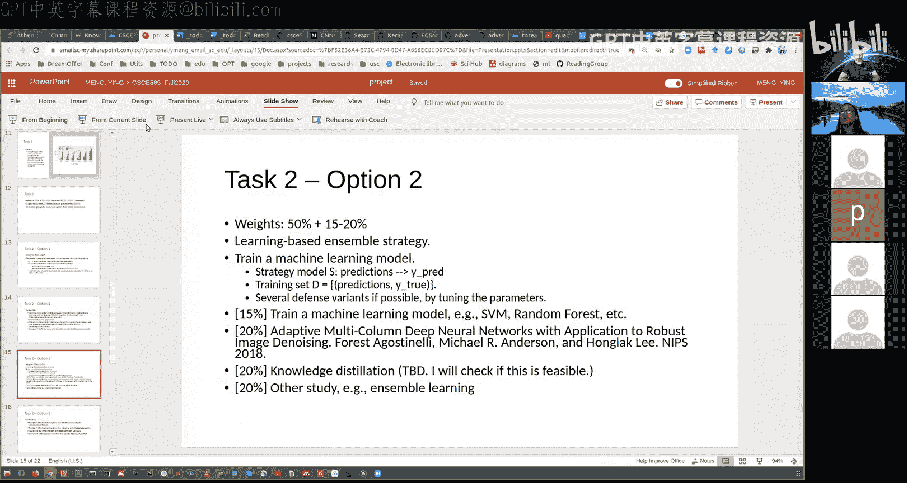

So。In with one ensemble strategy or with the learning based ensemble strategy。

 it's as you said so you take this。

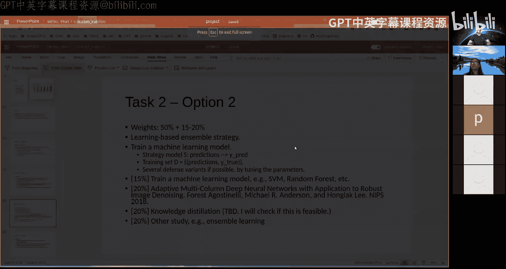

You try to learn this some of the set of weights where whereby you would。

Consider certain classifier or certain what is it weak defenses。

 the classifiers that are the weak defenses， you would consider some of them。

More important than others in some way， based off of these weights。And the sum of these。

 you would use the sum of these weights after through this learning process， which could be you know。

Like there's there's there's a lot of different things， but like a neural just a neural network。

 deep learning， whatever， you know， you can use any strategy there， I guess。

And then the other ensemble strategies you discussed in the paper were all like。

Predefined methods where whereby you could consider the classifiers potentially voting。You could see。

Which of them， I do believe they output some kind of a do they output some kind of a probability。

 I assume？Des， right， so for example， some of them they do but。For example。

 majority voting it doesn't right so majority voting it looks at the highest probability class and it decide based on a label but just like looking what what are those。

Most frequent carss， right？Yes， well it looks at frequency。Okay， right because then you could use。

 you could look at which of them it believe to be more likely and you could decide that。

You could choose the top two。What is it most the weak defenses which are the most certain。

 the top two weak defenses， which believe they are the most certain about what the answer is。I guess。

 and then there's there other methods I don't have the list up in front of me。

Yeah that's a very good explanation thanks Cody yeah this is exactly what I wanted to hear right so the current ensemble strategy that we designed for AtheA are fixed right meaning that the strategy no matter how many weak defenses we have what would the probability distribution。

 what would be the most probable classes， whatever its fixed so the strategy itself is fixed？

But learning based on sample a strategy， meaning that it really depends on particular situation。

 for example， could be dependent on the data part of it obviously part of it depends on the type of weak differences and some other factors right。

 so you want to learn。Some ensemble a strategy based on whatever you have right what you have is like some weak differences。

 some data， some probability distribution that you get and also you have much more information actually down the line like these neural networks you have like these hidden layers you can also use that why not you can come up with very interesting ensemble strategy based on learning right you could do clustering。

 for example， to find out what are the you can for example。

 one interesting idea could be create some cluster that may either expert in one subset of the classes。

 for example， you can create one cluster that these weak differences are really good to recover digit1。

2，3 right the other clusters are。Expert and good in class 4，5，6，78 for now right。

 something like that you could do class study you could do many interesting approaches right I'm very much looking forward to your formulation Okay。

 God formulation matters。The kind of data you want to exploit for this learning problem。And。

 and also， the result that you get。 Okay， so that would be fantastic if you could show that you could came up。

 right。No matter how you did in other tasks。If you could show us how you came up with some learning based on some of the strategy that performs actually better。

Right， I found better。Then the existing fixed ensemble aesthetic on all attacks。

 no matter how you do in an other task， you get a definitely。

 so try for it specifically if you've come up with a nice formulation of this problem。Yes， so the。

 the main purpose for these projects is for your creativity。嗯。耶稣。You need to do some evaluation for。

 for any， for all of your approaches。 So for defenses。You need to evaluate the models。The model here。

 I mean， the the approaches you trained and the and then。The， the defense you created， so。

You need to evaluate model's effectiveness against these advers examples you need to since you've you have any some adversary examples in your task one。

 you need to evaluated using the adversary examples you generated and。

Evaluate your model against the baseline adversarial example we provided。So， we need to。Oh。Yes。

 so for each。Here， I did I mention that。 Okay， I， I forgot to mention it here。 So actually。

 for each defenses or adversarial examples， we， we expected you to generate several variants。

 if it's possible。For example， if you generate， if you build an ensemble defenses。

You can vary your defense with， for example， with a different size ens sampleble size。 For example。

 an ensemble consists of three week defenses ensemble consists of 10 week defenses。

 something like like that。 So we so in that case， you can compare the effectiveness of your approaches。

 You can check how these the changes in size impact the effectiveness of the of these defenses。

 something like that。嗯。We。Yeah， we provide two baseline models on。So you need to compare。

 So basically， you need to evaluate these these two baseline models using the advers examples you generated and the baseline examples。

 so you can compare the effectiveness， whether your your approaches beat these two or or not。

 And and then you can further investigate。Seek sick for the the reason why or why not。

Something like that。So。Yeah， the option 3 is。The probabilities baistic ethena。

 So currently in this the vanilla version of ethena， we， we generate the， rebuild the weak defenses。

Just use some。CNA model so in this approach。You， you can try to build some problems。

Probabilistic classifiers， for example， using this basin neural network。

Since the training may take time， so you can just train like around 10 to 20 weak defenses。

 it depends the on So yeah， depends。If you have more time you can you can train more。

 but since you have at least three students， you can you can separate this work right each each of you will train like three models it will take。

Since this is amnes， I think it will take less than half day。 You will get all the。

 all the weak defenses。嗯。Yeah， so when you train， whenever you train a model， you， you just， you。

 you need to train the model on the training data only。 don't change your model on the test data。

Because that， that will be achieving。You you will think maybe your your model performs well。

 but actually that that's because your model has seen the test data at the training training phase。

 So just use training data at the training phase。 Yeah， that's that's a very good point。

 So by now you should already know about this right。

 so you have one training set and one test set you can definitely use part of your training set as heldout data if you want you're perfectly fine by doing that。

 but you don't you should not touch your test set at all and don't report any training accuracy if you want your talent but like。

Testing accuracy or testing error rate right is what it matters training accuracy or training error rate doesn't matter at all and training accuracy and specifically the heldout data accuracy might be useful for your debugging and especially if you have questions about something you want to debug and you want to discuss with maybe you know this training or handout data accuracy would be useful to look at it。

 but for your report like just test accuracy or test error rate what it matters。Yeah。

 so the training training laws or training accuracy may help So， for example。

 after when you train the model after， for example， like 20 applepos。

It doesn't converge for something like that。 So those information will help you debugging maybe something wrong in your training of you need to tune the the parameters。

 something like that。Yeah， so it， it doesn't help in the report。 We， we don't care it at， any at all。

Yeah， very good point。 Yeah， and one other point I would like to add， even though like it is。

For this project， it is only necessary to do this stuff with Ms。

But if you have time and if you would like to get more points for this course and to catch more interest from us try your whatever you have done with C400 as well right C400 might require GPU。

Like not really， so if they have time they or maybe some of students might have already have access to GPU。

But definitely they can run it on CPU as well， even more time， but I mean it is not really essential。

 but if you're looking for more interesting results， that's what I strongly to suggest you to do。Yes。

 okay。 So I just give you some baseline when I evaluate。Just for the prediction， prediction。

 Pre C00 on my CPUU on on yeah， on the CPUU desk desktop。 let me check the。The hardware。

I think it will take me。Around2 or three hours to， to， to do the prediction， so。呃。

So that's some baseline for you to， to compare。 I mean， to consider whether。

 whether or not you wanted to work on on C00。Yeah that's a very good point and to be Ki always you can buy these。

 for example， by focusing on。The weak defenses you want to consider right。

 maybe you don't want to for C400， maybe you want to decrease the weak defenses to n right you can obviously do that maybe you want to decrease your training set to half of what you already have what is already a standard of the training set in C400。

You're perfectly fine to do so as long as you do proper explainable intervention and changes and reflected it in your report。

 that's absolutely fine。Yeah， then when you， when you select the samples。

 you need to be be careful because there are。100 classes in C400。 So there are， I think is。A 6。

60 K or 50。50 K in 50 K training samples。So for each class， it will。 It only have 500 images。

So when you， when you select for you， I mean， if you wanted to select for the training training data。

 I mean， use， use a。Smaller training set。 You need to pick。Images from each of the hundred classes。

If you simply randomly select some of them， maybe， maybe the training that will be biasers。 And yeah。

 the， the result may be different or。I'm， I'm not sure yeah。You need to be careful to。

 to sampling from the training data and， and the test data。So that's， that's just some tips。Yeah。

 so for， for here， you， you just， maybe you， you need to try some basic。New network for this task。

 You just need to train the more train the weak defenses and then build the ensemble。

 You can simply use an。Majority voting and average output strategies。And then， as usual， you need to。

Yeah， so here a。Build several variants。 So here you can try different strategies。 For example。

 majority voting or adversarial outputs。 and yeah， various ensemble sizes。And then。

You do the evaluation。 You might get some curves。 Looks like this。For example。

 if you build the variances。With different sizes， you can see here when the， when the size。

 when the number of weak defenses increased。You may get some。 the effectiveness will。

Will be improved。 So the error rate will drop。But， but we' are not sure yet because this is a different type of model。

So。嗯嗯。嗯So the。Option for for for task 2 is the hybrid ensemble。So here the。

 the hybrid ensemble here we we mentioned remain here is。This ensemble was built a。嗯。

Different type of models。Because in the vanilla version of Athena。

 we built the ensemble using only on CNN models。So， here we will provide。

SVN models and CNNN models here。Then you can， you can， for example， you， you don't have to。

 you don't。 Then you will have a size of1，42。Moels。You don't have to build this。 I mean。

 an ensemble consists of 1，40。Weak defenses that that will be too large。 I mean。

 because you need to load 1，40 weak defenses in。On your desktop。

 maybe it will be out of memory or something like that。You can， you can。Find some strategy to select。

A subset from this。1 from this pool and use the this subset to build an ensemble， so。

So you can use any strategies， for example， some greedy search based on some metrics。 For example。

 this metrics maybe can be some。Entropy or ensem div or some， based on some。嗯。

K out diver or doing something like that。 You just。Try。By all means。Yeah。

 if you can find some other interesting approaches that can help you automatically select a subset from the poll。

 you can also try that。Okay。So here， because this is a defense。

 you will still need to do some evaluation。Yes， so task 3 will be。Will be much easier。

 maybe so after you all of you submit your task one and task task2。

 I will start a script to run the cross evaluation。And。

It it might take me one week to do that and after I get the results I will publish this evaluation results so we can compare the AEs you generated。

 the defenses you built。We can can see the results。And after I also provide some experiment results。

 for example， the predictions。Of each defenses on， on each AEs， so。You may。

 you may do some further analysis based on these results and trying to see whether there are some insights we can。

 we can， we can get from from here。So basically， for task 3， just the。Analysis and the paperwork。

Yeah。So， because this is the final。Final task。 you need。You need to。 Yeah， try to try to。

Try to find find trying to find some reason。 Try， try to analysis why or why not your， your approach。

for example啊。Tin 2， they generate some adversary examples in the context of a B box threat model。And。

Team 3， they generate， they built a defense。Some defense in task， too。

And we will do some cross evaluation on this。You， you can。

 you can try to find a reason why the aversary examples generated by team team 2 can fool the the defense。

That built by a team。Tin3， something like that。 You just try to find the reason and。

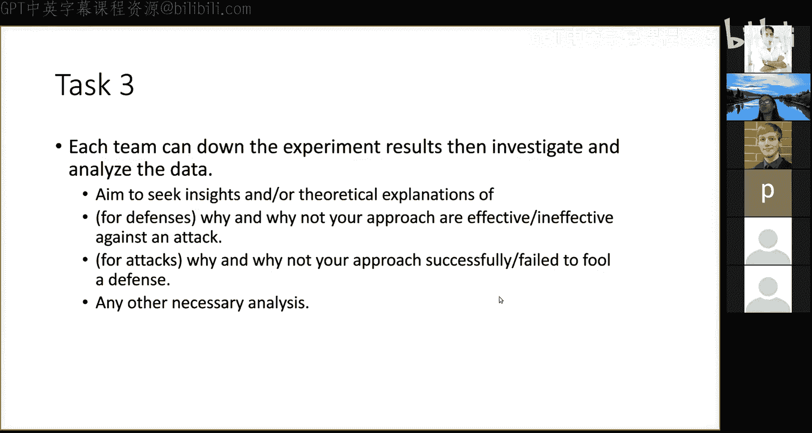

Yeah。

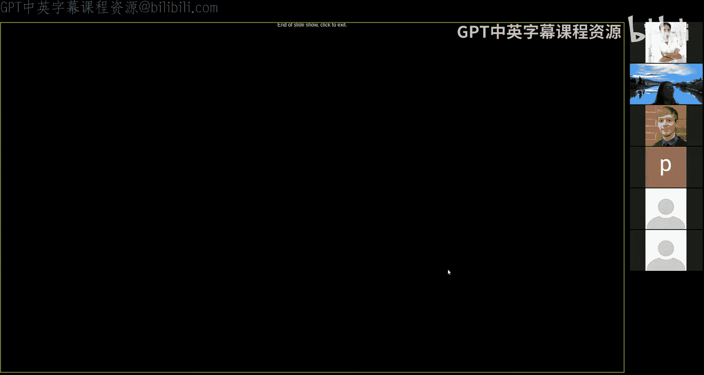

Yeah。I think that that's pretty much it is。And I will add something on the， on the report。Yeah。

 so write the report。 Try to write the report in a scientific way。 I。

 I think the formalized definition and notice。Notations will help you to do that。嗯。Yeah。

 is there any further questions Am I lost。Any questions regarding the， the project。Could you hear me。

Yeah。😊，Okay， thank you Pre clear， Yeah， it's just pretty clear to me， I think。Okay， great。

 So if you have any further questions， because currently we we just went through this very far very。

 very quick。 So if you。And later you have something you don't understand。

 You can just open an issue here。Any， any questions or any problems regarding the project， we can。

 we can new an issue here and you can assign to me。For example， here， assign me。

 You can assign to me so so I can get the notice。And， and I will try to。Rely as soon as possible。

Okay， actually， we don't have the option to assign issues since we're not part of the repository Oh okay then that's fine I will check it every night Okay。

 I will check this every night if there are any unsolved issue I will I will answer that。

What I originally did was I used like@ Yingmang du to make sure the notification went through。

 so I think that would also be helpful for anyone。Yeah， but since I， I might have some other。

Stuff to do in in day。 So I will check， check the issues。 Check the Piazza every night。 So。

 so I will answer all the questions within 24 hours。Sure yeah， yeah， thank you。嗯。So。Yeah。

 the code has been uploaded， has been pushed here。 You can get the code from， from this。

And here is the requirements。So our， so this， this project was based on pie torch。So。

 you simply install。好。An a counter with pie torch。 And then， and then here。Here is the requirements。

 then install all the libraries here， so I think it should be good。嗯。Let me。

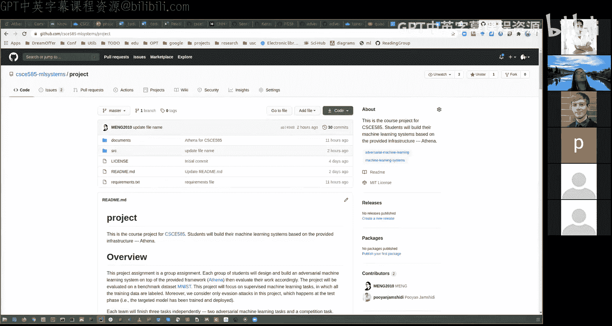

Get this。Okay， so here， here are this folder in this folder。 I will put all the documents。

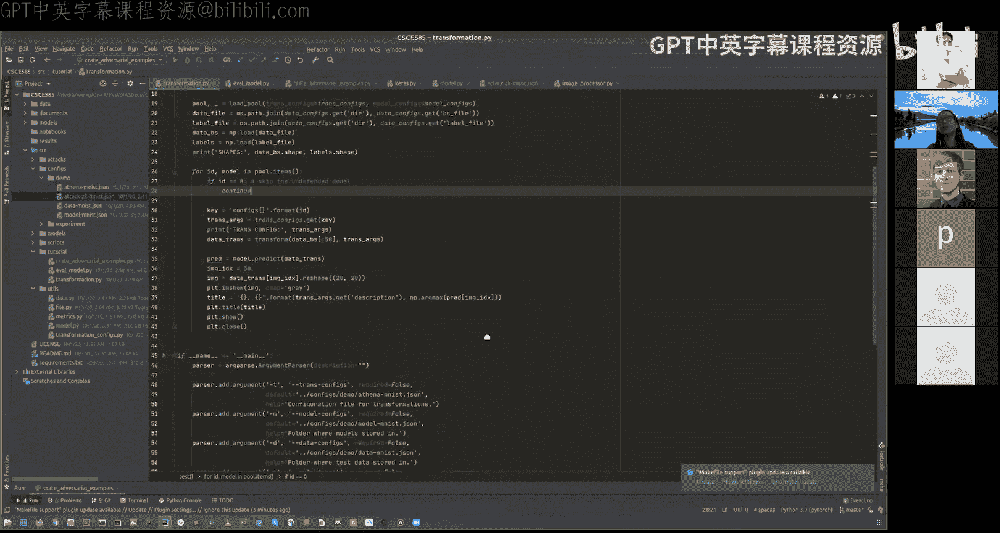

In here。

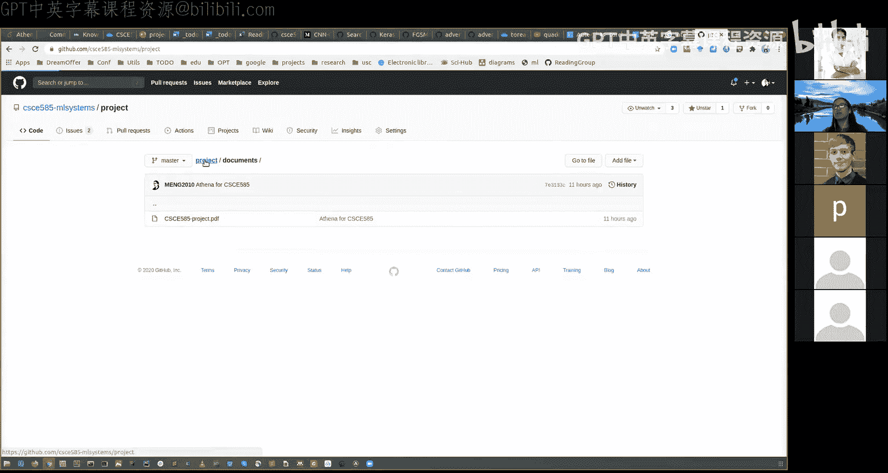

So。Could you recognize this。Is it too small， I mean， I'm not sure。

That seems just fairly big enough I can read。I'm sorry。 I could not hear you。 Oh， it's too small。

 right。 Okay， let me try to。😔，She。谢。嗯。Yes。好吧呢。Yeah， that's good， I think Yeah， that seems fine。Okay。

 thank you。Okay。M。I don't think I can enlarge this。

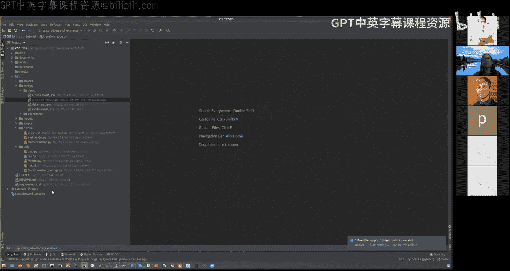

Let's。

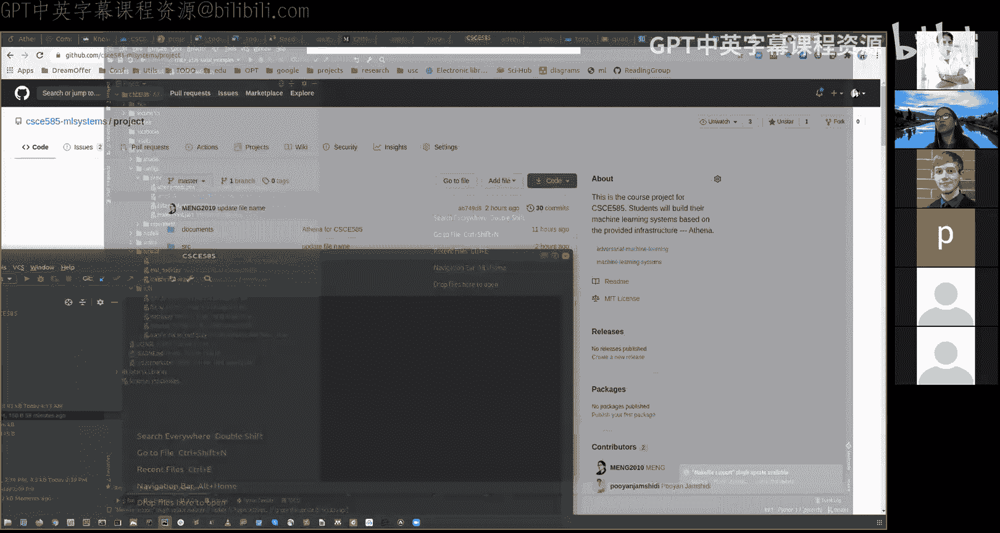

Check this。Yeah。So all the source， all the source code will be under this folder。 So in here we have。

 I will put some tutorial in in this folder。 So later you， you can check it out。嗯。

So we have some folders， thes。 this will the utilities will be put in here， for example， here。

For beta。I will。Maybe you don't。 You don't need this at all。 I mean， in， in this project。

 because this。These functions are for the C00。 If you are not using C00， you don't。

 You don't need this at all。And the file here， I try to implement some。I O operations。So。I will read。

A list from， from a text file for you， and。Load a dictionary from from Jason。

And dump a dictionary to pure Jason。嗯。I can， also。嗯。SaSave a dictionary to a C SV file。嗯。Also。

 we can load。嗯。From CV。To a direction。Yes， sorry。Matrix。So here， I think basically， you， yeah。

 this 1 I in here， I provide。This method help you to compute the rate error rate because for。

 so for the adversarial examples and your defenses， you you always need to evaluate your。

 your approaches and your AEs。So this one will help you to do that。嗯，毛的毛的。Yeah， so here。

This this method will help you to load。To load a pool， so。And this one。

 this just flowed a single model。A single CNN model。 That's this was for the banana version of。As。

So it will load CNN。 I， I will add one。 I will add one more to load S VM， because in here。

You can choose to， to wrap the。For example， the the CNN I provided actually was trained。

Was implemented in cars。 But later we， we move from Tensor flow to pipe torch。 That's why we。

We implement。 We provide a wrapper to wrap that model。 So， so we don't have to retrain a model in。

 I mean， on a use pie toch。 So we， we wrap a。Tsor flow model to to a high torch model。Okay。Later。

 I will， I will provide another API to wrap an SVM to。To the one with to。Yet to。

 to the one we supported here。And transformation configurations here。 So here， basically。

 we defined some。So。Yes。So for each type of transformation， theable the tunable parameters。And some。

 and some are。S sucktypes。Will be defined here， for example， for the deno transformations we。

 we support a wavelet and in something else。For the noise transformations， we support Going。

Poison salt， pepper， something like that。And this one。defines。The， the category， the big。

 the highest level category of the transformations will support it here。Yeah， models。

 So this one may be the most important part here。So the cars here are。

 this is the wrapper to wrap a Tensorflow or carro model to。To a weak defense， we support。

So if if you train weak defenses， use the cameras when you want to load that model to use that model as a weak defense in your ensemble。

 you need to wrap it using this method。And this is for the piei torch。

If your model was trained using a ptorrch。So you， you need to call the weak defenses we defined here。

嗯。And this ethena， we define the ensemble model here。So，Yes。So。You need to provide。Where the yeah。

 so you need to provide a list of。Classifiers。 so these are the weak defenses。

And the strategies you are using， the strategies we are deep。We defined it in here。 so you can。

 you can call this。Unsemble strategy， for example， you are using a majority voting。

 So ensemble strategy， do Mvy do value， something like that。Okay。I think the。耶稣。The most important。超。

Primeterters are here。 you need， you must provide a list of classifiers。So here， the。

 the classifiers must be the weak defenses。 We defined it here。 So you must。Convert it。

Using this weak defense or the pie or the one defined in a pie torch。Then。So， it is。When yeah。

 so here the the wrapper for the for the weak defenses。

 you need to provide the model you want to wrap yeah， you need you want to convert。

And the transformation configurations here， I will show you how to define this configuration。

So in this configuration， you will define the the type of the transformation type and some tuneable parameters。

And if you want to use a logic， make it true。呃，Then for the rest， you can just keep， keep them。

Ass the default value。So after you convert your rig defenses。You can， you can。Build your ensemble。

So these classifiers must be either the carriers of Pythtor should we provided。

So you need to provide a list of classifiers， you need to provide the strategies you wanted to use and here this classifier weights。

Classify with。This is for you to to do the extension。

 So currently we just use use equally weights for the for the for ethanna。

So when you learned some weights by， I mean use another approaches， you can fit the weights here。

This with is actually a vector， a vector of some。Yeah。

 a vector of weights is just like a vector of the probabilities。You get。So if it's。

 you if you are using ethena， the vanilla version of ethena， youd just keep it。Then， we will。

We will make it equally weight here。Yeah， if you have any question， you can ask。If you。

 you cannot have you cannot ask any questions right now， you can ask questions later after you。

Check the code。You might have some thoughts。 So this image processor。We define。

 we implement the transformations here。 So all the transformations will be implemented here。

 rotations， translations， flipping and。嗯。Others， so whenever you call this function here。

 this is the entrance， so。So when you call this。When you wanted to apply transformation。

 you just call this transform。 is the this is the data you want to transform the images。And here you。

This should be the transformation arguments。So。This， actually the transform configurations。

 I will show you the configurations later。Oh， there's one， one very important things here in Ethena。

Order images。Will will be skilled scale in 0 between 0 and 1， so。The。

 the pixel values should should be in 0 and 1。 I know， I know some of them may use a 0 and。To55。

But we scale to0， and 1。So here we define the models。嗯。Here we we find the attacks。Is。Yeah。

 so here we define the， the the attacks we supported here。The other the other a。

You will not use the other APIs in in this project。 So this one you might。

 you might want to use just to track what type of attack we supported。嗯 the attack。

So the main entrance is the generate。To call this function， you need to provide the model。

 So this is the target model。 You wanted to generate the adversarial examples based on this model。

So the data， the the data loader actually is a is a tu。Consist of the images and the true labels。

And the here are the configuration for。The tunable parameters for each attack。And the device。

 if you want， if you have GPU or something， you can， you can。You can specify this to GPU。

So this is the entrance for the， for the attack。 You only need to call this function。

Question for that model that that model we pass in that would that be one of the weak defenses like or a model wrapped in one of those weak the weak defense or yeah。

 yes， wrap yeah。Thank you for asking。 Yeah， that's a good question。So this model。

Since I have implemented the ensemble for you， so in here for this attack。

ItsThere's no difference between a single model and an ensemble。

So you can this model can be a single weak defenses here， a single rig defense here or a ensemble。

But you need to must must have to。Defined as an ensemble。Class。Okay， I I this， this configurations。

Will also be defined in a configuration file。 I will show you later。嗯。So， these are the attacks。

Anything。So the scripts， usually I just put the the scripts for my experiments in in this folder。

So for example， when you need to train a model or you need to generate some adversar examples。

 something like that， everything regarding the experiment。小度的。😔，Conrations， yes。

Here I will put the configuration file。 So here in this experiment。This。

 these three configurations are the configurations we we defined for the for ethena， so。Basically。

 when you get this， this file， you will get the。The vanilla version of Ena。Because we， we。

Each weak defenses， each weak defense is associated to one。Transformation， so you will define the。

 the transformations here。So the first one here，0 is the， the clean model is the unefended model。In。

 in asna。And the rest of them will be the 72 week defenses。For amnes。So you can see here if you。

 we have some weak defense associated to rotate。And。This one， I simply use this one， I mean。

 for the for description， describe this type of transformation and I you can utilize this。This。

 for example， as when you name the， the trained model or or something like that。

 So this is customized。And this， so for a rotation， we need one parameter。Angle， so。

Rotate  90 degrees， rotatet  1，80 degrees， something like that。 So for for translate。

transformationformation， it requires the offsets。So offsets in X or offsets in in Y。

 So this just the name you you you give it， it won't be used in anywhere。

I just use it for the name of the trained models。So， you can see。Here。

So different type of transformation will have will require different parameters。

so here are the other values for the vanilla。For the weak defenses in vanilla Ethena。嗯。

Here is the data。So， the data。In this Jason file， I define all the adversial examples we generated。

So。So all the all of them will be located in this folder and the be sample。It's this one。

 And the true label will be will be this one。And the rest will be the averar examples we provided。

I think in total， there are 45 of them。So when you evaluate your defenses。

 you don't have to evaluate， I mean 45 of them， you just choose maybe one or two from each type you can see for FGSM。

 we have different epsilons here。For， for this B IM。L to normal。

 we have different orders of different epsilons here。You just choose one or two。 That's， that's fine。

Because it will take time and yes。And this model。Yeah， so here this。

 this one just helped me to define。嗯。Define the model for， for the names when I load the。

Load the model。 load a tool。 So， so this just help me to define， for example。

 the prefix of this model name and the post fix。 And。

 and then here I will connect the transformation description。And here is the location for the。

 for all the models。So， that's it。Here I have， since we have 72，73 weak defenses there， I。

 I define a smaller subset here。So for， you can， you can use this as a demo when or for debugging something like that。

 You can， you can even， you can even make， make this even smaller。嗯。Yes。

 I think that's pretty much a。 It is。 Let me show you some code tutorial。

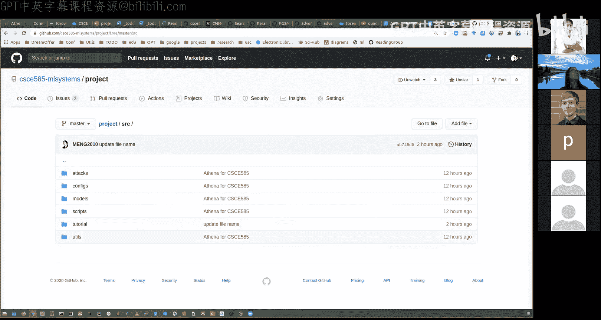

So in this tutorial， I just。Test the transformations。So， I。It will require some。Prameters。

 the transformations。The hardware， I don't think it has any。I think， basically， currentlyly。嗯。For am。

 if， it doesn't have much it doesn't have a high requirement。On the hardware。

So I think maybe I think all of your desktop or laptop should should work。It should work fine on。

 on your， on your computers。But C400。 That's a different story。So to run this， to run this。Program。

 you need to。You need to provide a。Transformation configurations。 So， for example。

 here are the ethena ammyt。And you need to provide the。Model configurations。Its。

We just show you that。It's the model。So in here it just defined the location of the models and the prefix of the model names and the postfi of the model names and here the data here here are the where the testing test data locates。

And the names of the， of the test data。So it will will require an output。For， for the。

 for the experiment results。And I， I also provide something like the the， the mode。

 So if it's in debu mode。It will try even smaller subset。For example。

 we have10 case in the test data。In， in this debug mode， we， I might only try like，10 samples。Okay。

 so after you get those， you， you will load the configurations。

 You can call this function load from Jason， and it will load。

It will prepare these configurations for you， and then。And here。呃。So we can load a pool。

Load the data and then you can call this transform transform。It will transform the， the data for you。

And then in even in this debug mode， you can plot the figure。To see how it looks。I think， maybe。

Is it。It's time。I think it's it's time， right？You can， if you need more time。

 definitely feel free to continue better to finish it today or if you feel that you need more time Yeah I guess just five。

 five more minutes。 Yeah， absolutely。Yeah， so this is the example to generate an adversarial examples。

 So after you load the poll the。With defenses。 So the first one is the， the unefended model。

YouYou can get it and pop out from your pool because this is not a weak defense and then you can build an ensemble model。

 use the weak defenses， use all of the weak defenses and you need to specify strategy。

 So here I use adversar probability。And then。Here is the。Attack。Yeah， so the attack。

Attack the configuration here is the example of the attack。 So here， basically。

 you need to define the type。You need to provide the value of because this is an FGSM。

 You need to provide this itsps。You can also provide the batch size if you want。

 But this is not necessary。 batch size is not necessary。 Only these are epsilon。Then。Here。

 this is the entrance。Of this attack。 So we simply call this function。Generate。

 if you want to generate a。Gener examples in the context of a zero knowledge flat model you fit。

You you use the unefended model as the target model。

 If you want to generate adversial examples in the context of white box threat model， you simply。

呃 feed the。Use this。啊。Unemble model as the as your target model。 So simple is that that。

 So basically， I have show you how to how to do your task  one and， and option one of task 2。

 So basically， you simply change this。This unended model to an ensemble model you you just done your task。

 too。So， so that's it。So that's it。 that's， that's， I think that's the。等。How to。 Yeah。

 I think that's the the main points I， I wanted to show you。About it， about this Edna。

I will provide some tutorial on the GiHub so you can。 you can check it out。And maybe。

 maybe you can download the the source code and play on your computer then。

 and you will get more familiar with it。Yeah， thanks， time。 that was excellent。

 So as you can see your project， your task would be really easy， right。

 Yes we expect you guys to do some creative work。We are really looking forward you to go beyond the expectation and do some amazing work。

 learn something new。And try to come up with some very interesting either attack scenarios or defense or any extension hopefully of Ana。

 so we are very much looking for what this you know surprises like if you could surprise us。

 that would be an excellent sign。So we are really looking forward to these surprises Do you guys have any any questions we are here and happy to answer yours。

Yeah， you can。 You can also ask questions on Github or Piazza。That's fine。Yeah， if you want。

 you think you need more time to， to get familiar with this， this stuff and。

 and then maybe you will have question later。Yeah， definitely， so again to emphasize。

This is quite important， right， please。Really pay special attention the way how you need to deliver。

Your code report and everything， so once you announce your team through the follow up issue that you already see。

In these people。Then we you we will add your GitHub account and all of you need to have GitHub accounts right so there's no excuse you can create free Gitthub account。

U。And like the way how Cody added his team， you do follow the same。

 like list of people with the As P account will add you to the organization。

And then you will be able to create。Your own repo， and that's the first step， right。

 you want to have one reple with proper name， like whatever name you want to to come up with and try to push your code。

 your update as frequent as possible。To these people， okay。

And this is also helpful for facilitating collaboration between you guys right you don't want to share the code via email or something like everything should be on Gi that's what we prefer and don't worry like。

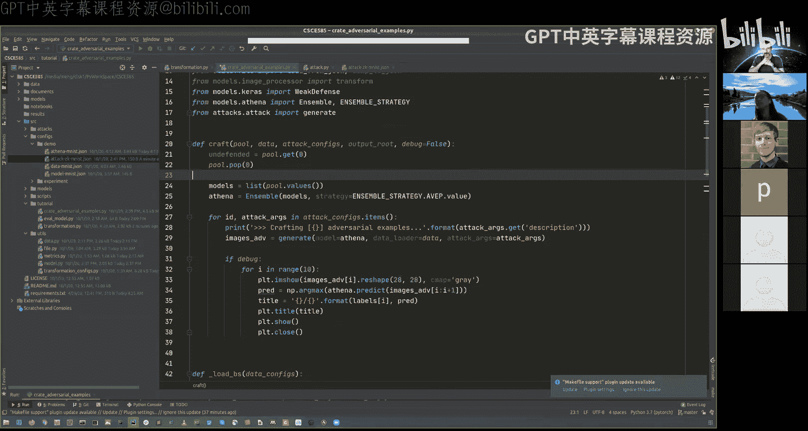

We don't look at like your code unless you tell us so don't worry that your work is not complete。

 we don't look at it and we don't have we don't evaluate it unless you tell us so don't worry about that aspect。

Try to use this platform for communication， you can also use like issue tracking for within your own GiHub Github Ripo for for example。

 for the activity you plan to do actually you can you can also。Yeah， actually。

 you can also utilize these projects to manage， manage your， I mean， project。 Yeah， yeah， yeah。

 this one will help you to， to track。 You can see here。 You can check the， the changes。

 You can even define the milestone or something like that， yeah。Yeah， this is tax formation。

 This is excellent。 Use this feature， new feature of Gi。 This is something quite useful。 Yeah。

 you can yeah， you can assign you can connect the issues with with some tasks in in your projects。

 So when， when your， for example， when some task has been done you it will close that issue for you and move to the next next stage of this。

So。You can try it。 it's， it's fun。Yeah， yeah， it is。And。Yeah。

 we are really looking forward you guys to work really really hard for for this project。

 because it's going to be useful for。Your understanding of machine learning systems and this as you know。

 it's one of the most exciting and hot topics in machine learning and going to be very useful。

 especially the key reason that we emphasized on。Machine learning adversarial machine learning is that。

This is going to be useful for systems， and future systems that will be out there soon。

Already there are other， right， so it's for a reason， good reason。Yeah。How about just for the one。

1 last thing I wanted to update。 So for this task to option 1。 since you。

 you just see that you don't have to do anything， then you can get all the things done。

 So I wanted to allow this allow all the groups to select this。 So I。

 I will encourage you to to do some other stuff first， if you， this is just a plan B。 if you。

 if you cannot work out for example， if you， I mean， in the last week。

You you still cannot get the new approaches done。 Maybe you can simply generate some A Es。

We provide it and do the analysis something like that。 So you don't have to worry about the， the。

 your credit and you can， you can try new things in the， in the first two weeks。 Something like that。

 How about this。That that's a good idea。Yeah。Yeah， and we are open to any suggestion， right。

 if suggestion would be useful for you guys and would be fair for all of you。

 So if you have any useful suggestion for making any changes that you think would be useful and fair and。

To this project description， okay？诶。Maybe think less about the percentage of the score and grades don't think about grades at all right as long as you do grade work don't worry about your grade this is the next thing you should be worried about focus on interesting surprises or but if you do have any suggestion that could improve this project description this is really would be helpful especially at this stage right El later if you do have any suggestion that would clarify things。

Please create an issue， and suggest yours。That would be useful for us。

 and we would really appreciate it。Yes， since this is the first time we are doing this。 So you。

 you will help us to develop this class。Yeah， this course， yeah。Thank you。So I I， I don't have any。

Comments great thank you Ynk it was excellent。 Thank you I did have one question Yeah Yeah。

 so do you want me to put the preferences for task team would you prefer them in Piazza or would you prefer them in the team formation request in the information everything in team information or any other issues there right cool so yeah。

 because we would like Piazza to be mainly for communication， but not for you know， keeping track of。

The project， everything about the project should be on。On， yes， we。

 we prefer everything regarding this project on Github。 You just new issues。Thank you。

 so we can track this and we can improve this project next time。 Thank you。

So if there is no question， so thank you， it was great to see you again。

 so looking forward to this and have a good weekend。Yes。Thank you， you guys have a good weekend。

ByeThank you too， bye。

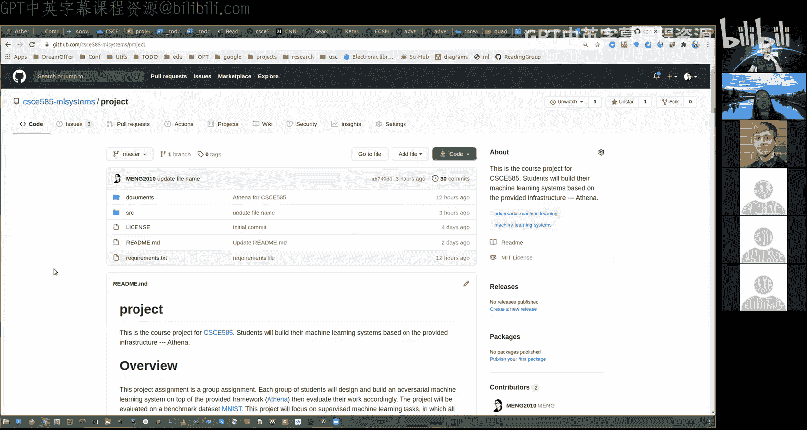