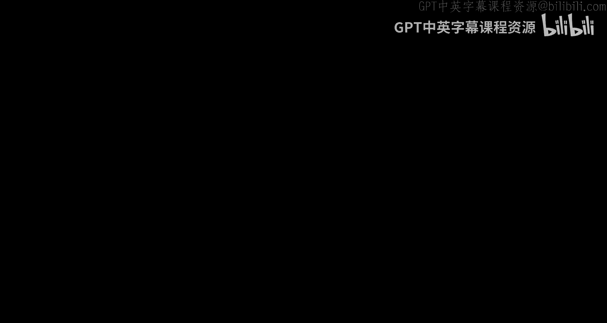
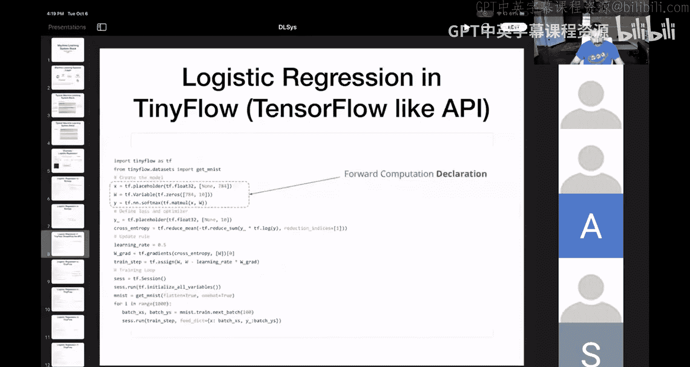
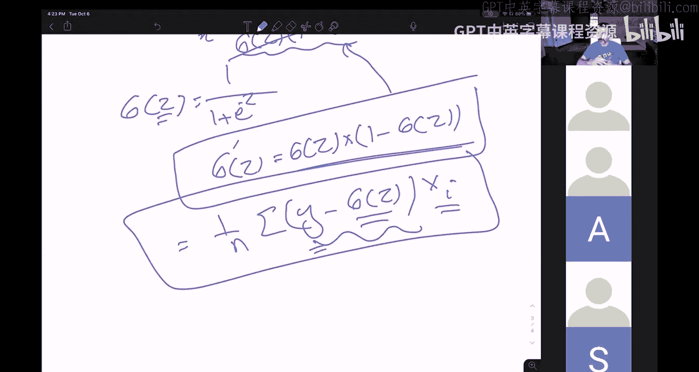
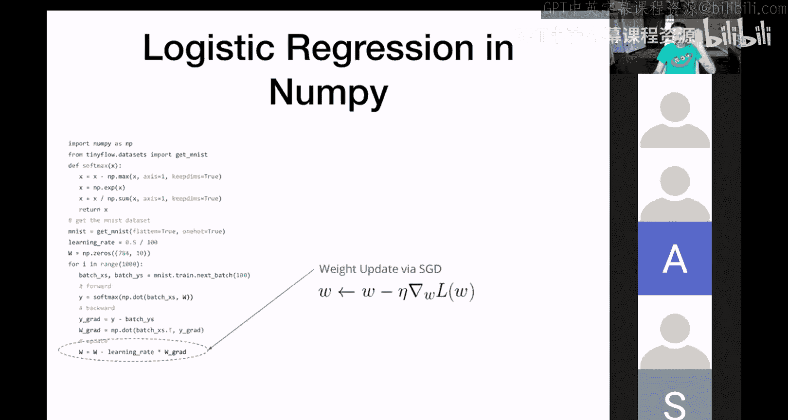

# USC《机器学习系统｜CSCE585 Machine Learning Systems 2020》中英字幕（Claude-3.5 p11 -11-Lecture 6.1 - Machine Learning System Stack.zh_en -BV1Xc9bYVEC6_p11-

Okay， hello， everybody。Today， we have。We are going to discuss something interesting， as always。

It's about system so let's a step back and think a little bit where we are at the moment in this course right so if you remember we start talking at the beginning at the very beginning of this course start talking about high level overview of。

Machine learning systems right so mainly we started by mainly defining what is a machine learning system。

 what is the difference between what is traditional machine learning。

And why we call this course a machine learning system course。

And we talk about some of the challenges of these type of systems in practice。

And then we had several lectures on kind of governance of these systems of what are the。

Key enablers or what are the kind of tooling that we need to construct a system in a principled way。

If you remember， we talk about these DevOps tools that it facilitates the process of building machine learning systems。

After scared。And then after those lecture we changed the focus to some theory。

 we started by talking about some fundamental theory of classifications。

 specifically if you remember， we started by。By perceptron a very simple classifier and then we make it a little bit more complex we talk about multi layer percepts。

And then we also talk about。Based on the intuition that we build based on these multiclass regression。

 logistic regression models， we build the intuition。

 how we could build a deep neural network based on these very simple models basically adding more stack of layers to learn。

Appropriate representation that we can feed into these logistic regression models and then we also looked at a different category of classifiers naive base which are basically probabilistic and we discussed about these differences right。

Now。Now， we have。Some intuition about the fundamentals。Then。

And nature question is that now we know a little bit of like high levels stuff about machine learning system。

 we also know a little bit of theoryry then how we could implement things right this is a nature question and this is timely because。

We are starting to think about and work on your project。

So asking about implementation is very natural， right， and it's timely。At this point。

 this lecture and a few other lecture we have is mainly we are will talk about。

What is the connection with the implementation right so mainly we call it system as stack。

This is what we want to talk about and more specifically about machine learning。

 I'm sure that you have heard about some of these frameworks that exist out there right so from Tensorflow probably the most popular was To。

 CNTK for Microsoft for example， Chaer Pytorch which becomes more popular these days。

So draw there exists。Many open source framework that。People have used a lot extensively for research。

 as well as practice in industry， so。And it really depends it becomes very confusing， okay。

 which one should I use？And this is a very natural question and today you are going to。

We are not aiming to talk about a specific framework because this is beyond。TheDiscourse。

There are loads of documentation tutorials。Like lectureects， stuff about these frameworks， right。

 This is， this is not about this course， right， So we want to understand what are the principles。

Behind these frameworks and how we can make a sense out of it or。

But we should know about this framework that help us to choose one over another。

And how we could use these framework books to build the system that we want to build based on the requirements that we have for the system。

Or constrain that we have for a system right and we talked about this constraint a lot right so for example。

 when we want to deploy a model on a mobile it would be like imagine that we want to develop a model and deployed on something like this right so this is。

 for example， a very simple simple。This is called coral。

You can deploy even neural network countriesdies。And run your model， get your result。

 Or obviously this this is very small， right， You cannot fit anything here， right。

 You obviously cannot fit a deep network here， but。

There are like different devices like this is another one， this is also from Google。

One of the T P platforms， it obviously has。Higher capacity than this coral， you can run。

larger models here。There are lots of other kind of hardware platform with different spec and with different。

 you know。Memory sizes。CPU computation capability and so on。

That you can use so we are going to talk about more practical stuff again。

 but from a different from systems perspective and with respect to these kind of frameworks and but before before we go into some details I would glad to ask do you have any question about where we are or maybe about。

The project， if you want to ask， this is probably a good time to ask your questions。

The only question I had about the project I had posted an issue about。

 which was just the setup of it， I think。I had issues resolving dependencies and some of my teammates also did as well。

I didn't know if there were setup instructions。I rewatched the lecture for that video or that for that demo。

 and I think the only thing Yingming mentioned was that you install it with Anaconda and Petorrch。

And the requirements so I don't I don't know I thought I'd bring that up just so you could right that's a good question so you could you face the issue probably yes that's a good thing that you create an issue for that Ying will look at it we' get back to you and please do so right so this is a good time to to go and play with the code Ying is developing tutorial for you guys to。

Get you set up so you can start。嗯。Like in preventing。The system you want to build， right？More easily。

And hopefully this tutorial， I'm sure that this would be very， very helpful。 Obviously， it would。

Maybe。Is as detailed as。Makes in a point that makes I feel that like it may make some of these task very trivial for you。

 but that's fine we aim to learn and that's the goal of this course。

But then you may need to more more focus on the creativity part right， so come up surprise us。

 that's what we expect you to do。Any other questions you want to ask？

I have one more question so in the past， I worked with the Tensorflow and this course is using more so pietorrch Ge adding any particular reasons as to why this course prefers some。

Tenssorflow over pie torch， I know from my academic standpoint that pieytorrch is more preferred。

 but I've never really understood exactly why。There is not actually。Much preference yeah。

 so the research committee now because of， you know Tensorfer was the first kind of framework specific for deep learning systems。

But Facebook recently hasnt spent a lot of， you know， effort to。To make Pythtor。

Somehow even more capability than Tensorflow in some sense。

 make it easier for developers to write code back faster， more efficiently。

And we have many researchers now write their code using Pytor， but they're essentially done。

Even though you may prefer for some。Reasons， but really you need to step back and think what is important for you。

Whether。The kind of system you want to develop the utility you need。

 you can find more stable utility in the community of Pytor or Tensorfer that's a question you want to ask and you want to do a little bit of research to see。

Which one is more suitable for you because the more stable and more active community。

 specifically about the project you want to do， you have around the framework like maybe that's a major choice and for Ying I guess。

She finds out that she can find more of these utility Py more recently。Thank you。Sure。

Any other questions？quick one in the project overview on GiHub or all that will you add。

Due dates for all the other tasks。 And you already talked about task one。

 but is that something we can add to the read major just so we can keep track of that Oh。

 I thought probably we have to due date for all tasks then。 If not。

 could you would you mind creating the issue for that。

I think Yin had the due dates in her presentation I forgot。

 but maybe she forgot to put it in the description， but yeah。

 if you create any show would' appreciate it。Yeah， okay yeah I can rewatch the presentation too。

 but yeah， it'd be nice to have it further the Yeah that's good yeah that's a good point if we did not mention it we should yeah。

Okay， so let's start。So at a high level， if you want to think about system as stack for machine learning or。

Maybe more specifically deep learning， you might want to think about not one layer。

 but multiple layers。Of of code specifically that take care of different aspects of what you need at a higher level。

 maybe you need some API， some kind of library for calculating the gradient because like in。

The essential thing as we discuss of the calculation of gradient for optimization task is important and like this is a basic utility。

 the most fundamental utility that you need for all machine learning models or systems。

And then at more lower level， maybe you need some。Computation graph optimization and execution will talk about these。

 what it means， what are the benefits of that and some runtime parallel scheduling based on top of these graph computation graphs like modern basically the key idea or the key innovative idea behind these frameworks was really the idea of like。

Rather than doing the calculation in an ad hoc way。

 having a model or computational graph based on the calculation or based on the model that you construct and we will discuss why we need such computational graph and what are the benefits of those at a later part of the lecture。

This is this layer。was actually the most fundamental layers that provide a lot of benefits for computation。

 especially for machine learning systems？And like the lowest layer。

 which is more closer to a hardware， you need some sort of like， for example， kernelnel code。

 some optimization， utilities。And some accelerators which are really closer to the hardware and their domain specific。

 and the closer you go down and get closer to the hardware， the more domain specific it becomes。

The upper you go to this stack， the more general it becomes right。

 so in terms of the underlying hardware and the goal of these。

A stack is to make end user because previously if somebody wanted to develop a machine learning system needed to implement all of these by themselves。

 which was costly， so they needed to implement some optimizationization code maybe for a specific harder platform that they wanted to run。

Or doing all of this in an a ho and， you know， non principle way。

 but the benefit of this framework is that。provide these clear cut boundaries between layers and you can escape with this layer wise design。

 you can really build systems that escape。In a principal way。

So let's start by this high level user API to see what it means。

 what what we mean really what we have。 So let's let's maybe a start by。

Talking about logistic regression， basic model that we started it。So。If you remember， we had this。嗯。

Input the input the Xs coming from this pixel valve and we have extensive to talk about that so I'm not going to spend much time on this and then we have some way of calculating the intermediate activations。

And we discuss about， like。These weights that we need to multiply to the inputs and doing some。

 you know。No nonlinear transformation like softms as we had in order to make the calculation nonlinear and pass it into another layer and be on top of this。

 right？Logistic recognition， but it's really a very simple one layer model that we needed to generate these activations and we had that fully connected network somehow。

So all all of these nodes were connected to all the the activation。

 the number of nodes that we needed for activation in this case like we had like。Right。

So that was a very simple calculation that we needed for logistic regression and again the question is that how we can implement it with something like Nmpy Python lib right Ny is one of those。

Pyon libraries that you can use。It provides some facilities for， for example， matrix。

 linear algebrabra kind of calculation for you， but it doesn't provide like。

Facilities for calculating the gradients kind of stuff as you get nature from a framework like Tensorflower。

So this is a very simple implementation of the same kind of。嗯。Logisticgreg。

Model where we have discussed extensively about the mathematical aspect oratory part of it。

So let's see whether we can make a sense out of what's going on。

So basically this code defines the model and the kind of calculation that we need for optimizing。

The model and by optimization， you know already that we need to find good weights that classify。

The example appropriately， right， So here。Obviously。Like you need piece of code to calculate softms。

 right， this is what you needed here essentially。Okay， so let's。

 let's see how this was implemented here， right， So here is the code。They're really。

 in a very simple， but yet elegant way， define define softs。

Using the non C here NP so basically it started by import NP N and it uses some of the operation that you need like some for example。

 for a vector。And like some Op mathematical operator like exponents。

So and the conclusion is really simple and the code is very very much readable。

 so essentially this part is the most important part of the code where where you first。Exponents。

 the input， so if you have x， what you need is really to calculate E。

Divided by going over all elements of x for basically calculating softms。Allright。

 this is what we had for。For software。嗯。Like啊。Okay， one thing， right？Again。

 like one suggestion that I have like in order to to understand and to work out。

Or to implement your code in the best possible way。

Like always good to think about and correspond with the math right。

 This is very important if you want to learn machine learning in the most efficient way。

You always need to think when you're writing code， you always need to。

To also think about the underlying mathematical intuitions。

And that's really important right so for example here you see this line of code。系。

What it does is really， you see that。It finds the maximum value of x x again is the。

Is the input to this function softm is a function right so it goes over all elements of x and give you the maximum value from this vector。

And it。Basically， deduct this value from all elements of the vector。Do you know why， why does this？

And whether it makes any sense。Is this some kind of normalization？

What kind of normalization it is and why it makes sense here with this equation。

It's going to make the highest element zero and all others negative。喂。Yeah， that's good。

Good thing why does it that。I mean， youre you're finding the highest one and subtracting the highest one from itself so you get zero there and then in every other case you're。

Finding something less than that subtracting the highest so you get a negative and so when you take the exponential。

 you'll get something less than one。Right， so let's maybe ask two questions， right？

Why we want to do such transformation and whether。嗯。It makes sense。Right。

I haven't still yet to re why we needed to do such transformation， why we， we don't simply。

Calculate whatever。We had in the formula， right， and the formula was really simple。

 What we wanted to to， to do is really to to maybe only like have have。These two lines of gold， okay。

So why， why we may need need at least。So obviously， like the。With this。

 you could get whatever you needed for this equation， right。Is that correct。

So if we remove this line of gold weather， you would get the same。Vibit。So this is what it does。

 right， They really exponent X and they divided by all of these E X I， right， You see the song here。

Some over like。Is the purpose like an issue of？Math with like large numbers。

 just like floating point error or missing missing like not floating point error necessarily。

 but like。If you're doing these operations with really large numbers， then。

You might run out of resources， you might have overflow issues。

 so maybe you try to make all the numbers I guess smaller in a sense。

 I guess that's with this you're bringing everything to zero or negative and。

I think maybe this reduces that possibility。Yes， that's a good point right so we discussed about like and you know that like I presume you have already a good sense of like the limitation of any compute computer right so you have limited resources to a store and execute things right and if you have a very large number like if your' X what the excess access essentially like when we have。

Soft marks of x， x is the activations， right？😊，And the activations coming from these maybe giant。嗯。

G inner product of values and your input right and this could essentially become large really depends on your input values and the weights the value that you feed to your soft Max right this is the thing that you fit to your soft Max okay。

This might overflow if if this is large， right， So because as a part of soft mass。

 you need to calculate the exponent。 So if this is large。This could overflow。Okay。

 I'm overflow of for those who are not familiar meaning that basically。

Your computer cannot represent this number by。By whatever。嗯。

Representation of your floating point you have right because for floating for any digits in your computer you have a limited amount of memory right。

 but at least 32 or 64 bits or whatever。So we can represent it like a certain real number， right？

And this is a simple trick， simple trick that you want to。

You want to do in order to avoid this overflow。A very natural question could be whether we mess around with the mass or not right because like we don't want to calculate something which is which doesn't make sense and can you tell me why it does make sense。

In terms of mathematics， right。If there's no volunteer probably， we can work it out together right。

 So you remember like for let's imagine like we have like activation Z1， Z2。I z three。For softms。

 we have this easy one。Easy  one plus easy 2 plus easy。3， okay。This， this was the first element。

 The second element was easy to divided by。Easy。1 plus  easy2。As easy。re。An easy tree。

 right easy point。Iasy to。E。3。Okay， these are like the soft masks。Calculation。

 so what it does is that it finds out the maximum at it deduct the the same value from all all elements。

 right， So imagine in this case， let's assume that easy is the maximum okay。

So what it does is that it transform this to Z1 minus Z 3， Okay， Z 2。Minus Z。3 and。0， right。

So let's see what happens to this softm calculation really， so the first one would become E Z1 minus。

So we need to look at this， right？us Z 3。啊。So for this one becomes easy。L minus easy3。Easy to minus。

 easyy to。Plus， what？one。Last one， okay。Same you， night。The last one becomes one over。系。嗯。Okay。

 so let's see what we get。How we proceed。So you see that。But mask， you know how to do things， right？

Then this becomes easy one over easy。3， okay， easy， two over easy。3 plus。Easy tree over easy。3。

 right。This is the same， okay。So。You do the common denominator， E tree， right。

 So this become easy  One plus easy。2 plus easy。3。This is for your denominator here。

 You get also the same easy one over easy。3， okay， and then this one， this one。

 you get the same magic， right。So basically， by doing this。嗯。By doing this transformation。

 really you would get the activation or the same values after you pass it through this soft Max。

It doesn't matter， right。And this is actually true when you deduce when you deduct basically the same value from all elements of your activation。

 right， in this case we deduct the maximum value， but if you deduct the same value masses that it doesn't affect these softm calculation。

Okay。As long as you deduct the same value from all elements。So again， to build up some intuition。

 sometimes we need these tricks。But we need to understand why， in this case was avoiding overflow。

And obviously we need to make a sense whether we don't mess up with the mathematics。

 we don't want to calculate wrong things， we need to do the math and prove that okay。

 we get the same value the same function value as we expected we are not getting。

Any incorrect calculation。 So even though you could like， maybe。

 maybe you have a proof that like your input for your activation would not。

Would have an upper bath and then then you're free to remove this line of code you won't lose anything if you have it or not have it。

 but if you have it it avoids the calculation of when the activation becomes very large。Okay。😊。

So and then here at this line， basically what it does is that。

You have some examples right examples that was selected here right and associated。

 this is associated labels， this is the your input right excess。

From a particle batch from MEs data set， right， this digits data set and like it selected from it was selected from training training examples。

And then you calculated this dot product between input and weights。喂。Why input some days。

How you corresponded， why you have this。Isn't that how like you evaluate score kind of the weights times the input。

Yeah， so you had the math mask here right so basically you needed to have a do product of these weights represented by these arrows and the inputs right in order to calculate for example。

 for H1 you needed to have these Xs and the associated weights right in corresponding to these weights right？

嗯。And we discuss about the mathematics to calculate the this activation。

 So basically pretty much it does， it does the same， right， Its really that product of。

Input the thes and it passes through the softm basically what we what we needed to calculate here to give us the probabilities right you remember we discuss about like even if you use this。

Soft masks， we needed to transform it to some probabilities to make some trade off and distinguish between good and bad and this soft mask because of the properties we then select the。

The highest， the most probable class as your output。Okay， and then。

Once you have this and what is why， in this case， why is the。Is your output， right。

 whatever you get from from your model， Okay， so this。

This voice basically tells you the actual class label of your model， right？And then for optimizing。

 you remember we also had lectures about optimization right so far so far this this line calculated the。

The y right the class label that the model thingss right based on the current weights right so here you see W this is the current weight。

 right。And you see a loop here because we want to have a mean to update the， right this。

Sttochastic gradient descent， you remember we had discussed about this。

Gidian descent a stochastic version of Caradian descent because of this selecting a batch of example and doing this optimization process in an iterative fashion。

Hopefully， you remember this。Thisア。And then so the rest would be and you see that here you see really update to the weight right so you have this learning rate which was defined where here right you had this learning rate that you defined here。

 you started with this zero weight。And then you， you updated。 So here， you see an update rule。

 So you。You deduct this。W grad multiplying by learning rate。To to derive the next set of weights。

 essentially doing this update， if you remember。Okay。You remember this update group， right。

 So you had this learning rate and then。You needed to calculate the gradient of。

Of your loss function or cost function right the with respect to the weights。

And then after multiplying with the learning you needed to update this。

 the current weight deducted and then update it and then doing the next calculation with the updated weight this is the way how a stastic gradient and thisent actually works。

Do you have any question。Is everything to live for you？Actually。I。

 I'm a little bit confused with the code。 Still， what exactly is batch underscore X and batch underscore or Y S。

 I know thoses like lists， but。I'm a little confused to like， what they actually represent。Right， so。

You see here， so basically if this is， let's say。Like I know they like they to the Mminist variable。

 which I assume is some sort of database you're pulling from and then with the first I'd say a thousand0 examples you're pulling from it。

 you're like extracting two arrays from it。Right， so let's make a sense out of it， right？Here。

 what you have from Y is whatever value you get from your softmax。 And you remember from Somax。

 what was the value you get。Tll me。😊，What was the kind of value you get from Sos， how it looks like？

Is it a number or is0？Instruction。Is what。A fraction。Instruction， what do you mean？

A fraction in number。Right， what we call these numbers。Proability。Is wrong。

A probability probability right， there are these are probabilities number， right， So between zero。

 right， So and was it one number or it was a vector of numbers。Effective numbers。Vctor of numbers。

 right？And。Right， so and what was the size of the vi。Was it like 2，300。

 What was the size of the vector。It's the size of like the number of possible classifications right exactly so the size of white was really depends on the number of classes that you essentially have for your model。

So。SoI this why， I'm sorry， is this why you have W equals NP dot zeros because Mist means like。

It's like like a database where you have， like。Images of numbers and you try to to a classroom in this case。

 in this case， the size should be 10， right？Yes， so you have a vector of like， let's say。

 you have some probabilities， right？And this the size of this vector would be 10 and each of these could be like0。

1， for example， whatever it is， right？So once you get this slide， then you see that。

The code says that look at this label that you get from here， these are what are these batch。

What are these batchwise， Basically is the true label， right。第一。

You get this voice from your training set and this is supervised learning。 So you have this。

 this is your actual label， the true label that you get from from your training set right So you have this actual voice and then you calculate the difference between what you get from your model basically this the model is actual is the current version of the model based on the current weights right。

 really the model would boils down to the weights right， This is what you learn then you。

Calculate the difference between what you get。From the model and what is。

The what is the true label and the true label typically it is a vector of zero and once right。

 So it looks like， for example， if if this is digit8 the true label would be0。

00 and then one for like index index。I8 or basically。Depends what you call this index， right？

And then，0。And then。So this is for digit zero，1，2，3，4，5，6，8 and okay， so this is this is a kind of。

These are a kind of。This is how how this y batchwise looks like and this is actually a stack of a stack of batchwise right you have00 examples So for both both these y and and batchwise they're a stack of vector but imagine that like this is only one we use only one example to simplify so this looks like a vector。

And then and then it calculates the viagra by multiplying the。诶。The excess。

 the inputs with the difference between the actual。

 the true labels and the probabilities that was calculated based on the model and in call W Gr。

And then it uses double gra for this calculation。Does it make sense？Yeah， that  clarifies a lot。

But can everybody。Explain to me why you are doing this。And whetheram like。That because like so far。

 we haven't talked about the loss function， have we。I last function could be anything。喂。

So the loss function is really。So in general， I mean。

 like if you remember what we have discussed previously。

We discussed like a function about like in the lecture is what's called G T of W right if you remember something people represented as J of W or J of。

If you also saw J of Teta， So Teta and W or what the same like。You can call it to you。

 you can typically LLW is more typical than the other notations， or sometimes you see also cost of W。

Because sometimes it's also called cost function。 But at the end of the day is。

Function that you want to use for this right and again like NI here。Doesn't provide any。

Any calculation of this gradient， right， But we need to， I mean， if you， if you want to do the same。

 really with。It's something that Tensorflow you can do it a lot easier right so here is doing the same thing using a version of tensorflow it called tiny flow but pretty much is the same you declare these variables we discuss this and at some point you need to calculate these gradients right so here you define your cost function here。

 basically cross entroies your cost function。嗯。Which is a function that looks like this， right？あ。

Is some of the log some of the So， so basically， you calculate these wise pass through log and。You。

 you multiply by。This on。This voice， right？ So this is the true。True voice on the， the， the。

The true labor， right。And is this voice or the voice that you calculated based on the model itself。

And then this is the way how you define it so mathematically。It's basically。Is some over。hyhy not。喂。

Or more specifically， you want to distinguish between these voice。 So this is the the correct label。

 right， and this is the label that you get from from the model。嗯。

And this is what is called cross entropy， right？嗯。Maybe you have seen a version of this for。Yeah。

 here is defined right。So。But maybe for。For binary binary classs it becomes a lot more simpler for such thing right so it becomes really。

 so you can represent it as by log。Log of basically， your。Actation， like。This is this s。And。

I hope I don't make a mistake， yes。Yeah， this is。Okay。Yes。

 so this is for like for binary classifier where you have two labels， either one or zero。So啊。And。

 and， and then you， you then。You need to。Some over all of your Xs， right。

This is the correct definition of like your JO。都俾。Okay， yeah。But pretty much is the same。

 this is for the multi class version of it。So you define your cost function。

 this is called crossentthtropy。And then you do the same really， everything else is the same。

 but the framework， what it does is really。It is really giving you the gradient by default right so you don't need to do any any kind of math for calculating the gradient of your cost function or whatever you need so for optimization you only need to call this function gradients you pass it with your function and it gives you the gradient right so you now have this W grad and then you do the same right so you update your weights using this updated update rule so pretty much the same the same exactly here like this part you declare a stuff this part you execute the stuff。

We'll talk about this， the difference and the of like declaration versus execution。

I wanted you to understand the difference right with something that you get by Tensorflowop。

 which really gives gives you the gradient by calling one function and what you need to do here really doing the。

Calculation yourself。And to see the mass is really could be un'm interested if you discuss about the mathematics behind it。

 but really something that non quite doesn't give you the gradient。

 you need to do the mass and calculate that this gives you this basically this year calculate this line of code。

 calculate the。This gradient of the loss function or cost function。

 whatever it is with respect the value。But this， this line of code could be different if we had have had different loss function here。

 The assumption， this assumption is that this。The the cost function that we define is cross and tropy cost function。

Right。And we need to do a little bit of Mar why it makes sense if we do the dog product between this difference between Vograd and the transpose。

 this is the transpose of the excess， the inputs， it gives us。It gives us the whatever we need。

 it gives us the。The gradient of the cost function， right？Because again。

 the assumption here is that and we might have different kind of cost function for the model that that we have and if we change the cost function。

 we need to go back and change this line of code for calculating the gradient for optimization process。

Does it make sense？Is there any question， I'm a little bit lost。

 Where is the cost function in the N example。That's a good question。 And that's。

That's what we need right so really if you think about it right for updating this。

And that's why you don't see the cost function here explicitly， as you see here， right here。

 you explicitly define the cost function。 This is this cross entropy my cost function。

 And here is how I define it。And then you pass it through this gradient function that gives you the gradient of this cost function。

Because if you look at the mass right here is what you need right so basically you need to calculate。

Basically， the gradient of the loss。But you don't really need the loss function itself， right。

 as long as you have the gradient， you're good to go to update the weight， right？Yeah， right。

And this line of code really gives you the gradient of the law。 So for， as I mentioned。

 like for this cross enroppy loss function and。And in order to understand why， basically。

Y if we multiply x with this。嗯。So basically， what it does is really we multiply X the difference of what we get from the model and what we get from the true label。

 and that gives us。This dog product is just the。The signal， this gradient that we wanted to have。

 maybe let's do a little bit of math to understand this， but。是。Yes， let's。

 let's do it because that's not a bad idea to do it too， because it， it then gives you an idea why。

 and like， it gives you some idea。 like， what are the benefits of these。

Library such as Tensorflow that really makes your life a lot easier。

By automatically giving you these。嗯。This gradient information， right。And we talk about。

Automatic differentiation， because this is what these libraries does do basically in practice。

Alright， so let's maybe。Maybe start thinking okay what we need to。

How we need to start off by thinking about this， right？嗯。Let's define our model。First， the homework。

And the model is really the logistic regression， right？

How we did things in logistic regression really， what we had was like we calculated this。

We have some weights， right， and we calculated these。By， by the inputs， right。And this is。

This is how we。How we we got this。Have we got these activations or better called them？

Let's call them to be。Precise， maybe。The， I think it was。Because this stuff or maybe。

Maybe DJ annotate to annotate this better because ice is the vector going over the input space。Right。

Right， so so basically this is going over all all examples that that we have。

And these are giving us the activation and we then pass it through the sigmoid， right？

In order to give us the probabilities， right？So the cross entropy in this case。

 when we have such model。The cross entropy， I mentioned how you can define it， right。

 So you can define it as let's call it J。K of w， you can define it in in a。In a precise way， right。

 or maybe。Right， maybe maybe to make things simple， let's， let's consider that we have。

We have two klasses， right we have class as we had before like we have zero and one。

Then then this cost function becomes simpler so this is one over n right and then what you have here is you go over all examples that you have。

Log， nature log， right？Of， of。第三。嗯。Plus。So this is the way how your cost function。

I typically defined， right？是。Sorry， you have1 minus。1 minus。fi嘛 yes。This is basically， again。

 this is cross。Anthtropy。Cost。Function。Or loss function。Both means the same thing， right？嗯。

So this is， this is a function of。Of weights， right？

 So this by definition is the function of weights。 Why it's a function of weight。

 because we know that by definition， these。These activations are parameterized by weights right this is the connection right and really we want to we want essentially to find WS star okay。

To minimize the cost function。嗯。For us， right？Or essentially better better represented we want to argue。

面。Arcmin W， hopefully you're familiar with this notation， if you're not， please ask。

 so basically amin meaning that you want to minimize this cost function with respect to your W find the optimal weights。

That gives you the minimum value。If this is minimization because like the way how we define it。

 we want to minimize this function， the lastV function， right？AndThere are some。And again。

 like we don't have only this cross entropy cost function。

 There are no several different cost function that people came up it。

 but this by far the most cross entroies， by far the most。

Useful cost function that gives us reasonable results for classifiers。Right。

This is the way how the optimization works， right？Okay。

 so far so and we know thatalculating for calculating these for doing this optimization。

 essentially we also need the true labels， right？Here are the true labels that we require and obviously we need the inputs。

 the Xs as well， this is what what is impliced in this definition of the cost function， right？

And now what we want to really do is to calculate the gradient。Of these J， with respect to。

Double this is what we this is what we want to calculate。Or better。 it's better to， sorry。

It's better to annotate it correctly。Like since we are talking about the vector of W。

 this is the right notation。 And if we want to calculate the partial derivative of J。

 with respect to a specific。Weight， like weight is the vector， right， And like， let's imagine w。WI。

 right？Right， or。So we want to calculate this guy or better calculate。

With respect to WI in order to get a sense how this partial derivative would look like， okay。

Then this function definition should be enough， right， This is what what we need。

We need to do some calculation of the gradient in order to make a sense out of it。

So let's see what we have in order to calculate this gradient， right？Let's maybe， let me。

Remove this because it becomes easier to see things in one page。Okay， so then。

Let's do the math we have what we have here is you know that by definition this doesn't depend on the value here。

 what really depends on the value is what。Is。Is these guys， right？

 These guys are depend on are dependent on W， right。And we need to be careful right。

 so this operator would go inside this sumation and it becomes basically one over n。X， right。

Also goes from here， right。And then we have this guy。 And then before this， we have this natural log。

So啊。Do you remember what was the gradient of nature long。Correct。But one over X， correct？Yes， so。

You're atent of。Natural log of x with respect X was one over x。 But if he had like log。

 this is not really， in this case， in this case， we have a function of。You have a function of。

You have like function of these excess， right？Letature log of F of x。Did this speak to eggs。

 was what。是。Anybody remembers？好吗？We you have the chain rule then correct， Yeah。

 you need to do the chain rule， right， and the result it， it would be。FO fix。Right， multiplied by。

Basically， derivative of。Okay。This spot basically， this is the this is the thing we need， right。

So using this， plug it in in。In here， so we know that by by definition， you can。Right。

 what you need to， you know， or maybe， okay， yeah， let's， let's do this。

 Let's not get into others right。Because I wanted to ask why we are。

Whether this why we did this minimization in a set of maximization， but that's another question。嗯。

So then right， So here we have a log。 So this becomes。

 So what we need to do is is really is to one over。Sigma Z， right？ Are we doing the correct things。

Right。Are we。Okay。And then。1 over minus， right， And then doing the same thing with respect to this。

Right， so here。嗯。We have this guy， right， So we need to。Be careful here。

 So this guy goes down1 minus sigma Z。Multiply by。嗯。So this， this is our F of X。 So we need。

We need to be careful here。Minus。You need minus， right， minus derivative of。Sigma the。

With respect to W I， right。And then we can we have this guy， we have this guy。Let's get rid of this。

And then right， so let's simplify things we have one minus over n。Then。Sigma X， Y over。你。Minus。Right。

 this is this is what we have。Okay。Is that clear。Yeah。Right。And then let's think so now。So what else。

是。Because we need to， we need to make sense of that line of code， right， How， how we really。

 we want to reach this point， right， we want to have。嗯。

We want to see why really this makes sense and here is the product of input， right access。And。And。

啊的呃。And the difference between the true label and whatever we get from Sigoid， right？Oops。

But we are getting， we are almost getting right。O了。嗯。So。By looking at this。So one more thing。

 one more thing。 You need also one more thing to to make a sense out of this。

 Maybe let's focus on this。 what it， what this says。 So we need to take the gradient of of。Sorry。

 we went over time， but let's finish this and then we let stop。

Make a sense out of this sigma Z with respect to thes right and we can really do that because this this is this is really simple right so it's a weighted weighted average of。

嗯。Of the of the weighted average of the inputs， right。

 So if we want to take the gradient of this guy with respect to with respect to a specific a specific。

Input index， what would be the outcome？Can anybody tell。It would be only X， correct。Right。

 that's absolutely correct。Right？诶。So， basically。嗯嗯嗯嗯。Basically， you need to。

You need to know what exactly this index is and then this is weighted sum so here it becomes。嗯。

Become。X。I， right， So this is the the inputs associated to this specific weight， W I。Multiply it by。

This gradient of， of the sigmite， right， by changer， right， You get this by changer。Okay。

 this is a lot better now what we have is again， let's simplify things。

Maybe let's also do this thing。What you have is。So basically， what we do is your。

Making the common denominator here， right， this guy and this guy。And then above， we have。

What to get is。This see。Why。min y。Sigma Z， right。Then。sigma。你知。Plus， why。Sigma。Right。

Are we all right or it it things incorrectly？The numerator makes sense。

 What is the sigma prime of Z that you added there， What is that derivative with respect to。We are。

So you， you said the partial with respect to WI evaluates to Xi times the derivative。

Of the sigma function。That that derivative is， this is with respect to the activation C， right？

You're about this guy right yeah， yeah this is with to Zeena in instead of W yours。

And then this guy with this guy， right， And then we have here is one N。Sigma。Y minus sigma Z。

Sick monthly。1 minus sma the。系。Yes。So what is the gradient of sigma Z， right？Anybody knows？

So let's look at the mouse， I guess we had， we had it in the other lecture slides， right。

I remember we had one slide about this。In order to make sure。

うんうんうん。We had it where when we talk about activation， where we talk about activation， it was in here。

 right？

嗯。😊，Do you have the formulas。To bad。So here is if what we had， right。

 so basically we had this sigmoid function。嗯。This guy。

 this is the derivative of the sigmma this line。But， basically。

 let's assume that you guys know it or somebody。Given you this activation， you can look at。 So。

 So if you remember this sigma Z by definition was what。But。Depends on Z， you remember， right one。

 one over。Heそ。你谢。Right， this is。minusThis is the way how how you define this。Dis function， right。

 and for taking the gradient， its it's become。我的。So this guy， basically。

With respect to Z becomes this is by definition is。This is。Even to you， right。And then。2。Timing。

AndThen youd simply replace this with here， right， So you see that。You can。

Remove these two things because they're same， right。You this guy up here here。

AndWhat is remaining is1 minus n。Right。Y minus sigma。Z。Multiply by。Ex slide。Right。Is that clear？Yes。

And you see that like here you have so this is the dot product right here。

 you have the difference between。What why what was why it was the true label what was sigma Z was the the activation so was the sigmoid of the activations right and this was the your input or was your specific input or the input that you get from the current batch right and this is exactly what you。

What you have。嗯。

Here。Right。This is exactly what you。What you calculated here。

 you calculated the do product of between your specific input。

 this input x and the difference between the correct label and the label， the correct label。

 this one and the label that was predicted based on your model， right？So again， to step back， right。

 this is very important to know。difference， even though in this case。

 you see that the calculation of the gradient， this guy was really simple， right？

But it was not really obvious， right， So we needed to do some math to calculate this this guy and write quote for that in this case was simple the product。

 So we were lucky。 but if the。If the cost function was differently。

 maybe maybe it looks like different and if we change the cost function。

 we really need to go back and change several lines of code to do the calculation right。

 but the benefit of like having some tensor like ATR like this， you only define your cost。

 you don't need to do any calculation， Tensorflow does stuff for you。Right， does it make sense？Yes。

 thank you。So just to summarize that assumed the use of a sigmoid activation。

 so it's only valid for a sigmoid activation and for that particular cost function。

 otherwise it would be a really complicated that is only for like cross en tropy cost function。

And sigm， right， You see that we use。The gradient of sigmoid and if we replace sigmoid with tangent or something else。

 some other activation， we have many different activation function。

That doesn't work right so we need to do the mass again and we need to calculate the gradient of this cost function again differently right so again this really depends on the definition of this loss for calculating of this loss you need the you need the inputs you need the true label right you need also the activation type of activation could be differently you need all of these in order to calculate。

Calculate this loss function or more explicitly if you want to define the cost function or loss function。

 whatever you call it， it's better to represent it that it is a function of not only the value。

 but for calculating this， you also need the true label， you also need the input right。不な。Tivation。

Type of activation right so this is more explicit way of defining your loss function because we use really all of this information to calculate this actual gradient this discussion。

And the rest is obvious， right， so once we have this gradient。

 the rest is simple update it's nothing more than that。So I think we went a lot over time。

 sorry about that， but that was useful， hopefully。Let's us stop here。Do you have any question。

when you upload the。This lecture onto the link you provide on PSa can you make sure it's not just the first hour in the full hour and a half not really first hour I uploaded the full thing I'm not sure what's going on really but I also provided the link to YouTube because like after lecture I also upload stuff to YouTube go to the Priazza you will find the link yeah。

Will do。 Thank you。Any other questions？Okay， thanks。

See you soon。