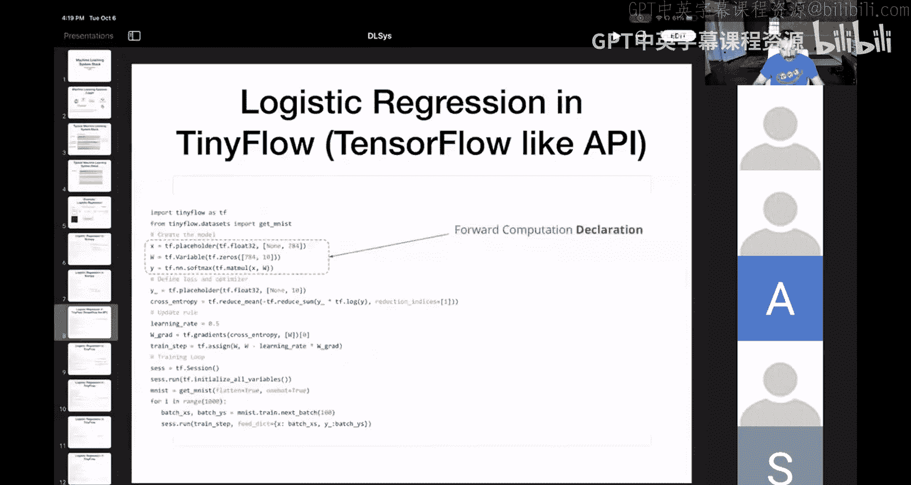
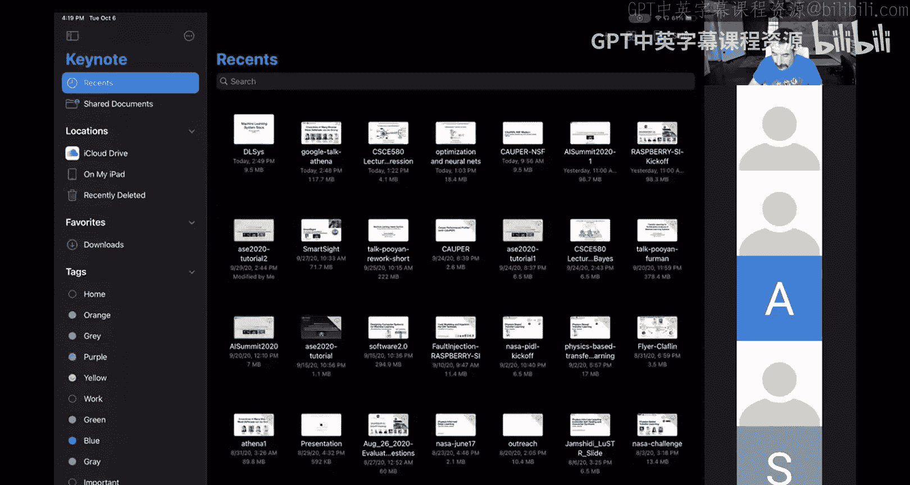
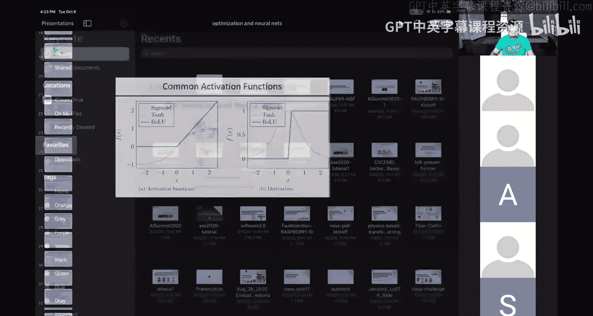
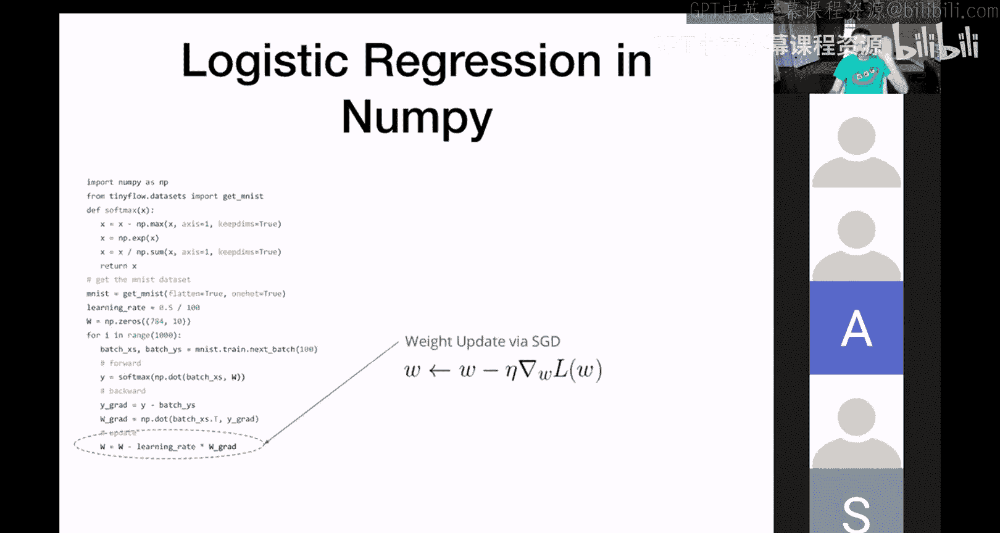

# 机器学习系统：6.1：机器学习系统栈 🏗️


在本节课中，我们将要学习机器学习系统的实现栈。我们将从高层次概述开始，探讨现代机器学习框架背后的核心原则，并通过对比手动实现与框架辅助实现，理解自动微分等关键概念带来的便利。

## 概述

在之前的课程中，我们讨论了机器学习系统的高层概述、相关挑战、DevOps工具以及分类器的基础理论。现在，我们自然要问：如何将这些理论付诸实践？本讲将介绍机器学习系统的实现栈，帮助我们理解各种流行框架（如TensorFlow、PyTorch）背后的设计原则，以便根据系统需求和约束（例如部署在移动设备上）做出明智的选择。

## 系统栈的分层视图

要理解深度学习或更广泛的机器学习系统栈，不应只考虑单层，而应考虑多个代码层。每一层负责实现的不同方面。

*   **高层用户API**：你可能需要一些API或库来计算梯度，因为梯度计算是所有机器学习模型或系统优化任务中最基本、最核心的功能。
*   **中层**：你可能需要进行计算图优化与执行。我们将讨论其含义和好处，以及基于这些计算图的运行时并行调度。现代框架背后的关键创新思想正是计算图模型，而非临时性的计算方式。我们将在课程后面部分讨论为何需要这种计算图及其好处。这一层是为机器学习系统计算提供诸多好处的**最基础层**。
*   **底层**：更接近硬件，你需要一些内核代码、优化工具和加速器。这些与硬件紧密相关且是领域特定的。

越接近栈的底层，领域特定性越强；越接近高层，通用性越强。这种分层设计的目标是方便最终用户。因为以前如果有人想开发机器学习系统，需要自己实现所有这些部分，成本高昂。他们可能需要为特定的硬件平台实现优化代码，或者以临时、非原则性的方式完成所有工作。这些框架的好处在于提供了清晰的层间边界，通过这种分层设计，你可以真正以原则性的方式构建系统。

## 从手动实现到框架辅助

上一节我们介绍了系统栈的分层概念，本节中我们来看看具体的代码实现差异。我们将以逻辑回归模型为例，对比使用NumPy手动实现与使用TensorFlow类框架实现的区别。

### 使用NumPy手动实现逻辑回归

以下是一个使用NumPy实现逻辑回归模型训练循环的简化示例。代码定义了模型、所需计算以及优化过程（通过找到能正确分类样本的合适权重）。

```python
import numpy as np

def softmax(x):
    # 避免数值溢出的技巧：减去最大值
    e_x = np.exp(x - np.max(x))
    return e_x / e_x.sum()

# 模型参数初始化
W = np.zeros((input_size, num_classes))
learning_rate = 0.01

# 训练循环（简化的SGD）
for epoch in range(num_epochs):
    # 假设 batch_xs 和 batch_ys 是一个批次的训练数据和标签
    scores = np.dot(batch_xs, W)
    probs = softmax(scores) # 模型预测的概率

    # 计算梯度（针对交叉熵损失和sigmoid激活的特定推导）
    dscores = probs - batch_ys # 真实标签与预测概率之差
    dW = np.dot(batch_xs.T, dscores) # 损失对权重的梯度

    # 参数更新（梯度下降）
    W -= learning_rate * dW
```

**代码关键点分析：**

1.  **Softmax实现**：代码中的 `softmax` 函数包含一步预处理 `x - np.max(x)`。这样做是为了避免指数运算时可能发生的数值溢出（当x中的值很大时）。从数学上可以证明，对输入向量中的所有元素减去同一个值（通常是最大值），不会改变softmax函数的输出结果。这是一种常见且重要的数值稳定化技巧。
2.  **梯度计算**：梯度 `dW` 的计算公式是 `np.dot(batch_xs.T, dscores)`。这里的 `dscores` 是模型预测概率与真实标签（one-hot编码）的差值。这个特定的梯度形式来源于**交叉熵损失函数**和**sigmoid激活函数**（或softmax的多类推广）联合推导的结果。如果改变损失函数或激活函数，这个计算梯度的代码行就需要重新推导并修改。
3.  **手动求导**：整个梯度计算过程需要开发者根据所选损失函数和模型结构，手动进行数学推导并编码实现。这对于复杂的模型来说容易出错且不灵活。

### 使用TensorFlow类框架实现

以下是使用类似TensorFlow的框架（此处称为TinyFlow）实现相同功能的示例。框架的核心优势之一是提供自动微分。

```python
import tensorflow as tf

# 定义计算图：声明变量和操作
x = tf.placeholder(tf.float32, [None, input_size])
y_true = tf.placeholder(tf.float32, [None, num_classes])
W = tf.Variable(tf.zeros([input_size, num_classes]))

scores = tf.matmul(x, W)
probs = tf.nn.softmax(scores)

# 定义损失函数（无需手动推导梯度形式）
loss = tf.reduce_mean(-tf.reduce_sum(y_true * tf.log(probs), axis=1))

# 自动计算损失函数关于所有变量的梯度
optimizer = tf.train.GradientDescentOptimizer(learning_rate=0.01)
train_op = optimizer.minimize(loss)

# 执行计算图
with tf.Session() as sess:
    sess.run(tf.global_variables_initializer())
    for epoch in range(num_epochs):
        # feed_dict 喂入 batch_xs 和 batch_ys
        sess.run(train_op, feed_dict={x: batch_xs, y_true: batch_ys})
```

**框架优势分析：**

1.  **声明式编程**：首先定义计算图（变量、操作、损失函数），然后执行它。这与命令式编程（如NumPy）不同。
2.  **自动微分**：开发者只需定义前向传播的损失函数 `loss`，框架的 `optimizer.minimize(loss)` 会自动计算损失函数关于所有可训练变量（如 `W`）的梯度。无需手动推导 `dW = np.dot(batch_xs.T, dscores)` 这样的公式。
3.  **灵活性与可维护性**：更改损失函数（例如换成均方误差）或激活函数时，只需修改一两行定义代码，梯度计算会自动更新，无需重写复杂的求导代码。

### 手动求导的数学原理（以交叉熵损失为例）

为了理解框架自动微分的好处，我们简要回顾一下为何手动实现中的梯度是那个形式。考虑二分类逻辑回归，sigmoid激活函数为 `σ(z) = 1/(1+e^{-z})`，其中 `z = w·x`。交叉熵损失函数为：

**J(w) = - (1/m) Σ [ y_i * log(σ(z_i)) + (1-y_i) * log(1-σ(z_i)) ]**

我们的目标是求梯度 `∇J(w)`，即对某个权重 `w_j` 求偏导 `∂J/∂w_j`。运用链式法则：





1.  `∂J/∂w_j = (∂J/∂σ) * (∂σ/∂z) * (∂z/∂w_j)`
2.  经过推导（过程略），最终可简化为：
    **∂J/∂w_j = (1/m) Σ (σ(z_i) - y_i) * x_ij**




这正是手动代码中 `dscores = probs - batch_ys` 与 `dW = np.dot(batch_xs.T, dscores)` 的数学依据。可以看到，即使对于相对简单的模型，求导过程也需要一系列严谨的数学运算。对于深度神经网络，手动求导将变得极其复杂且容易出错。

## 总结



本节课中我们一起学习了机器学习系统的实现栈。我们了解到一个完整的系统栈包含高层API、计算图优化层和底层硬件抽象层。通过对比使用NumPy手动实现逻辑回归与使用TensorFlow类框架的实现，我们清晰地看到了框架的核心价值：**自动微分**。它使开发者从繁琐且易错的梯度公式手动推导中解放出来，只需关注模型结构和损失函数的定义，从而大幅提高了开发效率、代码的灵活性和可维护性。理解这些底层原理有助于我们在实际项目中根据具体需求（如部署环境、社区支持、开发效率）选择合适的框架。