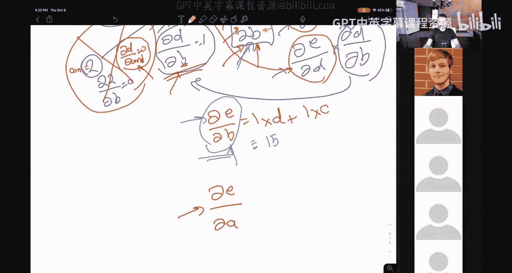

# USC《机器学习系统｜CSCE585 Machine Learning Systems 2020》中英字幕（Claude-3.5 p12 -12-Lecture 6.2 - Machine Learning System Stack.zh_en -BV1Xc9bYVEC6_p12-

Okay， let's start。So today we are going to talk about one layer deeper inside this machine learning system of stack。

 we are going more specifically to talk about this computational graph。

And this computation graph is actually a kind of novel or modern way of thinking about some mathematical expression that provides several opportunities and you will see it is nature to see easily what are those systems opportunities specifically with respect to。

Somehow kind of optimization that you might be familiar at the compiler level。

 so you remember right in traditional software systems。

 you write code and basically the compiler will take care of some of the deeper optimization based on the code that you have written and the essential part part of the optimization。

 you remember in compiler， I'm sure some of you have taken compiler of course is。

Is also somehow based on some sort of structured graph if you're familiar with ASD。

 basically provide some opportunities for some deeper optimization and more or less here we are talking about。

Kind of similar thing， but maybe a slightly different。

 so let let's get deeper here and maybe provide some discuss some intuition what we mean specifically maybe。

Let's switch back to some。Notes to discuss about some ideas， right？

Let's start by very simple example right， imagine that we have kind of expression a mathematical expression we want to construct a computation graph based on it。

 and this mathematical expression could be any arbitrary mathematical expression。

 but in particular you will see that。How you could translate what you have learned from this simple mathematical expression could be arbitrary mathematical expression。

 how you could use the same intuition when you're dealing with a model like neural network。

 a logistic regression or typically any kind of machine learning model that you would not to to optimize。

嗯。Basically to minimize the loss function as your family of it right let's start with some some maybe example to make things concrete let's imagine that we have let's say we have expression like。

哎。Maybe's a very simple expression， right we have some inputs right？And。Yeah。Right。

So this is the expression， the mathematical expression that we have right。

 so this is your these are variables right， all of these are variables。And this is also a constant。

And you have some operations here， you have plot here， you have multiplication here。Okay。

 so you have some variables and you have。You have also parenthees here， right。

 and you have some operation operators on top of these variables。

And you see already here some structures started to appear right so for example。

 you could you could see that maybe yes， maybe you could use these I basically。

As these different computation to other intermediate variables right。

 maybe you can call this like C equal a plus B， right and D。Eal B plus 2， right。

 And then for calculating E， you only need to multiply C。We be， okay， so these。

 these two essentially are are the same。We just did this intermediate assignment of， of this。

Simple terms or expression assign you get to some new variables C and D so the same thing right。

 we did not violate any any kind of mathematical expression here and then then you could based on this this structure you could build some some some graph right。

 So for example， you could start it with your。Initial variable， right？

 What are the initial variable like C， A and B are your initial variable， right， So a。一一。Okay。

 and based on A and B you we have some intermediate variable here。

 we have one intermediate variable here， C equals a plus B， so we connect a and B here。

And then we have another intermediate variable D。Is。Basically， B plus 2。嗯。So we connect B with D。

And you see the reason why we kind of PVT， right。嗯。It is it is very easy to understand。

 but we make it a little bit more formal later on and then we have we have this E right。

 so we have this E basically is C multiplication。月啲。Right， so we have something like that。Okay。

 so more formally， you can think about these， these。This is structure。 So within this structure。

 you see some node， right， so you see some node。Right， and you see some arrow。

So these nodes you see what is what is their what are their function right。

 so their function is really simple what the nodes does， they represent some sort of。Computation。

 right， and and。The edges somehow。Connect this computation to to other to other variables。

 you can think about data dependencies between these computational nodes right。

 so each node basically does some sort of simple computation， as you can see。And the edges。

 so here the computation is like plus。Here is multiplication and the edge represent the data dependencies right so for example。

 for calculating if you need these two notes C and B。

So the connection or the structure you see is it somehow becomes obvious and you can make a correspondence between these these two right the mathematical expression that you have as well as this structure and this structure is not arbitraryrarily right so you see that it is directed right？

And you see that it is as right， This is the whole structure is called if you're familiar we discussing in the area because its some sort of a D right directed acycl graph。

So it has some well defined structure between what we have。And then。We start thinking。 Okay。

 now why we want to represent this， What are the immediate。

Opportunities that you see with this with this structure。

 Can anyone wants to volunteer to say what are the。

What might be the possible benefits of such structures that we want to talk about？咩个支箱。Yeah，各 ahead。

Yeah， so。Since。Whi。Each， each node appear once， so。

There will be no repetition and whatever we are done with that within node。We don't go back to it。

Yeah， that's a very good point right so whenever we wants to have access to a node so for example。

 when we calculate D here we don't need basically to repeat this again for particular value of B right so basically if we need some reuse of computation。

 it is very much possible to reuse these computation what else。

The order of computation is explicit so we don't have any order of operations issues or dependencies Okay dependency issues right and then what these independenceencies provide。

What are the benefit of such。You know， independent reordering of things。

I'm not sure what you're getting at。 So， for example， I guess what you meant is that basically。

So for calculating E in this example， what you need is really C and D， right？But for example。

 for calculating D， you don't really need C or for calculating C， don't really right。

 so you have like two two parallel passes here， right？It are independent。Yeah。

 mean that's computationally efficient right because you can do those separate you can do them at the same time with different you you can do them at the same time in parallel exactly right so it becomes obvious that you can do this computation in parallel so parallelism opportunities right this kind of graphical representation it provide opportunity I mean in this case it's so simple right so maybe even with this structure you could guess that but if you had like massive kind of expression it wouldn't be possible by looking at the expression to identify these parallelism opportunities right so this graphical representation provide some optimization opportunities as I discuss for example for the compiler similar thing here like here for machine learning we have also compilers right and like you can think about like graph based optimization graph coloring。

Whatever you can imagine and you have learned in graphrapht。

 you can upload it here for optimization right you can optimize calculation of your model a lot。

 different orders of magnitude if you're able to exploit that and this is very very much important when again back to this layers because the layer below is harder right we want to optimize it for example。

 if we have GPU in the hardware we want to parallellyize it and like assign it to different cores。

 so things could be calculated in parallel a lot more efficiently with these exploitation of this structure so that's kind of the benefit of the connection that that why these computation graphs are important for machine learning systems right。

But the other benefit also is the connection with respect to the optimization of the algorithms right so we discuss about like several different type of machine learning models we discuss again about logistic regression we discuss about neural networks。

 we discuss about naive ways and in all of that we have some sort of you know loss function we want to。

We want to optimize and in all of these， you remember we needed to calculate somehow some gradients right so if you remember。

For example， for logistic regression， what we had was right we had some sort of weights。

 right input right so this is。This was。This was your simple model and based on this model。

 you had some sort of loss function， right？That you wanted to to optimize， right。

 So when you calculate this activation， you pass it through， you know， the sigmoid it function is。

Transformation to make these into some probabilities and you wanted to use this true label in order to calculate this loss and for doing that。

 you needed to calculate this gradient of the loss with respect to what you had as a variable in your model thes and you use this calculation right。

Use this calculation in order to plug it in in the。Optimization。

 I'll go to tell if you remember this stochastic gradient descent in order to find the optimal parameters that give you。

That gives you the right model that makes us feel mistake as possible with respect to your training set right so basically the calculation of this gradient of the loss。

I important and like the other benefit we want to get at is whether these computational graphs provide some opportunities for us for calculating these。

More efficiently。 And you can think about like this between this computation graph。

 maybe you want to map this loss like here and here like these are your input right。

 So and then you want to explore this this structure。

In order to give you some of these calculation point default or automatically something in the context of neural network it is called backpro right。

 and we'll discuss about detail， but I want to now make this connection for you to a reason about why such graphical notation。

 these computation graphs might be useful in this connection。Right。And。And within this context。

 let's explore some of these， these opportunities in。This kind of a structure that we have， right？

So in order to make things clearier let's read about this。Right， so we have。嗯。A we have B。Then。

 we have seen。第。Okay， so now you can think about let's let's do some of these calculation and we can think about calculation of the gradient in different ways。

 right so。There is one way is a start from the inputs right going down way a start from whatever we have in the input calculating the gradient of。

Calculating gradient from the beginning of the graph and propagating it throughout the graph until we get here and at the end we get this calculation。

So basically， we are interested in calculating how much loss or how much E would change if we change。

 for example， B， right？And we can do that right so for example here you can start calculating this right so in this case you can start calculating okay。

 how much for example if you change if you change B in this case right let's do this right if you change B。

With respect to with respect to B， what is this， right， B is now valuable， right， It's simple， right。

 What is what is the value for this。1。1， right。How about a。

 what is the derivative of a with respect to B。What is that？It's just zero。You're0， right。

It's very simple， right？How about this note。嗯。How we can exploit the this structure to answer that。

Wouldn't it also be just one。You can concatenate the results of both of them or add them， I guess。

How like I mean， so I mean we have a zero from one of them， we have a one from the other since。

The rules of derivation allow us to apply sums。Derivatives of。诶。Like， you know。

 to each of the terms independently， I mean， we can just add them， so c equals one。

So here we want to calculate what we want to calculate derivative derivative of。C。

 with respect to be， right。So this is what we want to calculate。Okay。

 and we have the expression here。Obviously， by looking at this expression。

You can calculate it easily right， you know that the answer is essentially one， right？

But we want to see whether you could have done some previous calculation。

That without looking at this expression， you could have calculated this value。you just look。

DCV is just D Db plus Dbdb。Okay， we already know what the results of DADb and DbDB are。

So you you mean that we have this， we have this， we simply add them up well because C is a plus B if you take the derivative the whole thing you get DCcDB equals DDB plus DB DB so instead of calculating the derivative of A and B again。

We already did that one time， we can just add those results together to get DC CDb。Exactly， right。

So basically since you have done this calculation before right calculating this with respect to with respect to B basically is' just adding adding whatever you have done before right and adding hope in this case would be one right without looking at。

At the exp， you could have done this easily， right？嗯。How about this。I mean， it's very similar， right。

 you DDDb。Is just Dbdb plus D2 Db。And then， you can。

You only basically all you have to do is you have to calculate D2 db。

 which is0 and then add it to what you already have done， which is DbDb。So essentially here。

 we have explicitly these as， right， So， and this is。Gdient of these two with respect to B。

 which is zero， right？That's right。 right。 So you have this calculation here， then。YouWhatever。Noes。

Leads to this node here where you have here， you can simply add them up right and then you get here what。

How about this。冇准。The last one。 So here we want to calculate the gradient of E with respect to B。

RightThis is what we wanted to see， right， we wanted to calculate。

What is the what is the gradient of the your final variable， right， the variable of interest， right。

 This intermediate variable was not the variable of interest。 This evil was the variable of interest。

 right。How we calculate this？Jimmy， without knowing the function。

I think it applied chain rule chain rule if we know the function。Okay， then。So I was asking。

 do you mean if we don't know the function of？The function between C and D。Yes， that's what I。

 what I'm asking， yes。So what what is missing here， What is missing。Okay。

 I feel like we've done all the calculations except for， I mean。

 like they were mentioning the product really， the chain rule。嗯。

Would we I mean so like we could we can look at this， we can look at the。

The definition of E and then like from that decide what we need to do。Like using the product rule。

 but then we can use the computation， the previous computations to。Arrive at the new assignment of E。

 right？So imagine that now you know this expression， right？So嗯。So in order to drive this。

 how you drive this？For few seconds， let's imagine you don't want to exploit this structure。

 how you do this using the chain rule。CDDB。那是定。So。This is the expression that you have right。

 so you need to apply the chamber right so it is。C。😊，Grareient of tea， with respect a lot。嗯咦啥。

D derivative of C with respect to B。With respectpect to。No。

 I thought it'd be the derivativeud of C times D。With respect to derivative of B。

 you tell me can you can you all right， we're not doing isn't this product rule not chain rule。

You're right。So it would just be the product of the derivatives and then。

Plus each other right for like one so you'd have like。DCDD。Times DCDb times D plus DD Db times C。

Okay， so it is derivative of what ECDB。Derivative of E with respect to C， right。

 multiply by derivative of C with respect to world。嗯我看。

B plus derivative of E with respect to the other value， right。

 D multiplied by derivative of D with respect to。Decttic about。CB， sorry， right。

So this is the expression that basically you need in order to calculate this derivative of E， right？

So basically is again， in order to calculate this， you have the chain rule right and product。

 you need to use books right， so it would be derivative of E with respect to one of its variable multiplying of derivative of one of the variables with respect to B。

Right and also doing the same with the with respect to the other variable。

 right on decline of the right derivative of D with respect to。B， right。

 is what this is how we want to calculate。So what we have here is， let's imagine what we have， right？

Here we have derivative of C with respect to B， right？And we have derivative of D。

We respect speak to。Be， right。And what is missing is these two。Right。Dve of E， we expect to see。

And they everything of。E with respect to D。 Okay， how we could have calculated those before。佢啲。

We didn't know until now that we needed done， right？Right。

 but let's imagine that now we know that right， how we could associate that with the with this with this that in order next time to have those。

 right。Any idea how we should go after that？For the incoming。

 I mean so we need E with derivative of E with respect to C and derivative E with respect to D and I'll note that those are the same those are the parent nodes exactly I guess we can just do with parent nodes exactly。

Maybe we could assign them to the edges， right？Since we since we here we did， for example。

 in this case， we need to have derivative the partial derivative of E with to with respect to C which is coming from here right so we have E and C。

 maybe we could assign it here right。And this one， maybe we could assign it here， right？嗯。Okay。

So how， how we can calculate this， right。Any idea。So what is what is the derivative of E with respect expect C。

嗯。Is what。D is D， right。That is going to be the product of all of the。

Parent nodes apart from the node particular node。Right， so derivative of E with respect to seeing。

Is D， right？ a derivative of。E with respect to the。Is the other one， right is。Its， right。Okay。

 that's feeling better， right， So if we would have had this calculation before。

The calculation of this。Would be trivial， right， So we have had everything there。喂。

How about the other notes down the line？So here you see that derivative of easy respect to the incoming no。

Right， so let's， let's maybe do that for the other。Other part of the the graph as well， right。

 So imagine that， for example， in this case， for this note。

 we have derivative of C with respect to what now。诶。You respect to a， right， What is that。

The derivative of c with respect respect to a。Is easy。咁去。嗯0。

The derivative of C with respect to a is zero Oh it' one， sorry one one right。

How about the of sea with respect to being。Also， one。Alsoso one。

How about this fund derivative of team with respect to E。What is that。嗯。one。

Dirivative of the with respect to， in this case， too， right。Or maybe you could。

You could name it constant， with respect to。Hmster。What is that。That's one or zero， so。嗯。

basicallysically here， you have constant， right， maybe you could you could even like you could exclude this part as well。

 right， because it was trivial you don't need that because you cannot really you don't have such entity right。

 because you cannot vary， So this means that what is the derivative of variable。

Or changing the other variable a little bit。Since this is constant。

 you cannot change that a little bit， so is this is not a defined entity right so you don't need that part。

 but I made it clear to make a sense out of it right。嗯。So we have so we have these， these。

So assigning to each of these arrows， we have some partial derivative， right。

 partial derivative of whatever we have targets， whatever we have。嗯。We have down there， right？Yeah。

 that makes sense。Makes sense， right？And you see already that if you would have had these calculation。

 then。Then everything else right， so imagine that you would have calculated all of these orange partial derivatives beforehand。

 right？The rest is simply reusing goals， right， So for example。

 for calculating the the derivative of C with respect to B， we already have the answer right。

 we already have the answer， which is which is one right， you see that is to。嗯。Two notes leads there。

And for calculating with respect to with respect to calculating partial derivative of E with respect to。

We respect to be， we already have the answer， right so we could。Calculate， so we have this pass。

 Also， we have this pass。 we could plug in whatever we have already there multiplying by。

By these guys because we also need the edges right and then we already have have the answer right so here more explicitly for calculating partial derivative of E with respect to B we have this guy which is one multiplying right this is really plugging this here right multiplying by D。

Plus。We have this guy， one， multiplying it by。B sea， right。So we have already answer。

 because we have already calculated。Calculated things before。 And like if， if you're talking about。

 let's imagine that we already have iniateated the stuff here。What color I choose。

RightSo let's imagine that for a， we assign it to3 for B。

 we assign it to5 right and then we could plug it in here so here we get D equal to。7 C equal to。

3 plus5 is 8。Right， and then this becomes。Obviouslybvi， right。This becomes 15。Okay。

 the derivative of E with respect to respect to B， Okay。

 so basically you only need to traverse the graph until to until you reach the end note and then you have had already all calculation for calculating this partial derivative But think about it right this calculation you you basically started from the beginning。

 right， So basically you have had this calculation before and this calculation。

 these partial derivatives are easy right。嗯。You did not need to calculate you did not even need to have change rule right so it was with respect to one of the variables involved in in in your target notes so the calculation of these were a lot simpler so you could precalculate those and then。

What we did is is that we assign the numbers to these input variables and we just propagate the information throughout the graph until。

We get what we wanted to have。Right， so if we would have calculated this partial derivative assigning to these edges。

 then the rest was trivial okay。But again， this is forward pass right， so we have forward fast。

 but we also need to have backward pass and why we need to have backward fast。

 let's step back and think about it The forward pass what you get is。

The partial derivative of your target variable， with respect to one of your inputs。Okay in this case。

 B， so if we wanted to have the partial derivative with respect to of your output with respect to other variable a。

 we needed to basically go back and do calculation again right we needed to go back and recalculate these stuff at least right so you saw that we needed so we took this partial derivative with respect to B okay so we needed to at least go back and recalculate the partial derivative of the nodes in order to in order to again calculateulate this this entity。

That we want。 We can do that the same way， but we need to do the same again。

 doing the same forward pass。 It was easy， but still is two different computations。

But you remember for the optimization of like something like neural network or logistic regression again back to what we discuss here。

 what we discuss here， we needed to calculate the the loss gradient of the loss function we respect to we respect to all all inputs and if you want to let's lets maybe do the same kind of graph construction with these right so imagine that we have let's say we have x1 and x2 here right we have two inputs so we are talking about two dimensional space right？

You have x1 and x2 and again this could be a vector here。

 the size two here obviously for the weight size would be the same size as your input so for each of these。

 you also need to have weight one and weight two， right？And you have this guy B as well， right。

 So these are your input variables， right， This is for logistic regression and。

What you need to do is to calculate this。Calculate this guy。

 this is the activation that you need right and the calculation is is basically you see that you can think about the computational graph right at this computational graph。

 if you think contrasted with the kind of graph that we used So we remember for constructing the logistic regression we thought about this X1 x2。

And we thought about this as like W1。W2， right， This kind of stuff。

 This is slightly different because W1， W2 becomes also the nodes。

 some different nodes in these computation graphs。 So make sure that you don't con。

 You're not confused with the graphs that we use to build this， this type of model。

 That was slightly different。 This is computation graphs。 So these， these。

 each of these are different nodes， right。Or different variables that we have。

And then we have an intermediate this is like your representation。Right， so this is。

So you need to connect all of these to this。Do you think is W1。X 1 plus W2。X2 plus B， right。

 So this is， this is your activation function。Okay， once you have this activation， then then you。

 you you need to have another node because you need to do another computation。

 that computation is the sigmoid， right， So you have another node for sigmoid， basically。Sigmoid。

 you need to pass edge to this sigmoid in order to to give you the probabilities。

 And then once you have these probabilities， then you。You can go and have your loss function， right。

 And for loss function， what you need is this。This guy， right， plus the true labor。

This is this the true。O。So you have this kind of。This kind of computational， computational graph。

And here what you need is to in order to optimize if you remember the algorithm forto plasticastic gradient descent。

 you need to have had the gradient the partial derivative or you need to calculate the gradient of your loss with respect to with respect to weights right so let's imagine with respect to。

So here mathematically， here it was。The things you needed to calculate。H W was W1 and W2。Okay。

 or more explicitlyity you needed to calculate this partial derivative of L with respect to W1。

Partial of all with respect to W2。Okay。So what you what you need now is that you have can you explore this structure in order to give you these calculation in one pass in instead of doing that。

To us， right？ And here you have like two weights。 But imagine that because we have2，2，2 input。

Two dimension on a space。 But imagine that instead a of having a logistic regression。

 we have a deep neural network that you have billion parameters。

If you have millions or 10 millions or 100 millions or even billion parameter。

You cannot do this for word billion times， right？ It takes a lot of time。

 Can you can you get something this calculation in one pass， Yes。

 it is possible to to get this calculation in one pass if you do this backward。

 And that's why it is called basically back， and we are going to to use the same examples in order to see how how we can really do this do this in a backward fashion。

 right， in order to。😊，In order to get what what we we wanted to to get， right。

 so let's let's maybe quickly do that again， let's。Construct this graph， so we have。We have yes， a。一。

And then， we had。C。And then， we have the。And then， we had E。你是啲。Okay。

 let's start from and unless I notate here what。Let's now imagine that we did the thing and， and we。

 we calculated these these guys， right， So we calculated the。What was this in with respect to。第一。

E with respect to the sky， see。See we respect to this guy a。See with respect to this guy the。

D with respect to this going P。Okay， so imagine that now we are。

We know what we needed to calculate beforehand and let's let's start from instead of doing forward now let's do backward tasks So here we start from here。

 right we start here what we need to cal is really calculating。

gradientadient partial derivative of e respect to what？With the to itself， right。是。

So we want to to start backward。 So basically what we want to get is that。

What is the partial derivative of each of these input variable with respect to the change in in the。

With respect to with respect to say what what is， what is the。

Change in the error or the loss or the final output when we change the input right for all input input variables。

 So we start by by this partial derivative， we know that like。

Each variable with respect to itself is one， and then we need to calculate these two guys。

So what we have here is。Is what。What is the how we can calculate this？Any thoughts。Com。

So basically here what to clarify， we want to calculate partial derivative of E。

 So basically if you remember again to contrast here， while forward。

 we started deciding what variable we want to change right we started by， okay。

 we want to change B and we calculate everything， all of these with respect to B okay。

 and then we said that in order to do that for a， we needed to do old calculation again for a。Now。

 you start from。Yeah， and we start changing E a little bit， right。

And then we do the calculation backward for， right， So for， for this node would be what is the。

 what is the partial derivative of even we change。C， okay。

 for this note would be partial derivative of E when we change the， right， You see， you see the。

The idea here， right？Yeah。嗯。So what would be the what would be the value here。Thatd be D。诶 w d喂。

I said D。You mean the， right。 Yes， I mean， I said the letter D。 Yeah， right。Correct， right。

 How about this， E respectively。That should be C。How about this guy？It is， this is would be。

That would just be one。I with respect or irrespective。A for year， we want to partial the respect to。

Be right。How we calculated it。Well， you can technical take you can take A plus B and。

Substitute that in with E is equal to a plus B times D。 You can do distribution。 You get。

should versus and you know one question one question， sorry before we jump into that。

How you told me this was the。Where did this come from。Where did you look at。

Which one you could you circle which value you're talking about this thing？No， I said it was D。

So it's the first and second time， right， But how how we calculated that it it is the。

So we know E is C times D right and we're looking for the derivative with respect to D so we can treat but the aim was not the aim was not looking at expression。

 the aim was looking what we had before。Did we have this before。

 like or some elements of this before。No， we did not。He did not。Be have it if you look carefully。

B plus 2。Where， where is that？Where is that。收啲。😔，I think it's equal to D， but D equals to B plus 2。

Yeah， but I'm asking where without looking at the expression。

 imagine that we don't know this expression， you want to exploit whatever we calculated before。

 Can we still have calculated this。嗯。找到。A we or not。Come on， is there。 You should really see that。

Don't you。Again， we want to calculate this。 You said that it is D， right， You said that it is D。

And that's the true answer， but。That answer comes from looking at this。 Sorry， looking at。Oh come on。

没。But you look at this expression。 We don't want to look at this expression， okay。

We want to have calculated this partial derivative without looking at this expression。

 did we have had this value somewhere？Look carefully。 we have it。直到后来呢。Oh， it it divide D A plus D E。

The divideDB。Where。Is there really。I mean， we did it during the forward prop。

Where is that exactly on that edge between C and E。 Yeah exactly， is's here。 Look at it。 It's here。

Wite it。 So we already have this value。Right， so we already have this value on the edge because we already have whatever we had on the edge。

 right， You said that this， this time， we calculated this before。

 whatever we needed on the edge and this。Things on the edge was really simple。about this。你还咩。Yeah。

 yes， it's here same， right， The same we have it。We have it already。How aboutdico。How about this？

Do we have it？No。Thnically， we do we can we have on the edge。

 we had the derivative of C with respect to derivative of A。

 and we had the derivative of E with respect to C。So we can just multiply and cancel the des of C when we get derivative of E over A。

Exactly， right， So here what you have here is。😊，So。

So you want to calculate the derivative of E with respect to a， right？

Here you have derivative of C with respect to A。 Here you have derivative of E with respect to C。

 right。So if you multiply this together， what you get is that if you multiply derivative of C。

 with respect to a multiply by derivative of。不要。Of。因为他有。E with respect to C here。

 you get derivative of E with respect to a， right， So you only need need to multiply this。

 whatever you have on the pass。 And really， like if you， if you go from this guy。

 this node to this node that you， you have all expression you need。

 you just need to multiply them together。Right。How about this guy。

Because we also need to calculate this guy， as well。Do we have all of these info。Yes。Where is that。

And the EDD。And times D， D， D B。Okay say it again。Divative move， partial wave。E were D。

That we calculated in the fourth pass， multiply by derivative of。D， with respect to B。This guy， yes。

 and the other one that you mentioned was this one， yes。So partial， So this guy。

 in order to calculate this。A should they of。E with respect to the by derivative of D with respect to。

B。Is that it。Yes， yes。Are you sure。We need to add。Whatia derivative of your respect to C times。

I should their vegetables。See， we respect to B， too。Because that's two。To発。Why。

Because two parts lead from node E to B。Exactly right。

 here you see again exploiting whatever information you have in this tag structure。😊。

You have this pass and you have this pass， right？So you should exploit all information。

This thing is related to this pass， right， so the downward pass。

 but you also need to have the ofward pass， right？Plus。

 partial derivative of E respect to C E with respect to C multiplied by partial derivative of C。

 with respect to。B， yes。G the offer pass。Right， and this is the the。And then you are done， right。

 So you get this partial derivative of E with respect to B。 So let's think about this。

 This is very important， right， think， think。So here so think about what you use really for calculating this right so for calculating these two entities。

 these two entities was really the entity that you wanted why because this egi is your target variable and let's imagine this is your loss function。

Get back to this up so here。You needed to calculate these two portion of derivative derivative of loss with respect to all all of your weight elements。

 right， all of these guys， right？Okay， so whatever you have in the input。

In one pass right we discuss about one pass and really here we did in one pass right so and we use basically whatever we have calculated before by using some information from the graphs and that was really how many paths we have between two nodes right so for example then we did this calculation when we had here like we had these two nodes like how many paths we have these these two node connected one pass right and we exploitd whatever we had on the pass for this node the same we exploitd whatever we had on the pass。

For this note， how many paths we have one pass， we multiply these two guys together in order to calculate this guy。

 right or simple here。For this guy， we have two passes， right， again， exploiting the structure。

 and we calculated。This multiplication， plus this multiplication， in order to drive this， right。

 So we exploitd whatever we had in the causal in， sorry in in this dagg structure。

 this computational graphic structure， nothing more than that。And within one pass。

 we calculated the partial derivative of。The outcome with respect to all inputs， right， in one pass。

 And if you have like million inputs， right， if you have million inputs。

We did the same right we go back backward in one pass and we would have gotten all the partial derivative that we wanted to have we respect to all the inputs variable right and that's the power of computation graph right in one pass backward forward you saw that it was not possible forward。

 we needed to choose like what is the variable we want to change and then at the end we get this partial derivative of the output we respect to this this variable that we decided we could do the same in another tasks right but if we have had million passes。

 we would have needed to do this calculation like million times。

 but in backward pass we did it once and we have had the same we have had all the entities that we needed to have for for plugged into the。

Into the optimization， right， And again， like this was， this was the。Connection。

 right this was the connection for for optimizing in a stochastic gradient descent we need to calculate this element。

 And if if this element was a million elements vector right。

 we needed to we could do that into one backward task and this is what is called backward and that's why it's fs and why it is useful right typically in highly parameterized the spaces such signal neural network where we have million parameters and we need to do it efficiently。

嗯。Is that clear？Yes。有。😊，Very good， so that's basically is the connection and why such a structure like computational graphs are important because of two important things。

One is that you can exploit the structure to parallellyize computation like to map two different cores right。

 and we will talk about it later on this is connected to hardware architecture。

 but also you can do some interesting calculation of gradient。

 like backward in one pass and you get whatever you needed in one pass and that's cool。

 so these are two essential important properties of this structure that makes things cool and efficient for optimization process。

That's it， so I think we are done here， let's stop here。Talk to you。 Ex。Okay next week。I， thank you。

My thank you。

