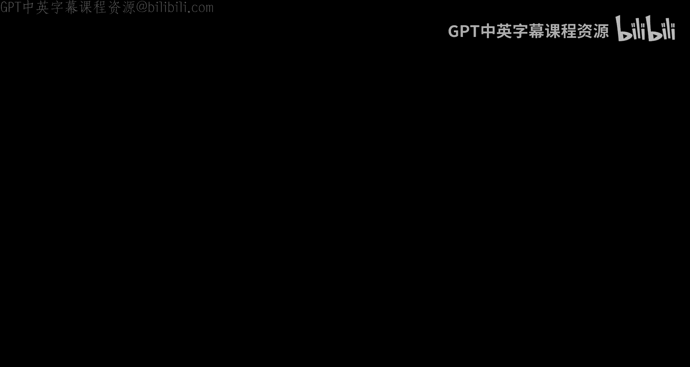
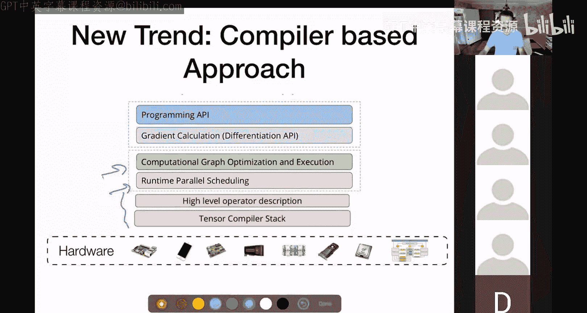

# USC《机器学习系统｜CSCE585 Machine Learning Systems 2020》中英字幕（Claude-3.5 p13 -13-Lecture 6.3 - Machine Learning System Stack.zh_en -BV1Xc9bYVEC6_p13-

喂。

那。Yeah， so basically in the last lecture we started talking about this layer with specifically the APIs that frameworks such as Tensor Fow will provide we also maybe discuss this conceptual。

And very yet very important and interestingly common across all of these machine learning frameworks like Pyth。

 Tensorflow is the key concept of computation graph。And we， at least。

 I hope that you got the idea why this computation。

Graph graphs are important for machine learning and what are the opportunities at least they provide。

 specifically we went to some detail some also examples， for example。

 in terms of optimization for mainly about back through back propag providing this gradient of the loss with respect to all parameters。

 This was what we wanted to get hopefully efficiently， because we need at once we have this。We can。

 we can go ahead and change the parameters of the network or the model iteratively， right。

 is this was the the key idea or the key basically procedure behind all of these optimization procedures that we learned and you got the idea right。

 they look somehow similar some details are different， for example， the implementation detail。

 but the key idea was basically we needed to get calculate this this kind in order to update the parameters through this update rules that that you know about it both and for different models like logistic regression or networks other kind of。

Models theyre similar， so we have optimization for during this optimization we need this guy and computation graph provide this very efficiently for us。

So that was we mainly discussed and we learned。Why we need this upper layer part of this machine learning aside。

 Okay， now we move slowly down。 So today my goal is to really give you some overview。

And like some intuition， why these the other layers like this system level。

 also this hardware level are important。But we will go into details like the way how we treat this computation graph with some examples in the following lectures。

 but today， the key idea is to basically get an summer overview high level。

Intuition behind this system is stack and then we move toward the detail afterwards。

So before we continue， do you have any question you want to discuss？Again。

 as always could be about anything could be about this or could be about your project， whatever。

I actually had a question， but it's mostly for the class just because I've been wondering this。

Is just like how many people have actually figured out how to get the。

The research project that we're doing， the dependencies resolve for it because I know a couple of us have been talking about and having issues。

 I think one person has solved them。But yeah， okay。

 that's what some people are saying in the chat because I'm trying to figure out like has anyone actually other than maybe like one person figured it out。

Okay， that's interesting。Yeah， my message is that try。

 but Ying will admit with you guys over the weekend， right， Saturday。

And for those who cannot join at least can watch， so to figure this out。

 but hopefully if few of you already basically got this all of the dependency in a store。

 then you can start。Yeah， absolutely all meetings will be will be recorded。

I will be available to you guys。Yeah， definitely Yan can help you guys。But。

 but you need to really spend time。 I know that you did， but this is the very。

How it works typically you know， this is one of the challenges you will get familiar but you will learn throughout these struggles right so next time these stuff would be a lot easier for you。

嗯。Right， and maybe some of you may want to。啊。We want to create a。Docker image or something that。

That facilitates or automate this right so we can write Do script so。

To automatically in a solve dependence on prepared and environment so you can start doing your experiment easily。

 maybe talking Ying can do it together。Yeah， that that makes things a lot easier， I would say。Okay。

 any other question？Are we good。And yeah， please， like for those who who will ask， I would prefer。

 as I said。To see you guys， so。So enable your camera。Okay， so let's and like in on P。

 I mentioned this right， So we have some extra more possibly interesting kind of task。

 obviously optional for those who。We're passionate about doing some research right。

 we think that maybe they are interested， you know。

 doing research in this direction because as I mentioned this adversial machine learning is a really hot topic and。

Sure， we have several ideas for you guys to work on。And like if for some of you。

 if you're interested in doing like graduate level kind of research， yeah。

 there are opportunities and contact me。Oring to discuss detail， I put some detail on Gi。

But we can also bear much more detail to give you an idea at least how it looks like and another update is that I will send you the latest and much more polished version of the paper a paper with much more results and more interesting discussion。

 so I would encourage you guys to read it definitely。And。And you will learn more of it。

And give you an idea of what kind of discussion you need to put into your report and what kind of maybe plot you want to do and all of the scripts for making these plots will be available so makes makes your life a lot easier for you Do you have any question about like at least the stuff that I put on。

On the top。If you have， maybe if you want to discuss some detail。I'm happy to talk about it。

So basically， the。This idea， I mean， more specifically we have we have a couple of ideas。

 but this one that I mentioned is more about like。Evaluating this antenna frameworking with real world kind of scenario by real world。

 I mean physical scenario where instead of deploying the defense on computer right on a server or something or on your laptop。

 whatever now you deploy on some real devices as I mentioned。

 right some of some devices small devices like this， right？So this is Google TPU。

 this is even a smaller coral device and the key idea is that okay。

 the difference really is that like when you deploy the defense。

 obviously you can add a lot of weak defenses， a lot of these transformations。

 basically as much as you want or as much as you have resources on the server，And in the result。

 at least in the result we reported in the paper， you see that as we add more to be defense。

As the framework vote becomes like。A strongerron， right？

But it obviously comes with the cost and the cost is like you need to load more you need to load these these models into the memory right and once you move to these the smaller devices。

 obviously you cannot put anything here right so that then you need to think about the trade of space。

And within these environments， the other difference is that like。

it's not the case that you feed some digital input like some digital images right。

 so you have this standard benchmark which has a clean training and test set。

Like Emist or C400 so these are killing and clear got like digital images but like with this you need to think about like real world images real world objects right so for example you have some object and you point the camera into this and you need to think of okay how I want to how and like how I could per real world scenario real world physical object there also work on that right you can。

You can maybe。Do this perturbation， synthesize this perturbation on your computer and print this perturb object and then point that per object toward the camera and see whether the defense can can recognize this or the the deployed system can recognize this object correctly or not。

With and without defense in place right so you can one nice scenario could be that you have one physical object then you also do the print of the pert objects and then you show these two with and without defense in place and see how it works works and you do this for multiple objects and then you report your findings。

RightThat would be a nice。Nice experiment and also talking about the trade of a space Okay how many models you were able to deploy。

 basically what was the size of the ensemble defense that you tried Did you face some of interesting challenges like did you for example。

 major energy consumption， like how was it right some of these ideas which provide as you can see different aspects about the real world machine learning system in a real world an interesting environment this could be really interesting and as mentioned we have also some other。

Hardware platform like AWS Deepplans which is also a nice hardware platform specifically it has camera attached it has the capability to deploy models on the device as well as in cloud even partially so you can put some part of the models and with antenna you can do that and that would be interesting。

Thing to try， right， whether you can deploy antenna in multiple places， right Part of within。

InClo and part of it in the device， obviously this needs to be designed and think through and see how you could do that right。

 it's not trivial， it is possible Def everything is possible， but it requires some creativity。

Right the other idea was also about like hybrid ensemble defense where you saw in the paper like the ensemble defenses that we tried was mainly homogeneous in a term in a sense that like you have a neuro architecture So you have a specific architecture。

 you train these weak defenses with the same architecture right and you construct the ensemble defense of these homogeneous architectures one other idea could be right。

 maybe some of the defenses could be trained on one specific architecture。

 some other could be another architecture or another type of model like could be a combination of SVM and。

And our architectures or。Or anything right， you can come up with and several of other ideas if you're interested。

We can also will provide more information about this as we move。

 but we can also set up meetings to discuss more details if needed。Okay， so let's discuss about this。

 So again， we move downward toward this。Systeemma stack to see how it looks again， again。

 like specifically about the example right we had on the slide right about this particular logistic regression model we discuss about the difference right when you do that。

In a Ny with no support from a framework like Tensorflow and how it looks like in Tensorflower。

 right？And stuff， but in terms of computational graph， it's very simple right。

 so you have some inputs and again to talk about this because。It is。 It is important。

 I couldn't hear what he said。Very close， okay。So it is important to know about these differences because again to give you a high level perspective you know that we start constructing this stack by these variables right these for example in this case we have A and B right so these are the variables and we have some operations right。

And we construct this computation graph， for example here you have constant and then you have another operation。

 this is for this operation right， so you see the mapping here is straightforward。So for。

 for example， corresponding to these three lines of code where you use tensorflow， right， So here。

You introduced our variables， right， You introduce here X。Right， you introduce W。

And also the corresponding。Size of size of the variable。 and quite a it to make it。

To make it more generic so these notess could be could be like anything right so in terms of type of this could be a matrix。

 right？Could be a vi。Could be a scar， right。佢 be。Could be even right， ten。Could be anything， right。

 these， these guys。And let the edges represent these operations， right？For example， these。

These operations as you see right， so you have these and then you have Y which constructed or computed based on these operations and then softm。

 right。So you see the correspondence and then like for these， so you see that。嗯。We have。

This variable。 this guy here， a specific size。 Again， now you want to calculate cross entropy。

 this guy。 So you need to。Start by by taking the log here right so this was the why you need to take the log here and then you need to multiply that with y right y on the line。

And then take the average， right， in order to。Calculate the cross entropy。Okay。

 so the correspondence is is really straightforward。

 And then so in order to calculate the gradient that we discussed this case， it is called W graph。

 but this is basically。Have the the gradient。嗯。Of the。

Whatever we discuss about the gradient of the loss with respect to the ratess right so here and this is like by something like。

Framework like Tensor follow， you know that this， this will be done automatically。 So here。

 by definition of。Of。Of this， you know that right so for example。

 and this is like this will be constructed by by the framework automatically right so here the batch that you feed to the network and you need to here you have log so you need to have gradient of the log you need to have gradient of the softmics right。

 you need to do some transport。Transposition of the matrix in order to calculate this part。

 basically this part will be done automatically by the framework。And then for the update rule。

 obviously you need to have the learning grade。And basically。

 this was the update through basically your family of it so once you have this gradient。

you need to multiply that with the learning rate。And learning rate is one of the parameter that you need to basically assign and the previous weight。

 okay。So basically this was the previous weight， you need to subtract it and assign it to the new weight。

Okay， so this is easy。 Do you have any question about this。So I think this is very。

 very much straightforward and。Is iss basically somehow a step by the construction of。

Of this competition graph， how it looks like not at the conceptual level。As we discussed last time。

 about how how really is done by the framework automatically。

And like all of the stuff for up until here was the decative part part of the code and again back to the code。

 you see here。Look。All of the stuff here。Adjusttic， right。

That you declare how you want to compute the stuff。 and this is this should be familiar。

 at least in terms of。In terms of what you know， those of you who are。P。Level right。

 but for those who are not basically we have some terminology it's called lazy evaluation basically you can。

Evalu things once it is needed， mostly you declare stuff and here like the session run would be only part of the code that really runs right so all of the stuff was only declaration and we saw that how the code would translate into a computation graph。

And once you hit this session drawing， you can you can。

Basically run part of the computation graph that you need and is used here right you can really run even part of this computation graph right so you can。

In your code， you can declare a large。Computation graph。But when it comes to running。

 you can run even part of it。Okay， this is the way how lazy evaluation works right so we could declare larger stuff and only when it's needed you run only part of the stuff that you really need at that time right you may need to touch another part of the computation graphs later on right。

 but every time that you need part of the graph you can run it right away。Again。Okay， we。

 we discuss about。About the key idea， right， What is the benefit of having this computation graph。

Right， and。At least one benefit that we saw last time was this。Back propagation。

 calculating of the gradient。 So it was it was easy to see， right， we thought that like for。

Like nonp situation， we needed to do a lot of calculation。

 a lot of math to at least get the idea of how how really we need to do this calculation of the gradient and we need to write code for that。

 but with Tensor ferorid is done automatically， right。But there are some system level also。

Ideas right， we also had the example where you saw a very very clean up example where there might be some optimization opportunities in terms of parallel execution of the code。

 right？So here， like you saw that， like in this case， we needed to calculate this gradient。

 right manually。You did， you saw that like there was a lot of mass behind even this line of code。

 but here。Its it's done automatically。嗯嗯。Right。Yes like。So。

Before we go into some system level of stuff。For some other languages， like Pytorrch is also。

The same computation， the same concepts。嗯。Very similar， maybe some implementation。

 some details might be different。The kind of API that different framework provide might look different。

 name differently may run differently， but that conceptual level is really the same right so for example in Ptorr here you have some very simple a few lines of code you have a you define it as a variable with a specific size here right？

Now。And you have some other parameters， right here， for example， requires graph is assigned to true。

 And then you you calculate another variable based on a。

 So you see the dependencies here with the code and like when you construct like you start with A as a variable。

 Then you see B depends on a right，So you have that and then like with a， you can calculate B。

 you can interpret it that way， and then you can calculate C。Based on B。

 And then this branches out to two different variables， right， this E and D， So in general。

 like if you want to again， make a sense out of it， like this was， again， a D。 Okay。

 So the computation graph is a D。 it has start from somewhere。 So we have some。

You have some like some leaf。 So these leaf notes are the stuff。

That will be calculated will be derived based on the input variables right。

 so in the example we had was was loss right here is。Is D and E to。

Computed variables in this case where。For example， here in the case of these mean。

Of the stuff that you put in see。And the。E is some， right。

 two different operation that would result to two different place holders。

D and E so you see you get an idea right where did actually start and where it end in the neural network again。

 it was this X right so Xon。X2 X， N。Right， and we had W1， W2。大给 you。And by the way， right？

And we have this。Buyers there。 So we had all of these。 and then。And then， we had， like。The stuff。

 And then at the end， we had loss。 Okay， so like。This this note at the end was loss and this is stuff that the started D is started with these input。

In put like could be an image， could be a text， and this weight was the stuff that was changing we wanted to learn。

O。So and make this distinction about don't confuse or don't conflate that like these computation graph are really only for。

In this scenario taking gradient， obviously this is the most used one。

 but you can you can do arbitrary right， so you can define as computation graph or something else。

For just doing some calculation， not necessarily even touching gradient。Okay。

 so it is similar in other frameworks like Pyths and others are so the same。But again， for example。

 like detailed required gra here is the case where， for example， P toch has the capability if you。

 for example， calculate the that do a backward on this graph， right for。For calculating D。

 for example， like if you do， for example， D backward。It start from here。

 do the computations it gives the。It computed that， right。 But once once you are。

 once this is called after this was calculated。So， part， So basically， the。

D is stuff the values on or die stuff is where will be removed because we are done with calculation and this is an implementation detail in point where these values are removed to save memory right because you computed D okay you compute D so hold the values and specifically the values for a will be removed So then if you if you call E backward。

It gives you an error so if you don't set this to true， so for example。

 if you set this to false right， but if you set this to true then。

You're fine this kind of implementation detail， the type of parameters， the type of optimization。

 for example， in this case， like whenever like you do this backward will it would remove the values。

Might be different right for other frameworks， but you got the idea that the whole benefits or the key concepts behind computation graph would be the same。

Okay， for system again， we discuss about this is very similar to。

The fundamental optimization we have had before even machine learning right so for compiler。

 for example， if you if you do compiler of course， you are familiar with the type of optimization。

We have for。Non machine learning systems or normal software。Like dead code elimination。

 like if you write code that code， you might have some dead code meaning that like when you run your code part of part of your code never get executed in any condition right but how you find out about that compiler has some optimization for that okay。

 so when when translate that to a binary， it identified what part of the code never get executed so。

For creating the binary considers that because to save memory and to to do more efficient。

Competation。And also beyond like some of these optimization in terms of execution time and whatever you can think about like memory planning as well so when you have。

These。Computation graph， I mean， this is simple， but imagine that you have a computation。

 very large computation graph Okay and you want to deploy it somewhere for example。

 you want to deploy it on a server but even doesn't fit there or you want to you want to deploy it in a multi deviceice。

 right， So for example， you want to deploy it part of the in cloud specifically part of the computation graph in one node。

 another part in some other node right， or even each node on different and different server。

 how you want to do this assignment， right， it's called the placement how you want to place these operations on computation node or even like for one。

One machine that has different cores， right， how you want to explore the fact of priorization to assigning these into par into different cores in order to accelerate the computation。

And the graph it is many of these optimizations are possible。So for example。

 here you have very simple calculation， right？Mxnet again， is。Yet another of these frameworks。

So you have a here， you declare a as a variable here， and then you calculate B and C。Here。

 and then based on PC you you。You derive D， okay。So， in this case。

You obviously see that this part and this part can be running parallel。Okay。

 maybe it's not that obvious here。I mean for this few lines of code is obvious okay。

 but like in thousands lines of code it's not really， but if you translate that to a graph。

Then you can see these optimization possibilities very easily， or at least graph algorithms。

 graph optimization can detect that very easily。That's， that's a connection， right， so。

The priorization， also multiple devices， our threats are the kind of。

Kind of optimization possibility that we will discuss later in detail how they look like。

So at least touch some of those because like this is yet another research direction right so for example several people and like you know and this is a very practical line of research very very and to companies like Google。

 Facebook that runs Netflix for example， runs。Thousands of models。 So these optimizations。

 you see that like it's obvious， the benefit could save billions of dollars for these companies。

In terms of cost， and it would boil down to the cause of computation。

 you know that like for any model， you need to train it， you need to update it。

 We discuss about all of these。 This is not free。 large model is costly to train also to update also to do inference。

 typically they are deployed on data centers and they need to pay for the electricity be。

 That's the end of the story， right， So the the optimization would provide benefit to。

To basically cost less for all of these operations。I really terms of billions of dollars。Right。

 so very practical line of research， exciting。Also。赶紧去去。

So this is also another like beside this parallel。Execution there are much more opportunities。

 for example， graph simplification right the previous one was the case that I mean this is the most simplified version of the graph。

 but we cannot make it as simpler as this for this code。

But there are opportunities for making some other code simpler if we can translate that into something like graph in order to even。

 for example， remove some lines of code。Through this graph simplification。Okay， and again。

 this is very simple example。 well discuss about some of these。Later on in much more detail。But。

And this door algorithms， even for you know that in graph story for graph simplification。

 this is where the the actual。Things will happen。The other opportunities in terms of layout optimization。

 meaning that。Like this is a NoRA network， the architecture of a NoRA network， which is defined here。

All right， so this is very where this is somehow。Different layers of your neural architecture。

you see very complex。Maybe in terms of layout， you could do better， right。And these stuff。

 there are some formats， right。See different。Change our format and here is the number of samples。

That you feed on H ED。Height of the of the。Of your input。 So like。W is your。Li。

And sees the number of。全了。Right， this is the size of your input， right。 So， for example。

 in the case of。In the case of images。You， you have this right。

 So each image has a white fit and also the number of channels， depending on the type of image。

 right， So this is another format when where you want to construct this tensor by starting from。

Number of sample then channels， then0 height and width， right。

 So this is the conversion that is happening。 But really。

 the the bare bonus structure without any conversion looks like this， right。

 So you have some re max reshaping。 And then you have this。

Maxical Grd and Relu Relu Grrad and identity bias a Grd， right， This is a simple computation graph。

 right。And then for example， then you can expand this simple graph by inserting these conversion pairs right。

 these conversion pairs are read from this format to another format， right？

Different types once you insert that and then you can collapse it to basically make the layout automatically through this very simple algorithm a lot simpler。

 right。To looks like。These in a， right？The same amountically。

 But this looks a lot simpler by doing this optimization over。Over this graph， right。

 and this is yet another optimization。About graph。And there are in this。

Ecosystem of frameworks there are opportunity There are different tool support for that right。

 so for example， coappler is one of those tools which basically do these optimizations over graphs right So here you see that this is the the computation graph you can connect with this so you can write it Python with Java3 plus glass。

 right。And then you have some other。Environments， right。

 so this is embedded environment where you you need to use Tensorferite to to。

To basically deploy your computation graph on mobile。

 so you have some tool down the line or for example。

 Tensorfer JS in order to do it for web TF runtime Incutor basically for running the stuff on GPU CPUU。

 right？So， you have some。三诶。So you can think about it that you have some。

Languages that you can write code， this would be translated into graph and this graph would need would be needed in order to either run or deploy some different environments。

And you can， before doing that， you can optimize these graph using some tools right to do this down the line task。

 deployment and stuff a lot more efficiently and especially this is useful for this kind of embedded environments。

This is where the real benefit would show。Okay， that was。

 so I I hope that was somehow a rough high level overview of。Of。

System level in this system stack right again to recap we started with this programming level right and then here was computation graph and then here what we just discussed about like some opportunities optimizing the graph itself。

And。For runtime priorization and stuff。 And then the next。The， the deepest。

Part of this stack would be related， obviously to to hardware。 Okay， so you need some。

Some carenel stuff， you need some accelerator in order to connect this with the real hardware because also like for example。

 a GPO okay。And typically machine learning models are you know that the least for training is you need GPU basically you need to run your computation graph doing all of this optimization and at the end on it with GPU right so you saw you。

嗯。Run it on GPU but obviously there are some other environments right so for example you can run it on very heterogenous kind of hardware these are GPU even CPU right this is a small device mobile some FPG right you can also run on FPG stuff TU right heterogeneous。

Hardware back， okay， as you know， as we move forward。

 more and more of these hardware platforms appear。So we need a layer for taking care of that。

 so basically you need some libraries， for example。

 for R right running this on R you need some library for TU okay， you need some library for CPUU MKL。

 for example， for。For intel， right， is a math library doing a lot of noise mathematical optimization。

At the graph level also when you want to run it on Intel CPUs。

And also could the library for doing the priorization。But this is， this was like the error。

Slightly several years ago， right， So that was that was a kind of a stock。That is thought。 actually。

 I mean， before， before all of these， the story， right， if you want to think previously was like。

The whole stack was somebody needed to。 if， if someone wanted to train a model needed to write。

Do the whole stuff themselves right so you need to they needed to write write code， for example。

 in C plus plus and figure out okay， how to optimize this code to run on something like GPU right before even having these nice libraries like several years ago there was no tensorflow or there was no Python and like it has started the whole of these the whole。

The story behind these machine learning for invos started when。

When people needed to do this themselves， like if somebody needed to do like。

 it' see needed to write。Tot different。Coode in order to to run this on。

And GPP right if they needed to use Python， right， totally different story。

It was a lot of effort for anyone who wants to do machine learning。

One of the reasons that why it was machine learning AI was not moving as fast as we currently moving right crazy because we have this library that facilitates the stuff。

So previously probably took like two years for somebody to write the whole。

A stack kind of for themselves and this stack was not really usable for somebody else wanted to write Vython and even at the time was not common to even share code。

だろ。So it was a lot of effort and then these。Framework at slowly by taking care of some of these stuff and then like some of these optimization and like it was several years like this where。

For each hardware people needed to to deal with this detail of like， for example。

 I want to run on Intel right I need to deal with this MKL library but then。Then， like。

From a few years ago， people started looking at maybe we need another layer here。Okay。

 to take care of translation from system to some low level。

Low level of stuff that could be reused across all of these hardware platforms。

And that was the area where people look at these compile。嗯。So compiler based approach。

And there are some nice compilers out there for specifically taking care of this hardware hardware layer。

 There are opportunities， not again， several optimization at this layer and this make it reusable for when a new hardware appear right。

 still can people。To this right， at least with some extension in these layers。

 So the extension would go into this layer and。You don't need to deal with each of them separated with different libraries。

 so it is more clearly aircraftcut and more integrated with。With like these upper layer。

 so some of these parameters that you need us here， you can like declare stuff。

 declare it in use it in change it in the program level。

 right if needed right or abstract it away if not needed。Okay， do you have a question？About this。

So the plan， so now we got an idea okay， how the whole stack of machine learning is stack looks like。

We now know why at least we need this stack。 What are the opportunities it provide and。

And some detail， but I would like us to go into some more detail about specifically some of this optimization we can do at the graph level and also for parallel execution because like these are important aspects of these framework and it provide you some insight and the key beauty of it is again that these insights are reusable across different environments。

 right。So these are very useful for you when it comes for it comes to constructing or building a machine learning system。

 right these are。Very important skills for you guys to learn， actually， these are the skills that。

Companies like Google， Facebook。Are highly needed and neat right so talking with these folks at Google for example。

 or other company like。And media， so。They're really in need of。

Forks who are familiar with this concept， not not necessary for a specific framework。

 but have a intuition about the opportunity and have the skills in order to extend these frameworks。

 You know that Google is the main company behind Tensorflow。 obviously the open source ecosystem。

 But Google is driving that。Framework and Facebook is driving Pyth for example so these company need these skills and this is really exciting and important that's why I would emphasize that this course is really important for you guys to learn some deep concepts about machine learning system and hopefully this would give you the skills that you require if interested one path for you could be some of you may be interested going to industry afterward right even for those who are interested to do grad level research。

We are discussing research opportunities throughout this discourse。

 and there are numerous opportunities。Even it's enough to only like focus on this layer for。Bicket。

 there are numerous challenges in of even one of these layer across the stack。To do research so。

So it would be exciting， so I would wait a few minutes here if you have question， please。

Are they going to stop。嗯。不是。Thank you guys， so thank you。See you next week。No。

 not next week on Thursday。

