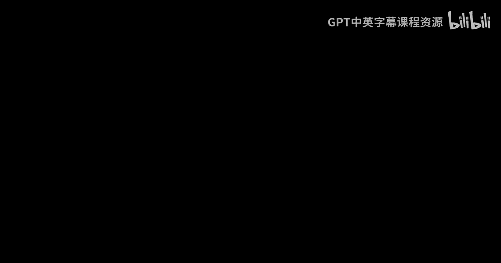
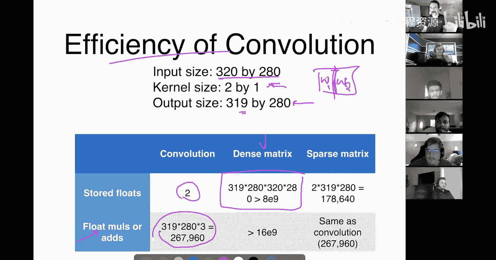

# USC《机器学习系统｜CSCE585 Machine Learning Systems 2020》中英字幕（Claude-3.5 p14 -14-Lecture 7.1 - Convolutional Neural Networks.zh_en -BV1Xc9bYVEC6_p14-

Okay， hello， everybody， let's。Start。Today。We plan to talk about a special， kind of。Neer network。

 basically convolutional neural networks， which are， as you know， very popular type of。

Neural architecture。And the key reason that I would like to discuss this convolutional neural network is that first。

 you get an idea of。What it means to have different types of neuro architecture。

 some interesting concepts behind these popular neuro architectures， also more importantly。

 the key is actually。Is that when it comes to understand some of these concepts at the system level as good as the。

Hardware level。 this， we will use the concepts here。To make things more concrete。

 basically convolution neural networks。Are the ones who。Have been deployed。A lot in practice。

 and that's。Why they are the most popular type of neural architectures and why it matters for us。

To understand the connection to the system and the hardware。

 because there are lots of opportunities for optimization， for example。

 for the memory aspect of these neural architectures。

 the kind of concepts behind how we could compress these kind of architectures and deployed them into this kind of basically small hardware。

pllatforms right with different macro architectureits。

 so we need to make things more concrete when it comes to discussing about these optimization aspects as well as the hardware aspects and some of the delays that we discuss across system spec we should have a good understanding of these important concepts behind continents。

Okay， so before we go into the detail， do you have any question？

Oh I saw these slides on on the lecture on the website I was just curious if they're like significantly different I noticed that actually are the same I probably added。

As fewer it。Few new slides or I will upload them so。Okay， essentially the same。May I ask something。

 so I would like actually some of you to turn on your camera。On a volunteer basis。Otherwise。

 I need to call call names， right。Yeah， we need more probably。😊，I'm on my desktop。

 and I don't have a webcam for that。 Yeah， that's fine。 Like only those who can。Okay。Okay。

 that's good because the key reason I'm asking this because。For me。

I would like to see your look right， and this is kind of feedback loop。

 I can basically see whether whether you understood things right or not or you're confused and adjust the way I can explain things。

 So this help me to。I just basically the way how I teach， this is what we used to get in。

Normal classes， right？But it Zoom， it the virtual class is difficult。 So That's why I would prefer。

 actually。嗯。To see you so not forcing to all of you， but for those who can。

 I would appreciate it if you turn on your camera in also in the future as well。Thank you。Okay。Right。

 so con networks。So basically and basically， you can find more detail in this。De learning book。

 actually this is the here I have the physical book here。Let me show you。 You probably know that。投是。

So this is the book， right， this is a famous book， deep learning book。

You don't need to bite obviously， but with this link you can find the PDF right to if you are for those who are interested to。

To know more about convolution folk also the other type of law architecture。

 it is actually a very nice book I definitely recommend for those who are interested in deep learning。

 this is a solid。Deep this is one of the basically books that I enjoyed reading a lot and I learned a lot this is not a shallow book this is one of those theoretical and solid books for those who are interested in doing research and' some more about machine learning more specifically about neural networks definitely recommended right。

But to be clear， you don't need to read it for dis course fully。

And the content of what we discussed today is based on this book， yes。I was getting my my camera。

 what， what book is it that you're discussing that you're referencing what's the title of the book。

De learning。Cool， thank you very much。 Yeah， And the link is， you can find the link to this book。

 basically on the slides。Okay， actually， convolutional networks are based on two key concepts。

Nothing more than that。 Just two key concepts。And these two key concepts enable them to scale up。

To process basically large input data， right， and by input data， let's not only think about images。

 obviously images are important。Because we can capture them by camera， but also。

These involve voice and videos， right the same thing。Applies here。

 so whatever we discuss today and about in general neural networks。

 even though we may provide example only for images。

And also for your project to clarify antennaA as a framework that you're working with。嗯。

You're basically doing the evaluation mainly on images， right。

But by no means this is restricted to images， you can apply the same。

stuff if you are interested to basically see how it works on other type of inputs like voice。

But definitely you need to figure out different types of transformations for the ensemble defense right obviously the kind of transformation that we have developed for this current version of antenna that we realize right and again I would like to emphasize it is a framework right and we realized several version of this framework as a defense so every realization you can think of as a particular defense right so for example。

 when you put together 10。The differences。You create a particular of this。Basically。

 adversariial defense。 This is one realization of framework as a whole。 You can do like 20。

 you can do 30 or whatever number you want。 You can also develop your own transformation for for image and add it right。

 you can develop transformation for voices right and try it， whether see how it works。

 whether for example， this could be interesting scenario that show that， okay。

 it is easy to trick maybe something like city or Alexa， but with this defense， it is not right。

 so it blocks this kind of。Admeria attacks on voices and their papers and research in this direction。

 basically adding some hidden noise， hidden attacks to voice， which is not。

hi we cannot detect it by our error， like these are hidden commands in the voice that you can add and treat something like C or Alexa to。

 for example， to do crazy thing right for just something on behalf of you right people have shown it。

So this becomes very interesting here is basically mainly we discuss about images。

 but basically you can do apply a convolution neural network on any structured data it is important to be a structured to be grid like。

Right， so the structure we are talking about is a grid kind of a structure， like images。Okay。

 that has S， so each employee by structure， meaning that each。

Pixel in the image has a special position， also with respect to the other pixels in the image。嗯。

And you know that for images， you have a grid of pixel values， you might have， for example。

 three different channels right， for each for each image， for example， for red， blue， green， each。

 you have three channels， typically this is for colored images for black and white you have one channel。

 right？嗯。But it is important to understand this type of architectures。

 neural networks apply for structured data， okay。And one example of maybe non structured data。

 if you want to compare is， for example。You can think about a time series， right。

 So you have a time series of data， for example， about temperature， about whether this is a kind of。

You can think about this different kind of a structure is not grid like a structure。 Okay。

 it's a vector like a structure。If you want to compare it。

As question will we get into time series data Is there any question， I cannot hear it， if there is。

Is somebody asking question。Yeah， Jacob is， but it was pretty quiet。y嘢。You want to ask。

He posted in the chat saying his mic was bad。He was I can see the chat Im so sorry I'm reading it out I'm reading it out I was saying that。

He was asking if we would get into time series data at all。

We might might discuss about time series actually， if there is interest。

 but depends like on the time because these are。More traditional kind of data。

It's kind of old way of machine learning right， but we might discuss about it actually。

 some of you are working on time series data and like this kind of data also important。

 we might talk about it a little bit yeah。Yes， so basically grid like a structure。

And since there are lots of data。The videoide in images needs to be processed。

 right is not one number is it。Like a lot of data in even this one image right that needs to be fed into into this architecture and this idea。

 these two idea as far as connection and parameter， sharing， enable that to do it very efficiently。

Okay。These two simple idea that。Basically， we plan to discuss about these two very simple idea to understand。

What we are what they mean， right， sparse what what we mean by sparse connection and what we mean by parameter sharing。

But at the abstract level sparse connection means that in contrast to the fully connected kind of deep neural network as we discussed。

 you remember。That each each input is connected to all other units in the network， right。

 So you remember that we had。Input here。And we had。Output， so every。Unit and by unit。

 we mean one of these neurons probably。Is connected to all of。All other neurons in the next layer。

 the same for this。The same for the other one。But as spars as connection basically mean that we want to change this to a kind of a kind of a structure that makes things a lot more efficient。

So most units are not。Actually connected to many other units in。In here。O。And parameter sharing。

 meaning that。In， for example， in contrast to hear what by parameter， you already know what we mean。

 these weights here we have weight 1， weight2。And all of these connections were associated to different weights。

Different， like number， right。And。And we discuss extensively about learning these parameters。

But the problem is that， you know， this is optimization， running optimization is expensive。

An optimization we wanted to learn these ways。So having a lot of valid basically is expensive tasks。

 but we want to maybe save have fewer weights， so have less basically connections。

 this provide us not only efficiency， but also if we want to learn them we learn them with higher confidence right so because if you have few things to learn with the same data obviously we get more confidence this is basically from a statistic。

You know about this。嗯。So these at the high level， but we will make these things a lot more concrete today with a little bit of mathematics to understand what are these right。

 but you got the idea about the sparse connections and parameterchet。

And the other important thing about convolution neural network， and this is also very。

 very important， right， it generalizes very well。And especially。It has some property， like。

It preserves some invariance， right， so for example， if you have a cat。Right。

 if the card is here in the。Right if you learn that this is a cat。If you move it here， right。

 the other side of the。Input right， the whole thing is the input， right？

You want to still recognize this as a cat。Okay， without learning this as a new as a new。Data。

 probably， right， because it's the same It's just moved。嗯。

So with these convolution have this property that the general rises very well across with these invariances。

 right。Translation， maybe rotation。Due to the particular operations that they use。

 they have this property of good journalismization。And basically， this idea is applicable to。Yeah。

 higher dimension as well， not only two dimension， but higher dimensional structure as well。

Any question until here。So the idea we want to introduce here is basically convolution as a new operator that we want to learn what it is。

And。Basically， you can think about it as a replacement for matrix multiplication。

 because matrix multiplication was the key operation we needed to have for。

Densely connect neural network， as you know。诶。So you can think about convolution as a replacement for matrix multiplication what。

As long as we introduce this new operation， everything else。Would remain the same。

 So no changes the way how we train the network， right。

 So we only introduce this new operation and we get the property to do， for example。

 if you used to do training with maximum likelihood。You can do that， right。

 If you used to do training with backdrop， you can still do the same stuff， right。

So the same exact same thing that we used to do with fully connected neural network is still you can do it with con neural network。

Alright， so if we only change the architecture here， the kind of。

Oper operatorsperators that we need to do the calculations， but in terms of processes for optimizing。

The architecture， everything else would remain the same。And that's， that's nice， right。

 Because we don't want to introduce a lot of new changes to the way we used to do。

And let's talk a little bit， you know about matrix or thatt product。

Very simple If you have two matrices， right， A and B。O。A， for example， and B。

 in order to calculate C。You basically。For a specific， for example， cell here。

 you retrieve on a specific row， row I。And a specific column。 And then you multiply them easily here。

 Right， So AI K， you know that this is one of。One of these multiplying by this， and then this。

By that， in order to calculate this right this is。C I J。

Within this output matrix that you want to calculate。 And， you know that the， you know。

 this linear algebra is should match， right， So this is already a presume， you know。还你说。

If you have question， let me know。To， if you want me to explain more， but these are easy。

And also we need to know about matrix transpose right。

 so you know this operation you have this a and then you transpose it to get new new a right so these are basic。

Matrix calculus， right。And you can do transse to。Mattrix multiplication as well。

 so you know about this rule right in order to get the transpose of these。

 you can do transpose multiply by transpose a。So， these are easy。Or what is convolution。

 Convolution is。Again， very simple。But think about that you have your input。So this is your input。

 Think about this as。And the image。 Okay， and image， you have different pixel values。

 So each of these。Basically， the one P。开。😊，And you have a kernel kernelel。

 you can think about this as the parameters that you want to learn or you have learned through a stochastic gradient descent。

 right？So these kernel have also a greatest structure right has also W， X， Y and z。

 so you represent each value by like a variable。And here you have ABCD whatever。

 So convolution is really doing。Very simple operation， right， Imagine that you have this window。

 you have this kernel。And you slide it through this。Input a structure， right。

 So you have K K typically is a small grid structure。 Your input is。

Is basically a large structure that's a difference in in contrast to kernel right so input typically is large structured kernel smaller and then you need to slide the kernel over the input to produce the output so this is this is the output structure and again。

 the output is also。A structure， right， Not get grid the same way。ok。

So you slide the kernel over the input to produce the output。And。

The rest the mathematics is very simple。 So， for example， if you put this k into。This part， right。

 so you start from upper left。And then you do the product of between corresponding pixels， right？

Aresponding self。A multiply by W， B multiplly by x plus E multiply by Y and F multiply by z。

Very simple。 And sum them together to produce。One cell。In your output。You are slideed。Here。Okay。

 doing the same。BW。CX。F，Y。IGZ。Okay， you slide it again。Here。You get C W， D， X。J， Y and H。The。

And the same be on the second browser。 right， So imagine as a window kernel， again。

 small input is large。 You slide to produce the the structure of the output you want to have。Okay。

 and this。Output typically are called either。And the terminology you might have heard is is typically called feature maps。

 right so。These are called feature。Marps， so basically each each output。

 you can think of as a feature that you have learned。O。嗯。And if you want to get different features。

 then you might want to have multiple outputs， right？嗯。So each each of these output。

 you can think about a specific feature that that you want to you want to learn， right。

 Also these also called channels as well。So if you have heard about channels or future map。

 send the same thing， okay。啊。Any question about this？Is it k？Because these are important。

I would like you to understand them very well。Then later on， you learn other more complicated stuff。

love easy。And again， as I said， the input。So for example， this this might in the if it is the image。

 right， for example， it is the image。You， you may want to think， okay， it has three channels， right。

 for red， blue， green， right， sorry red， green， blue and。

And if you want to and this was a one output or one feature map。

 if you want to have like let's say two outputs right， so you need to have a second kernel。

To produce the second， the second output for you in the same way， right。

 If you want to have like three feature maps， you have then。The third cabinet。哎。嗯。

So basically typically， like for example， you can think that in the first layer。

 input these three channels and then you do this like you make it like 34， 32 for example。

 feature maps and then 64 and so on， you increase these feature maps。

And then at the end you reduce it to get to produce that this is the kind of structure that is more common。

 things get big and then get a small， typically in conversion on a network。I have a small question。

So would different attacks or different。Yeah， so so for different tax or different weak defenses without yield of multiple different kernels。

If I understand kernel correctly。No， that's you're talking about we defenses， right？Yes。

 you said we so each week defense in Ana is correspondent to one one convolutional network right so so basically more concretely more concretely in the context of Ana we discussing about it right you have input right this was the way you can train or these correctly which defenses are trained you have one input。

You apply a transformation to the input， right。So and this transport transports input， right。

 so they have x。You get T of x。And this excess。Belong a large set of training example， okay。

And then you produce these T of access。 And then you train your network using these T of access。

 right， So you get a trained。Network on the transform input。Basically。

 think about this as each network is expert for recognizing。Like flip images， something like that。嗯。

But， but basically， think about each week defense as a different。

As a different network that has been trained independently。Makes sense。Yes， thank you。Sure。So again。

 this is important to understand because it might be confusing for some of you。

So typically you have multiple outputs stacked on top of each other， and for each of these output。

 you need one kernel to produce that output with this convolutional convolution operator。Okay。

 so that was basically key the key operator and。This is the main concept you needed to know about this evolution and as I said it's。

You can correspond it with matrix multiplication。So take an input， produce an output。

Typically hidden layer， right， you have the input， you have several hidden layers。

 and you go on until the end。You have two other。Operators， theconvolution。Basically。

 is the multiplication by transpose of a matrix and you need the convolution， basically。

 the convolution is similar to convolution， but going from output to the input right， you remember。

 we started from basically。We started from input in the network。

 we propagating to produce the output and。And you remember for backdrop。

 we needed to propagate the error back to the input and by error specifically the ra of the loss with respect to thes and we discuss about this to propagating output to the input and for this unit need the convolution operator to。

To do similar concepts， but for doing things backward， right？But it， it's very similar concept。

And weight gradient computation。Itss useful for parameter sharing， right。I use for back。

 I get the error from the output to the mate。So， yeah， that's so again， to。

 to make things probably concrete。 if you forgot， let me maybe。It was start here。

You see my screen right。So you can think about this as again， you have。You have input， okay。

And then you have your weight。TheMatrix， right。W and here I represented as like a matrix。

 not one weight， right。To produce some hidden layer， right。

And then you have maybe some more hidden layer year。And so on。And then， you produce。Your loss， okay。

You propagate the， you start from input multiply by。Mattrix of eva， right。 So here， for example。

 you can have。Wight1。Wait to。Wait and。O。To to get to your loss。So， basically， this is。Specifically。

 H1， again， a matrix is。It's calculated by multiplying the weight matrix to the input and then again。

H 2。Again， is a matrix， you got W2。Multiplily by。H1。O。And this is to be clear。

 this is not the product， this is multiplication of matrices。

Because now well put everything into matrices。Previously， you had this small W， right？

Doing a this W where。Basically vector， right now here with this notation。

 we put together all of this weight vector into a matrix。Okay。

 that's somehow mathematicalically we change this。嗯。

And then you used to produce these elements of these H， right？For example， H。1。

Like one of these elements， right， I used to produce this by。

Multiplying these weightits as a vector to a specific。A row in this， right。

And suming over to produce one of the elements in。In this matrix。

 but now with this notation we change this to a matrix and then you do the same matrix multiplication all the way down to get these loss。

 right？And then basically doing the same， so this was your forward pass。And doing the same。

 you can do backford， Okay， you can do the same backford。With with the loss that you produce， right。

 you can， for example， here， you get the error on。On here， right， then you can propagate back。

 And this error。嗯。Our peace back。Imagine this matrix， this E is。

Which element is the partial derivative of the loss with respect to rates， right？

So you multily this to。To basically these weight。For this layer， right， transpose。

In order to basically。goinging啊。Going the other way around， right， so。

So you multiply this in order to produce。Basically， the another error。Maybe I respond。

And then doing the same for。To。All the way down to to have the error with respect to with respect to the parameters that that you want。

 right， basically this is the way how it works in。诶。In neural network。

So doing one forward pass and then doing one backward pass， this is the way how we used to do。

 But now you can think about replacing these matrix。Mulipplication with convolution right。

 so the mass is really the same， but we replace things with a new operator。

 which is called convolution。But really they set everything would stay really the same the same way as we used to do。

Any question？Yeah， so that error error one， for instance。

 that does that correspond to then the first。Oh right okay， never mind。

 you do have it written there just to the eighth weight， okay， that actually answers my question。

Yeah， you do the same until you really doing the same kind of operation until you get like the error that you want to get at this。

For the input right， and then you use that to to adjust your weight。

 This is what you want to get to adjust your weight accordingly。This is the mathematical。

Description of this， but we also describe this with different。From a different perspective。

 from like。嗯。More granular inner product also from the computation graph perspective。

 how things will be done even with framework like Tensorflow。

 all of these operations basically automatically by the framework。

Basically think about these tensorflow as a library that do all of these matrix multiplication for you automatically for calculating the gradient of stuff。

Any question about this？Okay， so let's talk about this。As far as connectivity is very simple right。

 so here in dense in deep neural networking or densely connected network。

You remember a fully connected network we had。Each of these， each of these input is connected to all。

Units in the output。Right， it means that。诶。For example。

 it really depends how you want to interpret things， right， So， for example。This little guy。

 this X tree affect。S 1， S 2， S 3， S 4， S 5， right。Why， because you calculated S5， for example。

 by doing what， by doing weight1。With X 1。Plus。维图。With next door。Plusus。W 5。With x 5。All of this。

 right。Including X3。Its way， right。 So plus， sorry。So this， you see this term。

So these appeared here for calculating S5 similar for S4 for calculating S3 the same right。

 so this little guy affect the value that you get for all of these units in the next layer。Okay。

 so this is what's happening really in in。Anddent。Connections， right in deep neural network。

 which have dense connection between each layer。 and this is what you have learned right we discussed。

Right， about the architecture of neural network。 So the neural network stuff that we discussed was this has these dense connections。

 if you remember。嗯。But with Spar's connection， this is slightly different and this is important to think about it。

 right， is that this little guy affecting x2， x3， x4， but not S5 and S1。Okay。

 so it has a local connection to a limited number of units in the next layer。

 And this number really depends on on what。Can you guess。What this number depends。

You mean like the selection？Of。The number of captions from an input to an output。

So y instead of tea is not4。It depends on the kernelel size。Yeah， fantastic， right？

 So you remember here。😊，Back to here。So the kernelnal size is2。Right， so see here。嗯。要 see诶嗯。Right。

 or， or maybe think about。嗯。CB。😊，Okay。And where else it appears。App peers also here， okay。But not。

 yeah。So it appears into into units， right， So， but if you had a larger kernels or smaller color。

 that would be different， right， So so basically。Each input with it is property of that we have with kernel and convolution operator really make the network as sparse so each。

Input is connected to only a handful of。Output units。

 not all of them previously we had with densely connected network。Vole is important。

Why do you think it might be important to have this？Well， I know for one reason。

 computationally speaking， it's just more intensive to。Compute for all of the notes。

And I suppose another reason is that。Whatever operation it is that we're trying to encode through these convolutions or through these connections。

 they might not necessarily require a connection to all of the next nodes。

So if we add like all of those extra connections， if we have more than we need， I suppose。

 then we we might have some。Issues of， I guess， overfitting。Yeah， right so so basically。

 first of all， you have much less a stuff to a store right and much less stuff to compute so basically nice cat。

So。So basically you have stuff lesser stuff to a store。

 so it becomes much more efficient in this way， right？U。

So these are the properties that you get with is sparse connection as we discuss。

These numbers really depends on the size of the paradigm。

You can also think that the other way around right so this was one view right from the input to the output now you can think about the output like this S3 if you can think only depends on limited number of。

Number of input units， right， So S3 only depends on X 2， X 3， x 4， or previously。

 these fall basically。Dependent on all of the input units。 So all of these X 1， x 2， X 3。

 X 4 and X 5 basically affect the value of S 3 due to this。But for calculating S5。

 we needed to have value of all of these。Exess。So two， the same thing， but two different perspective。

That you can， you can look at it。And these basically sportsrse connectivity provides some of these properties that will make concrete about the invariances that you get with this type of neural network。

But like the key takeaway is that you have much less stuff。嗯。To a because of this。

A sparse connection。 And you see that this is really a sparse， right。

 comparing to these crazy connections。But one question would be okay。

Maybe you say that okay what what would happen to learning right so maybe these stuff do not learn about the whole so basically the stuff do not cover the whole input space right。

And。Basically， that might be true， but if you think about。

Multiple layers right that might be true here for when we have only two layers right they have input and like the next layer or output right so input output no hidden layer that's that might be true that like this guy may not ever know learn about this these two guys but。

If you think about deep architectures， right？嗯。This is a concept called receptive。Filt。

So if you think about G3。And yes， GT only depends on H2， H2， H4。But H2 basically sees H1。

 sees X 2 and sees X 3。The same for H3， X 2， X 3， x4， and H 4 sees H G。X x 4 and x 5， right。

 So now as a result of this hierarchy。Basically the whole input。Data was reached to this output G。

 right， So if you add these hidden layers， and that's why we need hidden layers to grow the receptive fields and see the whole picture。

 right。嗯。This is the this is why we need hidden layers and boy this stuff going deeper and deeper right basically learning more about the features in the input from different angles right and these different angles are really produced by these。

Features or panels， basically， that that we have。嗯。And yeah。

 that was basically about the sparse connectivity， right The other concept is about parameter sharing。

Right and that's also important。So what happened here is that in traditional。

 densely connected network， basically。Every parameter was different， right。

 So we had a large parameter， right， So each of these connections， right， again， we had W1， W2。

 W3 waterway， right。So， each of them was。At different parameters。

Right that we need to learn differently。O。And each of these stuff was really a separate thing。

 separate entity。 but in convolution。Convolution actually shared the same parameters across the spatial connections。

So basically， this guy is the same as this guy， same as this guy。

 same as this guy and same as this guy。O。This is a specific connection。Do you know代理。

Why this happens。Could you recire the nodes you're referring to the everything being in purpose a little bit confusing to keep up with。

使写得嘅。Or you were showing them which nodes were you were focusing on， could you。Yes， saying that this。

 this guy， this guy， this guy， this guy and this guy are basically the same， the same， right。

 So if you call this W1， this is also W1。 This is W 1。 This is W 1。W理吧。Right。

But here like we have like only W1 here and the rest was W2 W2 in whatever they were separate。

 no parameter sharing here， we have like the same parameter， but in different places。

Do you know when why this has。Have we got this property。Because it uses the same kernel， exactly。

Exactly， right？So you remember here we have the same kernel。 We just slide it over the input， right。

 but it's the same kernel。So we have the same kernel sliding over the input。But really。

 the kernel has。Is the small， the small sizes and just the slide it so sharing。

 so sharing means that like this thing is slide over。This input。

 and that's how sharing happens right is two different。Viewpoint that you can think about this。

 right， This is like kind of。To the structure。 But here is from。Different perspective， right？

So basically making these， these things， Imagine that now you see these things as a。

Notown as structure input， but if you put this into a structure you slide the kernel。

 then these parameterti sharing happens。Any question？So do we have then one kernel per like layer？

UOtherwise， like， you know， we would just have like the same。

 I feel like we' had the same weights being。Repeated through each successive where might not be or it might be I feel like that would be like a really restrictive。

S， I guess， yes， so for each so。These is stuff。This kernel， right， again， I said。

 like when you have one input， right， this kernel is slided over。

 give you one one output would give you one。Feature map， right， So if you want two feature maps。

 you need another kernel， right。If you need three feature maps for like。For this layer， right。

 for this。For the third output， you need the third cornerner。Okay。And you learn them separately。

 right。You learn these。Parameterters inside your channel。 right is W， X， Y， Z。嗯。Is this this stuff。

 So imagine that like this guy is。Is for detecting edges， right？

And this guy is for detecting some other features， right， detecting circuits。For example， right。

 so each of them is is。Is for different could be associated or talked about as different features that you want to want to learn。

 right？Or basically there are。So in better way is that these different kernels enable you to learn different features right because the features are really in your outputs right so this kernel help you to learn these specific features like edges。

 these kernel learn help you to get these output， the other output for circuits for example。Okay。

 and as you move down to these hidden layers， these features becomes more high level， right？嗯。

It generalizes better and。Do do this， right。So， if you move。Deeper， right。

 you learn higher level features， right here， Maybe you want to learn like edges， circles， the stuff。

 low level features。 and then you move。Down to the architecture。

You learn better about all higher level features of your。Of your input。Right。

 and this parameter sharing really。Again， help you to right so you have one parameter here share the cross。

Across these different inputs， so it help you to less parameters， right to save things and store。

Save basically memory computation。 and also you need to learn these once， right，Previous。

 you need to learn these like different ways， right。

 So this was different from this guy was different from this guy was different from this guy different from this guy。

Like not only you need to have memory to store them， but also for learning them。

 you need data and like you get。Right less generalization if you use the same same size right。

 so the same data for less parameters， obviously you get better confidence over your learning。

Right when you do this stochastic gradient descent。Right， so for example， think about this。Carlonnel。

 and this is your input。And this can imagine that， like one。

Negative one right for detecting edges where the edges are。Okay， so you slide it over the input。

 get something like this as an output。And this gives you where the edges of these images are， right？

Like here， right。So this is the way how we can。You can think about it。

 This is one of your feature maps， right， the output that you produce。

Would the orientation of this curl here like make it more sensitive to edges？

In a vertical from like a vertical difference as opposed to a horizontal difference like across the picture。

舍得嘅。So。Would this kernel， I guess， being a two by or a one by two？With that。

Make it more sensitive in some way to edge differences in edges。

If you imagine like there's an edge that's horizontal versus an edge that's vertical would it be more sensitive to like one than the other yeah maybe maybe yes。

 yes， as you can see maybe this is。Detecting these。Ororiztal， it is better， right。Yeah， maybe。

That's why you have different cares， right？Right。And yeah。

 think about like efficiency of convolution is that like imagine an input size of this 320 by 280。

 and you have a careness size  two by one。Right， and this is your。Output size， right。

 you can imagine why you have one here， right because of this banner size two。

So here for convolution， how many。A storage you need。How many things you need to install？2， right。

 is two by one， right， You need to learn these， these weights， right， You have two weights。

 You have W1， W2。Yeah， you need to， but for。For the other， densely connected， you need。This many。

Right。And why this many。喂hy do you think。Why is that the case？

That's the array corresponding to or not the array。 Sorry。

 that's the matrix corresponding to the features of each input。

So 319 times 280 is the matrix associated with all the features and then the three at the end that is。

The number of nodes for each layer。嗯哼。😊，Yeah。Or maybe maybe you guys think about it and we'll discuss next time。

 right？Maybe some of you could explain why we need these many。And what is the difference？

That you get with respect to densely connected that network， right？

And why you need that many parameters to， to save to， to store， right。Okay， let's stop here。

 but think about this。Because these stuff would be where we connect to the hardware。Are important。

 but basically the key takeaway that you had for today is that you you now know about convolution。

 you know why they are important and some basic concepts。

 and we will continue after what more details。O。Have a good day。 See you soon。Thank you very much。

 have a good afternoon。Sure。喂。

