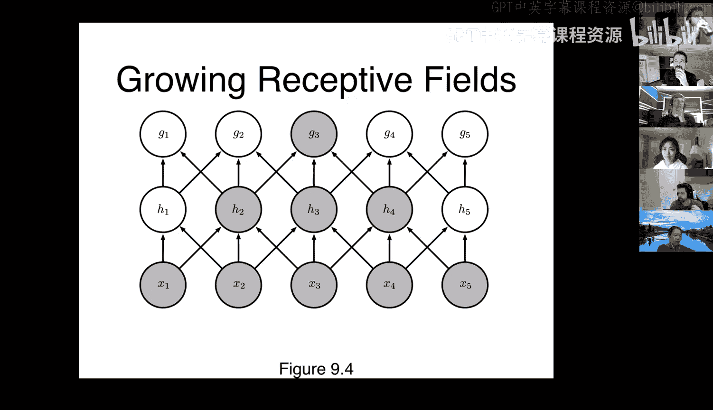
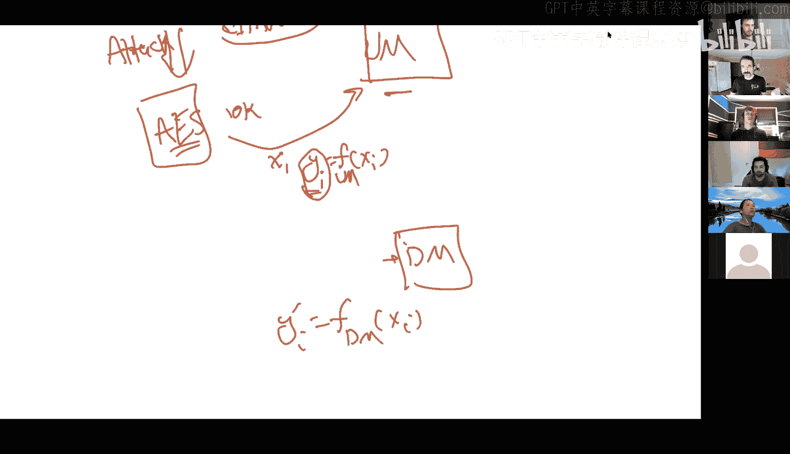
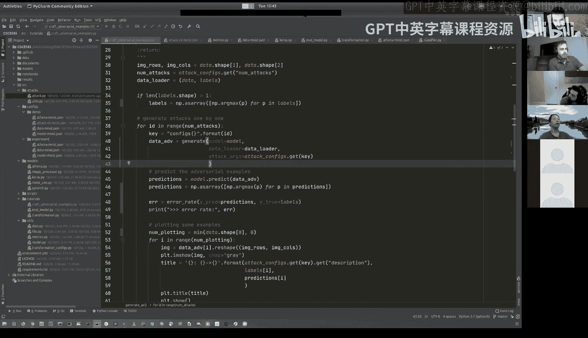
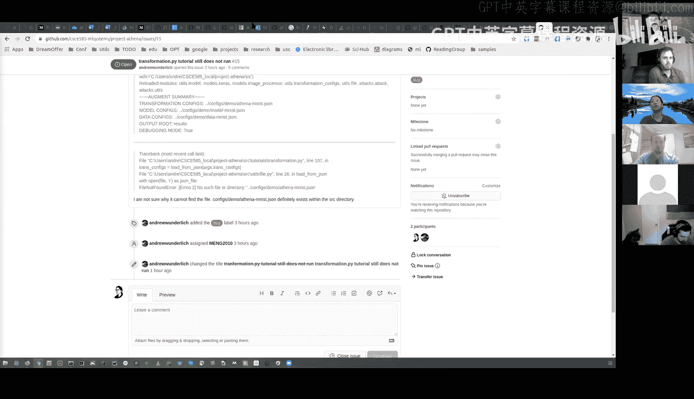
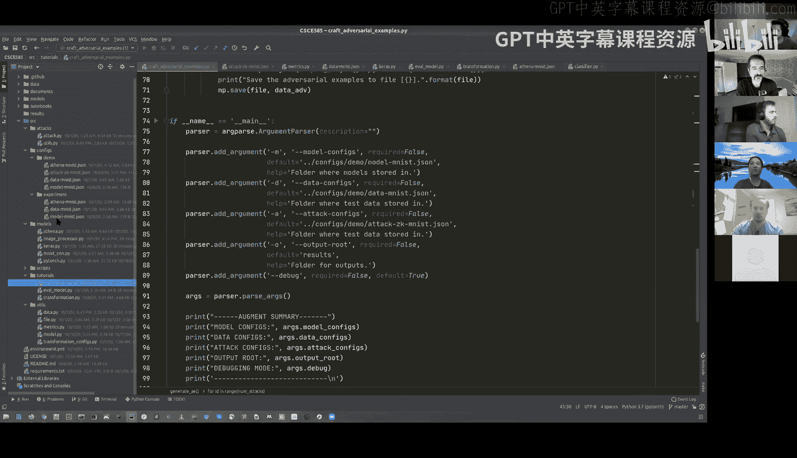
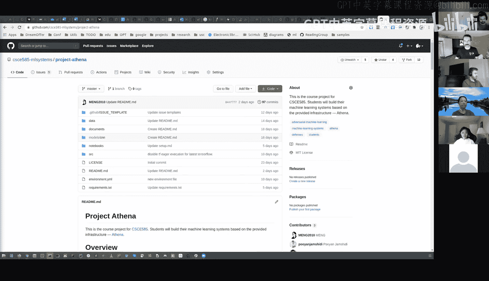

# USC《机器学习系统｜CSCE585 Machine Learning Systems 2020》中英字幕（Claude-3.5 p15 -15-A Demo of ATHENA for CSCE 585 Framework Overview.zh_en -BV1Xc9bYVEC6_p15-

Okay， hello， everybody， let's start Con discussion about convolutional neural networks。

Before we jump into detail， do you have any question？

About like whatever we discussed so far or about your project。Yeah。

 I was curious how folks in the class are doing with the project is anybody feel like they're in good shape with it？

Yeah let's discuss that that's a good point and maybe if there is something that we could do to facilitate this。

Let me know。 Let us know。 Basically， we are happy to， to facilitate this discussion。

 but maybe now is a good time。 If you want to discuss， if you have others have done some。

 have made some progress， you want to discuss。 That's a good time， I would say。Yeah嗯O。

Oh I just want to go okay。I have a little。Question to to ask like this， before I， I took discussion。

 we have a discussion of learning， machine learning。In regard of my research。

 because I'm from the mechanical engineering， my research is all about you I tell your video， Josha。

ok。Okay。O啊。I'm from Mechan， and we have a discussion first before I actually。To this course， no。

 many of us from other department， we don't have。Enough background in in CSC and stuff like that like me I use other things for my research vis labs。

 but my advice actually wants me to lend machine learning me to predict these properties so but ever since this project it's really。

Different because most of the things we are new to it like and what I've noticed in the class we have more of students from CSE and the parent of this group would have been done in such a way that you can do the parent like two people from CSC who from other department so that we can learn from there like before four of us in the group we haven't issued we cannot even install the antenna those that have issued running in fact we just confuse on what to do。

Right， so first suggestion is to basically。You want your teammates be from CS S side， right。

 Is that what you are asking， Yes， like some from from C S and others from so that we can link something from there。

 like Yeah， that's， that's a good point。 I mean， how we can facilitate this。 I mean， you could。

For the group through Piazza as well as Gi to but the that the CSE student they know themselves and they quickly pick themselves before you can even add they say oh I have a group already I have someone already I have someone already so it's just left for us that are coming from other department just to pay off with ourselves I keep having issue an issue to run this like me if this is the first time I'm using Gi all like if we can tell with this student we can learn from them at oh this is hard to do it so you know first we can run this project I'm filling this project for I agree this is a good suggestion I wish you would have suggested it earlier so we could facilitate that connection but still I believe it's not too late。

And。And I guess like you had the chance to meet and discuss with Ying， right？

In order to resolve these like initial issues that you have had for within a Stling Athena and other libraries that Ana is dependent on right and if she can help in any sort。

She's happy to meet with you guys， but I would prefer if you guys are scheduled it in a wayte that like several of you could attend such meeting right so she could help in installing resolving this issue or discussing even ideas。

嗯。Because this first step， you need to figure out， Okay， the first step is to install teams。

Sent up and get some very initial results see how framework works right and that's the first thing you want to do this should be easy I know there should be some challenges that would be helpful if you discuss it with with Ying and she can definitely help with that。

嗯。But in general this first step is a kind of a struggle that you will see across all different projects。

 so it's not just for antennana like you will see for most project that you want to do， right？

And there are many things that you can learn from this project。

 so and that's why basically I wanted to initially I wanted to。Provide several projects。

But I thought since we have this foundation and I see a lot of opportunities in this。

Both in terms of research， both in terms of technical aspect， the importance of these topics。

 cybersecurity of machine learning is highly relevant to this course and since we have been extending on this foundation for quite a while and there are lots of in terms of machine learning are lots of like opportunities in terms of for example。

 the detailed how defenses work， the kind of models you could use you you are free to use any model you are not asleep that even to deep learning models you could do whatever we discussed like in terms of in this class right even you could use na based kind of models right and any models that you could build these weak defenses so you have flexibility there if you're interested in particular type of model you would like to go deeper and under。

Stand them deeper right you could also think about more high level the they have the ensemble work right there are lots of opportunities I mean ensemble models ensemble learning is a very important part of machine learning and if you are interested in that there are lots of opportunities ensemble typically I mentioned they perform really well in many different task due to the nature or the characteristics that they have。

There are loads of opportunities for deployment side。

 the connection between machine learning and systems。

 right I mentioned about deployment on resource constraint devices right how for example。

 you want to deploy such difference where you need to use several weak defenses in some small environment right and you could imagine a variety of different environment from very small I showed you right so we have different different these very small platform where you have really limited resources to deploy a software。

 you can imagine a slightly bigger one such as this where you have more flexibility。

 maybe putting more weak defenses there or you can go all the way down to something。Like this。

And this is also another， for example， this is NVDS Avier has more capability and connectivity to also cloud so there are lots of opportunities in the space of systems and machine learning in the context of this project if youre interested to do beyond these there are opportunities in terms of for example。

 model compression opportunities in terms of hybrid ensembles where you use different types of models in the ensemble from something like neuraler network to even random forest。

 you know even with base net， a combination of those putting together andsemble a hybrid ensemble。

 right the skies are the limit right， loads of opportunity。Even within this context。

 if you're interested to work on I know it's at the beginning it would be challenging。

 but it would be really helpful if you find your way and focus on these tasks initial task and learn from it I'm 100% short term loads of opportunities for learning nice stuff that would be potentially might be usable for your research as well eventually。

Yeah， so I would like to hear from some computer science students as to how they're doing if anyone has gotten this installed this has been a nightmare from start to now for me constantly I've resolved the installation issues it took me like 40 hours to do so but I was able to get it running and I'm still completely lost here but my background is electrical engineering I don't know how much of my problems are due to my own lack of background in computer science can any computer science students speak as to whether they've had success here because if they're not doing well I don't know how I will be expected to do well Yeah any any successful try。

Yeah， so after the recent pushes to the repository。

 everything was I was able to install everything just fine。So I mean。

 if anyone's still having issues with setting it up， I would expect maybe you didn't。

Maybe you haven't fetched like the new changes to the repository。

 that's something to definitely think about。Because the setup there's a file under the notebook folder is setup。

md。And that。The instructions there are very， very clear and then there's also been some changes that have been made to the requirements TXD file。

Those。I don't know with those changes and with that new setup ins full file everything seems to work fine like I was able to run the craft adversarial examples。

And the transformations。File both fine。Yeah， I was going mention that actually。Yeah。

 I worked with Saturday and I what did it all last night。

 I just redid the entire thing and it was magically working again so。

But you guys feel like you know what you're doing after you've gotten the setup issues resolved do you feel like you can complete this task successfully not going to lie I haven't even really had chances to look at that yet。

Yeah， and， and thanks， Benjamin， for your contribution， Right， Like Benjamin， for example。

 contributed to， to make this。Instruction better right。

 and we appreciate if you resolve some of these issue。

 if you have some thoughts making the instruction better， more clear。

 if somebody wants to clear a docker image out of these， all of these are welcome， right。

And I mentioned this， this is the description is is not perfect and you could make it much better right。

 But I just like since we have。Successful deployment of these stuff。

 at least Ying has successful deployment， so we know that it works and you should be able to also do the same。

With some initial struggle。Any other success？Or question or suggestion。On this。

I have a question about task one， are we creating our own attacks through the config file。

 and then are we training Athena for that or are we just creating the attacks？So， basically。嗯。

The attack algorithms are there， so what you need to do is to create adversial examples， right？

You have these benign examples， right， This benign example。

 This is what you get from the the benchmark， right， for example， C 400。 you want to use these。

 the testing example to test how well it works， right， And these are benign example。

 So you use the attack algorithm， right，Different attack mechanism that。We mentioned。

To generate these adversarial examples and you test the performance of like either undeefended or the defended model with antennana with different variation of defense that you built with antennana with these adversarial examples。

 right。I guess my question is I don't know how to test the adversarial examples with Athena。

 how do we feed those examples to Athena and have it spit out some sort of data？Right， Ynk。

 are you here， Do you want to answer that。I'm not sure。 Let me ask her。 I would suggest her to。

And additionally， besides feeding it to the undefended model and to Athena。

 we're also supposed to feed it to another state of the art defense called PGD ADT and the description says all these models will be provided。

 has that been provided if so where is it， I mean is there a tutorial I have no idea how to even begin that task。

Yeah y。Is see on the list or。Yeah， she is now joined。Yes。Yeah， she's here。

 so students have some questions about that Tina， do you want to repeat your question again， sorry。

Yeah， my question is， we have to make the adversarial examples。

 I'm assuming through the config files。But my question is after we make those。

 how do we feed it to Athena to actually test？Our examples and then have some sort of data on how well it did。

 how well it was defended against or how well we attacked。Okay， so do you know how to。

Prediction。呃。Excuse me。 whoever asked the question。

 do you know how to use the classifier to predict images。呃， no。嗯 ok。Right， yeah， good idea。嗯。

Let me see if I have some examples here What I can。 I can。 Yeah， maybe show that through the example。

 right， That is better。But before you start， maybe I can add something here to at least conceptually explain what's going on and that might be useful for you。

嗯。嗯。Then youan can walk you through the code and show you exactly how units you need to do that。

But essentially， how you think about this is。Is that you。嗯。You have your model， right。

 This is your model， right， And this model could。Again。

 in the most simplest case could live in your laptop， right， this is the model that you trained okay。

And then。You have some examples， and this could be benign。Um。Samples or your As， right。

And these are some specific aids that examples that you generated using these attacks， right。

 so you use this attack。I could attempt to generate these a。 Okay， and typically， I mean。

 in in your workflow， you have a set。 So this benign， benign example where your test set。That set of。

 for example， C farR。Under it right like 10k example that you have， you use the attack。

 you create a 10k example of averial example like for example， Cw attack， right。

 or FGSM attack whatever you want to use and then you have an averial example。

 and then you want to ask your model what do you think the label of these example is， right。

 So you have one example X1 coming from this 10k averial example， and then you ask your model。

 what is the label of this， and it gives you a label， right。

And then you compare this label with the true label。 So you have， you have three different things。

 So you have。 So this is the the。The prediction that is done by your model and this model imagine this model is your undefended model right without even antenna。

 right， So you ask your model what is the label and then you compare it with the true label because you have the true label of these 10k example from your test set。

 right。Whether your model predicted this example correctly or not， this is undefended model right。

 with antennana， you do the same you have a defended model， right I call this undeended model。

But you do the same。 And this defended model read antenna， right。

 you feed basically your example to antenna and ask antenna。 So let's call this F of defended model。

 What is the label of this。 and then you get a label。For for bes and then。

Then you compare it with the ground ruless right how will it perform on the ground ruless whether it was fooled or not right and then you keep track of how much error it makes on these adversarial example versus。

Versus the benign examples， right， But think about this as。

As a model that lives in your computer in the simplest case， But if you want to deploy it somewhere。

 a remote device， you could do that also you could set up a model server。

 you could load your model there in report remote environment and you could do the same like asking the model server interface。

 what is this label right you fit when you have a remote server。

 like you have an I you have an interface， you can ask this interface。

 what is the label of this example， whatever it is and you get and you calculate whatever metric you are interested in。

 So for example， typically you want to calculate the accuracy or the error rate。

And simply these are like metric， the only thing you need to know， okay， on per example。

 what was the label and comparatively the ground route and calculate the error simple as that。

But Ian can go into the code and show you the same。

是。ok。So， let me share my screen。来。So could you see the code， Yeah， Okay， so actually。

 I have provided you guys。嗯。A method。 Let me see in the matrix， u matrix。

So here I have provided you guys this error rate help you to compute the， the， the error rate of an。

Of an Ae and you need to provide the predict predictions。 these predictions were。

Made on the adversary examples。 and this ground truth， the true labels。

 where you load from the let me。From basically， if you're using amist， this is the true labels。

 If you， if your files was if your。AE were generated using this be sample。 So the。The files were。

 the images were safe in the same order。 If you， you did not generate your AEs using based on this。

Be nice sample。 I guess you need to save， save your。True labels。Because because the when you are。

Load the samples from the from the database directly。 The， the order might not be the same， so。ok。哦。

okay。So we have this 1。 I will show you how to。Call it。

 So in this craft adversial examples this file。 Let's use this file。So now in this example。

 we will generate AEs， use this FGSM。With epsilon equals 0。25。And then。

I think many of you guys have have run this sample， right， So here， let me remove this。Okay。

 so previously， you will see something like this。This is the original。How it looks。 Okay。

 so import this error rate from， from this file。 And then in here。

 because I don't want to plot the images here。 I， I simply。嗯。

So you can see here in this line line 45， we predict the adversarial examples using the model。So。

 it will give you。Predictions， this is a matrix。 Each role will be a factor of probabilities on each class of each class。

 So after you get this predictions， you can， you can do， I mean。

 you can get the predicted label or you can directly pass it to this。This method。

 and I have handled this for you。 So either you can pass the labels or the predictions probabilities。

 I mean。这。SoThe error equals to the error rate， so。You can do something like this， The predictions。

In the true labels。So， that's it。先朋友知道。So we can。Priring it。And print it out to see。Okay。

You can run this example。嗯，谁。O。哦。I know what's happening here。

 this is not necessary just because I I， I use the shape。 so you need to convert it to an array。

No one okay， label。晓的嘞。😔，It's that all here。I didn't。 I didn't know that。 I had a passed it。2。

2 labels。So you can see the area is 。8， so the。So that means 80% of the generated examples can for the target targeted model。

Or maybe if you go to the code again in to clarify those who don't know。

Like explain before before doing the prediction up there， what you're doing there。

 what is data add Oh have last time we have show this example。 So yeah。

 and and I believe many of the students has play with this one。So in， in previous class， we。We。

 we have went through this， this。This example。I will upload the this， this updates to the。

 to the Github so you can， you can check it later。 Okay， I， I will add some comments as well， okay。

Okay， so we don't actually have to generate any benign data set right that's already created for us。

 We're just we have already have the benign samples Okay， so yeah for simplicity。

 I have saved the benign samples and。And true labels。

So the images in these two files they were saved in the same order， so。So that means index1。

 the label in。In this， I mean， the index one is the。

 the label for the index one image in in this one in this file。

And here are the files are the AEs we generated in ethena。小。😔，This files we provided as the baseline。

 or for you to check it how， how the。generatedrated aE show looks like。

 So you have some idea when you increase this this a， I mean， this， for example， for FGS and。

 when you increase the epsilons， how how the AE will looks like， how it will in in fact， the the AE。

 the perturbations。Yeah。Okay， so any further questions regarding the project。Yeah。

 there was some question。 I forgot who asked about where some of these models can be found。

Do you want to repeat it。嗯。Yeah I forgot to ask I'm not sure if you're referring to my question。

 but my question is more with the second part of this project after you generate adversarial examples you have to run them through not only the undefended model but through Athena and through some other thing called PGD AD0T I believe and the assignment description said that those models would all be provided I certainly don't see where PGD AD0T has been provided but i'm not sure I even understand how to run it through Athena either is that the other tutorial。

Oh okay， so P G D P D A that A D T。 that's， that's just one model。 You can， you can。

You just load it and predict you use them， for example。

 this is the the model that you loaded from a PGD ADT。It， it just。The usage is the same。

 You You just load the model and call this API。 Yeah， we wrap the。We add a wrapper on top of the。

Athena and， and our weak defenses to， I mean， so you can call， you can use these models by。

 by calling this predict。 So， so we you can use it。Maybe the take So for example。

 where what they need to change here， for example， to test it against。Afterturn now or PGD， A E T。

 right， Do you want to show this， I think maybe。Let me嗯。Yeah， I， I'm not sure whether I can。

I will give you another tutorial tonight with， but I think I have show you。Last time to very。Yes。

Yeah对。到底去了。Thank家。It looks to me like it comes from the model MN IT。 Jason， right？Yes， so the。

The models you are the W Bs you wanted to use， I mean。You want in， in your ensemble。

 is's defined in something like this。 You， you can。You can provide your own name。嗯Yes。

It will looks like this。 So each。So here this ensemble consists of。nieen。

WDs weak defenses and each defense， each weak defenses has the configuration of the transformation。

Yeah。Let I think， maybe， let me。Let me provide you a tutorial with。Comments。TonightYeah。

 I think comments would go a long way in these tutorials to helping me understand what it even does and how I'm supposed to modify it to do what I'm supposed to do because I really。

 I mean， I see your code there， but it's not abundantly clear to me what I'm supposed to do with it to actually accomplish the task。

Yeah， because here I， I don't want to show you because this task one actually it's， it's simple。

 And I， I don't want to， I didn't provide the whole process because I think otherwise I have done everything for you guys。

 So I， I want you to。To play a little bit。 So that's why I hide some details。

And I can appreciate that， but the amount of time I've put into this project already just to get。

 I mean， the most minimal functionality is unbelievable， I could not do it if I wasn't。

Taking only this class right now， but I mean you've got to provide some help to us and give some comments or something in these files because。

You can say it's simple， but I'm 100 hours into the project and I don't have anything working yet。

 So so what so to be what part is that what is your question Because youre not giving us a specific question here that Yin can head right so to be the first ask is trivial already and like。

If ynk wants， if you wants ying to do this task， then I。This is something else right no no no。

 I don't want yang to do the task。 I want a clear assignment if you want specific questions I can I can load a matcher right now。

Yeah， yeah。 if， if that that's it。 I guess a good time。 If you have a specific question。

 and you can clarify。 Yeah， Go ahead。 that would be great。 Okay， first 1， I think I've already asked。

 I'm not sure I got a clear answer。 Where is the PGD 80T provided， How do we implement that defense。

Okay， I will give you an。So tonight， I will give you an tutorial。So， loading the。六电玩。A model。

And use it to predict and a tutorial to。To use a。Prediction and an example to to use ensemble to do the prediction。

So okay that will be helpful yeah that that will be helpful particularly if there's comments in it will be really helpful are we supposed to generate adversarial examples for all of the 10000 images in the Ms testing data set because we're doing three different attacks five different configurations for each attacks that's 15 attacks and on 10000 images that's 150 image processing iterations which I tried on my laptop using deeppo and a few other things and it's taking like 12 hours to run。

Yeah， deep four is is a slow one。 only the FGSN and maybe BIM is a little bit faster。

Have you verified that all of the preproded attack methods actually do what they're supposed to do because I've tried both for Deep fool and JSmaA。

 I have used the preconfigured ones and even made the attacks really strong and they do absolutely nothing to the images。

 the images look identical to the unpreturbed images and all of the even the undefended model predicts it exactly the same as it predicts the benign images is there could there be a bug there。

Actually， the。Iver。They wanted to。They， they just want to generate。As as close images to the， I mean。

 as close as possible to the ben samples。So， if you cannot。Recognize the noises。That might mean that。

 that means the， the attack。Is the is a good one or something that right， right。

 But it's not a good attack because the undeed model is predicting it correctly every time。 Yeah。

 this is what he saying right， So a predict correct I。So。I think that。Many。That can be many courses。

 It's not。Yeah there are many courses I can I can have you tried FgSM that you FGSM and PGD have worked for me they clearly do something to the image Deep full and JSMA are the ones I've tried so far that appear to do absolutely nothing to it I see and have you tried to play with the parameters that they have Yeah。

 I've ramped the attack strength up to to much higher than the default values and they they still do absolutely nothing。

Yeah， maybe I'm right。Okay， I cannot give you a。Quick answer right now。

 because there are maybe many different courses。Yeah there you guys asked first specific questions。

 so I'm trying to provide them， but I appreciate that you can't just answer everything but maybe you could you could open an issue and。

Provide what exactly you have done。 and youin can' replicate this why has happened。

 right and could could help it out。🎼Yeah， one reason could be， I mean。Because previously。

 we generated this AE based on top of the tensor flow。And。For。

 for simplicity for this to make it simple for this project， I refactor and。Built on top of the。

Pe torch， aban art that was built on on the， on top of pie torch。I think that's one reason。

 That's one possible reason that they might require different。 I mean， values for the。

 for the adversary setting， so。So。That's one reason。 And the other reason we need to。

 we might need to check the。The scale of your pixel。 Yeah， so have you check。The， the pixel values。

 have you scale all of them between 0 and1， because in previous in in ethena， we scale all the。

 I mean， pixel values between 0 and1。 That's one possible。Reason。 And yeah。That's。

 that's two things I can think of right now。 Yeah， most probably this is the scale of this pixel value that you need to。

You need to do。 but but anyway， like you， if you could give when you open this issue。

 give us as much information as Y can replicate this。

 then she can give you an answer to to make it correct， right。Yeah， regarding， yeah。

 regarding the comments， I'm not sure how， how detail I need to provide。

 So I have to comment line line。 I'm not sure because I mean， some of them。

 you don't for for some of them not right and。Yeah， for those， I mean， few。

Few words right what each important block of the code does right not line by line but block by block right by block I mean specifically chunk of lines in each method as much as they could help the students to figure out things and learn This is what I would also suggest that would be used right because my experience is I do something it doesn't do what I expect and then even if you've commented a little bit in this top level andvariably the error is thrown somewhere five files down in something that called something that called something that called something and all of that is almost completely uncommented and I'm working with 2000 lines of Python code here that I didn't write I've never seen before this project and I don't know how to debug with this system particularly what I'm not even an experienced programmer to begin with and I'm brand new to Python。

Really as much commenting is is really， really helpful for for novices like me。 Yeah yeah。

 that that's a very good。Feedback， thanks。 Yeah， she will， She will do so， yeah。Right， this is。

 this is very good。Okay， so yeah， let me answer one of your questions you were mentioning。

Whether you need to generate the A E for the whole tank， right。I don't think so。

 because for some of the。Some of the attacks it they， they。Cost。So。I think maybe I'm not sure。

you could decide， right， I think in the project description， we give them this flexibility， right。

 they could decide the size of the address or your example， but it should be reasonable size。

 it shouldn't be10， for example， right， It should be reasonable。

 It doesn't necessarily need to be 10k then maybe like a few hundred right。

 but you guys decide as long as you call it representative you know， that that's good enough， right。

 we don't definitely want you to to spend lots of time generating this like address or your example。

 but as long as you have representative sets that that should be good。Yeah。

 just one more comment if you， for example， if you generate some generate the adversar examples based on your own subset。

 please provide the corresponding tool labels。Because we don't know。What AE you， I mean。

 what be nice samples you， you generated。 I mean， you， you choose。 so we can。

 we cannot get the true label from that。 So you need to provide the true label and。Yeah。Sure。

 thank you。一首。😔，And if you look at this new version that we shared。

 I also put the link to this new version of the paper。

You will see that we also made some trade off right， sometimes like we made the test set for advers。

 your example， smaller like to finish the task right and you can do so right？

As long as you can call it representative sets that that should be good enough。

I would encourage others also like ask questions like Andrew ask。 it was very useful。

So if you have specific questions， please。Do so， right， Otherwise， like， I assume that。

You know what you are doing and you have no problem。

 So like telling us that you have had problem and you didn't ask is it's not good so we don't take it if you have problem now is the time to。

To ask those。Especially if you have also conceptual issue understanding what's going on。

 you can answer those two as well， if you want。Yeah， any questions， Basically。

 any questions regarding the project you can， you can open。Isues。Yeah。

 and do that as soon as possible， right， So telling us that you couldn't do this like in the last minute。

 we don't take it， right， Not accept， not acceptable， definitely。Now is the time。

YouNo about any questions to asked。Yes。就出点。Probably not。嗯。Yes。

 I was just talking to someone in my group， we actually。

 although you explain a lot of things about this thing look really confusing to us。

 we have to look into the project from Nancy Toze to try as much as possible to get the antenna working then we can see if we have any questions to ask。

For now， we really can't say anything because it didn't work for us at all。

What do you mean it will work for you。 Have you， Have you run the。

Examples I provided we couldn't run the example you provided。And so。

You need to you need to tell me what happened so I can help you to to make it I mean。

 to get it run on your on your computer Yeah， you need to provide the error right in order to help with that。

我啊。Maybe that would be a course because。So actually， Ying。

 if you remember we at the meeting on the virtual meeting on Saturday。

And we actually tried so much to make the Athena and the year。

And we could not resolve the dependencies of this plugin。From the meeting on Saturday。

 So till now yeah， I have opened the issue for you guys。 I have search。 I have spent。

Basically half of my weekend to search all the possible so that the are you mentioned the the issue Let me share my screen。

So I also was having that issue on Saturday， somebody in the chat said that they reinstalled Ananeconda and it started working。

So I tried that now I'm getting exit with error code one。Instead of， okay， then yes。

 So you need to tell me， you need to tell me the what's your problem。 And I。So here。

 this was the problem with。We met on Saturday's meeting。 I think3， three of the students had。

Encounted this issue。I have spent lots of my time on this， to search。All the possible courses。

 And So this is for Windows environment Ying。I think this。

 this has nothing to do with the environment。 It's just。But。Some。

 somebody have this encountered this issue。 That was because of the。The ABE， the editors。

 I have also suggested to use another AE or something like that。

 but because I I never encountered this issue， so I cannot try this solutions one by one for you guys so you need to try the solutions I provided and tell me this doesn't work for you and you need to tell me and then we need to figure out。

Another possible solution， right。Yeah， so I'm one of those students that was having this issue。

And I followed a suggestion from someone in the chat here that I just uninstalled Anaconda deleted the folder and reinstalled everything and I tried running the craft adversarial and i'm not getting the same error code now I'm just getting exit code one with Tensorflow is not found。

So you need to install。You need to install the tensor floor。Okay。

 can that just the condoda install or is that Pip install？嗯。Have you tried using that setup that M D。

Yeah that set up an MD file basically solved everything for me so where you can see there that it's under the notebooks folder Yeah can you try real quick。

Yeah， so in here， try this setup。Okay， try this I just okay。

 I just went through the chat from Saturday， so I will look through that one。Oh， yes。 in the chat。

 we install the Tensorflow， I mean。呃。I， I mean， you might。

 you might miss that because the the chat was was oh， the chat。I I I forgot to。

 to type this comment line in the， in the chat， yeah。You sure have you also followed the same setup。

Instructuctionions。No， I'll do that。Today or tomorrow。Yeah， yeah。

 please let me know because we don't take any any any。

Anything that like you face in the last minute and you couldn't do it， right， not acceptable。 right。

 Yeah， please let me know as soon as possible。 Okay， if you， yeah， please try this。And。

So so we can move on okay， so there was a。If you encounter some。Issues that you cannot run the。

 the code because of。Some file does not exist。 Please download this file。 Jason file， I think here。

 because you didn't download it， put it in in this demo code folder。I think I just saw this。Yeah， so。

It says cannot find this file this J file。 You， you just download this file and and put it in a。

 in a demo folder。Yeah， there is a file with that exact name already in the demo folder。

 the file exists， but it says it doesn't。 can you explain more。Then you need to。

 you need to update this folder this because maybe the folder was not the same。

In origin or something like that so I'm running the file with the root directory of SRC。

 the source code directory。And within the source code directory。

 there's a subfolder configs with a subfolder demo with a file Athena Ms。jason。Yeah。

 because it doesn't find that。Yeah， because。Running from the root， right， and， and I define。

 I put this file pass here。 I put the pass because I run it from the。

 from the craft adversarial example。 So if let me。Show you here。

So。So you can see， I'm running from here。So if I'm running from the path of this， this file。

I have to go one level up and then go to this， this folder。Okay。

 so the two dots goes a level up vote from here。Yeah， if you， yes。

 if you are running from here so you don't have to level up this is a sub order from your。

In your case， Okay， so you need to。Yeah， so you need to fix this path or the file name or or something like that。

 you， you need to check that。 That will goes case by case。Yeah， that explains it， thank you。嗯哼。😊。

Okay， so any other questions。

I have suggestion。 I don't know。 Is it possible， Maybe Yin can set up all these in Google Col lab。

 I mean， run successful for the sample。And then share that to those who haven't said successful。

I mean， Google coab。 Yeah， if we run a sample successful in Google Coab and share that to。S。

 share that to the classmates。 Then they can use that。 They don't have to sit up。

That may save save you time。 You don't have to assist everyone。that case yeah， yeah。

 that's a good one。 But in that case， if， if anyone， for example， there are multiple students。

Me to use that。 So how do you。So。They will update the same multiple people。

 update the same folder or update the file。 They will。Do this well together。 I'm not sure。

Once you set up， whether you can copy that in their account or something， I'm not familiar。

 but that may be a solution。Yeah。Ymy leader。I do have experiments using that。Maybe like。

 she can provide this。And notebook kind of thing。 And then you can use the notebook。Right。

 to follow through to generate a example and test it and this kind of thing that might be helpful。

I have one more question in a somewhat different vein if we're done there but I don't want to interrupt that discussion if people have more questions Oh good yeah ask a question so I want to make sure I properly understand the breakdown of what code should go where so we're supposed to submit a report in the form of a Jupyter notebook which has its own python code。

But you've already shown today that for example， you're calculating error rates and things like that。

 even within the source code files， not within the report notebook。

 so what exactly goes in the report notebook is it just code to basically plot data that's already been processed in the other。

I mean， it is just exclusively plots。That's a good question。Probably yes。

Basically a notebook that show the result that you've got， right。

 generating the plots that show the result。In a set of like。The part that you generate a stuff。

 you could ignore that， but。From the data that you got after running。

Atna and the other part of the task， right？You want to plot the results， right。

 Put those in addition to the comments， discussion， right， what you see in the plots。啊。

In the notebook。I mean， if you want， you can also， I mean， this be thought maybe this way is easier。

 but if you want to， you can also use latex， basically plot these stuff and create a PDF right with discussion and plots whatever however quotes for you better。

Yeah， I'm trying to find an example for you。Is there any other questions？Yeah， this might not be a。

Wait for okay， this may not be a proper report， but at first we were we。

 we are we thought of this Jupiter。 we， we were thinking that so it might make your。

Life easier because so when you get some。呃。Data， you can simply write some script to plot the figure in here。

 So， and in， and in this one， you can add some something like this。At the shop。

 you can make it as a markdown， and then you can write something like like here evaluation。

For example， something like that。 Then you just describe something like some results。

 describe your observations here so you can see when you click this on。

Whatever in here will become become text。Right。Something like that。 So that's。

 that's why we thought this might be easier for you。 You don't have to。Magement的 the。

The alignments or something like that。 So you you simply put everything here and then you you can write some script and it will plot get the results ready for you。

 something like that， but。But yeah， either way， if。

 if you're more comfortable with some other tools or some other， go with that。Thank you。😊，Thank you。

Is there any other questions。So， so you can see when you have some other data。

 you can plot another figure。Something like that。Maybe because we we we are more comfortable with in this way。

 but。Yeah， you're right， just。Maybe if you are not familiar with this stuff， it just be。

Another burden。Yeah， that was， that was very useful。 Thank you guys for asking these questions。

That's maybe a stop here。 And if， if there are more issues， again， try to create a new issue。

For this repository that we have， right？And both。And provide as much information as possible so we could replicate tissue。

And we could help with that。Yeah， don't be sure。 there there are any。 There are no stupid questions。

 Just， yeah。And way how it works。 like， this is how you deliver stuff， right。

 So you create a repo for your own project， right。For your team in this Github organization， right。

 I suppose we have your Github account already gave us， I suppose。If no， if not， yes。

 we should put it in the associated issue so we could add you to this organization then you could create and update your repository there and this is the way how you deliver。

Teenth， right？To a Giub。Oh，1， one more comment。 I will set up a server for you guys to upload your generated AE。

Yeah。Yeah， okay。Okay， thank you guys。 See you soon。

