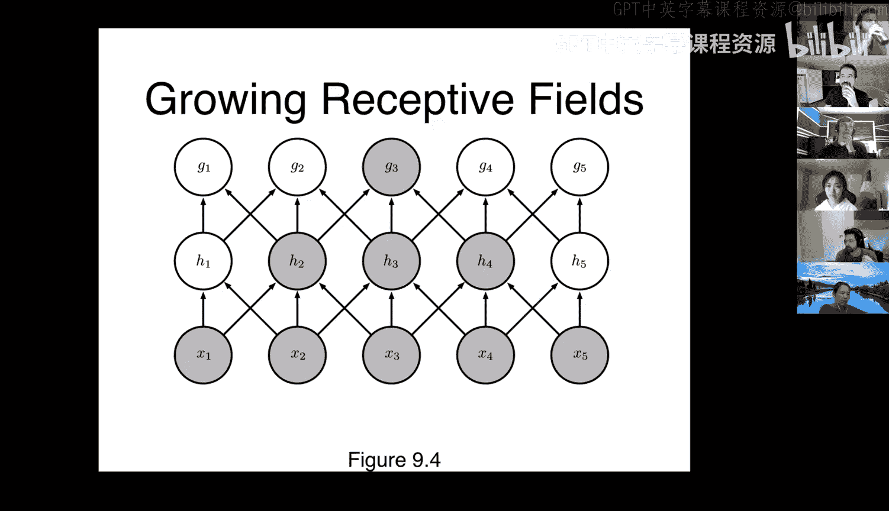
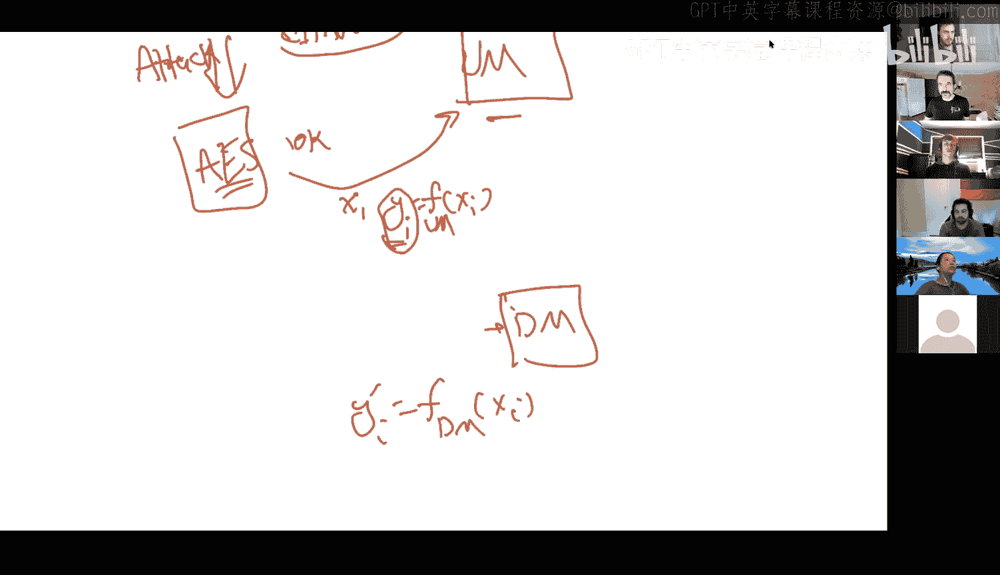
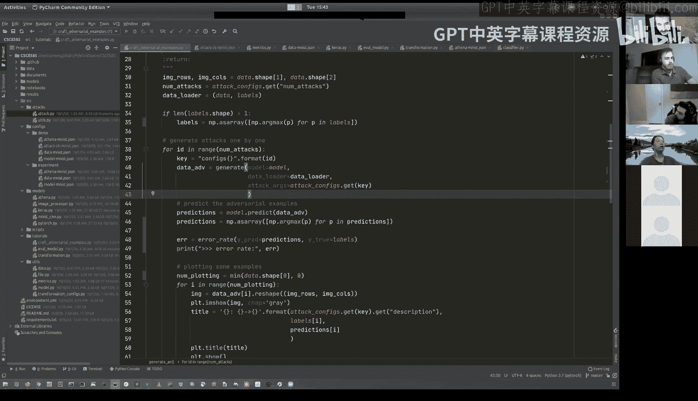
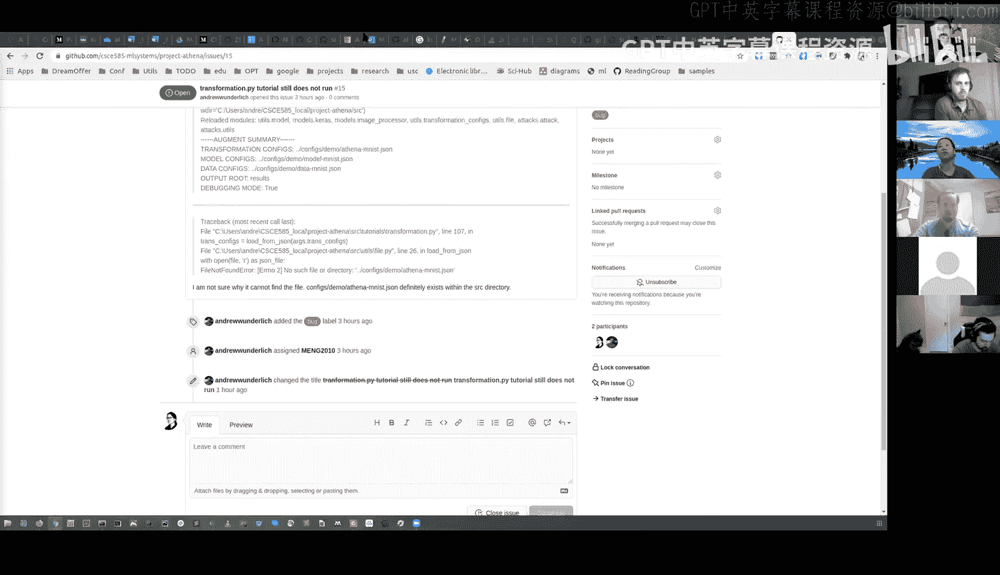
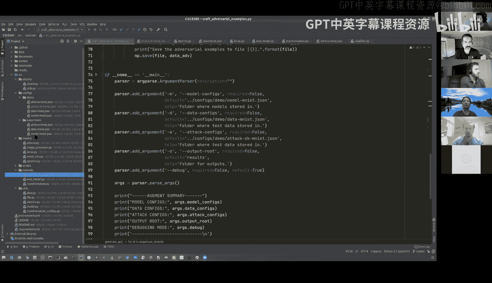
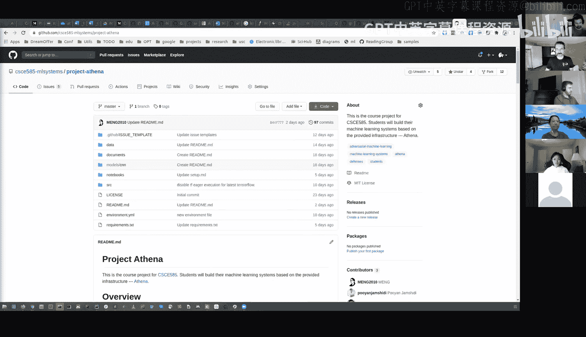

# 机器学习系统：CSCE585：ATHENA框架项目答疑与教程 🎓


在本节课中，我们将回顾USC《机器学习系统》课程中关于ATHENA对抗性防御框架的项目讨论。我们将重点关注项目任务一的核心步骤：生成对抗样本、测试模型性能以及理解整体工作流程。课程助教Ying将提供代码层面的详细指导。

---

## 项目概述与常见问题

在深入细节之前，我们先讨论一下同学们在项目中遇到的普遍问题。许多来自非计算机科学背景的同学在环境配置和代码理解上遇到了挑战。

一个关键建议是组建跨学科团队，让计算机科学专业的同学与其他专业的同学合作，这样可以更好地相互学习。助教团队也乐意协助解决安装和初始设置问题。

**核心工作流程概念**：
1.  你有一个训练好的模型（例如，一个分类器）。
2.  你有一组良性测试样本（例如，CIFAR-10测试集）。
3.  你使用攻击算法（如FGSM、CW）生成这些良性样本对应的对抗样本。
4.  你将对抗样本输入到不同的模型（无防御模型、ATHENA防御模型、PGD-ADT防御模型）中进行预测。
5.  你将模型的预测结果与真实标签进行比较，计算错误率等指标。

---

## 任务一详解：生成与测试对抗样本

上一节我们概述了项目的整体目标，本节中我们来看看任务一的具体实现步骤。我们将学习如何使用ATHENA代码库生成对抗样本，并计算模型在对抗样本上的错误率。

### 生成对抗样本

以下是使用FGSM攻击生成对抗样本的核心代码示例。代码位于 `craft_adversarial_examples.py` 文件中。

```python
# 导入必要的库和攻击模块
from art.attacks.evasion import FastGradientMethod
# ... 其他导入

# 加载模型和数据
model = ... # 加载你的模型
(x_test, y_test) = ... # 加载测试数据和标签

# 创建攻击实例
attack = FastGradientMethod(estimator=classifier, eps=0.25)



# 生成对抗样本
x_test_adv = attack.generate(x=x_test)
```


### 测试模型性能

生成对抗样本后，下一步是测试目标模型（无论是无防御模型还是ATHENA防御模型）在这些样本上的性能。这涉及到使用模型进行预测，并将预测结果与真实标签对比。

以下是如何计算错误率的步骤：

1.  **获取模型预测**：将对抗样本输入模型，获得预测结果（通常是每个类别的概率向量）。
2.  **计算错误率**：比较预测标签与真实标签，统计分类错误的样本比例。



代码中提供了一个辅助函数 `error_rate` 来简化计算。

```python
# 导入错误率计算函数
from utils.metrics import error_rate

# 使用模型对对抗样本进行预测
predictions = model.predict(x_test_adv)

# 计算错误率
err = error_rate(predictions, y_test)
print(f"Adversarial Error Rate: {err}")
```

**公式解释**：
错误率的基本计算公式为：
`错误率 = (错误分类的样本数) / (总样本数)`

### 使用不同模型进行测试

任务要求测试三种模型：原始无防御模型、ATHENA集成防御模型和PGD-ADT防御模型。它们的测试流程是相似的。

以下是关键步骤：
*   **加载模型**：从提供的文件或配置中加载相应的模型。
*   **进行预测**：调用模型的 `predict` 方法。
*   **计算指标**：使用相同的 `error_rate` 函数计算性能指标。

对于ATHENA模型，其配置通常在JSON文件中定义，指定了集成中包含哪些弱防御器及其参数。

---

## 项目答疑与实用建议

在理解了基本流程后，我们来看看同学们提出的具体问题及其解决方案。

### 环境配置问题

许多安装问题源于依赖库冲突或路径设置错误。

**解决方案**：
1.  严格遵循 `notebooks/setup.md` 文件中的最新说明。
2.  确保使用了更新后的 `requirements.txt` 文件。
3.  如果遇到特定错误（如TensorFlow找不到），请尝试在问题追踪系统中详细描述错误信息、操作系统和已尝试的步骤，以便助教复现和解决。

### 对抗样本生成相关问题

有同学发现某些攻击（如DeepFool、JSMA）生成的对抗样本视觉变化不明显，且模型总能正确分类。

**可能原因与检查项**：
1.  **像素值范围**：确保输入图像的像素值被归一化到 `[0, 1]` 区间。ATHENA框架内部通常进行此处理。
2.  **攻击参数**：不同攻击算法对参数敏感度不同。可以尝试调整攻击强度参数。
3.  **框架差异**：当前代码基于PyTorch和`art`库重构，可能与原始TensorFlow版本的参数设置有所不同。



**建议**：如果遇到攻击无效的情况，请记录下使用的具体参数、攻击算法和模型，并在项目仓库中提交Issue，附上可复现的代码片段。

### 任务范围与数据量

是否需要为整个10000张测试集生成对抗样本？


**建议**：不需要对整个测试集进行操作。可以选择一个具有代表性的子集（例如几百到一千张图像）进行实验。这可以显著减少计算时间，尤其是对于运行缓慢的攻击算法（如DeepFool）。在报告中说明你选择的子集大小和理由即可。

**重要**：如果你基于自定义的子集生成对抗样本，请务必保存并提交对应的真实标签文件，以便评估时使用。

---

## 结果报告与提交

最后，我们来明确项目结果的提交格式。



项目报告需要展示你的实验结果和分析。推荐使用 **Jupyter Notebook** 格式提交，因为它能很好地结合代码、可视化图表和文字描述。



**报告内容应包括**：
1.  **实验设置**：简要说明使用的数据集、攻击方法、模型和评估指标。
2.  **结果图表**：绘制图表来展示不同攻击下，各种模型（无防御、ATHENA、PGD-ADT）的错误率对比。例如，可以绘制以攻击强度（如FGSM的epsilon）为横轴，错误率为纵轴的曲线。
3.  **结果分析**：对图表进行解释。说明哪种攻击最有效，哪种防御最鲁棒，并尝试分析原因。
4.  **代码片段**：包含生成关键图表的数据处理和绘图代码。

在Notebook中，你可以使用Markdown单元格撰写文字描述，用Code单元格执行绘图代码。

---

## 总结与后续步骤

本节课中我们一起学习了ATHENA项目任务一的核心流程：生成对抗样本和评估模型鲁棒性。我们明确了从环境配置、代码理解到结果报告的完整路径。

**关键要点总结**：
*   **工作流**：良性样本 -> 攻击算法 -> 对抗样本 -> 模型预测 -> 性能评估。
*   **核心代码**：使用`craft_adversarial_examples.py`生成样本，使用`model.predict()`进行预测，使用`error_rate()`函数计算指标。
*   **解决问题**：遇到问题时，详细记录并在GitHub仓库提交Issue。
*   **协作与学习**：鼓励跨专业团队合作，积极向助教和同学提问。



下一步，请根据本教程的指导，着手解决环境配置问题，运行示例代码，并开始着手完成任务一的实验部分。祝你项目顺利！