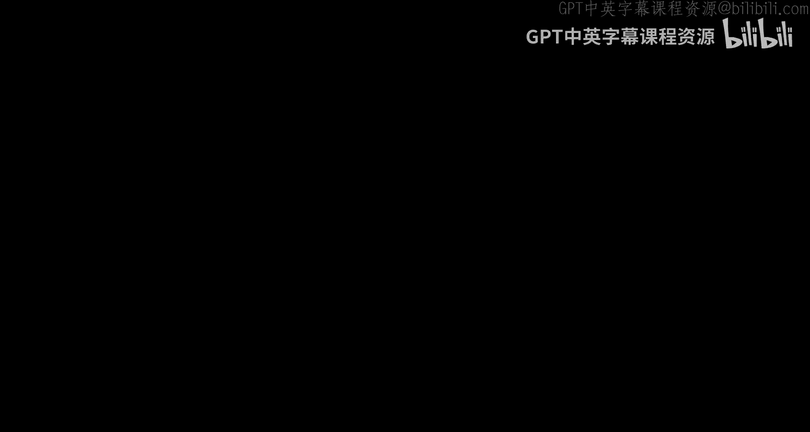
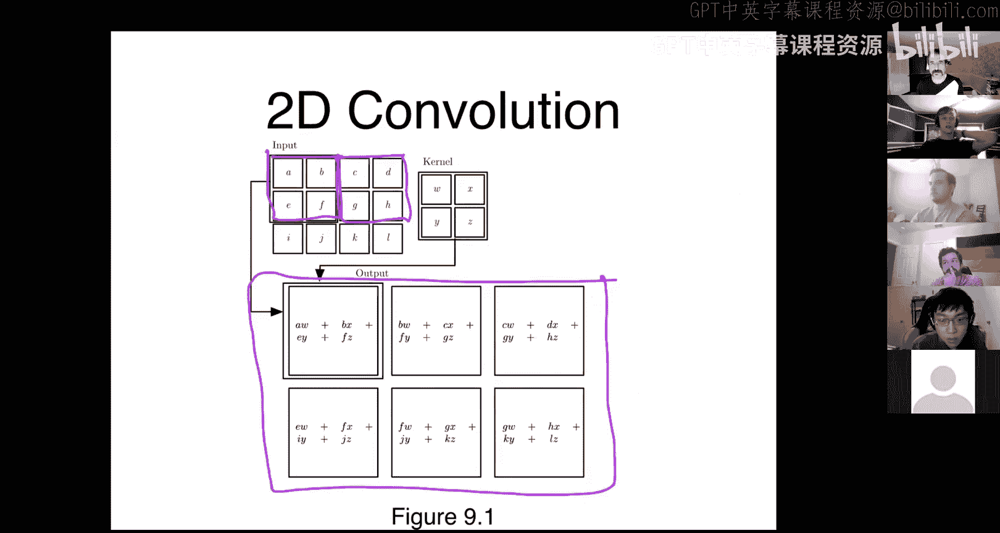
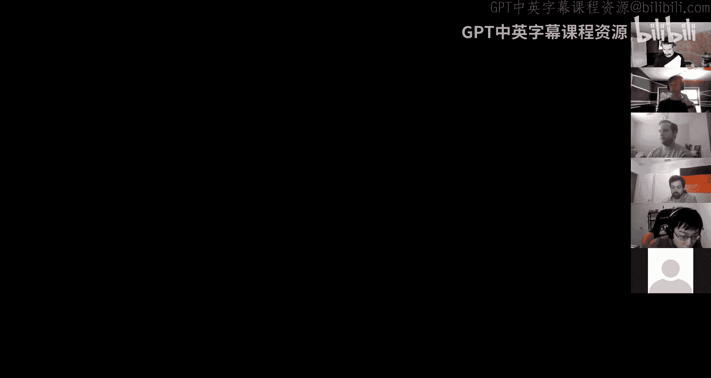
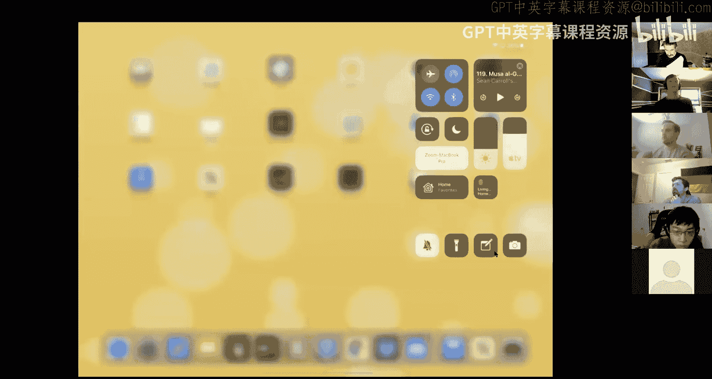
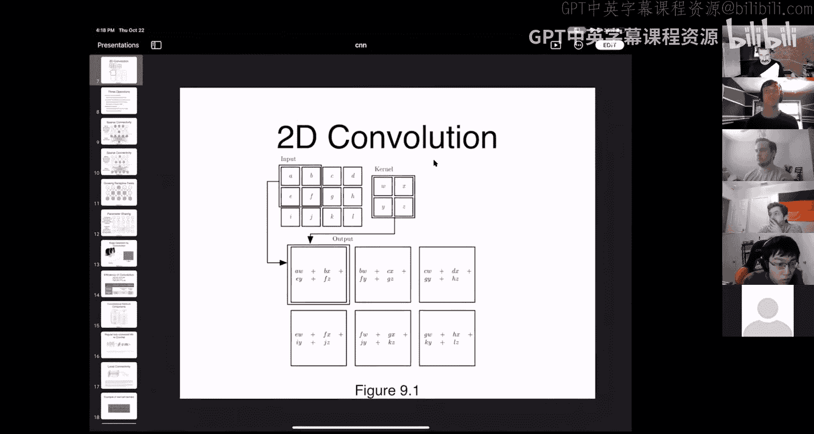
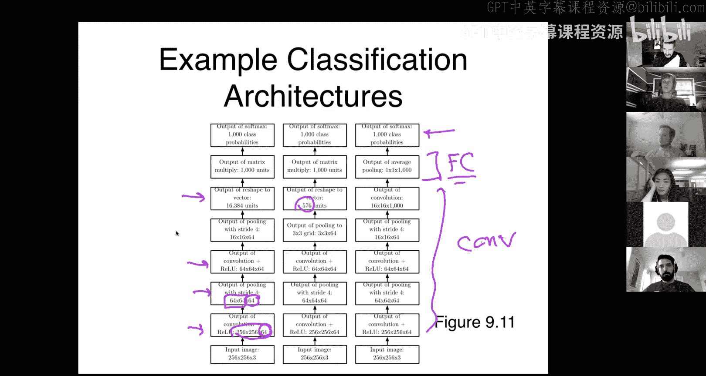
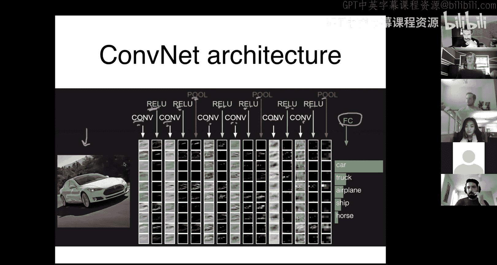
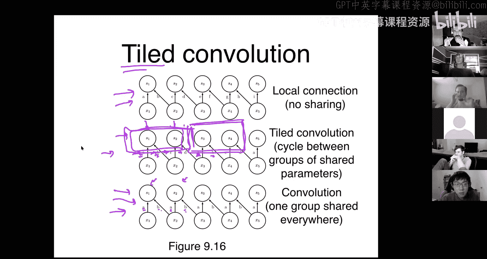

# USC《机器学习系统｜CSCE585 Machine Learning Systems 2020》中英字幕（Claude-3.5 p16 -16-Lecture 7.2 - Convolutional Neural Networks.zh_en -BV1Xc9bYVEC6_p16-

Okay， so。We started talking about this important architecture。

NR network architecture called convolutional neural network or Comfnets。

And we discussed about some fundamental operations like convolution。

 some basic stuff about this type of architecture， I'm planning to talk about some other aspect of convolution or networks to understand to give you an idea also from the architecture。

 side of thing and some also other detail some variations of type of kernels or some other operator is typically used within this kind of architecture。

 but from the architecture point of view。You can。YouAgain， it's a layered kind of architecture。

 and there might be different。Definition or preference what is called a layer in convolutional neural network。

 But two， this is one view。This is another view and the difference is that。You have here the input。

 right， So you start from input， and we can again imagine this is an image。

 So has a grid like structure has a height width and depth， right？ So， for colored image like So。

 for example， for C4 10 is302。30 to。2，3， right。It's a height and depth。Okay， so this is the input。

And then it goes to a convolutional layer。Which has some sub component， right？

 So it has some a stage。 you could call it a stage。 The first one is convolutional a stage。

 which does this convolution operation that we discussed。And then this convolution。

 if you remember when we do this convolution， it produced an output tensor or output channels right。

 so you get some activation and then you pass it to some linearity and we discuss about why we need nonlinearity way before when were talking about fully connected neural network。

 right？And why we need linearity because of we need to learn this nonlinear aspect of data otherwise。

 if you don't have this， everything stays linear and then we have the pooling stage that we will talk today why it is needed and。

What it does， But all of these three typically is called a convolution layer。 Some。

 Some other view could consider each of these stages as a layer。 So convolution layer。

 linearity layer， pullinging layer。This is not an alternative view。

 but the difference is that if you think about it at the abstract level。

With this definition on the left hand side。You at each layer。 So each layer produce a tensor。

So here you have a tensor like this。 And then as a result of this convolution。

 you also get a tensor of a size。Typically different size right and you go to the next layer。

 each layer produced tensor， but here， for example， not all layer produced tensor convolution does。

 but for example， the other layers do not but and that's why this definition of the left hand side is preferred from the representation perspective。

 but basically what do you want to call as a layer。So this is useful to think about。

Designing neural network what they want to call a layer。And basically。

 this is a contrast between what we have。Had in fully connected the year， right。

This was a kind of fully connected network that we had and this is a typically perspective for convolution neural network and this is。

 for example， input and at each layer you produce a tensor like this until you go to the end so each tensor you see that it has at width height and adapt。

And at the end， you need to produce。Basically， what you want to predict， right。

 So you show this network input image， for example。

 what you want to predict is the label for this image and the size of this。

Depends on the number of classes you have in your model right so for example。

 for C410 since you have 10 classes， this is of 1010 size right so this is you can think about it one。

1。10 tensor of this size。Right， so it has a depth of 10。 So each represents the。The basically。

 the activation for each， for each class。And you can pass this through a soft mark to get the probability。

 So these are typically are called logicits。And then you can pass it through a soft mask。

To get probabilities。With the same size， right， we discuss about this transformation。

 But this is basically， if you want to contrast fully connect that network with convolutional neural network。

 This is the way how you can think about it。 So each。Every layer is a simple transformation from a。

3D kind of input to， again，3D output。And each transformation obviously should be differentiable。

 You can think about each of these as a。Transformation from one input to another。

 from input to output， right， and each could be taught about。

 Think about as a function that transform this input to the output。And。So basically。

 if you think about this again。If， if you have this view。Not all layers have parameters， right， So。

 for example， convolutional layers have parameters， right， The parameters are inside the kernel。

 that you do the convolution operator， but， for example， Re doesn't have parameter。

 It has hyper doesn't have parameter。 the way how kernel works， right， Re is a function。Right。

But if you define the layer as this con layer comprising of conf linearity and pullinging。

 like each layer has。Prameterters， right？ And that's the difference。

If you want to have this preference， that every layer should have some parameters。To be learned this。

 and that's why this view might be preferred， that's the difference。Any question about this。

And we talk about this local connectivity that each neurons right。

 so each of these is again a neuron inside this。3D volume that is locally connected in a sort of connected to the whole image。

 It's locally connected to only part of part of the input， right， And this is like the input。

 the image that we are talking about， but general could be since down the。嗯。

Architecture and the network。Like this could be。From this volume to this volume， right。

 not necessarily from input to output。So basically。

 you have this local connectivity between neurons and the receptive feed of this neuron is。Loan。

 right？So in this case， for example， this is the size of C 10 in this case。

 So it has 32 by 32 depth of three for RGB for C 10。And in this case。

 if we consider a filter size of 5 by5， right， this is。What we talk about， right。

 So each of these is basically parameters to， to be learned。This is the kernel size。

Right so and then since we have a depth of three， we need three of these kernels， right， So in total。

 we need 75 weights plus one bias parameters to land。And if you think about it， right。

 So the important thing here is。Is to remember。Is that I again， think about。Withth， height and depth。

For width and height， we move the kernel。Throughout throughout the input， width and height， right。

 So again， going back to what we discussed earlier。

So we move the kernel from here to here and then here。

 so we have this local property when we move this kernel around。But if the input has depth of 3。

We need three kernels。 If it has 20 depth of 20， we need 20 kernels。Right， so to the depth。

 if you can think about it for the depth， We don't have this local connectivity is。

Is is fully connected in that sense， right。So we have this local connectivity for the high widths but not to the depth。

 so depending on the depth， we need that that many number。Right， so this example， for example。

 give you give you is talk about this。 So you have input of this size。So for example。

 imagine that you're in the middle of your architecture。

 then you have a tensor of this size right as your input so you produce a volume of 16 by 16 to the depth 20 then you want to。

 for example use of kernelab size of three by three。

 but then you need to have 20 of them to comb above to produce the output， right？

So it differentiating this basically give you a better understanding of what's going on during the。

Into the network and how these activations are being produced。So basically at the up level。

 we can think about this， the difference between fully connected and convolution。

Net is that these confidences provide some locality aspect。 And that's why。

And we discuss about the benefit of this。 And， and once you learn this kernel， it is， for example。

 how they might look like， right。So they learn about different different features， right。

 So see the difference， for example， between this and this kernel。Right， so they。

 they learn different features from。Your input。And this is how they generalize。

Basically on how they work。To discuss about。The connection between these kernels。And features。Okay。

 some more operator that we need to talk about， for example， max pooling also is important。

Because it provides invariance to translation and it's very easy， right？So basically。

Or let's call it pooling because we have different pooling operator Max pooling is one instance of such pooling and pooling is better to summarize the data。

Right， so， for example。Consider this on。So for example， here for producing this guy。

The receptive field is3。 You look at this， this and this。You take the maximum out of this， right。

 So max pooling is that you look at your receptive field and neurons in your receptive fields。

You bring up the maximum one。 This is the definition of max pooling。 Again。

 max pooling is only one instance of pullinging。You might have average folic that take the average of these activations。

 right？Yeah， you could define weightd average as well。 You have different type of。Pooling。

 but max cooling is more popular because it has some properties， like invari to translation。 So。

 for example。In this case。If you， an invariance to translation means that if you translate your input。

 how this affect your output？Okay。And let's start by this。And consider that， and this is your input。

And we translated to the right， So meaning that we put here， put here， put here， this one here。

 this one here， right， so we have a new value，0。3 here that came from here。And this guy is here now。

 this guy is here， this guy is here， this guy went out of the picture， right？

And this is the new output that has generated and compared with the previous output， okay。

We have translated the input。And if you think about translation。

 meaning that every single value in your input has changed， right， so。Not equal， Not equal。

 Not equal， Not equal。 So your input has totally changed。But your output。

 actually half of the output are the same。 So these two guys are the same as these two guys， right。

And that's the property you want to have， so once you change your input。

You want to get some invariances by this change。 And in this case， is a translation， right。

 when you shift your input。Like to the left or right， you get。Similar thing。

Or at least not all your output changes。 And this give rise to this property that like， for example。

 it shouldn't matter whether in your image cat is here or here to the left or to the right should identify this as a cat。

诶。And， or when you have a faith， it shouldn't matter， like。Very exactly the eyes are located， right。

So could be more distant， a little bit less distant。 But as long as you find your detector。

 your network finds that there exists two eyes。 So this is a human face， for example。

 iss a face floor in general， right。So you get these sort of properties out of Comfnets。

Or other features that he。That a face or a cat or a dog has。Right。

 so you get these these sort of properties， which are are useful for prediction。

At a question about the the pooling strategy， Maybe i'm not understanding this。

 I was thinking that it was a particular node would。

Would select the maximum value in its receptive field for this given strategy is that is that。

Is that the strategy exactly so oh because there's this one node where it doesn't look like it maybe it's just a typo it is so the bottom set of them the。

Second column first row。It's 。 one， but I think should be 0。3。So for the bottom set of them。

 it's the second column of them in the first row。Second column in the first。 So this one you mean。

I didn't see anything change on the screen。This one。You don't see anything change。aboveve it yeah。

 the one note above it yeah， okay， I guess I'm thinking about this upside down， but yeah the。So。

 so basically， for this guy， you need to look at these three，0。3，0。1 and1。

 So what is the maximum fund。 So you put one here。Right。

Maybe you could change colors because I'm not really following。Are we seeing the same image。

 the same slide？Maybe。Max pulling in invariance to translation yeah it's just the the color it's all blending together I guess I wasn't seeing changes on the slide Oh sorry let me。

He was basically saying that you look at all the arrows that point to that node and you take the max out of those three so there's a  point。

3。1 and the one you take that one Yes， so you have this this and this and then you have one right。

So this one is this maximum right， Oh， okay， I see what I did， I shifted a decimal in my head。

Yeah and for this is the same right so and again that max pooling is one type of pooling you might have different type of pooling anyway to。

For your。For producing output， right？And you can also have defined pooling cross channels。So。

 here was cross。Your course for， for one for one channel， right？ It was for one channel。

 right You could have also cross channel。So for example。

 here is your input and each of these channel basically learn different things right again these are。

The learn channel， right， So if if you show this image， so it would activate this。This unit， right。

Because it's more aligned to the left right in this case。

 it's more aligned to the right So it activates another unit right， so here you have three units。

 right。And each of the them associated to different。Feature， right？And these all gets activated。

 depending on what image you show this。 But if you use max pullinging across channels。

 every time that show any image， right， So either this or this Since you take the max out of this cross channel。

 you always this layer， you get activation， right， doesn't matter this， you show this or that one。

 you get large response in your pullinging unit。All right， so pulling unit is in this case。

 producing one unit out of these three different。Units that you have at this layer。

But basically here， we are talking about cross channel pooling rather than。Within within China。

 today。Which is helpful for getting new variances to learn transformations。Any question about these？

So with this method of。But cross channel pooling it feels like i'm getting you know some some serious you know athena vibes here with the the different you know transformations no no that's that's different that's don't associate it with Athena now this is we are talking about the property that you get out of。

Out of your convolution neural network right so basically think about this as somehow they are connected。

But don't。Don't think about antenna for now。 Each of these are associated with different the way how features are learned throughout the con。

 right， Basically， you want to So think about this that。

You don't want to learn a different model for the basically， for basically the。

Images that are tilted to the left and different model from dig tilted to the right。

 So you want to show them any sort of images， however they tilted or look like。

 And you have one model for detecting those right and you need to design your architecture and given these invariances that you get for either translation right to the left or to the right or tilting。

You can define these and how these invariances could be layer automatically throughout conflicts by the property that these operators have right like max pooling and。

Convolution， basically， so what I'm saying that each of these operator provides some properties。

 like invariances just useful for generalization。And your， we mean that however these images。

 your input is located， you want to detect that。嗯。Whether you have like five here or five here or wherever it is。

 you want to， you want to detect that。 This is a five。And these are associated too。To each channel。

 right， that you produce。Again， corresponding to this architecture that we have。嗯。So each。

So each slice out of this is。Is one channel， okay。So you have multiple channels there。In this layer。

Okay have this view also。Here， right。 So this is basically。Is this producing one China？

Any other questions？Puling also have。Other properties， and that's why we want to have that。

basically it has a downsling effect， right？So for example。

 depending how we move this kernel in the input map， right， for example， in this case。

 this is your input。And you have a channel of size 3。Okay。Basically， this。3 are different bits。

That are associated to this kernel， right。And then in a of like moving one。

 you could move like any numbers， right。And we discussed that earlier， right？Here。

 like you moved it two to the right it's called a strip。

 basically you could have a stride of different size typically we have we discuss a strip of size one。

 but in this case it's a strip of size two， so if you think about like this link。

Previously it was here， basically， it was over here and now it's over here。What is the difference to。

 And that's a strike to。 This is the way how you can think about it。

 So this thing and stop moving one，1 to the right， move2 to the right。 now is located here。

 And now the receptive field of this is is。Is here， right？Previously， you had how many。

How many of these you have one， two， three， four， five， six。

 your input size was six now your input size is three as a result of this down sampling right Basically again you're doing max pooling。

1 is marks，0。2 marks，0。1 is marks， right， So you have， you get this down sampling effect。

Were you drawn okay， it just all showed up finally。So basically。

 you can think about it that that one interpretation of this is that。

We just throw these smaller values， which might not be important， right， So in the next layer。

 we only use these bigger values like 10。20。1。 We got rid of like these are small values。Um。

Its also someone one。Could you explain again what stride is， Sorry。

 that the drawings didn't all show up and don't like all at once。 just So this stride is basically。

 you can， you could have a stride of any size， right？ So it stride basically mean that how， how。

How large you want to skip to the right， move to the right or to the left doesn't matter， right。

 So in this case， a strike， we have a strike2。 The interpretation is that like this guy， for example。

 this connection is now move to to the。To the right right or can think about this connection as well。

 every connection has moved two to the right。嗯。Does it make sense or basically if you want to have interpretation。

 if this is also confusing。This guy， we talk about like having these and this。

 this was a strike to one。So you could have this office straight， too。Here first， then here， right。

I don't think everyone having the issue none of the drawings are showing up on mine really Yeah well I think the issue and I think that's the issue we've been having is that there might be a delay there yeah this seems to be a pretty serious delay let me let me check it I wish you could。

Say it earlier。うんうん。

Stop sharing。

That was the thing。

So basically， previously， we had。

啲啊。And move to us here and then removed it here to produce this guy and remove it here to produce this guy。

 right？And as a result， we， we got these three guys imagine for the first row， first two。2，2 roads。

 right， And we a try to。You can think about this。First， we have here。 So you get。嗯。AW plus B on X。

Plus， whatever， right， You know how to do。 And then you move this guy。

 you calculate this second output， which is now C， W plus D， X plus whatever。U。So as a result。

 the output size has changed。 So this output channel， the feature map。

 the other word for it has changed， right。So this is the way how you can think about。

Think about this how this abstractoid would work。Is this showing up correctly for you guys？

It is now thank you yeah so the stride the stride here that you just showed is a stride of two whereas the original example is a stride of one right correct yes yes。

 okay， that makes more sense to me now。Yeah， exactly。嗯。Because like， we are。

These are a range different ways It depends how you want to interpret things。So basically。

 down sampling， you can think about this。As a vet to summarize。

Summarize stuff right so again here is your input and this is the output that is produced right。So。

Again， if you see the depth is preserved， the depth you had previously for your input 64。

 and you use 64 number of kernels to go over your input and produce your output so basically you have the same depth。

As a result of this。But the size of your output has changed as a result of this pooling right。

 this is yet another view。So for example， for kernel of this size。Okay。

 so you look at these four values and really depends how you want to do this max pooling， right。

So you take the max， which is six is here again for this is8，8 is here for this guy is three，3。4，4。

 right。 So this is the way how。How things are done and with the stride of two， right。

With the stride of one would be first here， first， the second term， right。

 so the output would be larger， it would be。3e by three， as a result。ok啊。

If we would have used a strike one， the output of this operation max pullinging on this input particular input。

 which is a slice， like which is this a slice， for example， would be a size three by three。

Can you follow why this is three by three。Yeah， as a result of a straight one， basically。

 you move this window or channel。嗯。Right， one by one。

And you get smaller or larger output as a result。And the key then is that you want to。

You don't want to， you basically， the way how convol the architecture work， you。

 you start with a large。Input。Your large image， for example。

 you want to then do this down sampling to create a small output and then you do classification on top of these a smaller。

A smaller output， something like this。嗯。So。So， this is your。This thing is not idea。嗯，过位俾。I。

 works this。So， come on。How can I get rid of this so you see this like your input image are of size 256 256 to3 right so this is for example。

 one size of input image。And then you have a convolution layer。That produce。This size of of tensor。

256，2 56，64。 This means that you increased。The depth you use the multiple number of cars here， right。

 64 kernels and then。This is the output as a result of convolution。

 And then you do a pooling of a straight4 to reduce the。The size， right。

 and you see that the depth is remained the same， right， as a result of this operation。

 but you reduce the size， the width and height of your output as a result of this pooling operation。

And then， you do。Another convolution plus Re。They say a convolution plus act。

No linearity I can help you find a place if you turn on location services， go to privacy settings。

 select location services， scroll to Syrian dictation and allow location access。Thatす。

That's the way how it looks and then。😊，So you do multiple。Operation， right。

 convolution re and then pullinging convolution。 So think about that way convolution re does the learned features right and then you do pulling to summarize things to get these property of invariances and everything。

 and then you do multiple of these again， convolution re plus pullinging。Do multiple of these layers。

 So if you want to have deeper layer， you obviously。

 you do more of these operations down the line in your architecture。Until you produce a small output。

 right， so。This is， for example。Your output vector which is of this size。 So for example。

 you have576 units of the output and then of this size you can do fully connected layer。

 typically once you have a smaller size of output as a result of multiple layers of convolution and pooling。

 you produce a nice small tensor on top of this then you can do fully connected for classification。

 so think about this as as a feature。Vctor or feature kind of。

Feature map maps that you produce and then you want to do fully connected layer on top of this for doing the classification。

So typically the later part of。Part of your network in this stage is doing fully connected operation。

Basically， is a matrix multiplication similar to what we have。

 what we have in fully connected network， but now we don't have these fully connected stuff here here。

 it was mainly。Convolution， which was a lot more efficient。 And we get those properties。

 So basically， the way how we can think about it， you have a large input。

 We pass it through multiple layers of convolution and pulling to produce it a smaller thing。

 then once we have a smaller。Cancer。or smaller units or vector， whatever you want to call it。

 typically you need to reshape it to a vector of a small size， then you can do fully connected。

 you can put a fully connected layer on top of these a small vector to do your classification。

 meaning that to produce these output classes。Obviously， before， before this。

 you have a logic of the same size。 you discuss about it。

 And then you do soft maxs on top of this to produce the probability that you want to get。

 So this is typically how it looks like and。不道。Typically， you can think about it as large。

 You make it a small and then on top of it。

You do fully connect it。Think this is another view， so your image。

 you have multiple convolution combination with rail convolution， rail pooling。Convolution rail。

 convolution rail pullinging， convolution rail， convolution rail pullinging。

 and then you put fully connected layer on top of these two for doing the classification。

Does it make sense。This is basically， I mean， there are so many variation in convolutional neural network architecture。

 There are so many variation of cons， basically， but this is the commonalities between different con architecture that you find out。

好对。Right， so you have some input。And then。Depending on on the number of。

Canels that you use you produce of the output of， of。Like different sizes。

And then you do re and then pooling to reduce the sizes， right， convert， Con the sizes。

 the size reduction that you get as a result of these pulling down sampling。

 and then you could do fully connected layer to compute the。

The final score on top of which you want to predict the output layer。Output later。

And the size of this really depends on the number of label。

 the number of classes that you have in your model。For C4 10， obviously we have 10，10 kilos。

 And that's why how。Why you have this size。So， and again， this， the size of these。And stuff。

 it really depends on the number of care names that that you use in in your architecture。 right。

 So when you define your network in Tensorflow， right， you need to define。 So this is the。

Overview architecture right， you define this layer if you correspond it with your coding the code also you find in antenna。

We have defined different。Networks， right for doing classification for CFR00， for example， or MIS。

You see a variation of these operator that has been defined there。Youput comb Re， pull。

 multiple of them， and then finally you have fully connected layer。And yeah， we talk about this。

 that some of these layers。Obviously have parameters associated with them some of them like Ra。

 for example， doesn't have any parameter。But does have some hyper parameters。

This is also another site we are going over time， but I would like to finish this and move on to the next topic from next week。

So。You can， you can think about this story again， this is another view， the same thing。

 but with another view。Basically， previously， you have this convolutional layer that you produce from the input。

 you produce the output， you get this Z1 to Z5。And as a result of this。Pulling or down sampling。

 you basically don't want to have this in between activation。 you only get。

As fun as to an S3 as a result， these are the your。Output units that you produce as a result of this。

Largerstr that you have， right， So here， for example。

 you have convolutional convolution operator that has astride of。2， for example。Right。So previously。

 for example， if you think about this now here so。It moved to two units to the right。

 And that's the way how we can interpret it。 So this is of a。To。

And that's why you get a smaller output as a result of this down simplyly。

And there are some other concept like zero padding。

 is it is useful when you want to preserve your output size with the same size as your input。

 because we know as a result of。These pooling， you get a smaller size of your output。

 but if you do this many times at the end you get to zero right as a result of if you do this many times so you cannot it avoid you to make the network deeper if you want to do this multiple time。

 so you want to sometimes add this zero padding meaning that you add some artificial zeros to your vectors in order to preserve the size of your output。

啊。With this， you you can make your network deeper as much as you want。You have。

Other types of connectivity。So convolution， it was something like that where you， you have。

 for example， in this case， you have a clear size of two， you have。A and B。

 you move this to the right， right So you have A， B， you move it one to the right A。

 B produced output。 We know about this is the convolution， how the convolution looks like。

 But you could have also some other local connection。But。This time there is no sharing going on。

 so here we discussed about parameter sharing previously that parameters are shared。

 so basically this a is the same as this a same as this a the same trorough。But here it is。

 make sure that you understand the difference between this one and this fully connected way。

 fully connected layer， everything was connected to the everything else in the next layer。

But here we have this locality feature， but there is no parameter sharing going on。

 So this parameter。Is different on this。 different than this。It's not like convolution。

 this is basically。Local connection similar to convolution。

 but there's no parameter sharing is going on here。So every parameter is different。

 but the connections are still local。Sometimes you need this kind of operator might be useful depending on the kind of task you want to do。

Also， you can consider some partial connectivity between channels too。If you think， so each of these。

 each each of these represent one， for example， one input tensor。And the channels are here， right。

This is the each of those are different channels。And。The X axis here are the spatial coordinates。

You can interpret it， but these are like 3D。You， you should think about this at 3D。

 because these are tensors， right，Previous， we discussed that these channelss。

 you move to all of these。 So basically， each output。然后。

Channels are very connected to all of these inputs， right， So that was the previous。

 So this one is also connected to this one previously for producing the output。

 But now you can have an alternative base where you have partial connectivity between different channels。

 this type of connectivity might be also useful for some task， especially。you want to， for example。

 preserve computation for producing these feature marks。

So there are some properties that you can get out of these partial connectivity between channels。嗯。

You can think of also other type of convolution， which were some point popular like five convolution。

So previously， this is the normal convolution that we have right AB， we move it down the line。

 this is the local connection that we just discussed in previous slide that theres no sharing going on。

 but tile convolution is somewhere in between where。For example。

 you have A B here and then you have A B here again repeated so there is a。

There is a rep going at each different stage， depending on the size of the tile right。

 So here so the size is is two。 So basically you have A B here and two on the right you again C A B again。

 So it' like a tile that moves。And you see， so as a result。

 you you obviously need to learn less parameters with respect to local connection with no sharing。

 but。More parameters with respect to the traditional convolution。There we have。And this， I mean。

 there are some properties。 you can think about it that why sometimes you want to have that。

Typically， if you think about this output。For example， for S1， it depends on A and B， right？

S2 also depends on A and B。So even these neighbors depends on the same parameters。

 But sometimes here in this case。These neighbors is one and it's2 depends on。Different parameters。

 right， so S1 depends on A and B， S2 depends on C and B， which are different from A and B。So。

 these two neighbors。Are not correlated in some sense。

 not on they're not dependent on the same parameter。This is three and4 again as well。

 but this block is also depends on the same parameters A BCD as this block right so it's useful if you want to remove correlation between neighbors of your output with the tile and with different size of your tile you can increase from two four to more sizes right so you have a control on the size of your tile in this case。

Yeah， let's stop here。Because I think that was everything you needed to know about convolution on your network。

 so now you have somehow an understanding。How Con looks like from the architect perspective。

 some of the operator。So it doesn't look as strange to you when you deal with these type of models and especially。

V you corresponding。

T with。With fully connected models that your family of it typical matrix multiplication that we talked about it extensively before。

And how they are different and what kind of properties they provide。

 especially about invariances stuff。Prameterter sharing locality aspect。Invariances to translation。

 this kind of thing。And the efficiency， especially in terms of computation and storage。

That's a high level perspective or correspondence or contrast between fully connected neural network。

 dense neural network and convolution neural network。

And that's why they're much more popular because with fully connected。

 you cannot make it deep that the mother gets so large you need to a billions of parameter。

Even with like relatively shallow network comparing with convolution， you can make it really deep。

But relatively much a smaller operation and a storage that it requires， but again。

 like if you make it really， really deep， the number of parameters that you need to learn will eventually。

Is also。Too much depends on the size， but a lot more efficient different orders of magnitude comparing with what you could do with。

Fully connected network。Is there any question here？If not， then。Let's stop it。使用。Good luck。

