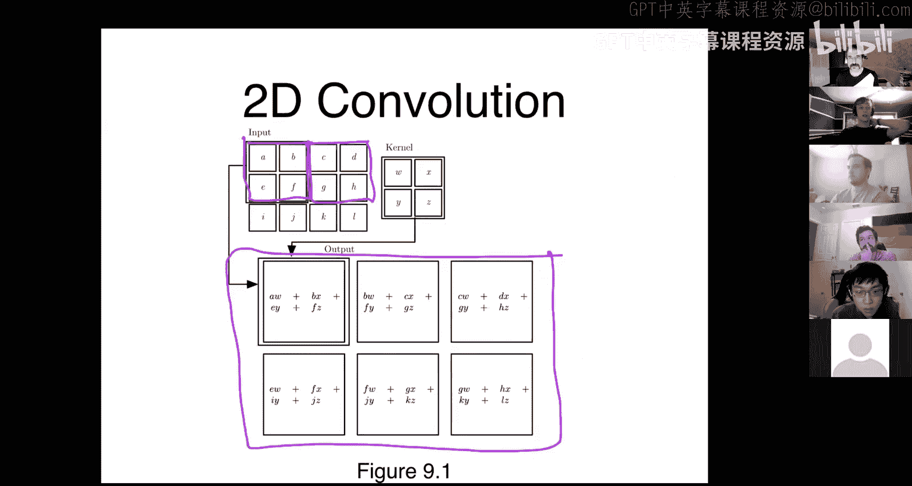
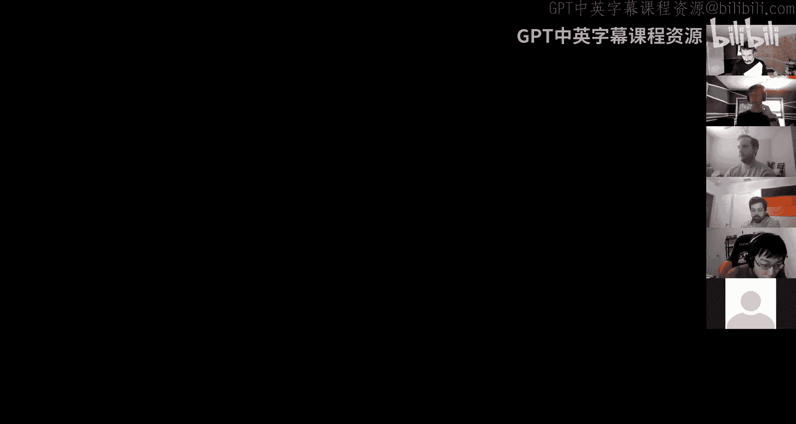
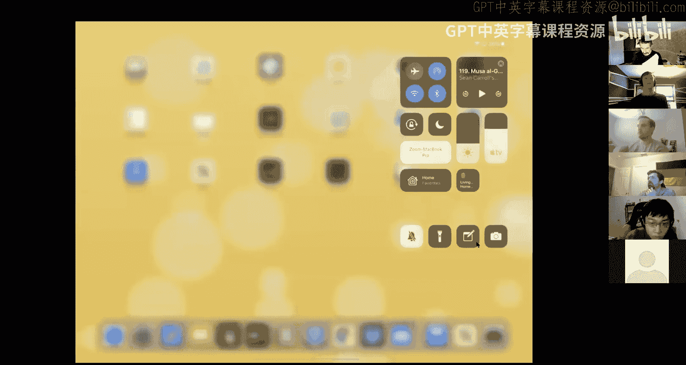
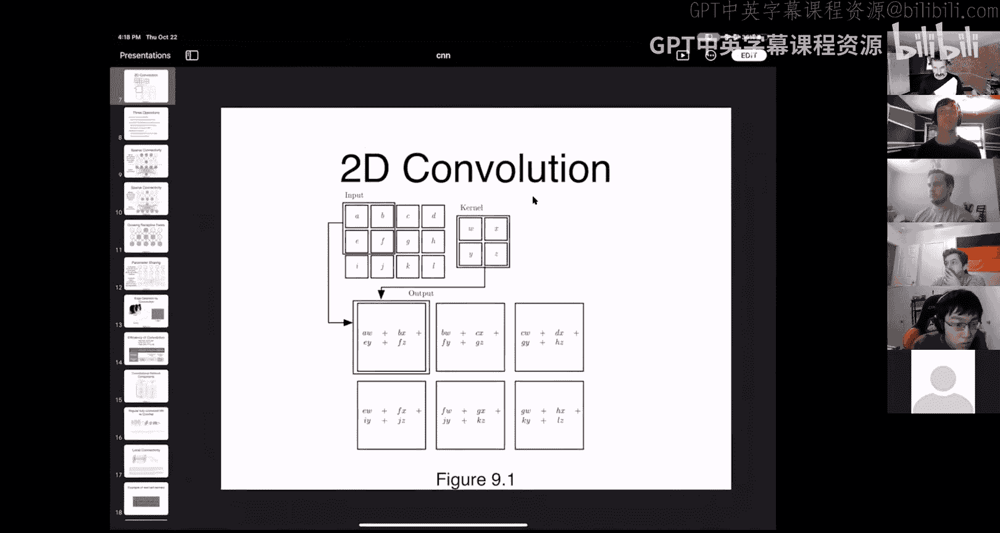
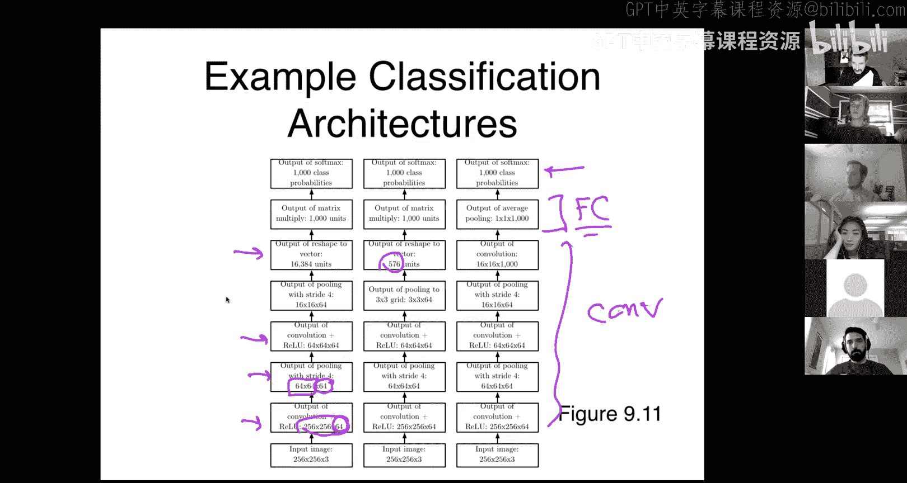
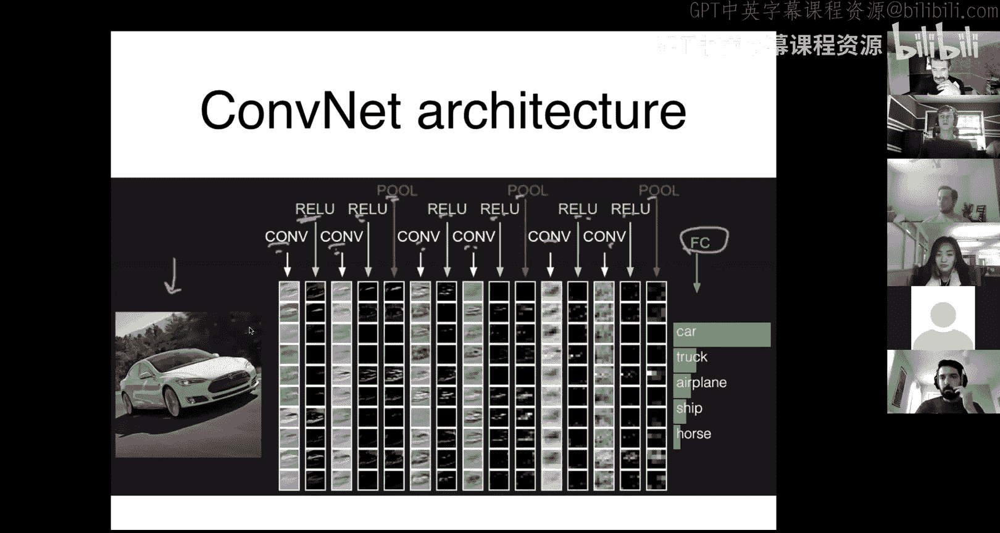
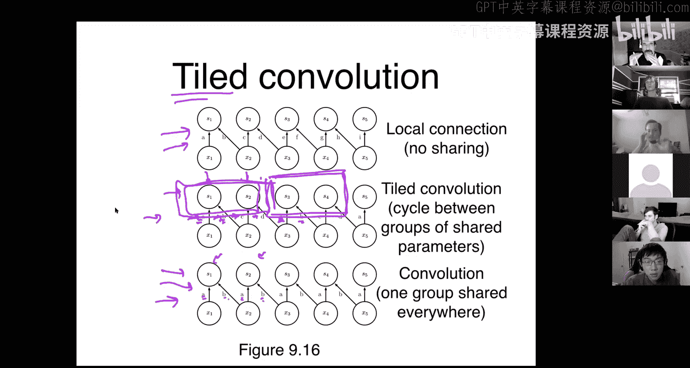

# 机器学习系统：7.2：卷积神经网络 🧠

在本节课中，我们将学习卷积神经网络（CNNs）的基本架构、核心操作及其与全连接网络的区别。我们将深入探讨卷积、池化等操作的工作原理，以及它们如何赋予网络平移不变性等关键特性。

## 网络架构概览

上一节我们介绍了卷积神经网络的基本概念。本节中，我们来看看其具体的架构设计。

卷积神经网络是一种分层架构。对于“层”的定义存在不同观点。一种观点认为，一个卷积层包含多个阶段。

*   **卷积阶段**：执行我们讨论过的卷积操作。
*   **线性阶段**：引入非线性激活函数（如ReLU）。
*   **池化阶段**：对数据进行下采样和汇总。

这三个阶段合起来通常被称为一个“卷积层”。另一种观点则将每个阶段单独视为一层。从表示的角度看，左边的定义更受青睐，因为每一层都产生一个张量输出。

## 与全连接网络的对比

为了理解CNN的独特之处，我们将其与熟悉的全连接网络进行对比。

在全连接网络中，每一层都是简单的矩阵乘法，将输入向量转换为输出向量。而在卷积神经网络中，每一层都将一个三维输入张量（具有高度、宽度和深度）转换为另一个三维输出张量。

网络末端，我们需要产生预测结果。例如，对于CIFAR-10数据集（10个类别），最终会输出一个大小为10的张量，这可以看作是每个类别的“得分”（logits）。之后可以通过Softmax函数将其转换为概率。

## 局部连接与参数共享

卷积神经网络的核心特性之一是局部连接。网络中的每个神经元并不连接到整个输入图像，而是只连接到输入的一个局部区域，这个区域称为该神经元的**感受野**。

另一个关键特性是**参数共享**。同一个卷积核（滤波器）会滑过整个输入图像的不同位置，这意味着在不同位置检测相同特征使用的是同一组参数。这极大地减少了需要学习的参数量。

考虑一个输入为32x32x3（CIFAR-10图像）的例子。如果我们使用一个5x5的卷积核，并且输入深度为3，那么我们需要 **3个** 这样的5x5核（每个通道一个）。因此，总参数量为 `5 * 5 * 3 + 1 = 76`（75个权重 + 1个偏置）。

重要的是，在宽度和高度维度上，我们通过滑动卷积核实现局部连接；而在深度维度上，连接是“全连接”的，即输出单元的每个位置都综合了输入所有通道的信息。

## 池化操作

以下是关于池化操作的介绍。

池化（如最大池化）的主要作用是**下采样**和提供**平移不变性**。它通过汇总一个局部区域（如2x2窗口）内的激活值来减少数据维度。

*   **最大池化**：取感受野内所有神经元的最大激活值。
*   **平均池化**：取感受野内所有神经元的平均激活值。

最大池化更常用，因为它能提供一定程度的平移不变性。平移不变性意味着当输入发生微小平移时，输出不会发生剧烈变化。例如，图像中的猫无论出现在左侧还是右侧，网络都应能识别出它。

池化操作也可以跨通道进行。假设一个层有三个通道，每个通道学习检测不同方向的特征（如左边缘、右边缘）。跨通道最大池化会从这三个通道中取最大值作为输出，这样无论哪个特征被激活，池化层都会产生较强的响应，从而获得对某些变换（如旋转）的不变性。

## 步长与下采样

步长是控制下采样程度的一个重要超参数。

**步长** 定义了卷积核或池化窗口在输入上每次移动的距离。步长为1时，窗口每次移动一个像素，输出尺寸变化较小。步长为2时，窗口每次移动两个像素，输出尺寸会减半，实现了下采样。

下采样的效果是保留最显著的特征（如较大的激活值），同时丢弃可能不重要的细节信息，这有助于减少计算量并增强特征的空间层次性。

## 典型CNN架构流程

现在，让我们将这些组件组合起来，看看一个典型的CNN架构是如何工作的。

一个典型的卷积神经网络遵循“由大到小”的流程：

1.  **输入**：大型图像（如256x256x3）。
2.  **特征提取**：图像经过多个“卷积-激活-池化”模块。卷积层学习特征，激活函数引入非线性，池化层进行下采样并增加不变性。经过多个这样的模块后，空间尺寸（高和宽）逐渐减小，而深度（通道数）可能增加。
3.  **展平与分类**：最终得到一个较小的三维特征张量（例如7x7x512）。将其展平为一维向量（例如 `7*7*512=25088` 维）。
4.  **全连接层**：在展平后的向量上添加一个或多个全连接层，进行最终的分类决策，输出每个类别的得分。
5.  **输出**：通过Softmax函数将得分转换为类别概率。

这种设计使得网络能够高效地从原始像素中提取层次化特征，并在最后阶段利用这些特征进行分类。

## 其他概念与变体

除了标准操作，还有一些其他概念和架构变体值得了解。

*   **零填充**：在输入张量的边界填充零。这有助于在卷积后保持输出尺寸不变，对于构建更深的网络非常有用。
*   **局部连接层**：类似卷积，神经元仅局部连接，但**参数不共享**。每个位置的连接权重都是独立学习的，参数量更大，灵活性也更高。
*   **平铺卷积**：介于标准卷积（参数完全共享）和局部连接（参数无共享）之间。参数在局部区域内共享，但在更大的“平铺”块之间不共享。这可以控制输出相邻单元之间的相关性。
*   **跨通道部分连接**：并非每个输出通道都连接到所有输入通道。这种稀疏连接可以大幅减少计算量和参数量，在如MobileNet等高效模型中常见。

## 总结

本节课中我们一起学习了卷积神经网络的核心内容。我们了解了CNN的分层架构，以及卷积、池化等关键操作如何通过**局部连接**和**参数共享**机制，高效地从图像中提取特征。我们探讨了池化带来的**下采样**和**平移不变性**好处，并梳理了从输入到分类输出的典型网络流程。最后，我们还简要介绍了零填充、局部连接等高级概念与变体。与全连接网络相比，CNN能以更少的参数和计算量构建更深的网络，并天然具备对平移等变换的鲁棒性，这使其成为计算机视觉任务中最主流的架构。