# USC《机器学习系统｜CSCE585 Machine Learning Systems 2020》中英字幕（Claude-3.5 p17 -17-A Demo of ATHENA for CSCE 585 Usage.zh_en -BV1Xc9bYVEC6_p17-

Okay， so could you see my screen here， Yes， Okay， could you hear me clear。Okay， that's great。 Okay。

 so， so today I， I wanted to show you。The whole process for a task 1。 Okay。

 I will show you this time I， I will show you in the。Nobook， so Jupyter notebook tutorial。 Okay。

 so first， if you want to use the Jupyter notebook， first， you need to Okay。

 so make sure you have activate the proper environment here。And then。Type this。手笔。5个。Okay。

 Jupiter notebook， type this comment a command line and then press enter。You will see here。 it will。

To open and。Notebook in your， in your browser。Okay， so let's go to the。So， this is Florida。好 plus。

I just， I just finish this tutorial。 I will update， upload this after， after this。Okay。

 so the task I， the tutorial I made is for task 1。Let me send in a little bit。

OkayI click the all the output， So。Okay， so first。You need to import some necessary packages okay。

 and since as some of you mentioned that yeah， that's a good point。Because for some attacks。

 it will take， take time。 So in that case or for in any case， you can generate a subset。

 a smaller data set for your experiment， so。This is the optional。I。

 I upload this file sub sampling this API， helping you to。

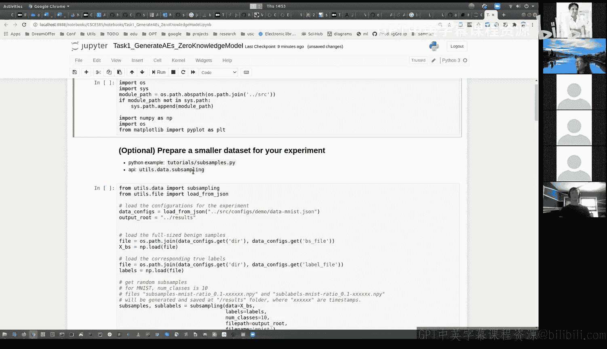

To some sample some。So simple the the data。The be sample as well as well as the corresponding labels。

And save in the same order。 So I， I provide this to you because I want to sample。The data that。

Equally from from each class。 So I， so I provide this to you when you are using this one。

 you need to provide the the data。 So here the B sample and the corresponding labels。

And the number of classes in in this task， if you are using M， this number of classes always be 10。

 So this will be 10。 If you are using a different data set that will be a different story。 Okay。

 the ratio here。 I set the default ratio as 10% that you can， you can modify this。

And you can provide a file pass and a file name。 Then the， the sampled files will be saved in this。

 in this place。With the prefix as subsles and the file name actually just as part of this name。

And the ratio。 And I attack the the time step here。So the。

 the corresponding samples will be name as the yeah， with the prefix as sub samples。 Okay。

 so this is the new。

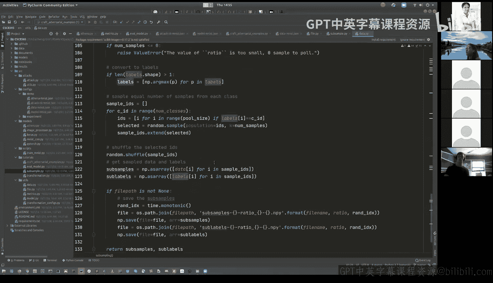

ApiI， you might or might not use it。 Okay， so with this one。

 we have an optional step so you can prepare a smaller data set for your experiment。 So you you you。

 if you want to use this one。 you only need to do a subple once。 So。And generate the A Es using the。

 the sample you。Yeah， you get from this step， okay。So this is the example for sub samplingling。

For example， currently。I don't have anything here。So I also have a Python example for this case in this file。

So this is the main API you need to call to finish this task。Okay， so first。

 we need to load the configuration， So we need to load basically。

 we need to load the organize sample and the corresponding label。And then， just call it。

Coets like this。So we need to pass the be sample， pass the corresponding labels and the number of classes is 10。

 as we just mentioned and output pass， I make it results。Okay， so I will。

 I want this endless display in the name。 Okay， when you run this。Okay， it。

If you can see a number here， that means this slides has been wrong， has been successfully wrong。

Then you check this results folder， you can see。You have a。Have sub samples here。Yan。

 can I make a comment。On the results folder， I just wanted to mention that。

Because Git doesn't let you upload MD folders， you'll have to create the results folder。

 like everyone will have to create their own results folder for that to work。Oh， yes， yes。

 you're right。 Thanks for mention that。 So if you can， if you encounter something。

 some error cannot find some file or some file or some pass does not exist。

 you just need to check whether this folder was there。So after you generate the。

If you decided to use that use a different sample to generate the AEs。

 you need to maintain this in the J file， so currently we maintain it in this data data analyst Jason in this file。

So。So first， you need to copy the the generated sub samplesles to the to this location。

And then you need to replace these sub samplesles with a name we just get here。Yeah。

Put it here one comment does it make sense for these like for example。

 expecting that a folder exists somewhere like we create a ba script to create all of these folders and sub folders for these。

How many of these folder。Are expected。Yeah， I think we， in my cases， I only need， I only need result。

 This is the only folder I need。 I mean， you， you need to create。

But if you specify a different folder， then you， okay， I think I can do that， yes。I mean。

 if if there are some， so what I meant is if there are some like。

Depenencies in terms of like location of like the result， location of the model。

 whatever we could or one of the students could write a partial script。

Then like simply one can run it before running the code， if that makes sense。

 if that's only one folder， that's probably not it， but if there are several of these。

 maybe we could write a I script for that。Yeah， in， in my， in my tutorial。

 this is the only folder thats required to。To create。So， but in your experiments。

 if you need you specify a different folder， you need to make sure。To create those folders。

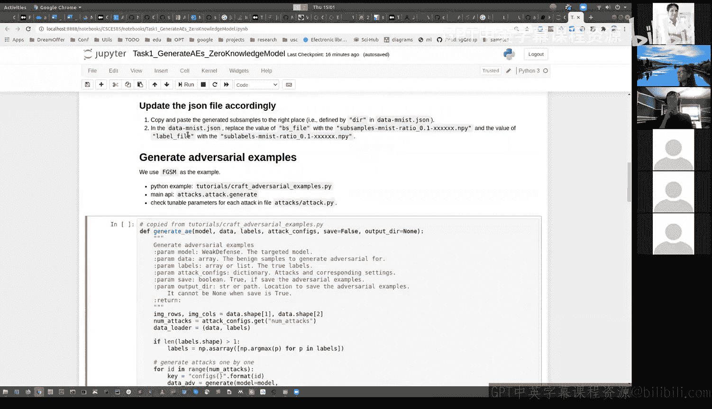

So， okay， let me show you the。Jason file。 So if you， after you generated the。The subsles。

Just replace。This file。Let me get the some samples。

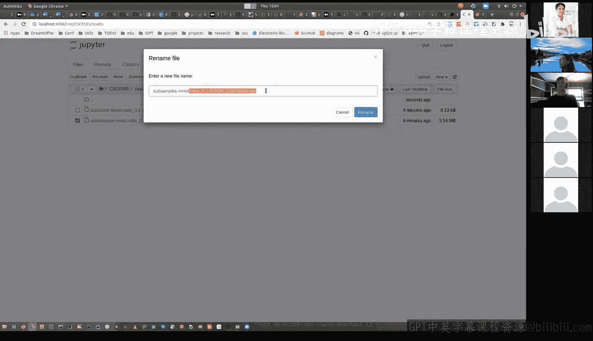

First， you need to copy this to to the right place。So。Here you just replace this。This one。

With the one you generated。And replace this label with those labels， just generated。

And then now when you the get the data。You can， we can now generate adversial examples， so。

This is the process we generate the example。 Okay， the Python example was was this file。

 So mainly we need to call this call this API to generate the the examples the AE for you and you can check。

In this file， for the for the tuable parameters for each attack method。

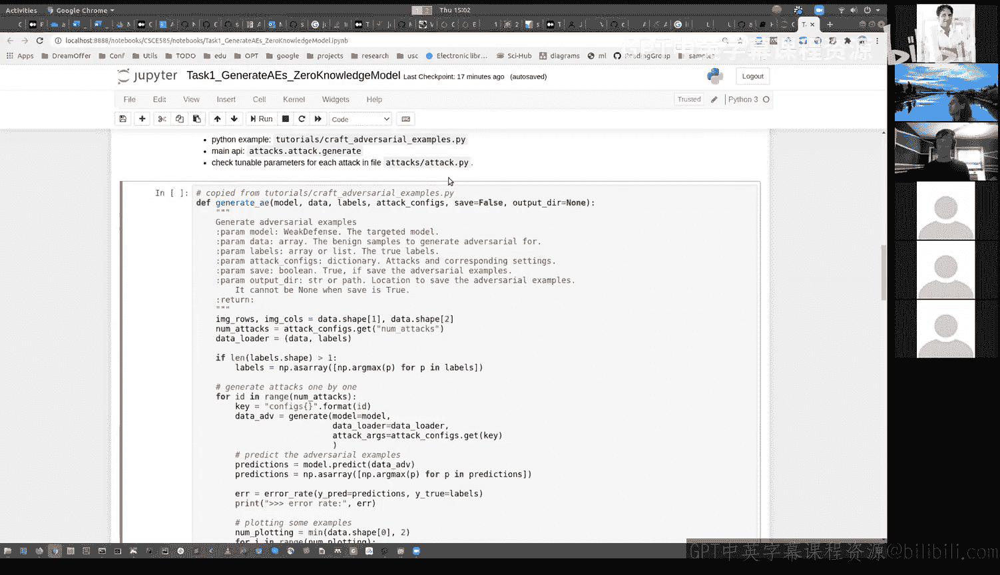

小。😔，嗯。slow on my。O。So， for example。I guess you guys have been familiar with this FJSM。 For example。

 you are going to generate AEs using C W。You can check this function。这首。嗯。All of these guys。

 So whatever we get from this attack a。X。They are tunable parameters for this， for this attack， so。

So if you want to generate the AEs using different attack methods， you。

 you just check here for the tuable parameters and con in this。In this attack， Z KMist Jason file。

Yeah， in this dressing。

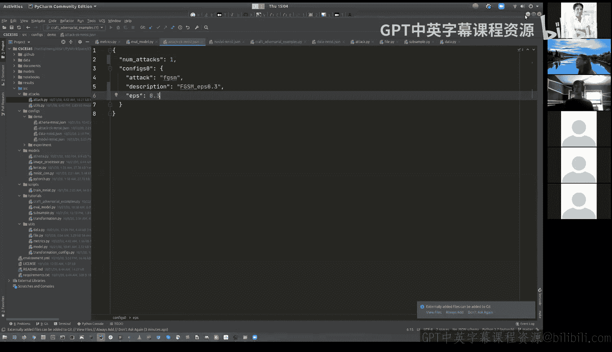

Okay， so here are。Here， this function。We， we show an example to generate aEs for you。

 So we require a model。Is in an instance of this weak defense， this class。

And this model will be the targeted model we we we for the attack attackers to attack。 And this A E。

 this data are the be samples。 We generate the A Es for， and the labels are the。

Corresponding true labels。 and this。Attacks。You just define in that J file I just mentioned。

 so if you wanted to save the generated AEs， you make it true。And provide a place to save the。

 to save the example。Okay so this is。So basically， when we get this。Get。Get these configurations。

We will generate。All the all the A Es you listed there。So basically we will iterate it。

 we will read the configurations for attack one by one。So。When we get this one。 we will。

We simply call this function。 This， This is the generate function I mentioned here。

Its the API in this attacks attack。In that file。So。You need to pass the targeted model here。

 You need to pass the data loader。 So here the data loader consists of the。

 the label and the the data and the label。And the attack conflicts。So here we just feed。

The configurations of the corresponding attack to this method。

And then it will return you some generated AE。And when you get this As， we can do some prediction。

 So here we use the。Targeted model to predict。To see if the generated AEs can fool this model。

And you can get the L rate。Yeah。So。So here I will show you to， you can also plot the the AEs to see。

 I mean， for debug or something else。If you don't need it。

 you you can simply comment this part out or or just delete it。Or make this one zero。O了。So。

 here we just。So before you generate the As， you need to load the experiment configurations。

 What we need here is the is the model。 we need the we need the data。

 we need the setting of the attack， so we。Get all this stuff from the， from J files。So when we。

 so we can load the targeted model。And we can load the files of the， the data， load the， the label。

 So in this case， I would only generate 5，5 examples for you。佢。Yeah， after you get everything done。

 you can simply call this function and pass pass them。Pass the the。values。Okay。So we can see some。

Some processing here。So we first load the targeted model。And then。

And then generate AE using this attack。And the the area of this， this two example are one。

 So basically， these two samples can fool the targeted model。 As you can see here。

 So this is the method we generate this， this image。 and previously the。

So the true label for this one is 7。 And now the targeted model， will think this is a 9。

 and this one as well。 So it was 2。 But now I think this is。

Okay after you generated the AEs and save the AEs， for example， if we save the AEs with listening。

And then， you need to。You need to update this in the in maintain the J file。 If you don't want to。

 you can you can either create a new one similar to this one and simply replace。replace your。 Yeah。

 Put your own A E。In here， I mean， for this one， for this barrel me。

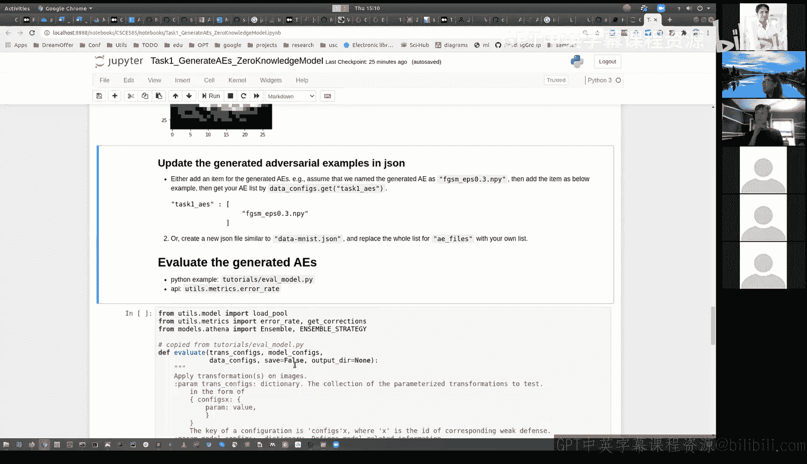

Okay， so here。If you don't， you don't want to， I mean。You want to use the same structure of this one。

 You can， you can create your own with a different name so you can read the。

 you can load the configurations from your own Jason file and then。Here。You just。Put your。

 put your a E here。Then you don't have to update the， I mean， in the code。

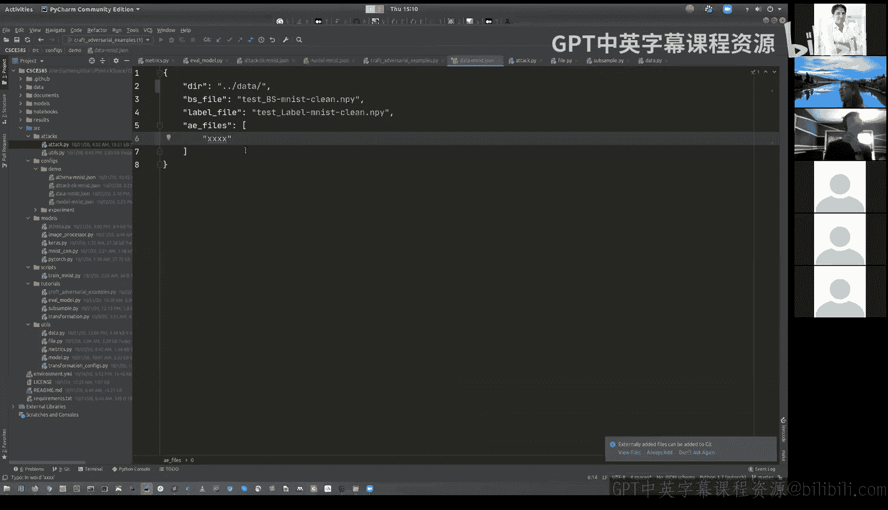

We don't have to update the past。But if you want to maintain everything in the same。

 in the same J file， you can add one more。Item in this in。In this data， analyst Jason file。So。

For example， if you。You can add key， for example， task 1 As and then。Let me是 example。

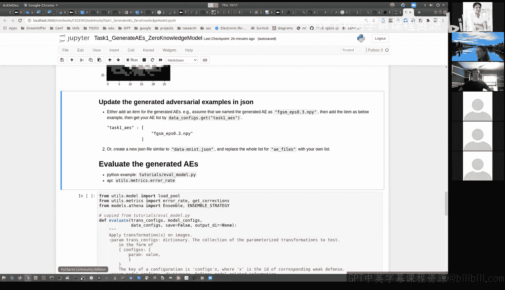

Yeah。For example， we， we just maintain that in this， in the same。reson file。So， I。哎。I add a key。Here。

So you can add maintain your， your AEs like this way。

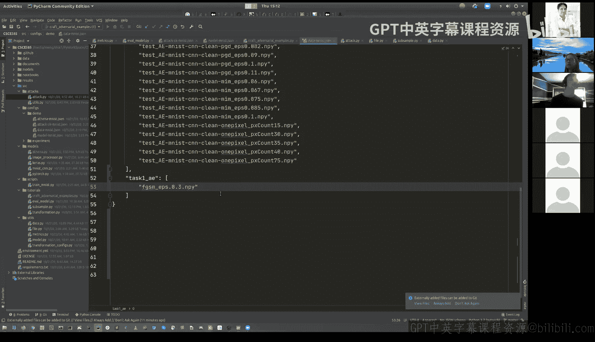

But if you。You maintain it like this way。 whenever you want to load your own AEs， you need to。

 you need to get your As like this。So you need to provide the the right key here。O。So。So now we。

 we get the AEs。The next step， we need to evaluate the AEs。So， the Python example。I is in here。

 evaluate model。And the API you you need is this error rate。Yeah， I， I would like to。Thank。Who I am。

Caught my， caught my buck。 Yeah， previously， I I counted error rate in a different way， but。I。

 I changed my mind in the last minute to use a totally different opposite algorithm。 So that'。

 and I forgot to， to remove that line， so。Thank you for caught the bug。Okay。

 I have fixed the bug and uploaded。Who caught the back？I think it was me。y thank you好。

I see Andrew want okay， thanks Andrew。Thank you。Yeah， we love to hear these works， right？Find them。

 yeah。Yeah， because I think at last minute， I think this is， I mean， more simple， I mean。

 to easier to understand。And so I changed the algorithm at the last minute。Yeah so， yeah， evaluate。

 we consider it when we yes the final。S course， yeah。Yeah。Yeah。helello。So this。

 this method was copied from this， this python example。 So here we evaluate the。The As。Using。

 so here the unefended model。 So here， this unefended model actually is the same model。呃。

TheSame target。In this generate A E some。Sttop， so it's the same Yeah。 It's the task。Is the target。

Yeah， it's this one， So these two models are the same because。I mentioned it in a different context。

 I just used the corresponding name in in we refer in that context。 so。

 but I don't want to confuse you。 you guys。 So I， I just mentioned it here。 So this target model。

When you generate the AEs， it's the same model。When I。The same undeefended model When I evaluate the。

 the AEs。So， in this example。It required the transformation configurations， this one。

 basically it contains the informations of the weak defenses in the the in the ensemble。

 so it's a dictionary。And these model configurations， it will， it's also a dictionary reloaded。

From the Jason。It contains some information regarding the models， for example。

 where the models locates。Something like that。And this data configuration。

It can be the data data dash analysts， Doc Jason， where you maintain the generated AE。Okay。

So here I first load the baseline。 So the baseline in this case is actually the PGD adversial trained model。

 Yeah， so first， I load this baseline model and I load this undeefended model。And then。

So we need to we wanted to evaluate with this ensemble。 so in order to create this ensemble。

 you need to load。The the WDs， the weak defenses。So， when you get the。Get the weak defenses here。

 We can create an ensemble in this way， so。诶。The classifiers are all the ensembles in this are all the weak defenses in this ensemble and strategy you wanted to use for this ensemble。

 So in this case， I create an averaging probability。 ensemble。 So you can， you can check this。

 I think it's in the。It's in the ensemble file。

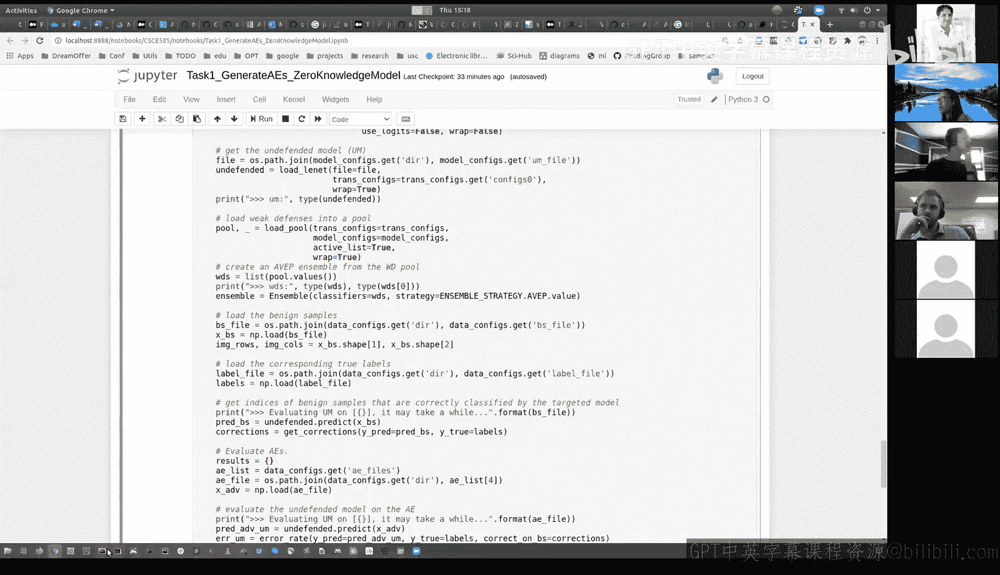

Let me show you here。哦， in the i啦。嗯。Okay。If you you' are not sure what kind of ensemble strategy you can use。

You can check here。You can check this one。Actually， you are if you coding in an IDE。

When you refer to this object， it will provide you when you press a dot， it will provide you a list。

No。In this test this three four and five there are no difference we just refer to this I mean the algorithm algorithms are the same they just use a different level of output to do the tube。

To compute the the results。 So in this case， we only have probabilities。 So you need to use this one。

Yeah， if you， you are using the rest， since you are using the the output。Probabilities。

 you will always get the same result。Use啊。Aver averaging probability。 And if you would like。

 I would suggest you to also use a majority voting as well。So this two。1 and3。

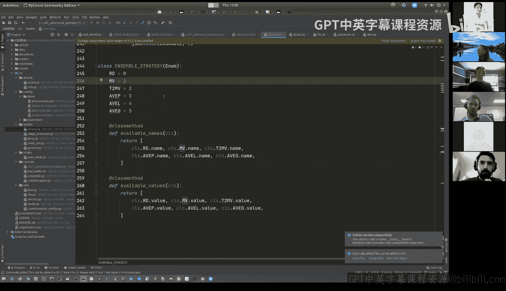

日数。So you need to provide the weak defenses。 And this is a list it， yeah。Weak defenses。

 You maintain the。A list of classifiers。 and you pass it to， to the classifiers。

To this parameter and then unifying the strategy。对。And then next step， we need to。

 we wanted to load the nice samples why we why do I need to do this。

 Because according to the definition of this successful rate， we need to first exclude。

The samples that was misclassified， the benign samples that was misclassified by the。

By the undeefended model， because。If， if the the model cannot， I mean。

 has been full by by the be sample already， it's not so。Yeah， the AEs might might also for them。

 but that's not the。I mean。That's not caused by the， by the perturbations， because the。

 the undeefended model has already。Make mistake on that sample。

 So we need to exclude these kind of samples。 So that's why we need the beign samples here。

 And then the two labels here。Yeah， and then we， we get the corrections。

 So these corrections are the are the index indexes of the samples that are correctly classified by the。

Undefended model， we can see here。But you don't need to know this。 I just wanted to explain the。

I mean， how we compute that error rate or the or successfully of the AE。Okay。

 so we evaluate the A Es here。 So in this example， I just evaluate1 A E variant。 That's F GSM。

 I think maybe。0。25。 No，0。3， yes。So we need to load the A E。 So in this case。

 you need to load the A E。 you generate it， right。O。

And then you just use different models to do the prediction。 So here， the undefended model。

 you will get the prediction。And then then call this error rate function。Fit the predictions on the。

 on the adversar examples and fit the true。Labels and。And provide these corrections。

And then it will return you an error。And then。是。We evaluate the ensembles in the same way。 You can。

 they all just call the predict this API。 APIs are the same。And it's the same for the。

For the P GD a trained。Moel。After that， you will get。The three errors。I mean。

 the areas of these three models are the same。A E variance。Okay， so he， that was the function。

 And here we prepare the。The for the parameters。 So load the configurations and。Sp an output data。

Since I don't want to save save the output。So， I make it false。

So you can see it load the baseline model。Load the unefended model。In this case， I only。

Show you a very。Very simple ensemble consists of three weak defenses here。So。You咩事。

An area on this ensemble is not， is not good， yet。So we get a results here。When we evaluate this Ae。

On the unefended model， you can see。The above 88% of this AEs can fold this model。

And when we go to the ensemble of this， just three week defenses。The error rate drop from。

 from 88% to 6067%。 And when we evaluate it with another defense approach。

The area will drop from 88% to 21%。So that's how we read these results。

This is very much this is basically related to the trade of a space we talk about right。

 where you can strength of Ana defense or basically more accurately。

Change the effectiveness of the defense that you create with the antenna frameworkver， right， Yes。

 given the cons that you have and basically the number of weak defenses you want to use。

 the type of V defenses， the overhead you want to。To have because again。

 these big defenses are associated to transformations and each come with different costs。

I I highly recommend you guys to to ask questions from Ying， right， So this this is a nice tutorial。

 I guess it is。Clear， and you guys are happy now。But ask your questions to understand what's going on here。

Yeah， please ask questions if。Yeah， any， any places you don't。

YouYou cannot follow or something like that。I have a quick question so yeah sure the Atheno model that would be the ensemble of weak defenses right so do you want us to include a certain amount of those or just whatever we want or all of them。

Yes， yes。 you're right。But in your example， I。嗯。I'm not sure whether you should include order 72。

Weak defenses。Like it is up to you。 Maybe you want to also consider different sizes and in your report talk about like your findings when you use again。

 different sizes so。You are free to explore。 And again。

The most the way how you need to think about this project and again I mentioned it before。

 but now since things are much more clear for you， I would like to repeat it。Think about again。

 this is a framework which has some flexibility， right， you can。

You can consider different styles of ensembles we have basically like over 70 different type of transformation。

 but you are free to explore transformations that is not already here right and train models of weak defense for this and we have a script here for doing that right in the framework。

Construct different。In as of the defense with different numbers。 obviously。

 you don't want to explore like。Thousands differences。

 but design your experiment in a nice way that you could find interesting things， and you can。

Write about those interesting findings in your report， right， Think about。

And design of experiment right you have some flexibility in the way how you want to design it。

 I would suggest to a step back think about design it brain astorm with other team members。

What do you think， whether it is and an interesting design before you even run anything right。

 thinking about this flexibility that you have。Design it innovate that you maximize the expectation of finding interesting results。

 right？嗯。So， for example， you may not give get very much different when you have two defense of like size 20 and 21。

 right？But you may want to have 20 and 30， for example， right， given the constraint that you have。

 basically think about this， design it， brain a storm with your teammates。

And I'm really looking forward to see some interesting design and findings about different aspects of the framework right again i'm looking for these surprises and these surprises I'm sure will。

You will find if you come up with interesting design of experiment。Does it make sense？Yeah， yeah。

 that makes more sense。Yeah， and if you have question， yeah ask it now if。

 if any part of this is unclear。Ynkee is here to help。It may looks like that， like this task may。

Became very trivial the first task， but that's fine we wanted to help you。And make progress。

But it doesn't mean that we make we will make the other task to you for you。

 So this was the first task a barrier for you I know， and we should have done it anyway。 Now。

 since you know how to set up defense and work with it。

We really expect to like explore and do the other task independently。嗯。And again。

 we really appreciate any contribution if you have in terms of bugs that you find in terms of like any sort of contribution that you can imagine。

So these are useful think about those and I'm sure you can learn a lot and you can we also mention about like some even future possible research kind of ideas we wrote it in the project description and Ying will update it soon with some more ideas I discuss with her but she needs to update the project description so。

Yeah， explore any sort of possibilities and learn as much as you can。Because with this framework。

 I'm sure there are lot lots of things that you can exploreel learn from。 So this is very good。

One question， how many of you attended the talk we had in CSE department from Google today。

Any of you attended that talk。Yeah I听。哦会衫。嗯。I cannot hear。 Who is that。And sugar。 think its sugar。

Okay， only Suge attendedant or anybody else。Do you have something to say today about the talk and the relation of the talk and what kind of challenges the guy discussed with respect to what we have discussed in this class？

嗯。I think the guys discuss。How to predict this customer whether buy something。呃 but啊。

I'm not sure what， what， I'm not that clear what he is。Is doing。You didn't。 You didn'。

 You didn't follow stock。 It was very clear。I's clear。 I I don't。Quite understand the。Technical yeah。

 but not technical at the high level。Did you find any connection between kind of challenges he discussed about you know。

 the pipeline that they have for marketing analytics because he was talking about the marketing analytics right。

 which is you can think about this as a machine learning system at a scale right there something Did you learn anything or you want to discuss that has any relationship between this course and what he discussed at a high level。

 not like detail of？

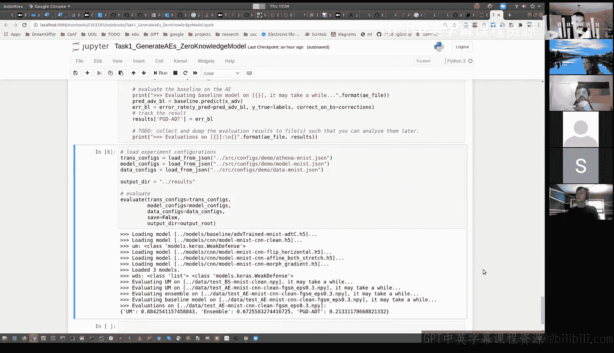

Advertisement or marketing analytics， I don't know either about those with did。

So if there's some connection， I think their pipeline is similar to the machine learning systems。

Yeah， the her partner。 but I don't。

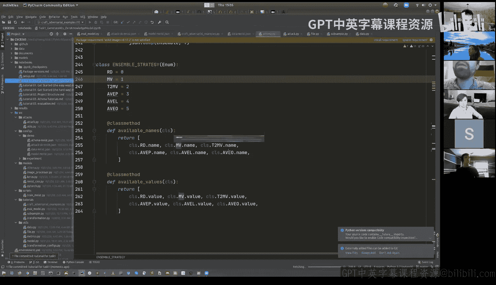

I don't know whether is too much。To much details。And and also， I think how to identify the。

Problems or the questions is important。Yeah， so it。If he is going to。Pd。

Whether the custom weather will buy the product。So how to identify the problems。How they formulated。

 you remember how they formulated that。嗯。So let me， let me maybe， maybe you didn't listen carefully。

 right？So。Any other students attended？就给 what only方。Okay。

 so that was interesting talk because this guy from he was an engineering lead at Google。

 who I invited to give a talk here in our graduate seminar。And for me， it was interesting。

 he was mainly talking about marketing analytics。And their pipeline。

 which is basically at an abstract level。The data is the behavior of customers that they have， right？

How they， how they interact。あ。

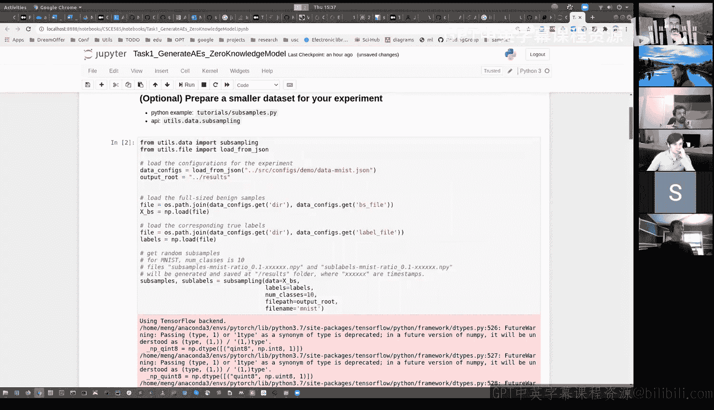

They collect many of these customer behavior and they do analytics on top of these data。

 basically they use many different type of models from neural network to logistic regression to ensembles basically mentioned they as long as any model provide decent accuracy for based on the data they're using and they are using many different models。

 right。And he was talking about like some challenges when it comes to several hundred or several thousands models needs to needs to maintain and needs to serve so basically they have one model per customer and customer means that like imagine a company having the website right and doing the advertisement or selling some stuff。

 right。

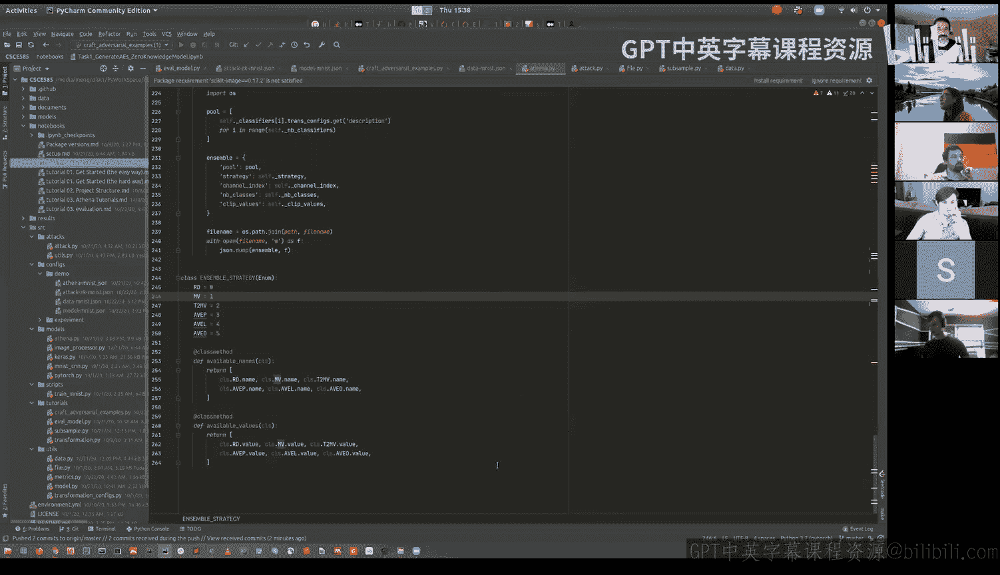

So at that escape， so it means that like maybe even millions of models they regularly train on the data。

 update and serve the customer， so he was mentioning one model per customer。

 which was interesting to me。And。You mentioned about these model updates that we discussed at the beginning of this course。

 If you remember， he was talking about the pipeline from data to model training to serving。

 updating the model， how the update of the model looks like。

 what kind of metric they care for when they decide to do model update。 It was， for me。

 it was surprising that also， I mean， it's not really damage super， but。I thought。

The model update is more is fully automated， but apparently it is not so is human is in the loop to decide when they need to update the model and in some cases it was mentioning that they fall back to the even。

Very old model or some model that they know that previously have work or even no model case。

 meaning that they use prior information to decide。

So basically it was interesting to me that he was mentioning these challenges。

And it was very much connected to what we have discussed so far in this course。Yeah。

 and this was a particular team at Google， Google， basically marketing analytics， but having。

 I talk with several other folks at Google in different teams， right advertisements， infrastructure。

 beyond Google， also Facebook， for example，And。嗯。And some other smaller companies。Smaller， I mean。

 smaller than Google， Facebook， but to some extent medium size。It was several weeks ago。

 it was AI summits。I gave a talk there and then talking with some folks from industry。

 even from these like smaller companies， they had all sort of these issues that we touch in this course and it is。

It was interesting and assuring to us that you talk about relevant stuff。

 so try to messages that try to learn as much as possible in this course it would be very useful for you guys。

Either， again， the past would be either if you are interested going to industry doing machine learning。

 This is the way to to do it。 If you are interested doing gra school or doing。

Like advanced research and machine learning， this is also useful。Was there a recording of the talk？

I believe the talk was recorded， yeah， reach out to Sanjeep。

He's moderating this course seminar course in our department this semester。

But the talk was recorded yes， and will be available， I believe。

But I'm not sure to what mailing this he will going to send。Whether it will be reach to you guys。

 But if I found out， I will。Post it in on Piazza for you。All right， thank you。Any， any question。

 talks。If not， maybe。Maybe maybe we can start talking about convolution nets。

Continue our discussion there。Okay， I'm stop sharing a now。

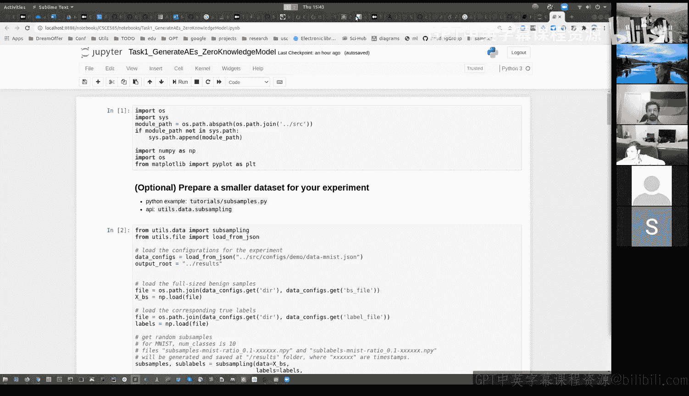