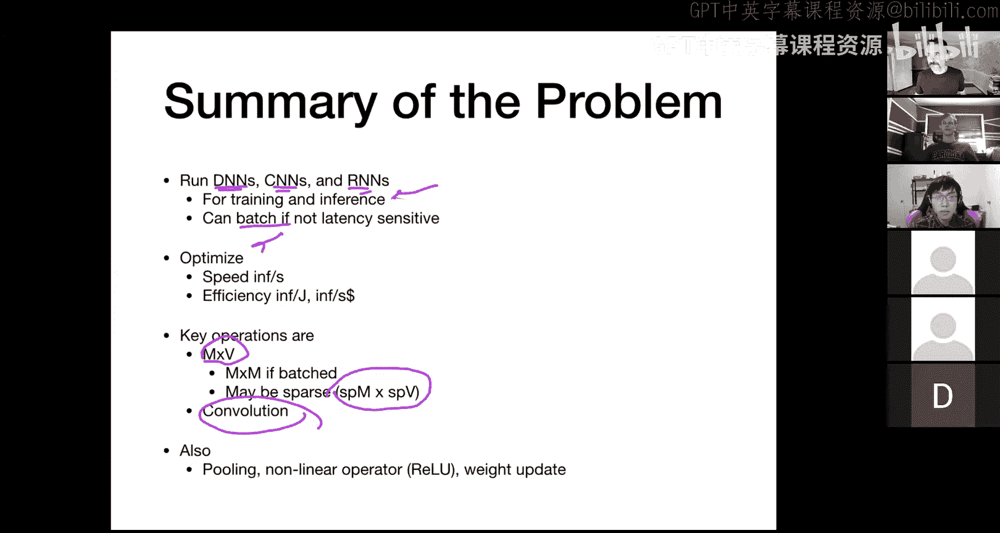

# USC《机器学习系统｜CSCE585 Machine Learning Systems 2020》中英字幕（Claude-3.5 p18 -18-Lecture 8.1_ Hardware for Machine Learning Systems.zh_en -BV1Xc9bYVEC6_p18-

Okay， hi， everybody。 I hope you can hear me wrong。I can hear you well。Good。

 could you please turn on your camera。As many as you could， as always， right？That's very good。

So the plan for today is to talk about hardware for machine learning system。

 so basically if you remember this deep learning system stack or in general machine learning system stack。

 it had several layers。At the top was basically the programming API that you were able to write your code。

 define the architecture of， for example， the neural network that you have or some detail about the machine learning model that you want to define。

 also some API for training， and several others that we already talked about。

A layer below that was the system layer that you already talked。To some extent， this is mainly about。

The computational graph， right， how you can translate translate this framework can translate。

The task that you define in your model and translate that to a computational model that can be efficiently deployed on the hardware。

layer year below that。And today we are going to talk about this hardware layer， which is。

Also very important to understand the detail。The connection， obviously， you don't need to。

The expert in hardware， especially for those of you non CS students。

 but we want to make a sense out of it， right and not all CSS students know a lot detail about hardware。

 but we want to make a sense out of it today mainly emphasizing on the key problems right。

 understanding the key problems and some of the exciting work that is going on these days。

 especially the connection between hardware or basically hardware for machine learning systems。

These are very exciting and kind of important area。

 at least at the moment in research and soon in larger scale deployment。Before we go into the detail。

 do you have any question as always， about anything you want to highlight。

 I hope you're doing well on on the project side do you have any concern is any team。Has any concern？

The latest that I know that。Most of you are in good shape。

 We had like one or two team still struggling。Professor I have a question so some most few of us this submitted the assignment but after for example after the due date or in the middle of the semester if we found that okay these kinds of things I could do in my fast assignment so because you know that our idea is sometimes some idea that didn't came to our mind so in the middle of the project if we find some new idea just by discussing with the other students or by from from anyhow so can we add these things or in the in the first project。

SoThat's a very， very good question and that's a fantastic question thanks for asking， yes。

 I highly highly encourage that。And probably we did not mention that。

Specifically how you are going to do that so my thought is that this is one way you could do this。

 you could create a tag or branch on your Github repo about this assignment I'm going to clarifyar very precisely what exactly you need to do。

For this assignment when you submitted for the first time。Right。Until the end。

 when you deliver everything coud task2 and task3， obviously， you can update all of these， right。

 But I want you to have a specific。诶。Branch or tag。 I will。 I need to think about it。

About this submission， about your grid， you are going to consider basically what you submitted at the end。

 so whatever update you could do。The only thing that I want you to do because my approach is that I trust you guys。

So basically， please don't try to copy from other groups and so on。

About specifically this assignment， I trust you that you do your best and you do creative original work for。

For these assignments but。But please yeah， note cheating or copying from other groups。

 but I'm sure that you don't do that right， but to be precise we allow you to update these and the only great whatever you deliver at the end regarding all of these tasks。

We have these due dates， specifically for。You to make sure that you have some milestones in between。

 right？So you can see yourself the progress that you have made and this will help you to focus on different tasks of different flavors specifically as your TA Ying mentioned。

 task2 is relatively more difficult than task on， but I'm happy that this tutorial help you。

A lot to get this first task done and this is good sign。Probably we need it at the beginning。

 but this is work in progress right， so thanks for your feedback and highlighting it I think about this tutorial。

As a hell work for this framework so this is this is good that you are able to to get things done any other concern or suggestion so when you say that the final graded version is the version at the end of the semester and we can continue to make updates does that also mean we're not going to get any graded feedback until the end of the semester no we are going to give you feedback definitely。

And that's why I want you to basically mark this because we are going to look at it now right。

 but we'll send hopefully tonight the updated we are updated the instruction so the instruction has been updated in updated it yesterday and I'm going to finalize it tonight I will send you。

Once I'm done， via Piza。Any other questions？Yes， professorfesor， I would like to ask。嗯。

Our submission for my group， we submitted in our repository。龙言费者电影。As， as a contributor。

Is that okay or how do you want to send。We， we updated the instruction。Yeah。

 I agree that it was not super clear about every aspect。 So I want to make sure that。

You know exactly how to do this， deliver this， right， task one。So呃。The， so again。

Make sure so this thing that I mentioned that we only create the。Whatever you deliver at the end。

 this doesn't mean that you you should not submit task one if you do not submit task deliverable。

You will get 0。And I'm serious about that。 So if you do not submit。Um。

 if there's like serious problem with your submission。

 you will get zero and whatever you deliver at the end。But if you submit and it is reasonable。

 we give you feedback， we want to help you and keep learning。

Give you great about the last submission right but that you have this constant you have to submit for the deadline for each task at the specific time and please once we send out the final instruction。

Read them carefully， again。And make sure that you understand every single detail。

 we repeated this many， many times that if you have any question you want to clarify ask to clarify things。

 create the issue whatever right and ask or ask your question here。And we。

 we need to make sure we need to know。Where we can find your repository and it will be in detail mentioned in the instruction。

And when I find a large and send it out， does it make sense？s does thank you。原告。Any other question。

Yeah， this is great。And。Yeah。And this there are some also news about this ana framework that。嗯。

You will hear soon at some point。One of these large company decided to adopt this for the back end。

So this is great that you're learning more detail about this framework for adverse Soviet defense。

 that's great。Okay， so。Yes hardware of machine learning this is exciting I showed you some different version of hardware let me show you that might be useful so like for example we have different different totally heterogeneous kind of hardware right so you have a small kind of hardware as this one which is super small I showed you before。

You have like slightly bigger。 This is， for example， from Google TPU is slightly higher capacity。

 GPU。And CPUU， you have like bigger one， this is NVDdia， this AGic Xvier。

 typically NVDdia use this hardware， for example， for self drivingr cars this is the development key but we have the real key that is used basically in self driving cars in the lab。

 I don't have it at my house，We have like some other super small。A smaller kind of hardware。

Wanting that like some other like these are， for example。

 some communication module that I'm using for creating some， you know。

 some robots and stuff and some。Har for doing machine learning， for example。

 I mentioned about this project that we have for blind people。

 so i'm assembling and putting together。嗯。Some of these。

 so the goal is to be as as small as possible because we want like attach to glass。

There are some smart glasses out there， but i'm trying to like develop something small so it is reasonable so we can attach it to to glass for enhancing the perception of blind people so what I wanted to mention was that we have。

So many different hardware platform and especially these days。

 these heterogeneous hardware platforms appear in every。Every week or every month。And。

And the difference is that they， for example macro architectures are essentially different。

 there are some differences in terms of obviously memory compute and the kind of capability that each of these exposed。

 but essentially with respect to principles and like the stuff that you need to know this is what we want to talk about it and why it is these are important。

 right？We discussed about。The trending machine learning。

 we discussed previously that basically even NoA network was out there many years ago right in 1950s there were not deep it was perceptturn right in 1980s we have convolutional networks for for example。

 for identifying checks the kind of famous leanette architecture it was not deep but like it was a sort of convolutional neural network and after right around 20009 due to appearance of large data sets like imagenet and appearance of。

G you now this big revolution happened。 So as a result。

TheThe trend is is that the trend is really simple。 We have more data， right。

 as a result of more data， the models gets bigger and bigger。They get deeper and deeper means that。

You need to train。More weights， so this network as a result of getting bigger or deeper。

 you have obviously more weights to incorporate in your training。

And obviously for both training and inference， you need more compute， right？

And make sure that you understand and we want to I want。

To somehow discuss about these differences between training and inference。

 because this is a bottleneck for both right and you already know。Some of the details right。

 we discuss about training lots for different type of models as well as inferencefer。But now。

 as I mentioned， the plan for today is only talk about the problem。

 you want to understand the problem what's going on。So and the goal is really simple。

 we want to run the network， the neural network faster， basically we want to get better performance。

Or。Or you can think about it as a throughput， right， You want to get more inference time per second。

 for example。Or in other words。So this is about running them faster， especially like for example。

 when you deploy an neural network on on some of these hardware， you want to like in one minute。

 you want to run。Several hundred。Inference right prediction or several thousand depending on the power of this。

 so you want to increase the throughput for a specific hardware but。On the other aspect。

 you also want them to run them very efficiently。Why this is important。

The way how we can think about it。You should separate training from inference。

For training you could assume that you have a server in a data center right that has a GPU you can even train a large network so obviously you can but you need to pay for the GPU server and we discuss about it what it means because like。

It is costly to run a data center so you need to do the training very efficiently。

 but you don't have the concern that my hardware is connected to a battery stuff。

 but for inference once you have the model trained。

 you want to take it and deployed in some of these hardware。

 these embedded hardware and typically these embedded hardware are connected to a battery。

So you need to run your model very efficiently， for example， if you use it in a robot。

You want to do many different missions with this robot， not basically charging。

 recharging it again and again， or if you wanted to use it on your mobile or watch。

 you don't want to run out of battery soon。So it is important to get energy efficiency。Right。

 and energy efficiency means that in per jewel Jus is the unit for。For energy， right？So。

 if you're familiar。This is the formula that you have right。

 what is chooses per second you might have heard about what more depending on the context you are familiar of it。

But essentially， you want to think about energy as inference per ju。

And also you can be fine in terms of cost as well， inference per second per dollar。

 you can think about that as well。So for inference。

 what's happening you is just the neural network in a forward path for training， we discuss about it。

 you run forward paths， then you need to run backward for propagating the gradient gradient。

Basically， you need to you need to calculate the gradient of the loss with respect to weight。

 So once you have done the forward。Calculation you calculated the loss you need to calculate this guy right through the backward propagation and then in the last state you want to update the parameters and do the same right so you have this loop of these three essential operation during the training so that's the difference between inference and the training。

Is that Keia， do you have any question about this？嗯。We discussed about neural network。Extensively。

 and this is。The the deep。Basically fully connected neural network right so we discuss about this so you know the detail。

Essential operation that we have in Ds， deep neural networks。嗯。And again。

 contrasting no I will discuss in detail the difference between we already discussed。

 but in terms of hardware， the kind of concern you should consider。

In both fully connected network as well as convolutional neural network。

 because the kind of operations are essentially different。In DNs。If you remember。

 we had a bunch of input units， so each of these were units and bunch of output units for each。

Two consecutive player and these were essentially your weights and you had so many of these weights。

Right。So be。If you want to count the number of weight， how do you calculate it， if you have。

 for example， let's imagine that you have。X number of units in your input and Y number of units in your output。

 How many weights you have。Just x times one timess y。 Yeah， exactly。 so it's x times y。

Andm imagining。Normal neural network for image processing or whatever if you have like four。

Thous0 units in the input and 4000 unit in the output。 How many weights you have。はい。Is。😊。

16 million right， so is a large matrix that you have as a result。嗯。

And this is only related to this particular。Part of the network。Okay， so these。

 you have a weight matrix， which is。Super large like 16 million parameters inside it and you have your activation and this is like your input activation okay in order to calculate your output activation you do this matrix to vector multiplication and this is。

This is a very expensive operation isn't it， you have a large matrix， 16。Million， right。

And you need to do the dot product right so you you have this and you have this you do the dot product to create this the first one right。

 so essentially you're doing 16 million kind of multiplication， which is。A lot， right。

 so this is very， very expensive， but more importantly。If you think about it。

Where are these weights located。Like essentially， where， when you， when you do this operation。

 where these weights located。In Ram。In RA， exactly they're located in RA and you need to retrieve them from RAM。

 right， so they're in your D。嗯。And like retrieving weights from Brown is expensive operation。

 Its not as cheap， right， especially in terms of。In terms of energy consumption is an expensive task to basically retrieve these weight from RA。

 but more importantly， if you think about this carefully when you move to the next。

Layer what happens？You mean， you need a new set of weights or you need the next set of weights？

Exactly， you need next set of weights。 And this， this guy was totally different from this guy， right。

 So this， these weights were different from these weights。 So basically for the next layer。

 you need to retrieve these weights again。You are total different。Right so you need to。

 when you move from one layer to the other， like from here to here。

 you need to again retrieve like 16 million or more even because this is bigger typically。

Weights from your RAM again， which totally different right and again doing this expensive dense multiplication matrix to vector multiplication to generate your next layer activation layer。

Okay， so you're really doing very inefficient operation with that sense and you need to basically do this until the end until you generate your output basically your losses and you need to do the same the same sort of operation we discuss about it for doing back for right essentially you need to go back。

Calculate this guy based on what you have here right so you need to do similar operation for doing the back during your training right so obviously during your inference on top of these and then network you don't need to go back right you only go forward。

 but during training you have the same kind of expensive operation to do。And。

And they benefit or the difference or how can I say the。嗯。What is the word for that so。

The kind of opportunity that you have in training that you do not have in inference is that you can batch your input。

Right， so in France， you cannot batch your input because。

The input come at one right like when you use your camera you see want thing right and then you move onto something else right so you cannot move toward during time to batch these examples right it doesn't make sense so you only do this one image at the time but during training you have your training set and we know that like you could do a stochastic gradient descent。

Be have the mathematics behind this right so at least maths is helpful here so we can batch them to to make it。

More efficient， why it is more efficient， Why do you think it's batching it more efficient？

You're calculating a gradient less times， I guess。Calculate gradient less time。 What do you mean。

Well， and when you're batching， I mean， you're calculating the gradient for the entire batch like。

In some way at the same time， unless I misunderstanding。Yes， yes。 But what else you get。

You're referring to。To this guy， right， so you calculate for all of all of。

Here is case that your batch size， right？But what else you get here as a result of。Yes。

So it's obvious right so you load these weights for all of these batches。

 all of these examples right so you don't need to basically access your memory for every single images that you have because you batched them and you have calculated all of these activation at once right so you retrieve these weights once and you reuse it across all of your batch。

So that's the kind of benefit that you get as a result。Which is super cool， isn't it？

Even though this is expensive， but and that's why batching makes sense thats that's really the key reason batching become popular and。

Was needed for it was mainly for efficiency purposess rather than。

The kind of algorithmic purposes because from the algorithmic purposes， yeah， you get some property。

 but essentially you're messing around with your because like。

You get better more accurate signal per image， right。

 even though in mass works with stochastic gradient descent because you patch them。

 but essentially you。You get every every calculation you do it with a batch you somehow make an average across all of the examples and your batch so it's more noisier I would say。

 but at the end it converges。Because you do several iterations， but essential for each。

 each iteration is more noisier kind of calculation you do。

 but essentially this is for the purpose of computation。But if you think about this。

And we discussed about the sparsity before， if you remember。

 in the context of convolution and neural network。So。Just a moment。

 I couldn't find any matches in the photos light。 Here are some images from the when。あは。So these。

Actation units， basically。Mostly， there are zero。What can you remember why are mostly zero。

Can anyone。Recall。Are you guys following？They're mostly zero because the weights are sparse。

As if they're not connected。うう。Why there are a spae， why their weights are a spae。

I remember you did some zero padding on the outsides of your data to keep the dimensionality the same so that you could continue to do pooling and add layers that was for convolution right that was for convolutional network this is for fully connected。

嗯。But essentially， if you think about it， right， So think about。嗯。Activation， right， so essentially。

 like what you said is its true that the weights are as spars。 Actually， both of them are as spae。

 and let's think about it。 Why there are a spars。So the the output。This is。😊。

This is for the back for but like think about like these two layers， right？So， or maybe let's。

Go to this right So if you remember， once we do this multiplication to to generate the output to generate this activation。

 we discuss about non linearity right for example， you need to apply much re right。

 how was re was like this right， so。Typically， most of them will end up to。

After passing through this value transformation， end up to being zero。

And only the positive one is stay the same。Okay， the negative values will will become zero。

 So so many of these activations that you get。After passing through this linearity became zero。

 So obviously you have this vector， you will see a lot of zero in there okay。U。But essentially。

 as a result of training， also if you look at this empirically， these weights。Mattrix。

 we discussed that when it came for convolution neural network。

 it is a lot of zero in there as well so。As a result of the mathematics， this matrix multiplication。

 essentially right， and the back propag that happens and the weight of that happened。

 a lot of these weights or either zero or very， very small close to zero and typically if you plot the distribution they're mostly centered around zero。

 So if you think about like the weights。If this is， for example， zero， these are negative， positive。

 the mostly like this。Deate。The value of the weight。 So basically。

 you have a lot of weights inside this matrix which are centered around 0。

And typically we will discuss about this when it comes to pruning。

 you can prune a lot of these small values to make this a law a spaer， right so you have。

Mattrix that lot of its value are small and like you get rid of them by making them zero you don't need to be worried about that right so that's a thing that happens for for model pruning which we discuss。

Probably after this lecture， once we are done with the hardware because it is relevant。

So you prune them a， make them zero。 So you get a lot more efficiency See， right。

 So basically now you could do a sparse matrix to a sparse vector multiplication。Right， I'm。

And you know that these spars operations are a lot more efficient。

 So this is the efficiency that that you get as a result of if you do both pruning and this is by default is S spars then you get a lot。

Much more efficiency in terms of operation that you need to do for this calculation。

 even for fully distance dense network。Do you have any question about this。Everything is clear。

But like one thing you need to know and maybe you want to think about it。

 so imagine that you have different images， right？Different input。嗯。

Since every time a new image come， right？After you pass it through。Through the non linearity for。

Each of these output the location of zero would be different， right， So one for one image right。

 maybe the zeros are here， right for another image， the zeros are somewhere， right。

Because because of the way that the information passed through right， it came from here。

 right passed through here， so you get the sense， right？The places。

 the location that these zeros are located are different or for these weights。

 once you have the network trained。They fixed right so you know exactly where these zero right after you prune the way prune the small values so this operation became a little bit tricky how to do that efficiently because for different image。

The location of these zeros would be different， but like the zeros here。

 you know exactly where they are， right。Okay。But somehow this this operation as a result become tricky if you want to ensure that like you get。

True SBRS to S spaRS multiplication for all of your data right and that's why it's not as easy。

 but again like this is a lot more efficient when comparing it with like non SparRS matrix to vector multiplication。

So difference in terms of regular where these zeros are。

And if you think about the whole architecture， we discuss about diseases。

 about convolution neural network， right， So now we discuss about CNNs。Um。So， we have an input。Right。

嗯。And we have some kernelnels。That moves。F to your inputs and generate these feature maps or channels。

 right。嗯。So you move this in your input， you generate several。

Feature maps and then you do the same here， you have your kernelnels move here to generate these feature maps for the next layer and you do this many。

 many times right throughout different layers。嗯。And the trend that you see here。Your feature maps。

 we discussed about this in previous lecture， right this is。Different perspective。

 but like the same right these feature maps are in terms of size。 look at the size。

 This is your input。Slightly smaller， right， and getting a smaller throughout。Okay。

 getting a smaller throughout terms of size。But in terms of numbers。

 you have more of these feature maps when you go to deeper part of the network right and these feature maps again essentially aren't associated to the features that the network learn as a result of training right？

And then。Also， you have this sub sampling that we discuss like about pooling stuff that you do in convolution and neural network to get these like。

A smaller。Size of network and this。Invariances that we talk about okay。

 and once you have this final layer， we discussed that last thing you want to do is the classification。

 the fully connected part right the F part。So here you have fully connection。

 fully connected network in order to generate the your outputs and these outputs are。Basically。

 the classes that you have， like in this case。For example， this is you have 10。1010 outputs， right。

 these areB。Probability of the label after you pass it through the sigmoid function。

 or if you consider this， it might be your logic as well。Then you need to do thick motor。

To calculate the probabilities。Okay， so this is the overall architecture of convolutional neural network。

 we extensively talked about it。About the detailed mathematics and operation。

 but let's think about the the hardware aspect as well， how it looks like in terms of。

Efficiency of calculation， right， So here this is your input map， right， This is， for example， here。

 this is output map。You have these guys。 These are your channels that run through。

This input map right and you have multiple input maps right you have multiple output maps as well as a result。

 So this kernel， you move it along this input and in order to generate one of these outputs。Right。

So essentially， you have a matrix to vector multiplication。Right。Why this is。Why this is efficient。

In what aspect and。Not efficient in some aspect。Can you make a sense out of it。

So kernels are a whole lot smaller as far as the memory impact。

 they have far less weights for an entire layer， so you've got less to load from RA right there exactly exactly brilliant what else？

I mean， as far as accuracy goes， I'm guessing you you just don't have the capability of learning nearly as much as complex a function between the two。

Although I don't know if that's what you're seeking as far， are you looking for more hardware。

 no right exactly more hardware。So basically this happened as a result of parameter sharing right so you have very small kernel so this your kernel is essentially small。

 right。And。And this needs to go through all of this input map。To generate this output map。Right。

 but like， this is positive that these are a small， right， So these guys are a small。嗯。Right。

 so but what is， what is the expensive part。U， it would have to keep track of all the feature maps in memory during runtime。

嗯。😊，Yes， that is that is true。 You have to keep track of this during Grai， right。

 so you need to store them in ground。 But again， there are。Theyre not 6016 million right。

 so they' are small right like 32 by 32 Okay， I mean， relatively small many not many cells。

 there are in inside each feature map and as you as you move here there are getting smaller， right？

But you have of there， but again， in terms of like it's nowhere near like 16。

Million right in deeper in deeper network， yes， like as a result of getting deeper and deeper like convolution network also。

Have like so many weights relatively but。A a lot better than fully connected。

The thing is that here for convolution， you need to do a lot of arithmetic operations。

 right in terms of memory that as small， but you need to run this kernel like。Tft， right。

So you need to do a lot of arimetic operation meaning that multiplication and addition right and if you think about this so in order to generate this output map is Bx Y J you need to run a 60 loop right。

 so for each output map J for each input map K right？Essentially， these last indices indicate。第一。😊。

The slide， right？And for each pixel X， Y。Right， for each kernel element。UV， right， can。

You need to do this operation。Okay。And add them up。For calculating this E， X， Y， J。

 essentially this guy。U。Right。So you do this multiplication in order to generate this and。

So you have， you have to do。Many arithmetic operation， right。

 even though this this multiplication is really inexpensive， right。

 but you need to have to do many of them right， essentially this this is by itself very inexpensive。

Because these are a smart。But you need to run through the whole。

The whole thing that you have like many of these channels， right？That you need to run this operation。

Does it make sense？So comparing with the。Fully connected network。

 fully connected network were bound from。Large size of weight right， and like memory here is。

You have more calculation， arithmetic calculation right， you're not bounded by memory， but again。

 if you think like you also need to do fully connected operation at the end。

 so like you have some restrictions there as well， but it's a lot more efficient so because these weights are shared essentially so these are relatively much more efficient and fully connected networks。

And if you think about some other type of model like recurrent neural networks。Here。

 essentially RNNs are like D network， essentially you have fully connected operations like we had for DNNs here。

These inputs are connected to your output， but in addition to this。

 once you calculate these output you run it through these guys。

 these are like your memory cell in in your recurrent network and you need to again feed it back to your output in order to generate the next the next activation so this is more or less like。

Fully connected networks， if you want to compare it that other you know that they're used for。

 for example， for a speech。So。Theyre expensive kind of operations。

And the idea there for like for speech you were mentioning。

 like is that it maintains some kind of memory of like past。

Input right exactly exactly so these memory cells remember stuff。

 especially if you have some regularities like a speech right。

 but like we haven't talked about the RNs yet but if we get time maybe we have a lecture about it。

 but let's see。So in CNN you have some other operation as well you have pooling right we discussed about that。

 this is like you have a stuff right and your activation you want to take the max if this is max pooling in order to do this。

Oh。Soft sound颗。是。You have Reou， which is relatively inexpensive， right？

So its very inexpensive operation in terms of calculation that it does， right， everything。Here，0。

 the rest could stay the same。Terms of implementation is so simple like。But this guy。

 like you need to also update the weights throughout training if you're doing the training。

And in CNNs， still you might have a deep CNNs， you might have a large set of weights that you need to update。

And you need to keep them obviously in memory， so you somehow have this concern。

 especially if you want to do that for a large batch and that's why sometimes during training you're bounded。

On the size of batch， right？You want to do， especially these are happening in your D and that you have limited size of D there so you cannot and that's why you cannot do large size batches you're typically limited by the amount of memory that you have。

The batch size during training is limited to the amount of memory that you have， right？

Does it make sense？If you have large set of weights。Right for。For large bite sizes。

 then this becomes really large。And the whole pipeline， if you think about this， so， and if this is。

For example， training like you store your images somewhere in your disk， you need to load them up。

 typically they're in some compressed format like JPEEC you need to decompress it and then once you have the raw image。

 you do your calculation with DN and generate your output and like each of these operations are like。

Different， essentially， like this is discuss access， right？

 So you have obviously a slow operation there。Decompress， you need to make it efficient。

 right in order to have the whole pipeline。Very efficiently。

 like if you make this BNN guy very efficient and these are as slow。

 then you don't get end to end performance。Right， so if you make one component very efficient。

 other components are。Not efficient then the end to end doesn't change so so there are some like opportunity to for example。

 make the comparison algorithms more efficient more Per and also this operation as well and that's why the whole end to end and this is very much related to discourse machine learning system and this is。

These stuff happen like in practice， I mentioned that many。

 many times in company like Google when they have end to end pipeline。

 like this is not only about like making this D， one DNA guy more efficient is about making the whole pipeline efficient and hopefully throughout this course you have already got a sense of what are those challenges why they are important and what are the possible solution and how you can approach it right and that's why this course is is very important for you guys hopefully you learn something throughout this course and they're more coming right。

And hopefully you enjoyed the course so far。So， to summarize。嗯。Basically。

 you have these different models from fully connected convolutional RNNs。

 there are concern in terms of training and inference。

Right bite size the stuff we need to optimize it， we have some basic operation these matrix to vector operation maybe we can do a sparse operation for convolution like we discuss about like memory versus arismetic kind of operations and the other stuff so let's stop here。

Do you have any question。Great。So good luck with your project。And see you on Thursday， thanks。Thanks。

 Professor。再见。

