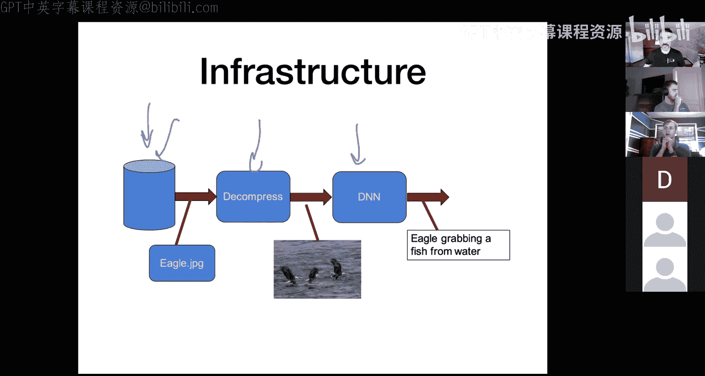
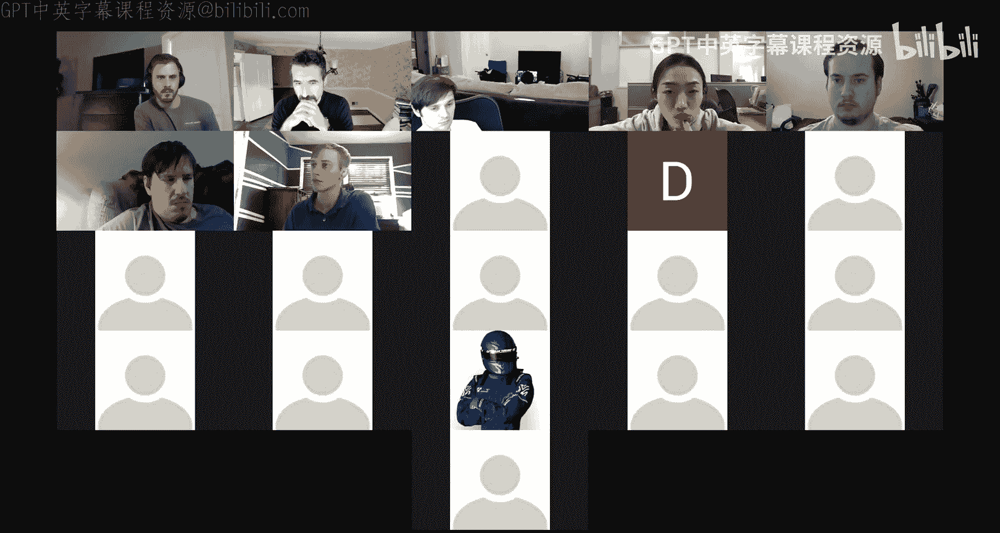
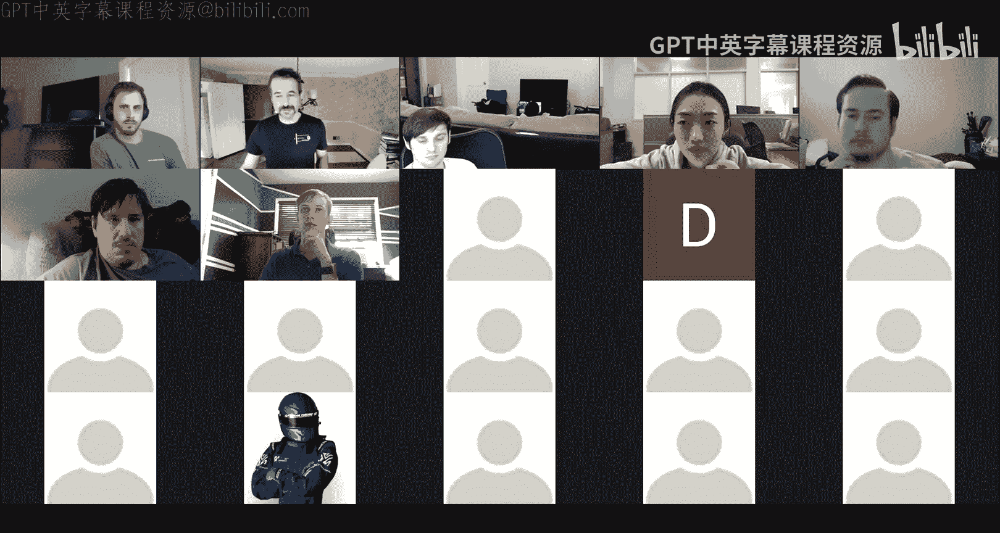

# USC《机器学习系统｜CSCE585 Machine Learning Systems 2020》中英字幕（Claude-3.5 p19 -19-Lecture 8.2_ Hardware for Machine Learning Systems.zh_en -BV1Xc9bYVEC6_p19-

Okay。Hi， everybody。 Let's start。 Could you please turn on your video if possible。Thanks。😊。

So the plan for todays to keep continued discussion about this hardware layer， which is interesting。

 I guess hopefully useful for you guys， because these days people only know about the upper layer of their stack。

 how to use Pyths or Tensorflow or Python， whatever you want to use， do machine learning。

Knowing deeper about the stack would give you some insight how to what happens to the program that you write in the actual hardware that you run so knowing this connection would help you a lot。

How computers write run the code that you wrote for learning from data and you discussed this is a new paradigm right essentially this is software 2。

0 or data de。Softer right or learning however you want to call it essentially some of you。

 the CSS students， some of you might have already taken like computer architecture。

 assembly these kind of。You you might have already some idea like when you write in high level programming languages。

 what happens， how these things gets translated to。

To what hardware can execute right directly so knowing about these detail and the opportunities specifically in terms of optimization code optimization and somehow like similar to the compiler that does code optimization for software 1。

0 here there are lots of opportunities for optimization of M systems for yeah。

 for M system right software 2。0 so this would help you to give an idea what's happening down here。

It would be extremely useful for you to to know the detail of this stuff。Okay。

 so we discussed do you have any question about what we have discussed so far。

 so I thank you even through all of this in detail。

 so I hope that you got an idea why performance matters specifically for these type of systems and the problem and the opportunities today。

 the plan is to to discuss in some more details basically。about parallelization that we can do。

 how we can make the program， what are the opportunities。

 at least for neural networks for deep neural networks。

 at least with the two paradigms that you're already familiar with the fully connected deep neural network and convolution neural network。

 what are the opportunities in terms of optimization and all of these in a little bit more detail。

 but hopefully will'll go deeper inside some of these later on。诶。Yeah， maybe a skip is but。

I'm sure you have heard about。The Moore's lock， right increase in terms of number of transistors over time。

 right， so the growth of number of transistors over time， but somehow。

3 x in one generation to the next， but now what is happening is that in instead set of number of transistor yet number of transistors following similar trend but the more important metric is basically performance that you can get right specifically about single threaded stuff it's called a specet。

So this is flattering oops。So this is phlateny and this is very much related to performance of ML。

 meaning that。Especially in these type of systems that requires either high computation or high memory access。

 right， and the actual computation the patterns is different from what you know in。

In other type of software right software 1。0 so this is very important and people calling this that Moore's law doesn't exist anymore。

 so basically the growth of performance in instead of3x from one generation to another generation is something around one point to roughly so that's what people call why Moore's law doesn't exist anymore or。

But Moore's law has been famous law in computer science and that was。

Kind of key motivator for computer industry that next year you're going to somehow have a prediction what kind of performance we can get from any the next generation of chips that appear out there。

 right？So that's why it was important。But the plan for today is mainly talk about these priorization opportunities for the type of neural network that you have。

So one way obviously is to use more processors， right？

More computational notes that you can run stuff in parallel and there are lots of。

 if you think about， for example， convolution neural network。

Even this architecture would give you some idea of what are these polarization opportunities， right。

 If you look at input， you have lots of data， right， So these are your。

Data that you use for training， right， So you can analyzeize this。

 You can split it into different right。Different bags。 and you can process each bag separately。

 This is obviously one way。 Obviously， you want to， when you want to do this in training。

Because the parameters are shared in convolution neural networks you want to take care of when it comes to updating the parameters。

 you want to make sure that you did not operate these different chunks separately because it means that if you use totally separate things means that you did not learn from the other chunk。

In this chunk， you did not learn from the other chunk or the other vicers al right。

 so you want to have mechanism that you do this eating and you merge this parameter update correctly。

 and we will discuss about that， how it looks like。You can also think about。See also。

 when it goes deeper， these feature maps becomes larger and larger。

 So there are lots of opportunities for doing priorization across these also。

If you think about the convolution convolution basically these kernels runs over your input right so convol over your input and you can like think about like eing your feature map into different sections and do them in parallel if you want。

 so this is also one other opportunity that you can think about parallelization and also we discuss about memory access and why it is important to have efficient memory access in neural network because we have loads of weights。

 where are the weights in memory。How to how you want to retrieve these fakes from memory and update them because you want to update them。

 you want to retrieve update in training and during inference you want to basically reuse that so。

Reuse that for different。Different images or different input that you feed into the model。

 so memory is also important and we are going to talk about all of these three today at some depth。

 but hopefully later on we go even deeper。Do you have any question。有过先。Are you best， Hol。Yes， sir。

 So question might become come later。 but right now， just focusing what you are selling。 Okay。

 sounds good。😊，Yeah， so lots of opportunity in terms of input points in the future map filters。

 right elements within the filters。Multipplication。

 basically this arithmetic operation of sums of reduction， treating layers independently， right？

And also some other。Data dependency between between layers。 So data dependency。

 if you think about this， right， So these layers are not totally independent， right。

 So you want you basically。Rely on for example， if you want to calculate these guys you need these guys right so somehow you have some sort of dependency between each layer otherwise you could run each layer in parallel but you can do that right？

Because these are dependent。With each other， right， each layer dependent on the previous layer。嗯。

So you have this dependency and when it comes to dependency。

 like dependence is a killer for performance。So one paradigm as I mentioned。

 is is do this data polarization and the idea is super simple， right， split your data into multiple。

Chunks， right， multiple bags， and then you obviously use the same network。

 right and process them in order to。To basically calculate。二藤。

The gradient of the loss with respect to the current weight， right。

 This is the current weight that you have at this iteration， right。

 And then you need to figure out how I。I should。Make the update to the weight， because you want to。

You want to。Update to the weight， right or， or in other way， you want to W I plus plus W I。

Plus some learning rate Okay， this was your learning rate。 This was your previous weight vector。

 and this is your new weight right， So if you calculate this over this guy obviously this is different from this guy right because they're running on two different data data set right。

So somehow you need to figure out the math in order to make this a。Correctly， right？And。

And there are some paradigm for that。So for example。

 one paradigm is that appeared in 2013 out of Google is using parameter server， right？

Having a shared place to make these updates， right。

 so each each of these workers work on different data chart right and these data chart are different。

This split of data right so the data you have here is different from the data you have there so for each each of these model workers operate on different data and calculate their respective deelta。

P basically this the dental that you need to add to the parameters， essentially this guy。

 this is the dental you want to add to the parameters。So you do that。Right here in a shared place。

 and'm within this pattern or two version， right。Because。This guy， again， for the next round。

 so this is iterative training is iterative。 This guy for the next round required this latest。

Value of parameters to。To calculate the next delta to the parameter， right？

So the first paradigm that was nature was doing this in a sync way。

 meaning that we wait for all the workers to do their job。

 meaning that all workers calculate this delta。Send it to the parameter server。Make the update。

 calculate the P prime and then send back the P prime to all workers。

 So all workers continue with the same latest value at every iteration。This is， this is the sink。嗯。

Version of parameter update。But obviously it has some consequences meaning that if this guy is a lot faster and calculate。

 like its deelta needs to wait for this slow worker node to send the Deltime calculate and get this P prime back。

 right？So if you have some slow notes in your pipeline， this guy， the fastest one has to wait。

And that's。That's not idea right， you see the consequences。

 especially if you have like many heterogeneous compute nodes。So， so then。You can do async equation。

 meaning that this fastest guy who send out its deelta can work。On the。

The latest version of P that it was calculated locally， right， Obviously， this is not ideal。

 This is not ideal because。This guy。Basically calculated this deltapy it knew somehow about this from previous iteration right。

 so basically let's。Sp this， right， So it had P。 It calculated Delta P。 So now。

But this deelta was local right and this guy do not want to wait for the central P prime okay。

 but has updated locally So let's call it P prime local okay。

 which is different from this it can continue of doing the same thing on on this P prime local to calculate the next。

The next Delta， right， but obviously on an outdated parameters because it did not learn from this guy and this guy。

Right but in the next iteration， when it sends it has better parameter from previous iterations right so it use the latest the best or latest update to the parameters in order to make this update right so in async version also eventually converge but you know that there are some nuances in terms of selecting the right learning rate because you don't want to like have a large learning rate when you really do not have the global knowledge about the parameters these are some。

Like tricks that you need to incorporate when you want to do aync version of this parameter update in this。

It is paradigm， right with the parameter server。Do you have any question。Yeah， I had a question。

So the only advantage I could see out of async is if we were to run it like。诶。

For only some duration of time and to decide to stop it。

 not necessarily after some number of iterations or epochs like。

Because I could see how if one of the sorry， if this was assumed in in the scenario where we assume that one of the workers is is faster than the others。

 right because？If there were some necessary number of iterations。That each worker needed to complete。

Then if the fastest worker finished its iterations first。Ultimately。

 the whole learning procedure still wouldn't finish until the lowest finished， right？

Like what I'm asking， I guess is。Is like is is the is the only way you can get this advantage like with acing so you can assign less less work to this lowest one。

 right？I suppose， you know。So that's also works， right？

But essentially like and this will show up really at massive escape right at Google escape that not really you don't see that。

Basically training a very large model。嗯。So， this。Data parallelism。

 like when you have large modern and large data really， you want to e it。

 typically like at the scale， a smallest scale that doesn't matter much even if you have like two worker nodes。

 right？In terms of a speed right， so basically it's like think about the scenario that we have like some scenario could be like you have one day to train your network if you don't do this。

 it takes like one week。Right then if you do this you bring it down to one day right so Im crazy the case that could have like several months right months is to train like your GPPT network with several hundred worker notes。

Right， and then in a of like， let's say。24 months， you bring it down to maybe three months， right？

Of training so。A this scale that we are talking about。Will show up these benefits。Does it make sense。

Yeah。And you know that if you do this， so this doesn't affect the right the latency essentially for one input because it does the same。

 but you can assign this into multiple like nodes using different。

Different and you can think about it as like when you have one node right you remember you for training you send a batches and do a stochastic gradient descent you can think about this that like you split it and you do your stochastic gradient descent in parallel for different for different batches right and if you previously had like one node of 256 batch size now you have like 10 nodes right and you get。

Like。B bag size in in total， right， so you you increase your bike size， essentially。

If you think that way。And this weight update coordinated weight update happens as a result of this。

Pmeter7。You can also think about like that was for data parallelism。

 you can think about modern parallelism as well for your network。嗯。So for convolution neural network。

 you'll remember this expensive 6D loop for calculating the output feature maps。

 but you can essentially think about doing this in parallel right so you can think about eating this into multiple region in your output feature map right。

And then。For each of these， you can。You can。You can split it up so you do this for all for all is。

Now is is for all of this region， X， Y region here， right， so you do。

Essentially parize the calculation for each of these regions in your output feature map in parallel and you can assign it into like four different GPU to do this calculation。

So basically， the key is is to split your output。Your output to a different region， right？

And you could do this e splitating in different way。

 you could think about regularized epiating like this nice for region or like if you have a different compute on different nodes。

 you could eillit it differently and like these nice structure of and if you think about what allows you to do that is really these small carenesss。

 right。Parameter sharing， essentially， because the parameters are shared across。嗯。

Across all of these slide， like parameters are shared essentially between。This guy。

 this guy this guy and this guy so you could e splitlate it into different region and that's the power of parameter sharing these small channels that allow you to do this e splitlitating and you have like different way to do e splitlitating like big region。

 a small region like however you want to do it because the math works in that case like you can think about each of these region as independent region so you could do this parameterization across the output region in your convolution。

Any question about this。You can also do this。For your filters as well， right， So basically。

 essentially。For each map right so you could for each of these guys。You could consider them as。

Differently right you could produce each map right and this for all is a basically the difference between for all and four is like for all is parallel version of four right？

So basically， you can treat each feature map independently and you could assign them to different。

GPU and calculate these feature maps in parallel。Right。So。At the end。

 like you get this the next layer。These feature maps independently or a bunch of them independently。

 like if you have like。00 feature map， you could like have four GPU。

 you could s 10 to four different you know batch， you can calculate them or if you have 100 GPU。

 then good luck brand them in parallel all of that。

So that's another way that you can think about this prioritization for convolution our network。

For fully connected， also there are you can think about priorization opportunities。

So you remember about this large weight matrix， which was like 16 million for the case that this was like 4K 4K right this matrix was like huge and we had to retrieve this huge matrix out of memory but now you could think about splitating this into two different region right。

 and then calculate this。Output activation， so basically essentially you parallelize calculating this output。

Activations in parallel and this means that really es splitating your matrix into two half and do this。

Mattrix to to vector calculation in parallel right so like this would be essentially W。

How can I say iss with PW IJ。Multiply by a J， right to calculate B， I and then。W， I J， this guy。

 Let's call it W， I J prime， maybe。Or one and two better。Multiped by AG to calculate B。This is one。

This is2， right。Essentially two different activation these guys in parallel， if you have two GPU。

 for example， two CPUs， whatever two core basically。Right， and if you remember like this input。

 I mean， you don't need to this because this input was already small， right， This input was。嗯。4K。

 right。バティス使ります。Huge among us。So you can do model priorization for。

Also for fully connected neural network as well。But you see that how different they are because of the difference of the calculation right there。

 you had convolution， you had kernels， right， the smaller kernels。

 you could esilate here you cannot do these right。诶嗯。Because you don't have care nets。But。

But at least you can do this way right， you can epilate it this way if you want or like you can have like multiple as right。

 but you can not epi it in2D right that's the kind of difference you can think about it。

And because of these dependencies， you have to have first these guys and then calculate these guys in the next layer。

And then， like the other。Opportunity you can think about these hyperparmeter and you know that like all these stuff that we talk about is about the model itself updating the weight。

 but like for each M model you have some bunch of hyperparmeter which are different from the parameters itself right this distinguish these hyperpar from the parameters。

 these are like some parameters that influence like for example。

 the learning rate is the hyper is a hyperparmeter right is a parametermeter you want to you never know what learning rate it makes sense you want to try a different thing and and see which one works best right like this could be defined as search over hyperparmeter space This is a。

Also， by itself， is。Is a line of research and that's essentially difficulties you might have heard about the hyperparmeter。

Optimization。This is also a line of research， is's a kind of a search。Over a massive escape。

 if you have like imagine you have like 10 hyperparmeter and 10 hyperparmeter could。

That gets different value like this learning rate could be anything right essentially and imagine you have 10 of these that could be anything like what combination works best is a huge searcher space that you need to search because there really some of these are nasty and effective performance。

 the training， the accuracy of your model greatly another line of research very much related to this is。

Neural architecture。Search。Which is finding iss very much related to hyperparameter。

 but essentially now is is to。To find the right architecture for your problem right how many layers you want to have how many neurons at each layer you want to get and all of these affects the accuracy of your task right for now we only assume that the architecture and fixed we never talk about okay how many layers you need and that's a hard problem to find that out right and this neural architectureitect stages also interesting hot area and research。

people are working and we also work on these two line of research if you are interested。

 one of my students Shariria E working on this。He developed a a tool called flexibleible。right。

Can look it up。That does some of these hyperparameter optimization， some extent。

 neuroarchural search。For for when we have multiple objectives like essentially we discuss about not only accuracy。

 but also energy consumption of neural network right so when you have multiple objectives right and this is already for one objective the accuracy is already a hard problem and imagine that you have multiple objectives so it gets really crazy。

For for this sort of stuff。Any question about this。Yeah and。So having more core。

 obviously you get some performance， typically linear increase in terms of computation。

 this is like number of frames per second that you can。Calculate， obviously with more core。This gets。

This gets a kind of we can think about linear increase in terms of。

With this metric frame per second that you can get out of priorization。For neural network stuff。Yeah。

Also， like people are showing that。You can also by increasing by doing。

Mod parallel stuff and also data parallel， the two paradigm。

 this is again the paper out of Google by increasing the number of machine。

 the X axis is the number of machine that is used and the Y axis is the training is speed up right these are for different。

N networks for either speech or image of different size， right。

 So you see that this is like crazy size 1。7 billion parameters for image processing this and massively。

Benefited from both model and data prioritization， right？And this is essentially， this graph shows。

Machine term model in a sense， meaning that they did model priorization， right， but。

This is a smaller right， gets relatively good a speed up。The other one， right， the blue one。

80 million much smaller somehow got some benefit， but not similar to these guys and this interesting terrain for this speech recognition。

 you saw that like this is totally different from like these three guys these are。

Image processing and this speech essentially is is。

Different I'm not sure I forgot what kind of a speech model they used probably RN types。

And you see that essentially this parameter model polarization didn't help also deteriorated for a couple of machine increase increase the performance。

 but afterward it was deteriorated as a result of so many thing could be as a result of。嗯。

Memory access could be。The reason could be many right and essentially this shows that the type of architecture matters and this would influence the speed up essentially when you do different type of a speedup like model parentization or data parentization。

So takeaway is that these image processing convolutional models benefited greatly。

 but not this speech， right？So that's a key take of it。

The last point I want to talk about today is about。Memory briefly。

 but hopefully later we go into deeper discussion， we discussed that like memory could be a bottleneck here。

 especially when you saw that for speech model it was deteriorated could be the case that memory really the I was the。

Bottleneck in that case and recently companies like NviDdia have started to look into how we can access memory。

Right because we have two things right we have in one machine we need to access memory the GPU that you have。

 you need to read and update your weights from memory and like these are weights in your memory and the memory inside your GPU is very much limited so you have limited memory in individual GPU so you rely on external memory and even memory outside of your machine。

 especially if you have multiple workcare nodes， you may need to have access the memory in some other node so you have some communication across network as well in order to do that。

So these several technologies appeared。For accessing the memory， right。

 especially communication over net and external memory like essentially it's called GPU direct。

 right。GPU direct kind of technology that this GPU in order to have access to a third party doesn't need to go through CPU previously needed to go through CPU and CPU was a bottleneck here to access to a third party device。

 this GPU direct they can directly communicate to PCI Express。

 PCI communication to make this communication a lot more efficient without having a bottleneck through CPU。

So this is CPU direct storage， for example。Mainly accessing the。Accessing the external memory， right。

 So this is the previous paradigm。 You see that this GPU in order to to talk with。With this memory。

 guys， right， so these are。AnMVM Express budget that might be your machine。In order to do that。

 you need to have access to the system memory， which are facilitated by CPU。

 so you could not take read the memory directly， but with this technology with this GPU direct。

 can you don't need any communication you don't need this stuff。

 you can directly read from memory without going through the CPU which was your bottleneck so this technology GPU direct storage。

 for example。Enable this efficient， because now。Mion that like when you go to largest land and again。

 these these challenges happen at larger scale doesn't matter for when you have one node in your laptop。

 right？So it matters at large scale you have many nodes and the IO become bottleneck。

 so you need to have technology to facilitate this。

And like you might have like external in this case or rate kind of thing。

 some external memory as well as some internal memory so you can have and for each of these you have like PCI connection right so this will help to all of these。

佢 good。我 of啲支票佢。Directly communicated in the memory， right。

 these guys these guys in order to to make it happen。 So， for example。

 you can think about it as a parameter server， right this guy is your parameter server。

And each of these could be。Worker notes， right， could be worker。Not。To work。然后。1， right。

And through this PCI communication。Like even you can like have some interesting communication pattern you can have like our actual pattern where you have central and like different worker notes right doing these two way communication or you can like even like have a ring so maybe you don't need these you could have like your worker notes。

Could communicate directly with each other through this technology， right on GP direct， so you could。

Get you could construct your ring architecture topology in order。

 so each work notes can communicate whatever it。Whatever deelta it came up with right deelta P。

 it can send the delta once it's finished and communicated with the all other。

Notes right and neighbor notes and this would facilitate this would make it very interesting So if this finished this communicate with its neighbor and this at the end would converge like if you have many notes they only need to。

Compute， communicate withnal， or you could also create a mesh if you want communicate with all all other notess so you could construct essentially different。

Different， different kind of topology from higherarch where you have or a ring or even。

Like when you have many different things， you can construct a mesh， right？

Out of all of this right and you can like this this also facilitates the communication and converge faster when you have a large network。

To do either model parts and more data finalization so these basically wanted to convey that essentially memory matters right all of these are again back to this。

Picture that we had before。Come on。So back to this picture that we had before we saw that， okay。

 we might have bottle leg here， if we do crazy polarization here。

 like if if I have like 200 GP notess， if if I priorize this to calculate like a stuff very quickly and if I'm slow here。

 then this doesn't matter right so I don't see the benefit end to end。

And this technology appear because like we are looking at a larger ecosystem of machine learning system right it's not just your single model sitting on your lot of this like whole ecosystem that。

That something become a bottleneck， right， people start paralyzing。

Model right or polarizing training with whatever program and then something irrelevant become bottlene like oil and then people thought oh。

 we need a technology to talk directly with with memory had the previous technology now become bottleneck right and that's why you see like these new technology every week something become bottleneck and you need to fix it so you need to create a new thing then this new thing with。

Would help to create a like amazing thing and then something else become button like you need to fix that too so all of this you need to think a step back and like think about a bigger picture if you want to ask why these technologies or these stuff matters。

And again， for you guys。We are discussing this because you get the opportunity to know beyond what what you used to work like not looking just at the model。

 but knowing deeper down what's happening in your computer when you run these things。

 at least you have to have some intuition。Let's stop here。I could stay。If you have any questions。嗯。

No question。Are you all doing fine with your course project？

Someone just asked a question in the chat。Could you please like。

Ask it very well if you could yeah sure this is Daniel I was wondering if we can expect a grade for task one before task two is due。

We try the best。 Yeah， that's， that's the goal。 Yeah， okay。Thank you。Yeah。

 so the task two is is really still very unclear to me I don't think there's very much helpful detail at all in the task description and it basically just points us to the Athena paper which。

Either it also doesn't provide detail or is not understandable to me as a reader is there a chance we could go over this？

In the lecture sometime and really， I mean， I don't think it's ever been really fully fleshed out and explained in class。

Sure， yeah。 we could。 We could have。A tutorial about that。Helping you guys。

 but please don't expect like as as you had in task one， right？

So this would be helpful if you could like create an issue and like mention it what is unclear。

 so it would help us a lot when we work on this tutorial right so Ynk can can。

Give her opportunity to think how this tutorial should look like， right？

So if you could create an issue and others can put like some other thoughts， that would be excellent。

Yeah， I made an issue yesterday， and I can try to add some more detail about。

Particular of questions but the other complication is that everybody has a different option chosen for this time so I have my questions about the options that my team chose but that may not even be helpful to the rest of the class yeah yeah so yeah I would encourage others who work on the other options right to create an issue right maybe one issue per option that would be excellent we would really appreciate it if you guys take the lead on this right don't wait for the last minute try to go into the detail create an issue explain what is missing what you want to know questions if you have like this week right no later than this week if you come up near deadline we cannot help it right you would love to help you guys right and you know that this matters a lot for us。

To help you to the extent that you can learn and get something out of this。

And this is like my way of style of teaching right I don't I mean like for me learning matters you like to give you the opportunity to learn and take away as much as possible。

 rather than thinking about the final grade， as long as you are interested in learning I'm the kind of those kind of teachers that for me learning matters great。

 not that much， as so great for me is like。Is a way somehow you can think about it is a way that you have to deliver something。

 work on something， learn throughout and show something so this a kind of regularizer rather than motivation this should be a way how you also treat other courses as well right for the way how I would like to a student to think about these that like learning matters great not much and this is the way how I think about this as stuff。

So basically as long as we see that you tried。You you thought about it like the report that you write is like you can't clearly see that you thought about these stuff right。

 you analyzed you got some results，Basically write a nice report。

 this would be sufficient for us to see that， okay， this would be excellent。Right。ProfiLast night。

 I posted a。In， in Ana。 So did you see。That I forgot something I already mentioned I mentioned I don't like those kind of emails so please don't that doesn't like if there is something you can you can update it in Github right if you forgot to mention your contribution you could like update your create that you push new update to Github we could easily compare with the tag that you put for for your submission and that would be easy right do everything Github no email please about these stuff right so you are free to send email if you have questions and stuff but these are easy to facilitate through Github or other stuff。

No because I was confused because you told that after the deadline should it is not good to update anything so just I didn't add anything clear you can update it until the last minute but you should have a tag for your submission right you should have a tag Github tag I made it clear in the project description how to create it that this is like our submission obviously you're free to make updates to your stuff and this is easy to compare with your Github。

Hisory of comets right because I was actually scared that for getting the penalty don't need to scared about anything in this course。

 at least the courses that I teach。😊，Thank you。Thank you， Proor。Any other question？Yeah， so。

One of the big hangups I think my team had， I think just for the first task was trying to figure out just how to divvy up tasks right because this is。

This is sort of a difficult thing， I guess with leading a group of people is just figuring out like an optimal method for。

Separating tasks and I was wondering if you had any kind of advice。With the second coming task。

 how to assign things between you guys， is this what you。

Yeah， because I mean like so we can do， you know。There are ways you could you could break up a task such that everybody's everything has to be done sequentially where person one has to do finish what they're doing before person two can like work on。

The next part， but that doesn't really that doesn't really work and it also it means that you you have like a very narrow I guess vision about like what's happening in the big picture。

But at the same time， working in parallel。Usual means you're working on different things and I guess trying to extract value from that is really difficult。

 so I didn't know for like us for for for option。We're doing an option two。

 so we have like a learning based strategy for the ensemble okay。

Yeah so I'm trying to think I'm trying to think like how to how to break this up in a realistic way and also I guess noting the fact that some of us have different strengths like。

Some of us know Python a whole lot better than others so。I mean， you could。

 you could think about like。Think about assigning different variations of these like， for example。

 you could split it up based on the ensemble strategy like based on the size of your model。

 like it would be good if if one of you guys who are like。Much。

Better at programming like could take directly lead to some of these， I know it might be difficult。

 but in a way to create some very small thing that show others right， hey。

 I did this you can try this way， right， not necessarily doing the whole thing， right。

 a small part of it and then helping a little with the other team members to proceed and。

Work independently that's that's way on thinking now。

 but I see that it is always difficult to work in a group， especially like。Even。When we do research。

 it takes time until we find the work habit of each other right until we become comfortable collaborating。

Later on for student projects so I would probably leave that to you。

 but like these are some thoughts like splitting like taking the lead is one option or splitting based on this and like he you guys go and figure out out that independently and whoever come up first could like could share and like could share this。

Progress， right， This is the way I'm thinking， right， So you could。Have a meeting discuss okay。

 this is what we need to do let's try it out independently whoever gets something first share with others。

And then， and then you continue。 But this doesn't mean that。

Like one should has to do everything and others nothing if we find out about obviously we see from the history right that's easy to see we want all of you to commit to this repository right and somehow relatively having the same contribution for each group so this is something that really we want to see happens not only one person doing everything and others just observe that doesn't work。

嗯。And by the way， like you also， for the final think。I clarifyar it in the description。

 you need to create a short video， basically presenting the work， you know。

 explaining what did you do also like what you have learned， right， the findings。

 interesting results，And so on and that would be fantastic right I would love to see interesting videos that you could create you could like use zoom and you could meet and like record this together right if you want you can basically create a presentation or you can simply talk over your notebook right you can show in a video okay let's do this in Jupiter notebook right and discuss with each other what you find out and like basically is think about it as an informal conversation that you could have between yourself。

In a way， that would be super useful for others to understand what's going on。 So you show。

What did you do and what did you find out the result that you get？And all of this。Yeah。

 that would be super useful if you could make an interesting video。

 that would be useful later on for yourself， all of you when you want to go to job market you can have this kind of thing as a demo right。

 a project that you did real project。So。And I mentioned that this stuff is going crazy。

 so all of you would benefit from this。Professor， I have a question。

 short question because in the Ana paper， there are few is discussed about few attacks。

 So definitely all of members， all of the team members are not working with the same attack。

 So I'm using one attack。 So my other members。 So do I have to get idea for about the other attacks or it is end of just with。

W which attack I'm working。Justャス focusォーカ onンです。Actually does it make sense what I'm。Trying to ask。

嗯。Can you specify that you mean splitting that based on the type of attack right Yes right so you can obviously do that yeah that's also a good suggestion right splitting based on the attack is also one way of。

Doing a stuff right is split between your stuff right， hey， I'm more familiar with FGSM。

 I want to work on this， the other one I'm interested more in JSMA， I want to work on this right。

or other attack that you recently may saw other there and you want to implement or like for the other attacks。

 obviously can that you don't need to implement and you know that this is a trend in machine learning like good researchers always publish their code out there。

 you can find the code and try to。Attack Athena right that correct is not there。

 so it would be a good try if you want to do that。No I'm just asking it because actually there are many many students here here the two challenging thing one is the programming language and another is the machine learning by itself So some of our some of the students we don't have any programming background I mean I this is this is。

K it's required， right， and if I mean， I made it relatively easy for others to join this course。

 to take this course。By requiring only one course as a requirement for graduate students。

 also like they can take it， I mean I mention it in day one。

 that's fine even if you don't know language， but if by now you did not learn even Python this is obviously your fault there is no excuse telling us that。

I did not know and at the moment I don't know no excuse for that you have be fine you did not know at the beginning。

 but Python is the listing that you could have learned in like one week。

Please learning to the state that you can play with it even though I'm learning just I'm asking it because you know that it is it might be in from my point of view。

 if I learned something specific from the Athena paper not I'm not thinking just to learn every attack just I'm thinking just specific some portion。

Some portion。 So that's that is the thing I'm， I， I'm asking。Sorry。

 I don't understand what you think Nom I'm just asking just is it necessary to have a big good knowledge about the whole Athena paper like the for example。

 just that there are few attacks on on the Athena few attacks are mentioned on the Athena so do I have to get do I have to get the strong knowledge on the all attacks just specific one attacks obviously not this is very clear we don't to learn about the all attacks。

This is super clear。 We don't want you guys to spend time on like so many things。 No。

 this is super clear。 Do the task， learn as much as， as， much as you can。

 because this project is not about the attack force This project is about the defense。

If you have some idea about improving antenna or something yes like we encourage it right。

 but we don't want you to spend time on learning attacks if you are interested in using new attacks。

 yes， maybe you can read one paper and try to implement it or use their code to see how it works。

 but definitely we don't want to like going into two any different or 100 different papers and attacks to understand them obviously this is out no。

Is that kid end？Yes， I just give。Thank you。Sure。Other questions。Sounds good yeah。

 please create issue， especially since this is a task have you are working on different options。

like Andrew mentioned， he created the issue， please Andrew had a lot on task one right you also do your contribution right create issue if you have questions or you need clarification in something let us know。

And do it as soon as possible， right， no later than this weekend。Okay， it was good， thanks。

 talk to you soon。

