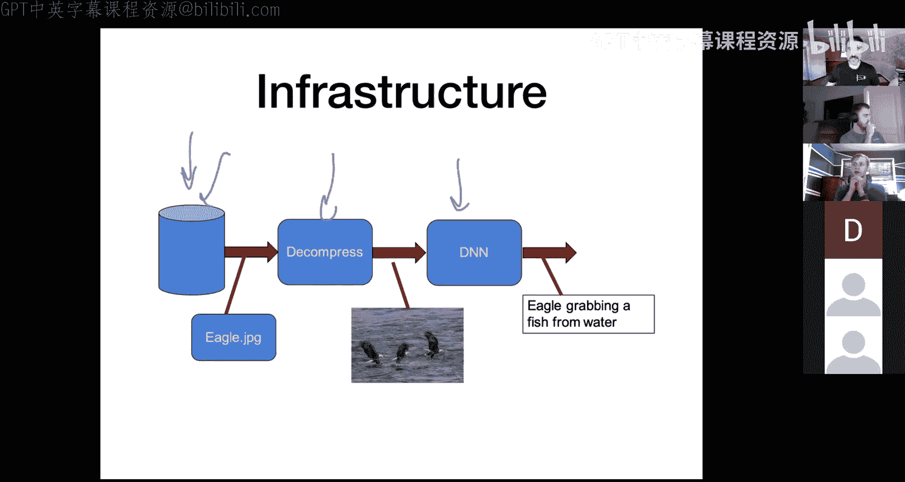

# 机器学习系统：第8.2讲：机器学习硬件系统 🖥️

在本节课中，我们将继续讨论硬件层，这对于理解你编写的程序如何在底层硬件上运行至关重要。了解软件与硬件之间的连接，将极大地帮助你优化机器学习系统。

上一节我们介绍了性能对机器学习系统的重要性。本节中，我们将更详细地探讨在深度神经网络中实现并行化的机会，特别是在全连接网络和卷积神经网络中。

## 摩尔定律的现状与性能瓶颈 📉

你可能听说过摩尔定律，它描述了晶体管数量随时间增长的趋势。然而，更重要的指标是单线程性能，这直接关系到机器学习的计算效率。

近年来，单线程性能的增长已经趋于平缓，这被称为摩尔定律的终结。对于需要高计算量或高内存访问的机器学习系统而言，理解这一点非常重要。

## 神经网络中的并行化机会 🔄

在神经网络中，存在多种并行化机会，可以显著提升训练和推理效率。

### 数据并行

数据并行是一种直观的方法。以下是其基本步骤：
1.  将训练数据分割成多个批次。
2.  在不同的处理器上并行处理每个批次。
3.  计算每个批次相对于当前权重的损失梯度。
4.  协调来自所有工作节点的参数更新。

参数更新有两种主要范式：
*   **同步更新**：等待所有工作节点完成计算，汇总梯度后统一更新参数，再将新参数分发下去。缺点是速度受最慢节点限制。
*   **异步更新**：工作节点使用本地计算出的梯度立即更新一个本地参数副本，并继续计算，同时将梯度发送给参数服务器。参数服务器异步整合更新。这能避免等待，但可能使用过时的参数，需要调整学习率等技巧来保证收敛。

### 模型并行

对于卷积神经网络，可以利用其结构特点进行模型并行。

**在输出特征图上并行**：卷积核在输入上滑动生成输出特征图。可以将输出特征图划分为不同区域，并分配给不同的处理器并行计算。这得益于卷积核的参数共享特性。

**在滤波器上并行**：每个输出特征图由不同的滤波器生成。可以分配不同的处理器来并行计算不同的特征图。

对于全连接神经网络，也可以进行模型并行。可以将巨大的权重矩阵分割，并行计算不同的输出激活值。公式表示为将权重矩阵 **W** 分割为 **W1** 和 **W2**，分别与输入向量 **a** 相乘，得到输出激活 **b1** 和 **b2**。

### 层间依赖与挑战

神经网络层之间存在数据依赖，每一层的计算都依赖于前一层的输出。这种依赖性是性能优化的主要挑战之一，因为它限制了纯粹的层间并行。

## 超参数优化与神经架构搜索 🔍

除了模型参数，超参数（如学习率）和神经网络架构本身也对性能有巨大影响。

*   **超参数优化**：在巨大的超参数空间中进行搜索，以找到最佳组合。
*   **神经架构搜索**：自动寻找针对特定问题的最佳网络架构（如层数、每层神经元数量）。这是一个热门的研究领域，当同时考虑多个目标（如准确率和能耗）时，问题会变得更加复杂。

## 扩展性与性能收益 📈

增加计算核心通常能带来近乎线性的计算性能提升。研究表明，对于卷积神经网络等模型，结合数据和模型并行可以带来显著的训练加速。然而，收益取决于模型类型，例如某些循环神经网络模型可能无法从模型并行中获得同等收益，甚至可能因通信开销等原因导致性能下降。

## 内存访问的优化 🚀

在大型分布式训练中，内存访问可能成为瓶颈。权重参数需要从内存中频繁读取和更新。

传统上，GPU访问外部存储需要通过CPU，这造成了瓶颈。新技术如 **GPU Direct Storage** 允许GPU直接与存储设备通信，无需经过CPU，从而大幅提升了I/O效率。

高效的通信拓扑结构（如环状或网状）也能促进工作节点间梯度等信息的快速交换，加快收敛速度。

## 总结 📝

本节课我们一起学习了机器学习硬件系统中的关键优化思想。
我们探讨了摩尔定律的现状及其对性能的影响。
我们深入分析了数据并行和模型并行的原理与实现方式。
我们了解了超参数优化和神经架构搜索这两个重要的研究方向。
我们认识到内存访问可能成为系统瓶颈，并介绍了一些先进的硬件通信技术来缓解这个问题。
理解从高层代码到底层硬件的整个栈，能够为你提供优化机器学习系统的深刻洞察力。