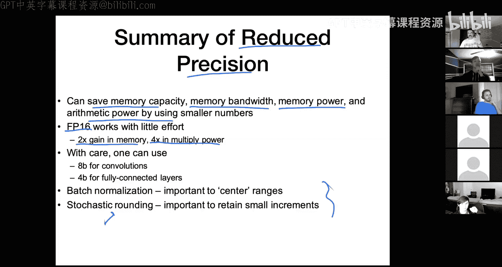

# USC《机器学习系统｜CSCE585 Machine Learning Systems 2020》中英字幕（Claude-3.5 p20 -20-Lecture 8.3_ Hardware for Machine Learning Systems.zh_en -BV1Xc9bYVEC6_p20-

Okay。Let's start。 So today， the plan is to continue the discussion about the hardware layer again。

 this。What we will discuss about reduced precision is also interesting。

 important when it comes to model compression， right so today is mainly talking about this reduced precision representing。

Both weights as well as the activations with some reduced precision in order to save energy and so on。

So the benefit that we get out of this reduced precision and again this is by reduced precision。

 I mean their specific representation that you have for these digits right so the default is using some floating point numbers right floating point variables like 64。

 this is by default is used， you want to reduce it to like 32 or even like integer representation。

 so you get some reduced precision， obviously as a result。

 you need less storage also we discuss that this will result in some reduced energy consumption improved performance but on the other hand you need to make sure that you don't lose any accuracy because you don't want。

To mess up with their mathematics and get that。Basically train but network that doesn't give you the accuracy that you wanted to have。

 So is again talking about the trade office space and essentially this is。

What we discuss in more detail when it comes to model quantization and compression。

 but these are the building blocks of basics， why we get these benefits out of this reduced precision。

Before we go into the detail， do you have any question about this？So again。

 this provides a trade of a space between， you know， even like you can consider multiple objectives。

 obviously in one hand like you want to。Get same accuracy， right。

 but also you're talking about the energy。All right， and storage。So you want to。

To have benefits of all of this by this reduced precision。

And if you think about like the kind of operations that we had specifically for dense network。

 you remember we had some weight matrix that this was。

Large size for this dense fully connected network， you had some activations。

 this was your input activation and you had some output activations right so we had some operations you had also need to some some all of these so you had this product plus some to generate each of these。

Values in the output activation vector。So this was basically what you had。

 and you pass it through some linearity to generate this output activation。

 So these are the key operation that your family with。And then when it comes to training。

 you also need to update the bits， so you multiply this activation。

Also with this gradient that you calculated， you multiplied by some learning rate adding to the previous rate in order to update the。

 So these are essentially what what you are doing This is for generating。The activation， right？

And this is for updating。If its。So these are essentially like whatever operations that we need。

 what kind of computation that we need for such network。嗯。And the question is that。

 like why representation matters。Right， obviously different representation。😊。

provide different precision or accuracy in terms of representing the actual numbers right because like we are talking about the computer and you know that like in mathematics in abstract way when you have a number you' are talking about the absolute precision right but when it comes to representation representing these actual numbers in computer。

 you don't have that。Absolute precision that you get in mathematics。 So you get some accuracy。

 So in floating point，32。Bs， for example， right， so you get some bits for exponent the actual thing and the sign and this representation。

 the whole thing would give you the precision or a range of values that you can represent between roughly around over 70 orders of magnitude essentially with this 32 floating point number and you get this accuracy or precision。

 which is quite large right， so and when it comes to floating point 16。

 obviously you have 16 bits to use for representing the floating point numbers the。

The range is a lot smaller。And you know that like these are I don't want to go into detail I see if you know these basic things how these ranges are represented by using this representation so these are you already have learned in previous courses。

 but essentially the takeaway is that when you have smaller representation。

 and in your programming language that you use Python C C plus+ you have。API。

Classes that you can use for each of these representation。So obviously。

 the accuracy would be smaller for integer values。Then these are fixed fixed values with exact same space between these these values for 32 integer representation then。

This is the range that you cover and you know that for integer the actual precision that you have is。

Is exactly the same。 So the difference is that here。

 So when we are talking about the accuracy that you know that like when we have a smaller values。

 right。From negative， right。From like， let's say， from very small value。 So from 0。

To whatever value that you can represent， right？So when you're approaching to the upper end。嗯。

With a floating point。Or you're approaching to the lower end， closer to 0。

The actual precision that you get。Would be different when it comes to floating point。

 But for the integer values， it doesn't really matter where you stand。

 So all the time you have a fixed。A space between each of these values that you can represent this structure。

Because these are integer。嗯。The same for lower precision integer。

 you get exactly the same the same accuracy based on this integer。

 but obviously the range of the value that you can represent would be totally different。

Do you have any question about this？So with different。Representation。

 you get different ranges with different accuracy。 But the important aspect is。

Is the cost cost of this operation when it comes to a mathematical operation that you do and the mathematical operation。

 you need to have treating， right， multiplication。Right so you have multiplication。

 you have addition right， and you have a read from memory。

 so you have essentially three different operation that you can do。

Your computer for any any sort of calculation， including neural network。

 and you see that the interesting point these numbers。

 the relative energy costs are very interesting so some observation that you can see here。

 so if you focus only。嗯。And these two， right。 So this is 32 bit floating point multiplication。

16 bit floating point multiplication。 So essentially these to the difference between 1。1。

Pick a jewels to 3。7， roughly around。Four times higher you pay the energy consumption when you do multiplication in 32 bit representation so that's why it matters and what kind of saving you can get if you reduce the procedure。

Can also see even higher when it comes between 32 to 8 bit representation from from this number to 0。

2 so like the relative values or this is for basically for integer。

 the relative value of doing multiplication between 32 bit representation of integer is even like higher roughly around。

Yeah。15 times higher the difference between these， these two， right。The addition。

 so these four were about multiplication， if you look at the addition。

 then the difference between 16 bit and 32 bit floating point addition。

Not as before that you had in multiplication。Maybe around like two times higher。

 but even this higher is is dominated by if you compare this guy。With this one。

 you see that the cost for addition is smaller than than the cost for sorry this one the cost for multiplication。

 so multi essentially is much more expensive task in your computer。And compared it again， these two。

Integer operation with。With these two。 So again， a lot， a lot smaller， relatively speaking with。

With respect to the multiplication that you have。And if you want to also compare it with the memory read and write。

 you can see that the most expensive operation that you have on your computer is retrieving these digits that you stored in memory。

For doing the operation because like you have this data。

 this data basically essentially what you have or the weights and the activations。

 these are you need to store it in memory so these are the most expensive operation and essentially in your SRA。

The operation is， you see that even in ERA， which is basically on cheap type of memory with off chip type of memory D Ram D。

 you see that like off cheap memory is the most expensive operation that you can do So anything that goes like beyond your chip is very expensive and this is like comparing the other ones is several order of magnitude higher。

 right so。You already see this difference。 Two orders of magnitude are higher。

 even comparing with this on cheap type of operation。 and obviously， each of these representation。

Has some cost because specifically these we have two two dimension when it comes to。Ce design， right。

 like the area cost。 This is what。The the area。Based on which you build your chip。

 so obviously for higher precision you need higher larger area to create this chip。And。

ItIt also affect the energy consumption。 So you have basically two dimension， One is area。

And one is energy。So。And you see that already the difference。Ts of area。For different。

Operation that you， that you have。So basically， these are you are essentially your。嗯。Ps。

Ch all connected to each other。You have a mash of B， right。But anyway。

Some of those who have gotten the architecture， art architecture。

 you't already know what I'm talking about。So， essentially， if you are。

If you think about the hierarchy of memory。So in your computer。You have some hierarchy， right， so。

 and the locality matters。 So you see that if you have access to your local S。

You pay for each access， you pay five pick joints， right， if if you go to your un cheap SRA， you get。

Basically， one order of magnitude higher comparing to your local sRA， the difference。

 the difference between these two are maybe obvious here in this diagram。

 So these are you have for each processor you have some core right for each core。

 you have some local SRA。 These are basically for each of the core that that you have and you have some unche sRA for for all of your cores right。

 So this is shared across all of these processor cores and you have some。Off chip D。

 This is the most expensive operation that if you want to all the way go to to your D， right。

 So essentially， this gives you an idea like this is both of this。Ourre。On the chip。

 this is associated to each core。 you see that this is the least expensive files pule again。

 like the least expensive relatively for any memory access obviously using is higher if you compare it with the any multiplication so。

The least expensive memory access is。In terms of energy consumption， consume more than even like the。

The most expensive mathematical operation that you want to do。 So these read access。

 memory access are really expensive。 And if you go higher and higher， obviously。

 you know that this if you go higher， you get larger memory size。

This become expensive and if you go to your DR external memory， this becomes very。

 very expensive in terms of energy consumption that you need to pay。

And that's why's some type of new accelerator specifically for inference。

 they have this local quality feature that for。For each of these。

 you get some inference core that have this integrated local local memory。

 local core to store activation and weights locally。For each core， a first score。嗯。

So these are explicitly managed essentially。Do you have any question。

Let's look at if we now we understood， okay。Different precision。

It has some influence to energy consumption。 So we have like， this gives you an idea。

 We have different operation for doing the。嗯 eitherer your friends or。trainraining啊 task啊。

Since we know that each operation are consuming different sort of scale of energy。

 then see going to the trail of these operations， see what what are the opportunities and make it much more concrete so essentially hear what you see is the operations that you need for doing inference essentially calculating this。

BI this BI if you remember was the output activation。

 this AJ was your input activation that you needed to multiply it with weights right so you had some weights for this obviously you need to access memory to retrieve your weights。

And then， you had this。Actation input activation you need to multiply this and then you need to add this add this together in order to calculate to calculate this output activation so these are the operation that that you have essentially for inference and you can think about it like one way to to make this exploit the usage of。

嗯。Knowing this knowledge that each operation provide different costs impose different costs。

 then you can design the right way。For these operations that decrease your cost， for example。

 these weights， we know that we need to access memory and if like these are like again。

 a fully connected network like you have 16 millions of these weights。

 then even you cannot store them like in your。In your on cheap and sometimes even you need to store them in your Dra external memory。

 so you want to have the lowest possible quantization for these weights and like one way to do that is train quantization we'll talk about it later。

 but you can consider the lowest possible precision like four bits representation for each of these weights and then like once you have it retrieve it locally。

 you can decoded to to get higher precision like 16 bit。

You can store this activation as 16 bit and then you have a 16 bit to 16 bit multiplication。

And then basically you can accumulate all of these 16 bit multiplication and accumulate it to something that 24 or 32 bit。

Out put， and， you know that they they。So let me， let me ask you this question。 why this scheme。

Makes sense。Do you have some thoughts， how you can make sense out of it。

 like like why why is representation， why not the other way now？Why。

 and you see that you see some mix mixed precision， right。

 you use different precision for these weights， use different precision for this activation。

 and then you use different precision even for accumulation of this。

Why this makes sense from what we have discussed。My intuition would be that the weights are something that you have a whole lot more of than the activations。

And。Because we have a lot more of them， we want to use。A lower precision for those。Okay。

 because that would。Give us I guess less DRA what access or we would be accessing memory far less with those okay okay。

 but then the activations I guess the information stored in the activations is more important in some way。

Maybe more useful in。Training or an inference， I guess iss just more important or like。You can。

 can interpret it。It's just more important or。Or you have some other idea like why， for example。

 you want to use higher precision for these rather than the weights themselves， right？I mean。

 I guess we just get we would get less benefit using。

 say four bits for the activations because we just the activations we don't have nearly as many of like nearly as much。

Like we have far more weights than we have activations， right？

Exactly that that's the case right so you remember the had is distinct right？Where is this。

So the activations。Or small， comparing with this gianty， right。So the whole thing， right。

 this is giant。You， you take it， you put it on your burra， right。This is of， right。

And this is very expensive right， and like you have no way to like store the whole 16 million or even more weights in your you know。

 local memory。So you want to like have the least precision as possible for for these these guys。

 right， to make them like a lot more efficient。We to we respect to accessing this D， right。

 because this is very expensive。Right。But relatively speaking。

 these are a lot smaller and you could consider having a higher precision for that right so this is kind of the way how you want to think about it and once you retrieve this so you store this with like four bits once you retrieve this guy you want to multiply by this guy right and then you can decode this to 16 bit so having the same precision at this guy for multiplication because you don't want to have mixed precision when you do the multiplication and you can decode that once you retrieve it locally because you retrieve part of it。

 you don't retrieve the whole thing retrieve part of it locally once you have it locally。

 you do this multiplication it 16 bit precision。Right。

But why you want to have like higher precision here and why it makes sense。

So if there's quantization error with the weights， you can actually factor that into the training process because you learn the weights whereas the activations change for each inference。

And so。You really need high precision for each inference in order to consistently not lose accuracy。

Does that makes sense？And this is this is， I mean， this is only inference， right。

 We'll talk about training shortly right here， but when you accumulate the base。

 but this is only for calculating basically the output activation。 somehow the explanation， you。

 you said makes sense， but do you have some。Other top。Well。

 I'm just thinking that the loss of accuracy that you would get from reducing the weight bit size is something you know about during the training process。

 so you know about it in advance， whereas when you do that to the activations。

 it's not clear in the training， what will happen in the test set。Actually， it not really about this。

嗯。You know， myth of。Accuracy， when when you have in your training。

 let me maybe does anybody have any other explanation for this？Before I answer it。I mean。

 I was figuring that's just because the output there is the activation for the next layer。

 so we would want to maintain。For the same reason that the activations are stored as 16 bit。嗯。

We would want to accumulate them to the same or higher level precision because those are going to be used。

With another layer with the next layer with a set of weights。

 and then eventually as an output we might actually just want higher precision。But like the output。

Like啊。I mean， like the output would be the input of the other the other layer right。

 so like this guy would become this guy for the next one， right？So at the end， at the end。

 we need to convert this guy if we use 32 bit to reduce precision to 16 bit when it comes over the next layer。

But like when it comes for accumulating those， why we want to use like higher precision， right。

And isn't that， I guess in some way necessary when we're。

 I mean we've got it at a 16 byte by a 16 byte multiply， so we need those bits。

 at least to begin with。Just that we need that space to begin with just to actually multiply those two together without。

 I guess。I mean， you could just lose the precision and if you're going to is there something is there something about like precision here where we're like if we if we accumulate it to a larger side set of bits and if we somehow。

And。Squeeze that down into 16 bits that we somehow maintain more information。

I don't know if I'm making any sense here。 No， no， it makes sense。

 So like going back again to this diagram， right， So two things， right， So we have this sum， right。

Basically， for calculating these guys， right， You have this sum， right。

 that is going through your right。Your rose right， essentially here。 You have this guy， this guy。

You calculate it and then you move here next， next guy， you retrieve it from your diran。

 you do this stock product， and then you need to add this to to the previous one， right。

And then this guy， you need to add to previous guy， right。

So obviously when it comes for adding these， like。Obviously， you add more numbers。

 If you have higher precision， you don't lose anything， right。But on the other hand。

 you're talking about addition is multiplication。 if you， if you think about this。

 if you go back to this。These additions， right， you see the difference right。

 So see the difference between this even this higher one， right。

 Even this higher one or even this higher one is lower than the multiplication， right。

 So I mean if if you increase the the precision for addition I mean， is is。

It's not bad right so is' bounded by your multiplication anyway。

 so it doesn't matter and like better better to have higher precision when it comes to addition。So。

I think I hope for everybody， it makes sense， right， Why this this。

 this kind of mixed precision somehow， Because like。

Having access to so two things like where this information exists and what kind of operation we do and how this is related to to the energy consumption of of each of these operations and memory access。

And that's why this mixed precision is useful because like we have different types。啊。

And we also have like some concepts batch normalization。 if you use Pytor Tensorflow。

 you might have heard about it and it exists in some of these APIs that use from these frameworks batch normalization is very simple right。

 So when you。Remember for。Batching， right during your training， you do batching and。You。

 you do a stochastic gradient descent through this batchched input。 each， each input。

 each input basically has some range of values。If you batch them together。

Basically back to normalization， center the dynamic range of these inputs basically。For activation。

 specifically for each each examples provide different activations， right， So for one example。

 the activation might like go from like minus something to plus something these individual numbers for another example。

 this would be totally different。 So you have totally different ranges for each of these activations。

 So this， if you center each of these， if you normalize these across your batch then then everything is centered。

 then you do this addition stuff， you don't。Miss any。

 any crazy thing because like if so to give you an idea that we talk about this here。Here， right， so。

Especially when you have these floating points， right？So when you are on the upper range here， right。

The the， the kind of which。 So between two。2 different values， right， Either you go this way。 So。

 sorry， either you go this way when you when you round things or this， this one， right。

 Because like you cannot represent this in between， right， no matter what。

 you need to go this way or this way， right，These are we are talking about a very large number。Right。

I like this difference。For large number doesnt matter。 But when it comes to smaller numbers。

This is huge， right， It really matters which one you end up。 So， and that's why you see percentage。

 because this is accuracy when you average the whole team。And then when you center this。

 you make everything even right， so you're not having situation for some activation that are mainly here。

 some activation or mainly here and treat them differently。

You centered everything like somewhere right here and then do your calculation。With the same escape。

 So you want to across your batch， having the same escape so you don't treat each example totally differently。

 You don't want to have a bias when you， when you do this calculation with different precision。

 And that's why。That's one of the technique useful when you do dis batch normalization。

 you have a centered dynamic range where you can treat each individual examples in a similar way。

And during training， you need to do weight updates， so these are the input activation。

 you have some gradient value。 you have again multiplication here right and then you need to multiply it by the learning rate。

 you have another multiplication and then once you have these delta values these weight update。

 you need to accumulated， so you have some addition in order to update the thes right so these are your previous weights and you need to accumulate them to update the weights so these are the operation for weight update that you have And again that you have you're talking about different operation。

 different sizes and how you want to consider。Consider a different precision and like one challenge that you might face essentially is that if you have very small。

 so imagine that you have very small gradient。You have very small grade right and then like at the end of your stochastic ir end December typically you start with large large learning rate and at the end you want to converge it to very small learning rate this is the way how you adjust your learning rate over optimization right。

And if you have this low precision stuff， if you multiply a small value here by a small value of learning rate。

 this multiplication again become very， very small that this low precision would drown it to zero。

 right。Become because there are like very small value。

 and then this means that there is no learning theres no so all of these dental becomes becomes zero and there is no learning。

 and this is one。嗯。One thing that you need to make sure you do it correctly。

 These are situations that happens in practice， especially this is about weight update， so。

You need to when you do this mixed precision or lower precision quantize training， you。

 there are some challenges to deal with。Essentially to take care of it and one way of doing this is is called a stochastic rounding is is also very interesting stochastic rounding is the case when you have like between two digits right imagine。

Between two values， right， each of these。Representing oneang， right。As a result of calculation。

 let's imagine that this w and let's imagine this is0， this is  one，2 right， this thing would be 0。

 right， would be very small right， So in normal rounding what you do is is to。Lunded to 0， right。

 and no land。What a stochastic rounding does is that with some probability in a of like normal rounding。

 when you always round it to zero because this is closer to zero with some probability。

 you round it to。Let's consider a P1。 you round the20。 It's some probability。 you round the21。

So it's probabilistic or stochastic rounding right like in let's imagine with probability 0。

9 you're rounded to zero probability of 0。21 sorry。

You round it to what or some some other width and at the end。

 you get an unbiased estimation of your weights so expected value of the weight would converge to the true。

The two。Update the true Delta W right so this is this is again one another technique that that is super useful when you have these situations。

是。啊。嗯。啊。Wass this clear。It's very simple， very simple kind of rounding it。

Terms of implementation is like taking the， you know。嗯。

Bandom number and deciding which way you want to go。So in terms of again。

Here what you see on the axis different arithmetic precision from 32 bit float，32 bit integer。

16 bit integer and 8 bit integer。 These is stuff showing the。Accuracy， the given on。

 this is showing the multiplication energy consumption in terms of picos and。Obviously。

 when you lose precision。You reduce energy consumption。This is the trade of a space。Right。

 so with all of this precision you get similar comparable accuracy that is fine。

 but you see that with this you get a lot better energy consumption right much better than these two guys。

That you have before， especially when it comes from 32 to 16 bit integer representation。

But on the other hand back， you don't want to also lose accuracy when you。

Go from 16 to 8 bit integer but you lose accuracy and when you want to trade off maybe。

This is the right way to decide so within this trade off a space。

 you need to consider right the right trade off in order to not lose accuracy。

 but also reduce energy consumption quite a lot。嗯。For precision。For training。Also。

Like when you compare， this is your baseline when you have floating point representation for all the stuff with no fix with no basically。

Precision， mix precision。This is when you use， basically。Floating point12 and 14， right。

You see that the。They converge similarly similar to the floating point， right， representation。So。

 these digits integer。Representation also。嗯。Would convert the same way as floating point。

 but if you don't use like for example， here here， if you don't use stochastic grounding。

 then during training it won't convertverge right it divert because of the reason that I mentioned right because you don't learn any new thing when you do this。

Training。Training of your network。Any question about this。Yes， please。Yeah。

 could you please explain why。It will diverge， And the test error would。

Increase if you don't use the cast ground in game。Yeah， so basically。The key reason is that。

Without by rounding to nearest one， like in this case， I mentioned here。By rounding to nearest one。

These things， this update that you， you are to to the。

To the weights right so in order to update the weights essentially you add nothing。

 you learn nothing from your new examples right so so essentially。There is no， especially later part。

 right， because in a stochastic gradient descent， the scheme that you have you。

You decrease your learning rate over your training iterations， right。Here， like when you increase。

 when you go。Over your training epochs， you decrease your alpha。

 And this means that after some point， maybe the initial iteration， that's fine。

 But after some point。Right so this is for testing this is for training right after some iteration since you're not learning basically your your error rate becomes high as a result of this training because essentially。

You are not updating your rates for new examples。Does it make sense。Yes， thank you。嗯。So to summarize。

We reduce precision， right。So we have reduced precision and also mixed precision that we。

 we talked about like， why。Typically makes precision makes sense。 You can save memory， right。

 You have less things to a。 you， you get better memory bandwidth， obviously， as a result of this。

 like even if you store。The same 16 million number of weights， but with reduced precision。

 you transfer less stuff across across this connection for reading these weights。

And for all of these mathematical operations with the smaller normally you get better efficiency。

 right。Typically， for even 16 floating point， you can gain to。

2 x again in memory and 2 x4 x in multiplication power in terms of energy efficiency。And。

 and like we discuss about this， too， right， what。Batch normalization does essentially centering around the same sort of scale。

 So you don't mess around with treating each examples differently and also doing this stochastic grounding when it comes to you know。

 training。 So these are the techniques that you you need in order to。

To make sure that you do a stuff correctly， especially when it comes to reduced precision model。Yeah。

 let's stop here。 And then。嗯。If you have any question， let me know。

The plan is actually to continue again this this stuff in two aspects， one is。Talking about the。

Memory also optimization with respect to memory kind of scenario that we have also with respect to quantization and model compression。

 So these are kind of topics that that you。You basically might。

You might encounter in practice and these are very useful topics， as I mentioned。

 when you want to deploy these models， basically this topic that we discussed today was basically building blocks right。

 but how to do that is something that how you want to actually reduce is。

Precision that you don't lose accuracy in the right way。

 that's the topic for quantitization and modeled compression and there are so many approaches and this is a hot topic in machine learning currently because these are relevant when it comes to again deploying machine learning system at the scale right and you want to deploy things in real small devices right。

And also like doing these stuff very efficiently。These are very。

 very hot topic at the moment in machine learning。And these are very important to learn about and also like some of these when it comes to memory also important for designing chips right designing chips that。

That gives you。Knowing some。Some some of these are important to give you an intuition how to treat these different macro architecture when it comes for deploying machine learning systems there right and the kind of capability that you get out of these different essentially macro architecture that we are talking about。

Okay， thank you guys。 So talk to you soon。 Good luck with your project， Ynk will。

You provide interesting tutorial。 So hopefully this would help you to finish your project and deliver it very well。

Thank you。

Bye by。