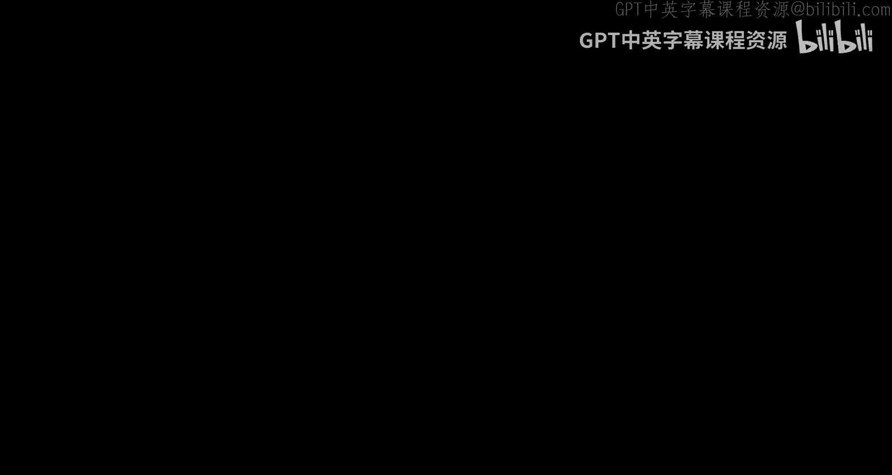
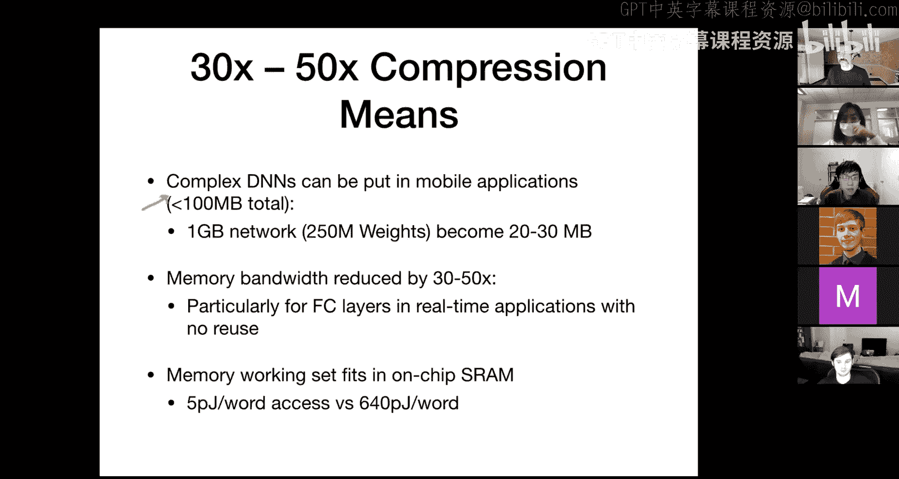

# USC《机器学习系统｜CSCE585 Machine Learning Systems 2020》中英字幕（Claude-3.5 p21 -21-Lecture 9_ Model Compression (Pruning and Quantization).zh_en -BV1Xc9bYVEC6_p21-

嗯。Okay， let's get us started。So the plan for today is to。Discuss model compression。

Which is basically a continuation about the hardware layer of the stack of the machine learning system of stack。

And， and the key idea is that how we could use。Some of the insights。

 either from the mathematics of machine learning， essentially that was some of the earlier work even before 2000 by La Khn。

And and recently， based on。The capabilities that we get from different macro architectureit。

 some different new ML based hardware accelerators and how we could compress。

A deep neural network in this case， in order to make it more efficient in terms of storage。

 first of all， we have large models， it has a lot of weights。

 either like the fully connected ones or the convolutional ones they have lots of weights and obviously they do a lot of calculation。

 how we could。Decrease the size of it and decrease the number of calculation that we do in these networks。

That's basically the topic we want to cover now。 Before we start， do you have any question。

About the topic about what we have discussed or about your project。 How's it going with your project。

 Is everything fine。No concern or anything。Okay， sounds good。

So basically the idea is to reduce the size the size of such network and as a result。

 when we reduce the number of weights， not only the size will decrease but also the computation of these network especially when they do inference France。

 and by now I hope that，Since we discussed this many， many times throughout this course。

 now you exactly get what I mean， right？When we say computation， we care about multiple aspects。

Pils down the number of floating point operations， but as a result， the energy consumption and so on。

 so we typically talk about。Multiple objectives of such systems。

So there are basically this area of model compression。

That boils down to pruning approaches as well as quantization approaches。

 so you can consider this pruning。And quantization。I will talk about both today。

The key difference is that in pruning like if you imagine neural network as a tree。

 you want to cut some of these branches quantization is with respect to the representation of。

Of the numbers that we consider for the weights or the activation as well。嗯。And。Toward the end。

 I will discuss also， it has some implication or relevance to your project and Aina that you can think about it it is。

It is interesting how these stuff could be connected to。Go we say your machine learning as well。So。

 again，Pruning of。You can consider your neural network that it has a。

Connection or architecture like this， This is。As you know， as you see。

 this is somehow fully connected network。That it has some。

Activs from different layers and some weights associated to these connections。And by pruning。

 you could consider both right pruning these weights or synapses you could consider as well as pruning these neurons。

Is cicus， right。And you can think about it。 Some of the connection， right， it is somehow intuitive。

 Some of the connection might be。They weak。So if the connection， so， for example。

 if this connection where where here， it very close to 0 iss very， this means that it's。Very weak。

 It doesn't influence the activation for this。Note， right for this unit。

Why you want to basically pay for its storage， right？ That's。

 that's a kind of intuition behind pruning typically。After you train the network。

 as we discussed previously， a lot of these weights are very small and we want to get rid of them because they don't。

Influence the activation， much。And also when you cut out all of the weights toward an activation。

 you may want to get rid of the notes as well the units as well basically these neurons so you don't want to represent them in your feature map。

And they get。You need to store them as a result so you want to get rid of them so you can think about it in both aspects。

 so and this is how this will would look like after after the pruning。啊。This is， basically。

 this approach。Having a three years ago。嗯。If you look at。

All publications or active research and again this area is one of the hottest area in machine learning research people look at this and come up with some innovative and interesting solution。

But you could you could think about this pruning as a threeS step high level threeS step approach right so you start by training your network right。

 this is obvious and then you want to prune some of the connections。However you want。

 typically you want to have a threshold， whatever mate below this threshold， you prune them away。

So if you prune these rates， obviously。You can use that like you can use the Pe network。

 but just cutting for your inference， but typically in those cases， the accuracy would。Drop。

 so you need to do some retraining again after you cut out some of these connections or neurons。

 and here you can， you can see the results， right， This is， this is the case that you， you basically。

 you prune your connections。This particular and this particular with two different regularizer with L1 and L2 regularizer you prune your network and do the inference or measure its accuracy right away without any retraining and you see that either start to lose some accuracy。

Very quickly。 after you， after you。You go beyond this 50% threshold this percentage on the X axis shows the percentage of the weights that you cre away。

And you see that around 80 with respect to this， particularly through regularization。

 it once you prorunne 80% of your words， you lose roughly around 5% of accuracy， which is。

Not something you want to do， right？So typically you need to do some retraining and the key idea is very simple right so you first train your network。

And then prorunne some of your connection。Based on a particle， right？And you know。

 exactly what are the connections that you prune away。Once you know where they are。

 then you can retrain the network， not allowing those connections。To basically you put them。

 you force them to zero right this is the way how you do that you don't let them to change during the training during the stochastic or gradientian descent right in in your stochastic orian descent your update ratess so you need to change your optimization not allowing a specific weights to get updated as a result right。

This is typically how these approaches you force a specific weight not to change。

Only you allow certain part of your connections to change their。Their number， right， they rate。

So after you do this returning， you see that you can。Go beyond 90% and lose lose just。 So。

 for example， in this case， you can， you can prune 90% of the weights and。Loose 1。

 half% of your accuracy， right， So with returning， you have much more chance to to。

To not losing any sort of accuracy。And even this red line shows that if you do this iteratively。

 not in one step， maybe you do multiple pruning well retraining， pruning。

 retraining pruning retraining， then you can do much， much better right so even with 90%。

 you see that you preserve all of your accuracy， nothing as loss。So basically。

 meaning that your 90% of the base were useless somehow。

You get the same accuracy as your general model。Do you have any question about this。

And this result for this particle data learning both plates and connection in efficient neural networks。

 one of those。嗯。Earlier papers in new generation of model compression and prunic。So， if you look at。

The weight from two aspect， right， so。This particle is。Pning Alexnet。

And thevo access in the first diagram shows the percentage of。Dates。For all layers of your network。

 you know that like the earlier layer or con layer and the later part of your network is for classification fully connected layers and this is this shows the total number of weights。

 you see that。Roughly around 90% of the has been pruned debate and this shows the percentage with respect to with respect to the whole architecture and you know that like or let me ask you。

hy these numbers are too as small comparing with this。Can you answer this。嗯。Yeah。Okay， so I think。

It's because the convolutional layers have less weights because they。Like that's the whole idea。

 they have this small kernel which runs across。The whole data。

 so there's just there's just less to prun away， right？Yeah， exactly。 So these convolution layers。

 as you remember， comparing with fully connected layer。As a lot less number of weights， right。

 because we do weight sharing， right， We sharing help to decrease the number of weights。

 But on the other hand， like what is the cost we pay。If you want to remind us。

And it was just accuracy， I guess， over the more you， the more you。Comparing the calm layer。

 what is the difference between fully connected layer and comb layer beside these number of eights？

Less flexibility， I guess they can't learn nearly as much。嗯。In terms of computation。Oh， well。

 the convolutional layers。Require less storage computationalally though。

Do they take less computation？Recall or believe that。

You can't think of right because because you do convolution operator， right。

 you need to like do this convolution over your input map and then produce the output map。Right。

 so convolution， if you remember， it was somehow。You remember。

 we discussed about this 60 loop that that we need to。To do in order to calculate the output。

 so more computation but less number of weights to learn and gaining some invariances as a result of the property of convol on the other hand。

 be fully connected we had a lot more weights to a store and access this accessing the memory was expensive。

 but relatively with respect to the we need to do。Let's computation。It is much as straightforward。

But yeah， very good point right and that's why comparing with this fully connected you see these are very small right？

But then after you normalize it， you put everything to 100%。

 meaning that you normalize with respect to the number of eights。So you see exactly what's going on。

 pear layer， these green stuff showing the part of the weights that you can prune away。

 as you see like in your calf layer， you can like remove。Right， so。

Roughly around two third of your weights and in fully connected layers。

 you can roughly remove 90% of the weights's that's kind of result that this paper got and in any layers since you need to look at all features in your input typically you don't want to。

Lose those right so this means that you don't want to like if you want to compare it with human。

 you don't want to basically blind yourself because you want to look at everything。

 maybe some surgeon could remove some of your neurons and you can still do some processing。

 but you don't want to lose your。嗯。Your eyes， right， This is the way how he can correspond it with。

With these pruning approaches。And for VG， again， another larger architecture or deeper architecture。

 you see that we have like several conf blocks， right， much more number of conf layers。

So in this case啊。And again， the same， right， you see that you have much more number of its in your fully connected layers。

And then in total， they were able to get rid of 93% of the weight in total， again。

 more or less similar comparing with this previous Alexnet here around roughly two third of。

Of the VgG conf layers and more than or roughly in total。

 around 90% of the weight fully connected layers。Yeah that's somehow the result that。They've got。

 and again， like there are like numerous work papers。 this， This is resolve of one particular paper。

Some诶。And it has some interesting properties， some approaches， model compression approaches。

 they consider a specific percentage of the weights you want to clonee from each layer。

 So as a result， you would see all of this， like in some papers。

So there is no variation in terms of the number of weights like you consider it I want to prune a away like 80% of the weights from each layer no matter what right and this is the approach I want to I develop right this approach consider different flexibility in terms of the number of weights depending on。

嗯。Depending on the threshold that you choose for pruning right and the number of retrain you would do as a result。

Any question about this？嗯。Like another sort of result for LSDM architecture or recurrent neural network。

You see that so is this one， the blue line is without any retraining。

 you see that it is stopped losing accuracy right away when going above 50% of the weights but with retraining you see that it preserve the same accuracy up to 90% only start losing a little bit when it goes from 90 to 95。

 so again， if you remember this LSTM architecture somehow similar to fully connected。Netfl。

 this is the way how NSTM works， right？More or less similar result， what we have seen。

And in this paper they shown， okay， for example， for for these kind of systems that you use for capturing。

Basically， this， this neural talk architecture based on LSDM generated a caption for each image。

 This is the caption that was generated with the original。A SDM neural talk model。

 this is after it has grown 90% of it。Right， so you see that in this case。

 I generate a basketball player and a white uniform is playing with a ball。After pollruning。

This is the difference that you see， so it replaced a ball with basketball。All， we take somehow。

Even you can consider it even better， depending on how you think about this。Right啊。In this case。

 it replace field with area。You can see that maybe field in this case is more concrete areas more generic。

But again， it really depends how you want to interpret it。The interesting case is this case。

 a soccer play in red is running in the field in this case， after you pruned 95% of it right。

 a man in a red shirt and a black and white black shirt is running right so。Ba。

 you can see that it it does not capture。It does not capture。The context。

 right and what context means and or relevant here。So啊。When you prune like 95%。

 it is start to lose some of the accuracy that it had before， right and it was joined here， right？

That the result somehow correspond with the actual experiments running on some of the data set。

 So this， this is interesting to provide what it means， really on on the。On the evaluation and test。

 what is the implication of this beyond just accuracy？Also， they reported the speed up。

On different hardware， particular CPU and GPU for different door network， right， Alex6，7，8， BGG。

Different kind of architecture， right？This is the。This one is the summary or the average geometric average across all of these。

 so you can see that。This one is for CPU。 This one is CPU when it is proed3 x on average across all of these architecture。

 When you use proed on the CPU， This is proed on the GP right。嗯。Sorry， this is GPU dense。

 This is when when you prorunne it and you deploy it on the GPU。

 you run it on the GPU 48 X improvement comparing with。YouBa what you had on CPU。

 This is in terms of a speed up。 So basically this CPU is your baseline。The rest is。

Is a speed of with respect to this baseline。 So again， this one3 x。

When you deploy it on the same CPU or just prune it。Already with deploying on GPU。

 you get 15 x improvement comparing with。With CPU， and if you prunne it。

 you see that is 48 x comparing with the CPU， which is great。嗯。But again。

 like as I mentioned there has been work in 1990s it's called Op brain damage this is one of the interesting work if some of those。

Those of you want to go deeper in mathematics。And gain some insight。

 This is one of the paper that I would highly recommend if you want to learn more about these model compression approaches。

 It's more theoretical and。Mathematically， then。This recent world。

But you can associate most ideas that come out now is more or less connected with this foundational work in 1990s。

Let's also talk about quantization， specifically trained quantization that is introduced in this paper。

So。Basically quantization again is about representing the numbers。

 represent how you want to represent your your rates， for example。

 do you want to use floating point representation or hintteger representation。

 we discuss about that like in terms of consequences。

 number of bits that you require to represent your number， right。

and computer architecture for those who already passed it， you know what I mean exactly。

 but we discussed it briefly previously in this course as well。

So after you do this pruning you reduce it to roughly around 10% of the size with the same accuracy。

 so here you have the same accuracy now like with quantization you can do much better right so quantization again is this is one idea for quantization in this paper but there are so many other ideas out there but this is interesting one and after you do quantization you reduce it to 3。

7% of the size so this idea of quantization。The interesting part is is that。So in quantization。

 you know that when you reduce floatinging point to， for example。

 integer representation right to clarify it， let's consider this。So when you when you reduce。Your。

umbThe number of bits that you want to consider for representing numbers typically default is to use a uniformified representation right so uniform representation right so for example if you have four bits to represent numbers you can represent 16 different numbers uniformly distributed。

Between two two interval right and one interval， the idea behind this trend quantization is that maybe we could do better。

 maybe we could expandend these 16 different values more centered around where these weights are right so these are the histogram。

Of debates after。After you did your， after you did your prun， right， So the original。

Density was probably something like that right so this is this is after you trained your network initially this was probably a kind of density function for the original model the idea for the first step pruning was to get rid of these small value which are centered around zero right after you prune it。

 this is now the two modes of your density function that are remained right so you get rid of a small value。

 a small values were here So after you do this after you do retraining youre basically weights have typically multiple modes in this case。

 two particle modes。嗯。Is this clear for you guys？So this is basically the distribution or density function of the weights。

After after you do pnic。Then the key idea behind train quantization is that maybe if you。

 for example， uniformly distribute your number， your quantized number here。

 then you wasted these right so there there is no weights here。

 there is no weights here right all your ratess are here and here right。Then basically。

 you lose accuracy， right， So if you look at carefully， you only。How many you have here let me？

Make it clear for you so without so with uniform representation you have one here， two here。

 three here， right and and。I four here。To to represent the weights for this second mode， right？

But once you do this quantization carefully， you have more numbers within this distribution with this careful consideration。

 right， so in particular， we have1 here，2，3，4，5，6，7，8。

 right we have8 different numbers to capture the weight values here and again， like quantization。

 like we like we have only limited value in this case， we want to use four bits， So only we have 16。

16 different values to represent and we want to put them carefully where they can capture the most information after quantization right in this case also like you have one。

 two three， four， five， six Minnesotanes of one， two three。Okay。

 that does a benefit of it right to have more numbers to capture this variation because the the stuff here。

 the stuff here doesn't matter。 There is no weight to represent right with this way you you。

You basically you did your conversation much controlled and better。More specifically。

 the way how they do this intelligent。Vay of representing this quantized value is based on like some cluster right so you have a limited number of numbers to represent right so here you have only two bits right with two bits how many numbers you can you can show four right。

So you have only four numbers that can you can show and these are the debates that you get。

Considering 32 B of floating point。 Okay， this is。This is the weight， right？

So after you train it with floating point representation。These are the bits that you learn。

 then now you want to use your your only four values to represent these weight right。

 only four values and look at the numbers right you have different different numbers like you have 2。

9， you have 0。98， you have these， you have 0 right and you want to find a way with only four numbers。

 how you want to represent this the best because you want to get as close as possible to these values。

To these floating point numbers。Then what they do is that they， they run it came in。

Ca in is a clustering approach on the weights right these are again the weights that reside on the kner。

 this is basically your kner。What you do is， is to。

To consider this clustering so you have multiple cluster you have like four cluster in this case。

 we came in if if you remember you needed to to say that how many cluster you want to get as a result in this case like came in is the most appropriate clustering because we know exactly how many number how many number of cluster you want to get and this how many number of cluster depends on。

Can anybody say depends on what。And俾点样 you。嗯。How do you know how many colors we want here。

Byer the number of bits that we want to use for quantization exactly right。

 so the number of bits is two we know that with two bits we can represent four。Numbers。

 so we have only four cluster， right， So since we know this information， we run cans with。

Fll cluster。 This is what we get。 These are colored， right， So， for example， this cell， this cell。

 this cell， this cell is one cluster， right。And then so basically corresponding to the bluelu。

And then you center these two around two， because most of these are around two， right？

This makes sense。And then you have these， these， these and these are zero cluster number in cluster index0。

 these are cluster index， right？And look at the numbers there。Around my one， right， So you have one。

Clusster with the centroid of minus1 and academic 0 and 1。2， right？

So you have and you have the representation of one point half， right。

 because you have the flexibility to decide。Where do you want to。Put your center it。

And then you can you can fine tune your centroid after after you do returning and so on right so this is the key idea behind this。

This interesting way of of doing quantization。 Any question about this。And some results。

So this is showing the accuracy again。So the X axis used a number of bits for the values， right？

And you see that it only lose。A lot of accuracy when you have only one bit which makes sense right you don't want to this is for fully connected layer。

 you don't want to have like one bit with one bit like you have two numbers to represent right and it would be difficult really to gain any accuracy two numbers for showing the weight right for con even higher right you start losing after reducing to below four bits。

So， this is on。These are some result that you can consider。 So essentially for coner。

 it means that you probably need more。More。Basically quantized values to represent these weights inside your conors。

Here are result for pruning and trained quantization when you do both， right？These red dots。

 and this is the case when only pruning。Right。And this is quantization only。

AndSVD is is another way of doing。Model compression that they compared against and you see that pruning and quantization basically improve the results so the X axis shows the model size ratio after compression。

嗯。You see that it is able to so if you go this way， the better。

And this is the accuracy loss so you can you can reduce with pruning and quantization。

 you really can reduce it。Reduce your model size somewhere around even 2% of the original size and not gain not lose any accuracy。

 right？With which with only pruning or quantization， you were not able to do that。

But if you combine them， both together。As they have done here right so meaning that you do first pruning。

 you do retraining multiple times right， and then you do quantization and combine it as a pipeline。

It works really well right， so you reduce your mother size for quite a bit without losing any accuracy。

And， and some of the other results with respect to different model architecture。

 And this is showing the compression rate。And。Different error metrics， top1 and top five。

And by the way， like top five basically is the accuracy and the top five label that is predicted by the network is among the true。

The true labeled in ground truths data。 then it counts one example that as labeled as true。

 even it is not the top  one。 So that's the difference between top 1 and top 5。If。

 if you haven't discussed it earlier。So you see that like both in terms of top five error and top1 error。

The error are really comparable after you do this number of this compression and it means that like you see the difference in terms of size right and if you go all the way to VGG like VGG is a large model that if you want to a story it is like。

500 megabyte， which is relatively large after you do compression is only 11 megabyte。

 So if if you if you do this model compression， imagine like what would it mean right。

 think about what would it mean if if you use if you want to use VG G。For like。

 let's say image prediction of like。An app that predict what is this particle plot， right。

 you deploy it on。You develop an app right for predicting。

 showing with your camera on your mobile device what is this plant and it predicts， okay。

 this is this particular plant right for plant type prediction。

If you want to use VGG means that with your app， you need to bundle a model that is sized。

Over 500 megabyte and you want to push it in the app in， for example， the app store of iPhone。

 right Apple。嗯。So everybody that wants to use this app needs to download 500 megabyte first of all。

 there are some restrictions on the size of app and some limitation on that。

If in the first place and some of the devices like for example。

 you cannot use it in your watch because typically watches have less memory than this right So there would be so many and relatively comparing with even newer models is a small relatively right has been one of the largest model like a few years ago but now relatively even is a small So if you are able to compress it again and not lose any accuracy。

 that would be the way to go and why it is important for modern applications。So。Yeah。

You can compress complex deep neural network。And it has a lot of benefit for。

Energy consumption for storage， the kind of you know application you can develop it and specifically this is important for like again like model compression might not be relevant at all like if if you have like a model and you want to do like just prediction maybe why you care about like model compression but specifically for machine learning systems right this is very important because of all of the restrictions that you have for ML systems and you want to you want to。

Both in terms of inference and training， you want to。Decrease the energy consumption。

 decrease the inference time， decrease the number of computation and the storage that you have。

So yeah， that's it。 I stop here。 Do you have any question。If not， yeah， have a good day。

 good luck with your project。And yeah嗯。Let us know if， if you're struggling with。

With your project kids。I hope I haven't seen any discussion on Giub lately I've been busy with the deadline that I have this Thursday。

 but I will try to catch up。But I talked with。Your T A。 So yeah， Ying said that。

Everything is all right， apparently， but let us know。

soundsunds good thanks。Bye。

