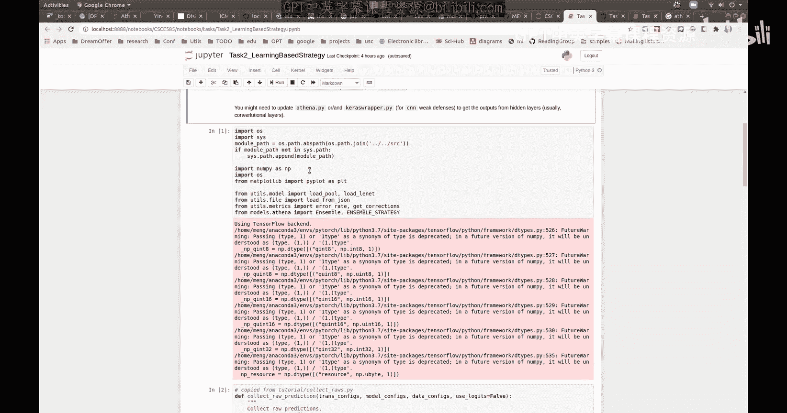
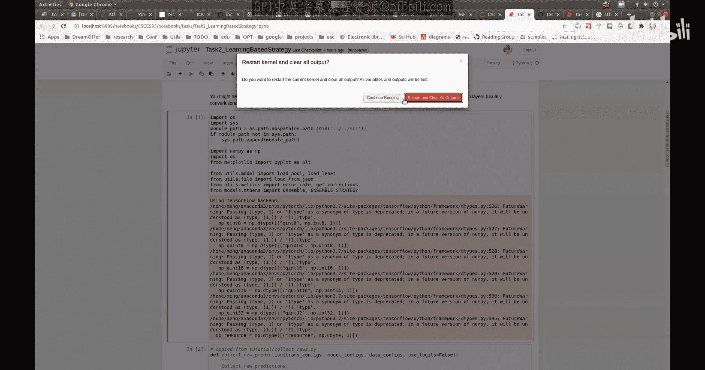
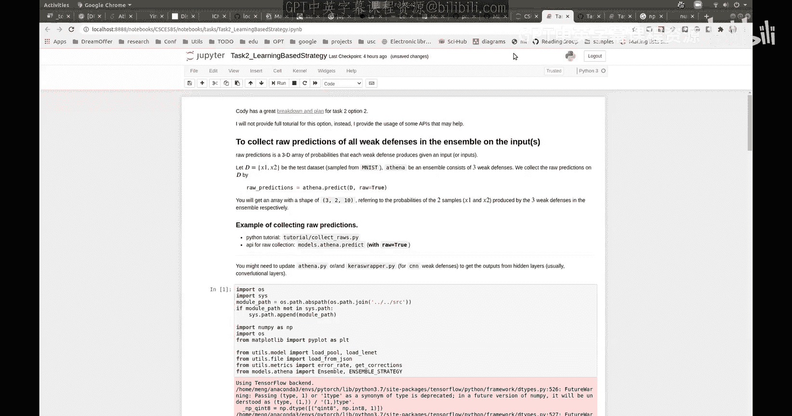

# USC《机器学习系统｜CSCE585 Machine Learning Systems 2020》中英字幕（Claude-3.5 p22 -22-Tutorial_ ATHENA Learning-based Strategy.zh_en -BV1Xc9bYVEC6_p22-

Okay， so。Task 2。Learning based strategy。Okay， so。嗯。Cody has a great breakdown and plan for this task。

扫律史。😔，Yeah， so basically， Cody wanted to so his team wanted to train the regression model。嗯。

Using this data set， using， yeah， on this data。So this is actually， so the predictions。For of。

Of each individual weak defenses。嗯。Each example here。And then with the corresponding。

Corresponding labels here。But I doubt it here， I don't think you should use the。

 you should train this strategy model， regression model on the， on the test data。Because。

You should not see the test data at the， at the training。At a training phase， so。

You may want to train your model on the on the。On the training day， What did I say？ Yeah。

 you should not。Use the test test set to train your model， because the test set should。

Should be unknown。 should remain unknown。Until the inference time。

So you need to train this model using the training training data。But if you。

So you want to use the A Es to train the model if you want to do something。If you want to do that。

I would suggest you to separate for example So， for example， right now， we have 10 K。10 K test set。

10 K test data in the in the test set， right，10 K samples。So I would suggest you to sample。

For example， you will use。I'm not sure。I'm sure。 I I just， I just make up some。Some numbers here。

 for example， you will， you will separate this， these A Es into two separate data sets。 So。

 for example，6，6 k。For the training or 8 K for the training and。You need to。Keep the rest。 to paces。

unc。For until the test， until the test time。So you will change your model on the A K。8 K As。

And then use the rest two K A Es to test your。Test。The the model。Because if you trained on the。

If you train the model and and evaluate the model on the same dataset。Its。It learn from the data set。

 So it will。It should perform very well on that on the， on the same data set when you。

 when you evaluate on， on it， right。So。If you want to use some AEs to train this。

 to train this model。I would suggest you to separate them into training data。And， and test data。O。

I just。Yeah， that's some suggestion。 I just。I just remember。Okay。嗯。

But I think that's a good breakdown。 It's a good plan。So I will not provide the a full process for。

 for this tutorial。Because I， I would expect to see。More exploration from you。I don't want to。

Constrain your。You， your， your ideas。Of this。Okay， so I will， I will provide some APIs and some。

Some of my comments or suggestions that might help。My help in your， in your task。Okay， so actually。

 we provide an API to collect the raw predictions。So this raw prediction is actually a 3D。

Aray of the probabilities or other logics。That each individual weak defenses。Made on an input。So。

 for example。We have a， we have a test set consists of two inputs。 So two images here， X 1， x 2。

And then。Since we are talking about the analyst， so。It will have 10 classes， right， Digital 0。

 digital 1 through digital 9。 So 10 classes。And then we。

 we just created an ensemble named Athena and this。

And we used three week defenses to build this ethan ensemble。Then， we can collect。

The raw predictions on， on B。Like this way。So since this is the ensemble， we can。

 We can call predict API directly。So。We call this predict， predict。 And we。Pass the test data。

 And we set this raw to true。So this function will return you the raw predictions。So this。

 these raw predictions will in is an array of this shape。Of the shape of this。So。

 three weak defenses。wo images。And 10。A vector of 10 probabilities for the 10 classes。

So I think the only difference of these raw predictions。From what you want here。Is。

Is the order of the， the dimension， right， So you expect。You expect for each。For each image。

You get the predictions of。Of the。Of the weak defenses。And then， in our case。Is Ws。 And then。Image 1。

 image 2， image 3， something like that。 And W D2， image 1， image 2， image 3， something like that。

 So all you need to do is when you get the raw prediction。

You can apply some transpose to that matrix。Then you will get， you will get whatever you want here。

You can you can try on a very small scale to see whether to make sure you transpose the metrics correctly。

Okay， so here I provide， I also provide Python tutorial to。For the usage of this。Of this API。So。

The pattern tutorial is， is in this file， and then。If you wanted to to collect the raw predictions。

 you will call this API with raw equals to true。And so， here， we provide。The predictions。For。

Raw predictions for probabilities and， and logics。If you wanted to collect the output from。

From some hidden layers， you need to maybe。🎼I think major modification will be made in this file。

 in this carrot wrappers。I just refactor， I。I changed the name of the original name is Cars Da piei。

Because that carriess。It's duplicated with the package carriess。 So I， I changed the name。

 I rename it as car wrappers。 So this is。This will provide a wrapper for。Carous models。🤧。

Okay。So let's start from the very beginning。

Import by packages。 And then。And then here is some demo of the。Of collecting the。The raw predictions。

 so。This function will require the configurations of the transformations of the models and the data。

And also a flag， whether to use los or。Or probabilities。So。If it's true。

 it will return you the largest value。 So this logic value。Are the。🤢。

The the outputs from the layers before softm。So if you。Make it to be true to be false。

 That was the default value。It will return you the probabilities。

 So after we apply the soft max on the logic value。Okay。So we need to load the weak defenses。

And in this， in this demo。I love。I try with the very。Small pool。 that consists of。3 weak defenses。

Yeah， so the same as we described in this， in this， in that example。

So we load the pool of three week defenses， and we will built an ensemble using these three week defenses。

Then we will load the data。It can be。So this will be the the training data。

YouYou will used to change your strategy。Strategy model。Okay， in this。So when you load your data。

 your training data。And。So in this， in this demo， again， I will use a very small subset。

 It will consist of only two images here。Okay。Then I will collect the raw predictions for。I mean。

 for this data set。So。Ethena， dog predict and make this bra to be true。

Then I will get the raw predictions。On this dataset。And then， I also。I also do the prediction。

So this is the final predictions。On the same data as the， I mean。As， as the comparison。Okay， so。

We get the， we get the functions here。So。We prepared。 We get。The configurations。

 and then called the functions here， so。Here， we will。We collect。The prediction probabilities。

Because we， we will because the use use logic equals four here。Okay。

So it will load the weak defenses and do the prediction。 You can see。

This is the raw predictions we have。哦。On that dataset consists of two。two samples。

And from the ensemble。Building with three weak defenses。And then， here we get。

We get 10 a vector of 10 probabilities on 10。Classes。Here is the。Here is the。

The raw predictions we collected。And this is the final prediction。On this data set。 So， so basically。

 they， they are just the probabilities of。Of each。Of each samples here。When you apply arcm on this。

 on these probabilities， you will get the predicted label for， for the first image and the。

And for the second image。Okay， so I just copy the results from， from this one。Thank you。

From above to here。And add more concrete comments here。小 you see。So these raw predictions。

We will get the results for。For the嗯。The first W D。And then。The， the two samples here。

 the second W D and two samples。The third W D2 symbol。Like that， something like that。

 But I know what you want is， for example， the。First， input， and 3。

And the three predictions from the three weak defenses here。All you need to do is you。

 I think you just transpose。To switch these two dimensions。Yeah， so here is the final prediction。And。

 and this is the example to collect the。The raw predictions。Of for the logic value。So。

If you want to want the model to return you the logic model。

 when you load the model or load this poll， set this use logics to true。Okay， so as what we did here。

 the rest will be the same as above。Okay。Now you can see the collected raw predictions will will be in the same shape of the probabilities。

 right so。But the values， you can see， values are different。 These are the largest values。Logs virus。

Okay。So。So I think that's pretty much。 it is。呃，南民。还能说嗯。Let me give you the example。

 how to transse this。These raw predictions into into the shape you want here。Okay。Still something。

Here。Okay。Show we transportse。The， the raw predictions to， to whatever you want。P。Oh， it is the。不是在。

Okay。So， this。呃，南拍。Provide us a。全都是。啊，防身。So you need to pass the。Of。A ray you want to transse。

 And then the new shape。Since we know this is a 3D，3D array。 and we wanted to swap the。

The first and the second dimension。 So you just swap the index here。 So we want the。

We want this to be the new。First dimension。 And we want to s 0， and。And one。 And keep the。

The last one unchanged， so。是。So， this is the new shape。Okay， let's plot。Not the ship to see if。

Tposed。Okay。5是。We can track whether this is what we want。Okay， we can run this again。Then。

 werun this。Okay。Yeah。So you see here。😔，This is what you get from the API， right？

And then you just transpose the raw predictions you you collected from， from our API。So， swap。

Swap this。Swap the W Ds with the examples。So， you will get。An array。 So for the， the two examples。

 right， The first example and the second example。 And for each example， you will have。3 predictions。

From the three W Ds， right。In the， in the ensemble。So I think this is what you want in。In here。So。

 for this table。系。Okay， let's try the。Lo its values。So you can see you will get the same， right？Yeah。

 transposed。 okay， I think。I think that's pretty much it is。For the learning based strategy。Okay。

 for further questions， you can。Ask in the， yeah， you can open issue。

 I just connected the that project with my slack。 So whenever there， there is some updates in the。

In the re， I will， I will receive the。Notification， I will be noticed。So， so。So I can。

 I will try to answer your questions as soon as possible。Okay。

