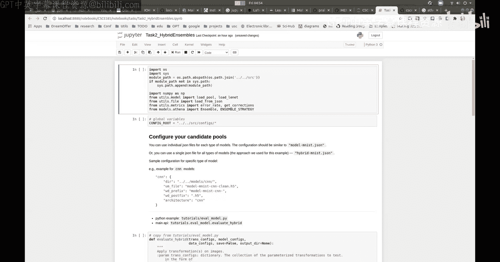
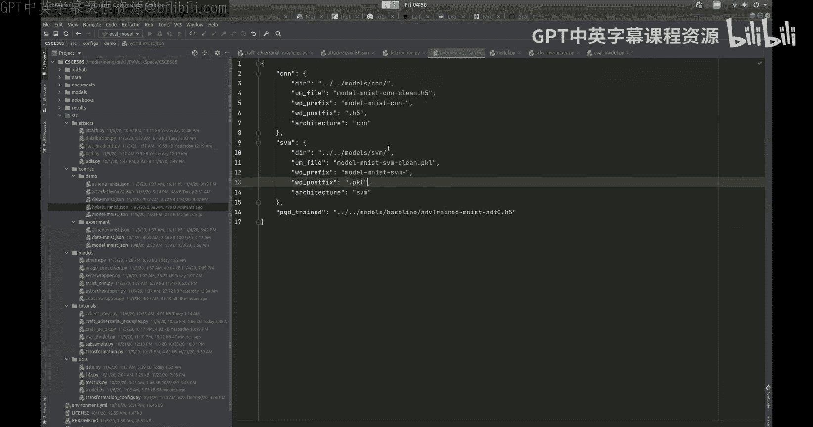
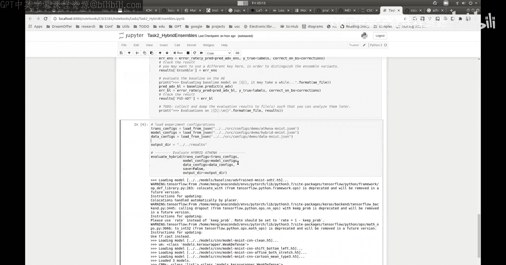
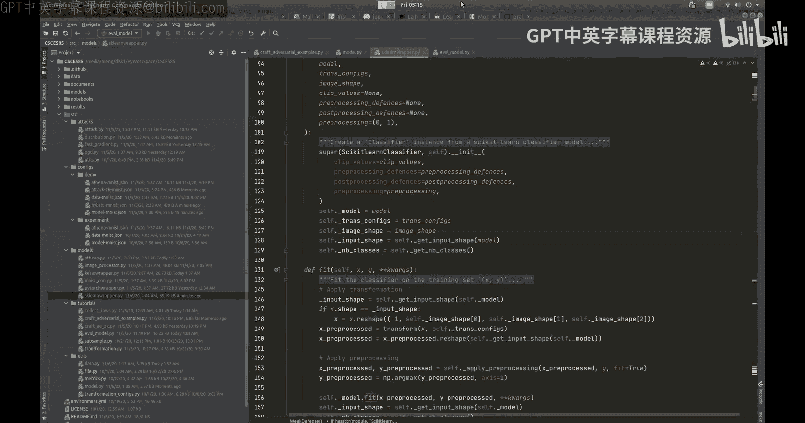

# USC《机器学习系统｜CSCE585 Machine Learning Systems 2020》中英字幕（Claude-3.5 p23 -23-Tutorial_ ATHENA Hybrid Ensemble.zh_en -BV1Xc9bYVEC6_p23-

Okay， task 2， hybrid ensembles。Okay， so here in this task。Let me clear。好可子。So here in this task。

 you will ask to。To build。Mararian's answer。Ensemble variants。 So this， this。

 each of these ensemble will build using different type of。嗯。Models， so when we mean， I mean。

 the different architectures of classifiers。 So here we will provide provide CN models and SV models。

嗯。So in order to con， con for the。For different type of models。

 you can do either configure each type in an individual adjacent file。 So each file will looks like。

 like this one。Model dash。Anes。

Okay， let's see。So explain models。When I was uploading it。Because some of them is too is too large。

 So I。I wasn't successfully uploaded to the Github， but I'm working on it。Okay， so。

If you wanted to configure the， the model informations for each type of models in the in different。

In different Jason files， you will do something like this。 So this a model dash am Jason。

 this file is the configurations for C M models。So you can see here， architecture is CNN。If you so。

 you will need。A different adjacent file for the for SVM in our case in this case。 So you。

 you need to make some modifications accordingly。But you can also。Confit the information。

For all type of models in， in the same file。 So as I did in this demo。So， I。

I confi the informations for。For same and models。And for SVM models。In this hybrid， hybrid en least。

Okay。Small。Here is the sample。For configuration。So the Python tutorial， you can find it in this file。

 evaluate model。 And then the the demo we using。In this demo， we are using this function。

Evalate hybrid。So this function will require the configurations for transformations， for models。

 for data。Then the process will be very similar to what we did in task 1。So first， we will load the。

 load the models we wanted to evaluate。 So basically。

 the baseline model P G D adversial trained model， and then。The undeefended model。 So here。

 the undeefended model here。It's actually because this， the AE I uploaded to this。

To this ripple was generated。Based on this。CN N undeended model。

 So the undefended model will refer to this， this one specifically in this demo。

So we load the unended model。And we will load the。Or the candidate weak defenses。

 since we have two type of models， we will load each type of the model into an individual pool。

 So that will make it easier for。For the weak defense selection。Okay， you。

 you will know what I mean in。Couple of seconds。 Okay， so。In this demo。

 we have two type of weak defenses， the CNN weak CNN N models and SVN models。

 So we will load the C model。Into this C and pool。 And when we are loading the C N models， we will。

 we will pass the C and configurations。嗯。To the， to the load pull function。

 So we get the C And N configurations。嗯。Through this key。By this key。And then。

We will get the SV configurations。And then load the S1 models into this pool。And in this demo。

 I will use。Very tiny pole， as the example。So。As off。3 weak defenses。So， it's the same here。Okay。

 so your major work。For this。In this task。Is to come up some strategy or some idea or some approach you can use。

Yeah， any anything you can involve to select。The weak defenses for your hybrid ensemble。

So I give you an example， very naive example here。So。So here I will， I， I will build。

 I will try to build。And。Varents。明。I will try to build in hybrid variants。

 that that is in hybrid ensembles。So。What I did is first。

 I will fix the number of the total weak defenses I wanted to use to build。

To build an hybrid ensemble， for example，50 weak defenses。And then。I will start from。

From a simple one。With 50 C models， and 0。S VN models。 So this is my hybrid ensemble 1。And then how。

 how will I。嗯。Get my second。Ensemble from this one。I will replace。Part of the C。

 N N models with SM models。So， for example， I will replace5 semi models with five S1 models。

Then I will get my hybrid ensemble， too。And then。And then replace five more。

 I will build my hybrid ensemble 3 with 40 c N models and 10 S models and so on。

 I will get my hybrid ensemble and。Okay。This， this may not。

This maybe this doesn't make much sense or or something like that。 You can come up。 better idea。 We。

 we expect better ideas in this。Selection theres in the WD selection here。Weak defense selection。

Yeah。So you can come up your own idea。Not necessarily using this one。And then。So when you。

 when you select。Select your SV C N candidates， and you selected your SV N candidates。

You can build your hybrid ensemble like this。 So in this， in this example。I will build an ensemble。

Using three cinema models， and3。S V M models。 So first。

 I will add the selected C M models to to this。To this list， to the list of weak defenses。

And then I will add the selected SVM models。To this weak defenses。listist。

And then I will build my hybrid ensemble， using the。Using the weak defenses that Oh， yeah。

 using the weak defenses。I just selected。And then I will use adversarial probability as my strategy。

 as the strategy of this ensemble。Then。We get， then we have our ensemble model here。

 Then the next we will perform the evaluation。So。This part was were prepares for the。

Aary computation， because we。We need to get the， the samples。

 the samples that were correctly predicted by the ensemble， right， by the ensemble unefended model。

 Sorry， unefended model。Yeah， so， so this hope this。

 these blocksbs were preparing the for the error computation。 So we load the be samples。 We load the。

True labels。 and collect the。The list of the correct corrections。And。Now we can start the evaluation。

 We evaluate the we load the A Es。We load a we then perform the evaluation using this out。

Undefended model。And we evaluate our ensemble。On the A Es。

Then we evaluate the baseline model on the A E。So if you have。Have multiple。Ensemble variations here。

You can。 You can use the full loop。For， for this part。Okay， so。And if you。

 you're doing that in a full loop， you might want to。Make this key changeable。 So， for example。

 plus some variable。For example， ensemble I， ensemble plus I， something like that。

 And then that I will will change in each iteration。So， so you can distinguish。Your hybrid ensembles。

Otherwise， you， you can， you only record you only check the， the last one。The。

 the last ensemble you built。 if you do this in a loop。P from these parts。嗯。The。

 the functions is ready。And we prepare the configurations， and then call the function。

To evaluate our hybrid ensemble。So you can see， we load the。Weload the C models。

We load the SV models。Then， we evaluate。The A Es on using this unefended model。And we evaluate。Our。

 our hybrid ensemble。On this a e。It will take a while。Okay， so。Evariate。

evaluate the baseline model on these AEs。And then we will get the results。Like this。So。

The AE generated。Using FGSM with Epsilon equals 03。So， around。

88% of the AEs can successfully for the undeefended model。

 So that that is the area of this unefended model on this AE is around 88%， so。

When we evaluate these A A Es using。When we evaluate our hybrid model。On this AEs。

We can drop the error error rate from 88% to around 40%。

And then when we evaluate using the PD avers trained model， the error will。

Will decrease from 88% to 21%。So I think that's pretty much much it is。For the hybrid ensembles。

maybe one more thing。嗯。可手。For the。I swim models。We have a rapper。So that呃。

The SVM models we are using was。What's the。Pyki learned models。 So S K learned model models。 So yeah。

 let me show you。Oh， it's not here。Okay， anyway。And that S models was， was store in。

 in this pickle pickle format in the format。 Yeah， so you need to use this package。Too loud。

To load the S models。And this is the wrapper。To。Wrap the。SK。SK learn models。As the。

 as the weak defenses in the ethena。Okay， I think that's。That's it。

