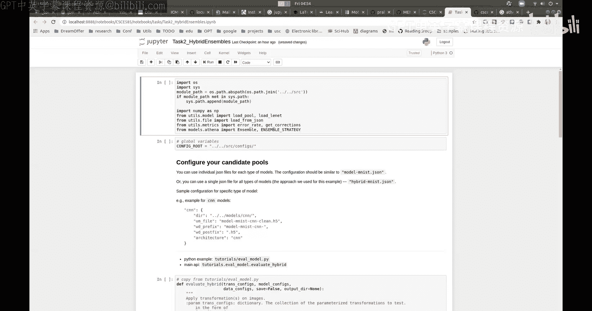
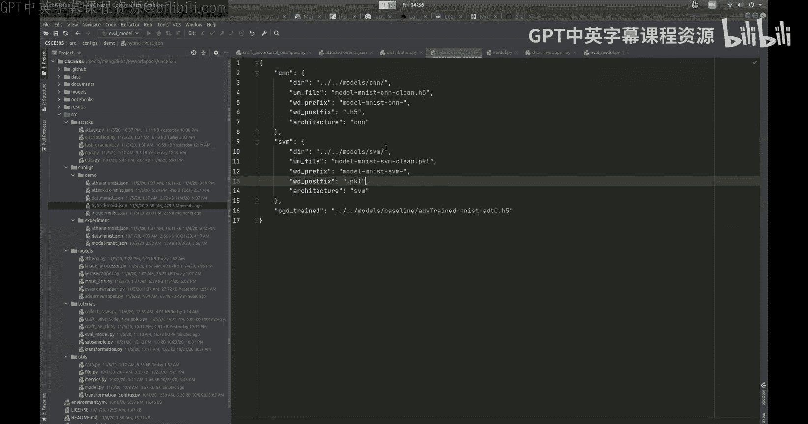
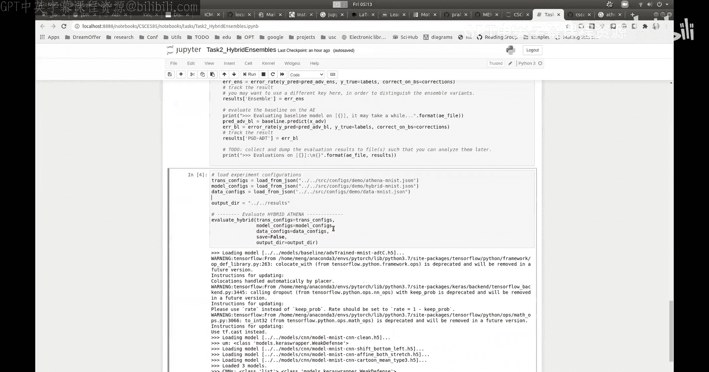
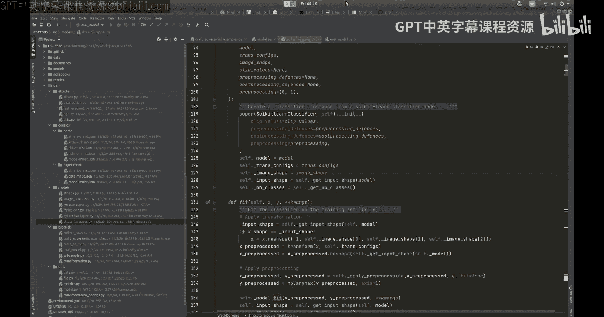

# 机器学习系统：任务2：构建混合集成模型 🧠


在本节中，我们将学习如何构建一个混合集成模型。混合集成模型是指使用多种不同类型的基础分类器（例如，CNN和SVM）组合而成的集成模型。我们将介绍如何配置、加载不同模型，并探讨如何选择基础模型来构建有效的混合集成。

---



## 概述

在本任务中，我们将构建一个混合集成模型。与任务1不同，这里的基础模型将采用不同的架构，例如卷积神经网络（CNN）和支持向量机（SVM）。我们将学习如何配置这些模型，如何从候选池中选择它们，并最终评估混合集成模型的对抗鲁棒性。

---

## 模型配置



上一节我们介绍了单一类型模型的集成。本节中，我们来看看如何为不同类型的模型进行配置。

你可以为每种模型类型创建单独的配置文件。例如，一个用于CNN模型的配置文件 `model_cnn.json` 可能如下所示：

```json
{
  "architecture": "CNN",
  "model_path": "./models/cnn/",
  "parameters": {...}
}
```

同样，你需要为SVM模型创建另一个配置文件，例如 `model_svm.json`。

或者，你也可以将所有模型类型的配置信息整合在同一个配置文件中，就像本演示中所做的那样。这种方法将所有配置集中管理，便于查看和修改。

---

## 加载模型

以下是加载不同类型模型到各自候选池的步骤：

1.  **加载基准模型**：这包括PGD对抗训练模型和未防御的基线模型。
2.  **加载候选弱防御模型**：由于我们有两种模型类型，我们将分别加载到两个独立的池中。
    *   使用CNN配置加载CNN模型到 `cnn_pool`。
    *   使用SVM配置加载SVM模型到 `svm_pool`。

在本次演示中，我们使用了一个非常小的候选池作为示例，每个池只包含3个弱防御模型。

---

## 弱防御选择策略

你的主要工作是为混合集成设计一个选择弱防御模型的策略。这里提供一个非常简单的示例策略：

首先，固定用于构建集成模型的总弱防御数量，例如50个。
*   **混合集成变体1**：使用50个CNN模型和0个SVM模型。
*   **混合集成变体2**：用5个SVM模型替换5个CNN模型，得到45个CNN和5个SVM。
*   **混合集成变体3**：再替换5个，得到40个CNN和10个SVM。
*   依此类推，生成一系列混合集成变体。

这只是一个基础示例。我们期望你能提出更智能、更有效的选择策略，例如基于模型多样性、在干净数据或对抗样本上的性能等进行选择。

---

## 构建与评估集成模型

选定CNN和SVM的候选模型后，就可以构建混合集成模型了。以下是一个构建示例：

```python
# 假设 selected_cnn 和 selected_svm 是选出的模型列表
weak_defenses = []
weak_defenses.extend(selected_cnn)  # 添加选中的CNN模型
weak_defenses.extend(selected_svm)  # 添加选中的SVM模型

# 使用“对抗概率”作为集成策略构建模型
ensemble_model = build_ensemble(weak_defenses, strategy='adversarial_probability')
```

接下来进行模型评估。评估前需要准备数据，包括加载对抗样本、真实标签，并确定哪些样本能被未防御模型正确分类，以便后续计算错误率。

评估过程在一个循环中进行（如果你有多个集成变体）：
1.  加载对抗样本。
2.  使用**未防御模型**评估对抗样本的错误率。
3.  使用我们构建的**混合集成模型**评估对抗样本的错误率。
4.  使用**基准模型**（如PGD对抗训练模型）评估对抗样本的错误率。

在循环中，请注意保存每个集成变体结果时的键名（例如 `ensemble_1`, `ensemble_2`），以区分不同变体的性能。

---

## 关于SVM模型的说明

我们使用的SVM模型是基于 `scikit-learn` 库的。这些模型以 `pickle` 格式存储。为了在ATHENA框架中将其作为弱防御使用，我们需要一个包装器（Wrapper）来适配接口。你需要使用 `pickle` 包来加载这些模型，并使用提供的包装器对其进行封装。

---

## 结果示例

运行评估后，你可能会得到类似以下的结果：
*   对于使用FGSM攻击（ε=0.03）生成的对抗样本，**未防御模型**的错误率约为88%。
*   我们的**混合集成模型**能将错误率从88%降低到约40%。
*   而**PGD对抗训练模型**能将错误率从88%降低到21%。

这个示例展示了混合集成模型在提升对抗鲁棒性方面的潜力。



---

## 总结



本节课中我们一起学习了如何构建混合集成模型。关键步骤包括：为不同类型模型进行配置、分别加载模型到候选池、设计弱防御模型的选择策略、实际构建集成模型并进行评估。虽然示例中的选择策略较为简单，但希望你能够在此基础上，设计并实现更优的策略来提升集成模型的性能。