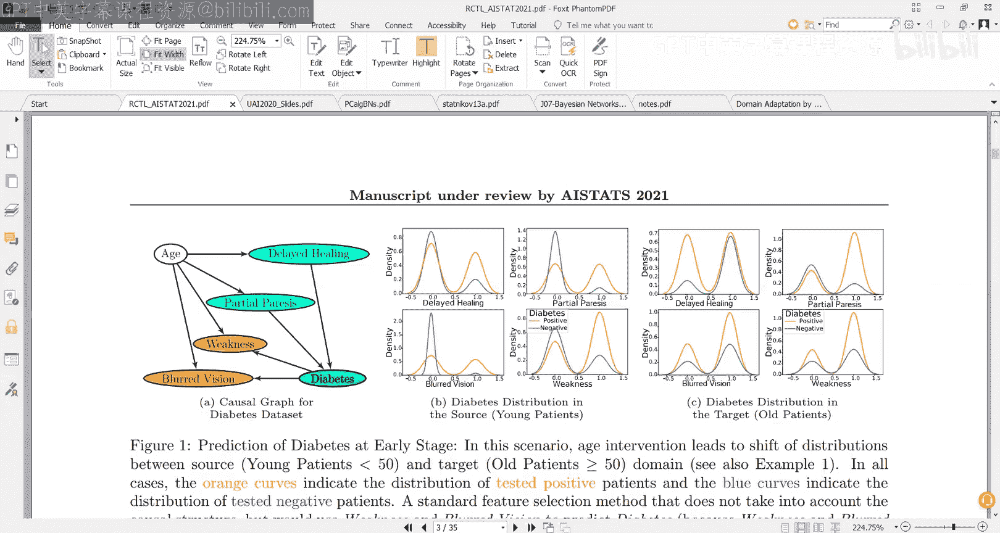

# USC《机器学习系统｜CSCE585 Machine Learning Systems 2020》中英字幕（Claude-3.5 p24 -24-Guest Lecture - Mohammad Ali Javidian - Robust Causal Transfer Learnin -BV1Xc9bYVEC6_p24-

I my Daily video and Im a post at the。

I got my PhD from University of South Carolina。My advisor is。My PhD advisor is the actor Latorta。

 I'm sure you know him。And I worked very closely。 is that the J Shi for。嗯，三毛宝玩。啊。

Are some researchers？嗯，按。The fact that I want to present today is a。One of the our recent wordss。

诶 on。

Using the causal inference and transfer learning。And hopefully， this gives you some。

Idea that how can we。啊。Explloit it。Cause inference in。Machine learning techniques。

 especially for transfer learning。嗯。就觉得。A short notice that I received yesterday。

 I have not prepared any。A specific presentation。Chhan for this talk。

 So maybe I'm jump on some different slides。 and， but I try to give you a high level。

Sense of the vote first， and then I will go through the details。

And please let me know if you have any question。You can。Hep your questions in the chat box or。

You can place your hand or。Seign on your microphone and asking me directly。If you have any question。

So， let me share with you。The cream。啊。So the我 time。To talk about。

Today is robot casual transfer learning。We submitted this paper recently。

And it still is under review， but。Let me give you some motivational examples first。

 and then we go through this paper。啊。In this。そラオ。That you are looking at， we have different。啊。

Pictures。Of calls on camels。And the。If you look at these pictures。You can see the most of these cow。

The background is。嗯。嗯。🎼The on。Background of the。In this big。嗯。And the color of the camel。

More or less is brown。啊。Asume that。Our task here to classify。Hos and camels based on the。A data set。

 which is a。Set off pictures of calls and cameras。嗯。Just imagine that the data set that we have。

Almost all of them follow the same。Ting that you are looking at right now。And retain our。

Algorithm based on this type of data set。And we want to use and deploy。

This trained model in a new environment for a new data set。做。

Pssify and distinguish between cows and camels。Based on the in machine learning algorithm。However。

 if we use just this type of data set for the。Eeddiction and coification task。And the test task。

The test environment。If the test environment be different from the training environment。I mean。

As you can see here， the background。Of this camel is grain rather than dessert。Or the background of。

A discount。Is a desert more or less and。Co of the cow。

Is beachian rather than to be a beachian white like the training environment。Here is brown。So诶。

Very likely。Our。Algorithm or other model machine learning technique failed to。啊，啊。

Or can classifiedify correctly in this new environment。啊。And the reason is that。

AlAnd then you use the machine learning technique algorithm that are traditional and classical machine learning techniques。

Very soon， these techniques。Find that a highly relevant background to the。嗯。

Type of the animals that we have here。嗯。I mean。If weve trained in these type of background。嗯。

The machine learning techniques。Very soon。 Find out that， okay。Those background that are green。

 more or less。There is a cold air and if there is a desert is a camel there。So。

Using this kind of training， somehow mislead the。Mod out。And as a result， fail to。

Currentectly predict or caify and distinguish between the camels and cows。啊。

This is a very simple story。But you can generalize this simple scenario to many， many。

AReal world problems。That。There are some。Background or。We call them context variables。That's。

Der across domains， across environments by domains and environments。

 I mean terrain environment and testing environment。More or less。

 when you try to use a machine learning technique。You turn the model in a specific data set and then you try to use that model for the prediction in the new。

啊。Environment and mostly untested in my environment。赵玉顺呃。Thank you to in our call the。诶。

Differences between the context。That you turn your model and that the。The testing environment。

As another example。嗯。Let me。Talk about this。Example， which is more abstract than the previous one。

In this example。We have a context variable C1， C4 context。

And we have three other variables in our experiment。

Those variables that are not the context variables， we call them system variables。

 so we have three system variables and one context variable。

And what's the difference between the system variables and context variables？Context variables。

 as I said， are those variables that differ。Across different environments and domains。

Or more formally， they have the shift distribution。Across domain for those variables， like the。

エストリだた。放啲。But in the test environment， we have a shift in the background。

And you can' see the background of these camels。Our green and the background of this cow is。啊对是。

Or even the。Colllor off the call。These are can be considered as a。🎼Context variables that。

Dfer across environments and domains。In this imaginary scenario。We have a context variable。

That across domains， we have a shift distribution for this variable。And three different。

Any other system variabless？And assume that we have trained this model。And the。Sour environment。嗯。

Or training environment。For the prediction of extreme。Based on the other variables in this scenario。

Sorry for the prediction of x2 or the prediction of x2。And as you can see in this example。啊。

There are two variables that are very highly relevant to this target variable x2。Wehi are x1 and x3。

And this is an imaginary causalsbirov。By a casual graph， I mean all of directed edge。

In this scenario， have a causal interpretation， which means。呃。X1 x2， there is a de h from x1 to x2。

 That means x1 is the cause of x2。And the same x2 is the cause of x3。So for the prediction of x2。

 if you use any。Clelassic called machine learning technique。啊。They use both x 1 and x 3。

For the prediction of x2。Because these two variables are highly relevant to the x2 in this scenario。

好呢。If you have a data shift in the。Context mal C。And we use both x1 and x3 for the prediction。

As you can see in the right figure。That we have a。啊。In the left figure。For the prediction of x2。

 we have used just x1。And you， you can see that， okay。The prediction is not very accurate。

 but it's somehow noisy， but it's maybe acceptable。But。

If we use x3 for the prediction in the testing environment。

You can see that the very bad prediction in this figure。And。They have a huge。Data shift here。And the。

That shift leads to the very bad prediction。搜。If I want to summarize this story。

The main goal here is to。Find subset of variables。In our experiments。That嗯。Make our prediction。

 not only accurate。But also robot。Across environments。 and by robust， I mean。

Even by having a shift in the。Context valuable across environment。

That subset that we are using should be able to give us。Good prediction。骚。In order to formalize this。

Problem in the context of causal influence。You need to have some background related to the。嗯。

Causity and Bayesian net。嗯。我真系。Try to。啊。Give you some。Basic information about the。Casal growths and。

嗯。De separation and dogs。First， and then we can go for。And。Talk about the details more。

Let's sort with the definition of a causal Garrov or a D， a。啊。Or directed acyclic graph。

Is a directed girl？Is an acyclic graph， which means there is no cycle directed cycle in this graph。嗯。

收。A dad is a directed。A a click girl。系啊。And。Most of the time， a casual gr。Is a。Shown by a do。嗯。

They have a notion about the。That's。That we call them desipation。嗯嗯。

You can imagine three different connection in a that。

The first type of connections is a serial connection， as you can see here。

 A is directed connected to B and B is directed connected to C。啊。In this type of connections。

 serial connections。If we have evidence for the intermediatete。InThe node or valuable， you can say。

Here。The knowledge or the evidence about the。嗯。Variable in the middle， blockss the。

Connection between A and C。For example， you can say that。啊。The。Sson。

Considercident that A is inval about the season。Like this fall spring， winter， summer。

B is a variable about the such as raining， it's a binary。

 it's raining or it's not raining false or true。And the sea。Is the。啊，你。麦克星。The threat is。

That or there are。This very simple， imaginary scenario。And。

Without having any information about their reing status。

There is a connection between the season and the。The success of the dryness or wetness of the street。

For example。If the season is。Summer more likely is not raining and more likely the street is。died。Or。

If it's winter， more likely it's raining and more likely the state be wet。But。😮，In this story。

 if you have evidence about the。Raiing status that disconnect the season from the。

The effect of the season on the street， for example， if it's raining。

Doesn't matter that it's summer or winter or spring or fall。You呃 you can嗯。

Tell that the estate is vet。Doesn't matter that what's the season。哦。If it's not raining。

 it still doesn't matter that what's the season right now。Very likely the authorities。第二。So。啊。

In a serial connection in a deck， then you have evidence。On them。Middle valuable or not。That。

Evidence。Be locks the path between the。Beginning of the serial connection and the end of the serial connection。

 or technically， we call that。Be de separate。This separates a from C。Separation。

 which means or blocks， like blocks here。啊。But。The de separation is used because this is directed。

 so the de separation notation is used for the Ds because of the directed。

Acycl graph that we are working on。So the first type of the connection is a serial connection and in a serial connection。

Conditioning on the middle。Avalable or not。This separates。The endpoints of that connection。

The second type of the connection in a D is a divergence connection。So。You， you can see that。

A divergence connection in this figure。And the same as the。Cial connection， having evidence。

A blocks the。Connection between B and C and between B and E and so on。Or technically， we say that。啊。

Conditioning on A。D separates B from C， also D separates B from E and E from C and so on。

The third type of connection is converging connection。Ithich is the。

Oppposite situation of the diverging connection。In a converging connection， story is。

Completely opposite。Conditioning on A。Connects B and C。Also connects B and E and C and E。

Remember that in the diverging。Colle嗯。Conditioning on a。Blocks there。

Connection between B and C and B And E。Or conditioning on A， D separates these variables。But。

In the converging connection， conditioning on a。Connectex these valuable。

So in order to desseate B from C， we should not are conditioning on a。Or without conditioning on A。

 we say that B is marginally independent of C。Or B is marginally independent of E。Also for this C。啊。

So these are three type of connections。And these separations that we need to use formally。

In our trees。And as you can see here， what's the reason that using x3 makes prediction bad。

By the explanation of three type of connection that I explain to you。

 you see the connection between C1 and x2 is a serial connection。 So conditioning on x1。

Belocks the path between C1 and x2。Or conditioning on c1 de separates c1 from x2。好玩的。

The connection between C1 and X2 is a。Converging connection， the third type of connections。

 which means。Without conditioning， these two are marginally de separated。哦。

Independent other conditioning on x3 makes this connection open。Which means。Then。

You are using x3 for the prediction of x2。Technically。

 you are conditioning on x 3 and you are opening the connection between C1 and x2。

 And then you have a data shift in。Then you have a shift distribution in context variable。

That's shift。Since this connection is open， directly effectss on the x2。

So that makes the prediction bad。 So right now， you should have a better。嗯。Ts about y， using x1。

Is better than using x3 for the prediction of x2 in this scenario when you have a。

Shift distribution on。感t到丝望。O。啊。Let's give you another motivational example。嗯。大可。Using our paper。

In this simple。Scenario。啊。We have some patience。That。We want to test them。For the diabetes。

And we gathered some symptoms。And we ask them some。啊。Questions。To have some killing called data。

AndWe ask them about their age。About the aesthetic of delayed healing。啊。

Partial purse and weakness and blurd vision。啊。And in this story， you know that the。

Person suffers from the diabetes。啊。They suffer also from the billard vision， their vision。

These kind of people。诶 more likely。Have B Vi。And the。嗯呀。

Then the condition is serious about the diabetes， these people also。See there are weak。

 and they cannot do。There are normal activities。And。Also， they realize that。The wounds。啊要。嗯。啊。

Takes a lot of time to to heal their wounds， so delayed healing also can be seen in the diabetes。

People。And also the partial policies。嗯。However in this story。哦。We know that the。

All these four factors are directly。Affected by edge。Age of the person。and。嗯。

Correlation or relationship between age and these four factors is then the age。嗯。Goes up。

More likely the people suffers from these symptoms， these symptoms。Show up in these people。

If you assume that the causal graph in this scenario is like this one that you are。啊先啊 figure a。

You know that。Like the previous example， the connection between age and diabetes。

Is a st connection for？啊。This below。嗯。Symptoms， valuable。But is it？

Converging connection between age and diabetes。But。啊。These variables are in orange。And this means。

These two variable weakness and blur vision are the symptoms of diabetes。But。These two variables。

 as you can see。啊。佢。Causes some problems in the body。 That makes the。诶飞啦 in度。系啊。Punre us。

 and make the。啊，Pa diabetes。So。This in this story。The gather data in two different。

Category for young people and for old people。And in this story， we used that thresholdial 50。

 I believe。呀。Yeah。你 divided嘅。啊。Questioners in two categories。 So we have two different environment。

Wund for the。Patients is less than 50 years old， and old patients with more than 50。And return if。

The same thing happened here， you can' see in the。嗯。Diaialgrams啊 at。Figure 1 B。

You can see the district， the district of the。These factors。And。啊，对对。Dシティ。Distribution of diabetess。

啊。And。By changing the age category， you can see we have a big shift。

For all of these variables across environment， you can see that， for example， the DNA healing。啊。

We have a big shift also we have a very big shift about the billard vision。Explain that。

Young patients and old patients。Also for other factors。So what should you do in this case？And the。

Vified that。Since this is a causal graph that。啊。We have for this scenario。

We shouldn't use weakness and blur vision for the prediction of diabetes across these two environment at least。

Since using those variables。Make the connection between age and diabetes。Open。And that means。

By shifting the age across environment。That。Effect on the。Prediction of diabetes the。

Based on this shift distribution in age。It's better to just use these two variables that are the cause of diabetes。

 first of all。And second of all， using these two variables makes the connection between age and diabetes blocked。

And。Or technically， these two valuables。Disips age from the diabetes or。As we like to say。

Using these two valuable， these two variables are causally。Invariant。Features。Across。

Stors and target environment。Since these two are causal effects。Of diabetes。 and also。啊。

Using these two variables。嗯。Does do not allow the age to effect on diabetes directly。

So by changing the age across training and testing environment， we have a better prediction。放。

A diabetes people。If you use just these four symptoms。And their results in our experiments come from。

This observation， if we use all of these variables。The minus square is 0。29。But if you use just。

Are these two blue。Factors for the prediction is 02。To our new mom。And minimum moment。

The minus square。啊。This is the whole story that I。holdold you in high level。And I think。

It's clear well to know that in our story。The main task。嗯。Then we have a data set。

Finding those casually。Invariance。Features。That makes prediction robust across source and target environment。

This is the main problem that we want to solve。There is。Most of the time。

 we do not have the causal or the。Cause of model of over experiment。

Or learning those causal models or causal graphs。Is。Difficult。And。It's a challenging task。

So is it possible to develop upon？Approach that。Without even knowing about the。啊。

Get onto causal model。In our stories。啊啊。Developer。Sound algorithm or method。That takes。

 That helps the。Machine learning technique for the。嗯。嗯。查他啊。

Transferring the knowledge from the source to the target environment and have a better prediction。

Or co。Or any other。嗯。Tk that。 you are interested。is。嗯。Sorry。😔，三。Any questions so far？

I didn't look at the。Chatbars。那。If you have a question， you can open your mic and ask immediately。

If if you don't have any question， I'll go forward。OK。嗯。So。Let man。Talk about。你 formal。嗯。Yes。Okay。

For the predict for predicting T， which is a target valuable。From a subset of features。

S that our system variables of all features rather than the context variable and target variable。哦。收。

We want to find。啊。诶三。Features。Of this subset， of all features。That makes。嗯。

The prediction robot both across domains。And。By。Robotness， I mean。啊 we should。啊，还。Lower bias。

Which be divided to two different metrics to estimate the bias in our estimation。

The transfer bias and incomplete information bias。嗯。

So the total bias is the summation of these two bias that we have。In our scenario。

And there are some assumptions that are very important in this case。

And let me tell you about these assumptions first。啊。We have two main assumption。

The mark of condition and faithfulness assumption。The mark of condition simply says。We have a dad。

Bugage directed as aicer off。And a prolonged distribution that is defined on the。

Variable or notes on in this this type。收。Simply， any de separation。And the。

That implies the independence in the data set。I there that's I told you。In many cases。

 we do not know the geon Tu causal model， so then you do not have the deck so。Oh。

You need to learn the that or you have an approach that。嗯。Satisfies these two assumptions。

The first one is if there is a de separationation in the deck。

 that de separationation implies the an independence relationship in the data set。

And the faithfulness assumption。Is the other way around。

 which means any independence or dependence relationship in the data set。Should be reflected in the。

Dag and low。So。There is a one by one relationship。Between the independence really independenceency and dependency between the dark and between the。

Data set。And。So our first assumption is。嗯。Our experiment is based on some hidden or unknown causal model。

But even without knowing the causal model， we know that that Guanttulu causal model satisfies。

Other experiment satisfies these truth assumptions， which means。Any。Independency。In the data set。

Implelies a de separation in the DG and vice versa。So one of them is Markov condition。

 another one is called faithfulness assumption。Another asm sha。啊。That你咩。

Here is causal causal sufficiency assumption。The causal sufficient fishinging assumption means。

Then you have two variables that are causally。Related， for example， in this simple example。

 smoking is a cause of the cancer。你啲想哪里有。You are assuming that there is no unmeasured。

Common cause or unmeasured either valuable in this scenario。If服。

You assume that there is no unmeasured common cause。Or unmeasured selection biasers。嗯。

You are assuming causal sufficients。But in reality。It's quite possible that there are some。

Either variabless that affect both。Varis that are causally related in Europe。Cse， for example。一啊。

Maybe there， there is some。Unknown gene that affects smoking and also the cancer。

 lung cancer in this scenario。But you don't know about it or you cannot measure it。

If you do not assume that， there is some。Unmured。You for a measure。嗯。Common causes in your scenario。

 so you are not assuming causal sufficients。In our case， in our paper， we do not assume that。嗯。

The cause of sufficiency assumption， which means it's possible to have some unmeasured。Common causes。

嗯。Unreassured common causes sometimes is called confos or hidden variables。So， it's。

It's quite possible to have some hidden variables。But also。

 there are some more assumptions that we need。呃，就 make。To build a Milan algorithm。

To find the causally invariant features across domains。そう。嗯。It's quite possible that。

 in this scenario。May have some hidden valuables。Another one。

 our data set satisfied the mark condition and faithfulness assumption。And， finally。

We assume that there is no direct edge。From the context variable toward the target variable。

Because if there is a delete edge from the context variable and target variable。You cannot。

Use other factors or features who deses the context variable from the target value it's useless to use。

Other features to dissipates。Context value will from the target value。So， its is。

Crucial to assume that there is no directed edge between the context variable and target variable。

 this is one of the limitations of our workt。other wrong。🎼Also， there is no direct edge from。对。So。

 none of these。Features and system variables be the parent of a。家大一。These are two more。Limitations。

That we have。🤧。And by having these assumptions。Now， we are able to design an algorithm。You find the。

Cas of invariant features across in。收。As I said。嗯。Since we cant have。

Some hidden variables in our study。We need different type of。

Gphal models rather than Ds that also can be able to cover the unmeasured confounders and hidden variables。

And this type of。嗯。啊。Graphs is called acyclic directed mixed graphs。And。

The difference between them and the dogs is。It's possible to have a bidirected edge in this scenario。

And then you have a bidirect as the interpretation is。There is a common causes。

That it's hidden then in your study。So you cannot represent or you do not want to represent it。

Expericingly， so。Since if you have a common cause which is hidden。

 you can use a bidirected between mys。So the difference between acyclic directed mix graph and D is we have two types of edge directed and bidirected。

And the main concept that。Help us to。啊。Find the causally imvariarian features is that is a very famous concept in the causal inference literature。

 which is called Markov Blant。Let me talk about the Marco Blan， quickly。In a dark。

If you want to find the mark of Blanta a target variable。

Simply a mark of blankets in the machine learning context means。Those variables that are highly。

An relevant to that that's target valuable。As you can imagine。

Those variables that there is a de edge between them and the target variable should be in the markov binular。

 but it's possible to be more than those just those variables that are directly connected to the target variable。

So。The elements in a Marco Blant is。Consists of three different subsets， the parents。

You can see here CG that are directly。Connect to the targets。The chiland。

 those elements that there is a directed edge from T toward them。

And these type of variables also are directly connected to the target。

And expose of those the target variable。And what's the reason supposed to be in the Marco blanket index that is since the children。

Are already directly connected to the target variable by conditioning on。A child。

Of a target variable， you are opening the connection between T and this L。So we start path now。

Nots are called exposes and the reason is because。T and L。Are sharing a child， so。T technicalically。

 L is the export of T。And all of them， together。Pardent， children and exposes make the。

Marco Blankeofti。收。We showed that in our paper， that in order to find the。Casly invariant features。

Across environment of a target variable， it's enough to just。

Focus on the Markov blanket of the target variable。So。As you can see here。There are many。

 many more valuable in this story。That are。Irelevant to the target valuable T。

So what's the importance of using Marco Blant here？

The first thing is reducing the searcher space for funding those。Cause of the invariant features。

And by reducing the searcher space， you make your algorithm as scalable。So which is very important。

Then it。You know that in practice， when you are working with the real world problems。

There are sometimes thousand， hundreds。Hundred thousands of variables in your study and。

You should find a way to make your algorithm scalable。

And you have to speed up your algorithm in practice。So， using some。

Kind of brought for search that doesn't。Makes sense。 And it's not applicable。

So in order for the purpose of feibility of your algorithm and scalability。

 macro production are very good candidates in this case。But this is a。That what about our case。

 you remember that in our case。We can have a the acyclic directed mix care of。

 which means we can have a bidirect edge as well。啊。So as you can see in the figure B。

 we have some directed and bidirect edge here。And we want to find the Mark of Blanqueov。

T in this scenario。啊。They proved that。Those variables that are that there is a path between those variables and T that each variable。

In between， there is a colider。What does that mean a colider？You see， for example， between T and E。

 we have a converging connection， a converging connection is the colider。so。啊。

And remember that single edge。Is also a coliar path。So in a acyclic directed mixed graphs。

In order to find the markov blanket of the target variable。You need。To find those variables。

That there is a coliidder path between those variables and the target variables。Their valuables。

In gray are out of the Markco blanket， because there is no。啊。

Collli their path between them and tea but。With A and B are in the micro of T。

 Remember that the single edge are。Hllide their path by。Definition， also D and C are directly。嗯。

Related to the T and there is a single edge between them and T。 so CD also in the Marco blanket。

E is in Marco blanket， E is an expose of T， and you can see that there is a colider path between E and T。

Y1 and T， there is a colider path between y1 and T。

Because we have a colider at C between y1 and T y4 is in the mark blanket because there is a colider path。

 y4， y1， C and T。All elements in between vein， we have a colider， we have a colider at C。

 we have a colider at Y1。And so on， vital also vital and vital。So in this way。

 we define the Marco blanket。Another contribution of work is we proved that。In a fuel them。That the。

啊。First of all， they proved that the for finding the。啊。Casly invariant features or。

Finding the best separating set of features that de separateates context variables。

Flong the target very。第一。嗯。Acro is enough to focus a subset of a Marco Blan just neighbors of the target variable this is our first3M。

And。In the second the， we defined the markov blanket of the we prove that the。嗯。As I told you。

 those variables that there is a colider path between them and the target variables。

Are in the Mark of Blanque of T and nothing more， this is the second floor。And the third。

P tells us that。啊。The traditional。Or Marcolan。Discover algorithms。In the literature of that。Also。

Can be used in the acyclic directed mix you without any modification， which is great。In the DAs。

 you know that we have the causal of sufficiency assumption because Ds。When you have a dog。

We are assuming that there is no hidden variable or hidden common cause。

 but here we relaxed this assumption and we prove that still these algorithm are sound algorithms。

For learning the Mar blankets of the。Targe money above。In this case。And our algorithm is very simple。

In the first step。We learned the mark of Bs of the target variable。And then。me turn on。At least。因为这。

Of course， its the context valuable。Independent of the target valuable。 If we find that subset。

We return that subset and we use that subset for the prediction in the test environment if we couldn't find we return a failure that our algorithm cannot be used for the prediction。

Of the targets variable in the test mark。The X。In order to evaluate。嗯，对。啊。

Performance of our algorithm in practice。We use two different data sets。

 the synthesized data set and the real world data set in the synthesized data set。啊。

We assume that okay， we somehow we cheat， that we start with a Geranttus causal model that we know it。

And then， we generated。Two different data set， one for the source environment and one for the target based on this causal graph that we have here。

And。The reason is we wanted to verify that when we know the causal model and we know the real Markov Bs。

啊。And we know that what's those context variables and applying some shift distribution on this context variable across source and target environment。

啊。Using different methods， which one is more robust and more accurate in practice and。

This is for the synthesized data set。And。嗯。let me show you some of this。嗯。Yes。For example， here。

We know that the causal graph is。D golf。They the golf。And啊。fiigure a three a。

And we comp our approach is robust causal transfer learning are， R C， T， L。

 robust causal transfer learning。And as you can see in this story。啊。で。唔系 minimum梦。S square。

Is less than most of the other。I'll go to dance。That we compared against in this case。啊。

And also is scalable algorithm， for example V。嗯。Syntically generated this。

The this causal model and the data set in the test and target environment and be tested in this case。

And as you can see， also in this scenario over RCTL algorithm。Shows a better performance。

In comparison with other。mark other。Machine learning techniques in the literature。Also， we。

Evaluated our algorithm in a real data set for the diabetes。

And we use the RCTL for the prediction of the diabetes across environments。

 for the young age and for the old people， patients。And we got a better results in this case as well。

That shows all our approaches promising in。Not only for the then we know about the。

Cas get on proof causal model， but also then we do not have information， any information about the。

Getear on through causal model。 It's still applicable and。嗯。The results seems promising。

And as the future vote。你。He learned to relax some of the limitations that I told you about this approach。

For example， what about the cases that there is a directed edge？

From context valuable toward the target valuables， what should we do in these cases？嗯。

This is a very exciting project that you are working on right now。Hopefully。嗯。

This gives you some motivation for your。Future award and。Maybe are you。If you're interested。

 you can talk Dr。 Ja Shidi to go into of our projects using causal inference。Techniques for them。嗯。

Performance analysis or improving the performance of machine learning techniques。

 especially for the transfer learning。啊， lets all。That's it thank you all for listening and。

Let me know if you have any question。

Yeah， thank you， Mohamd。 It was a great presentation。Thank you so much。Any questions？AndCom。I'm here。

 but thank you。Thank you。

嗯。好门。Listen to the talking。Cody， if you have time， please stay on the call。

 I want to talk to you open for five minutes。If you， if you， if you can' do it。Sure。

