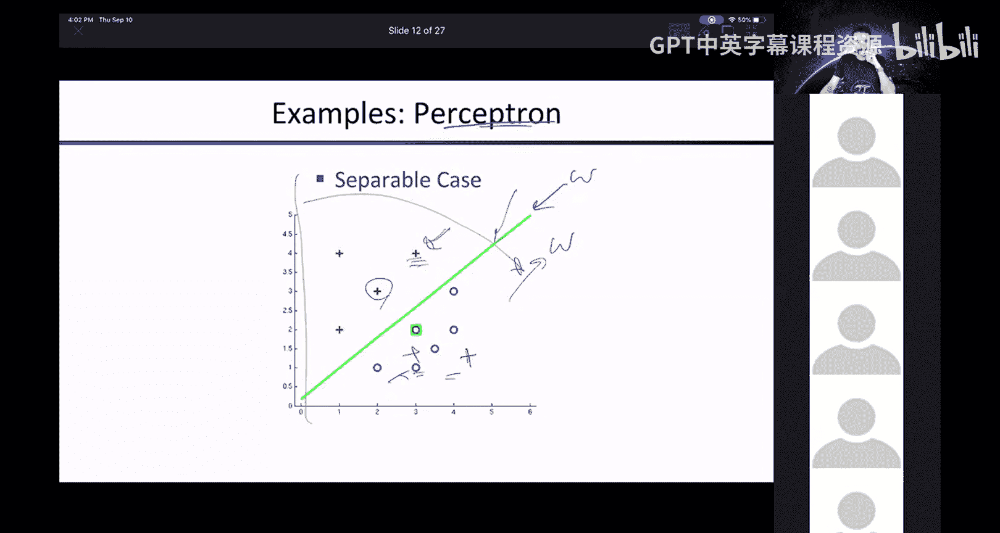

# 1.1：感知机与逻辑回归 🧠

在本节课中，我们将学习机器学习的基础概念，特别是深度学习的基石。我们将从最简单的线性分类器——感知机开始，理解其工作原理和背后的数学原理，并探讨如何通过学习过程来调整模型参数，使其能够正确地对数据进行分类。

---

## 从输入到决策

上一节我们介绍了课程的整体目标。本节中，我们来看看一个分类器的基本工作流程。

一个分类器通常接收一个输入 **X**（例如一封邮件或一张图片），并将其转换成一个**特征向量**。这个特征向量是一个数学上的向量，其中每个位置代表一个特定的特征值。然后，模型基于这个特征向量做出一个**决策**（例如，判断邮件是否为垃圾邮件）。

以下是两个关键过程：
1.  **特征提取**：将原始输入转换为特征向量。在传统机器学习中，特征通常是人工设计的；而在神经网络中，特征是从数据中自动学习得到的。
2.  **决策**：将特征向量通过某种“魔法”映射到一个决策（例如，分类标签）。本课程的重点将放在这个过程上，我们假设特征向量是已知的。

---

## 生物神经元与数学模型的联系

理解了分类流程后，我们来看看其灵感来源。感知机的设计灵感来源于我们大脑中的生物神经元。

一个神经元通过**树突**接收来自其他神经元或感官的输入信号。每个连接有不同的**强度**（或权重）。细胞核（**胞体**）对这些加权输入进行汇总，并决定是否通过**轴突**向其他神经元发送输出信号。

我们可以用数学来模拟这个过程：
*   输入信号表示为特征值 `F`。
*   连接强度表示为权重 `W`。
*   细胞核的汇总计算就是计算加权和，即**激活值** `a`，其公式为：
    **`a = W · F`** （点积运算）

在这个模型中，特征值 `F` 是给定的，我们无法改变。**学习的目标就是找到一组正确的权重 `W`**，使得模型能根据激活值 `a` 做出正确的决策。对于一个二分类器，一个简单的决策规则是：如果 `a > 0`，则预测为正类；如果 `a < 0`，则预测为负类。

---

## 权重向量与决策边界

知道了模型如何决策，我们再来看看权重向量的几何意义。

权重向量 `W` 和特征向量 `F` 都存在于一个高维空间中。`W` 不仅决定了激活值的正负，还定义了一个**决策边界**（一个超平面）。在二维空间中，这个边界就是一条直线。

*   位于决策边界一侧的点会被分类为正类。
*   位于另一侧的点则被分类为负类。

**学习的过程，本质上就是寻找一个能最好地将不同类别的数据点分开的决策边界**。对于线性模型，这个边界是直线（或超平面）；对于更复杂的模型（如神经网络），决策边界可以是非线性的。

---

## 感知机学习算法

那么，如何通过数据来“学习”或调整权重向量 `W` 呢？这就是感知机学习算法的核心。

这是一个迭代更新过程，其核心思想是：**如果模型对当前样本的分类是错误的，就调整权重向量，使其更倾向于做出正确的分类**。

以下是算法的具体步骤：
1.  **初始化**：将权重向量 `W` 初始化为零（或小的随机值）。
2.  **遍历数据**：对于训练数据集中的每一个样本 `(F, y*)`，其中 `F` 是特征向量，`y*` 是真实的标签（例如，+1 或 -1）。
3.  **做出预测**：用当前权重计算激活值并得到模型预测的标签 `y`。规则为：若 `W·F > 0`，则 `y = +1`；否则 `y = -1`。
4.  **比较与更新**：
    *   如果预测正确（`y == y*`），则保持 `W` 不变。
    *   如果预测错误（`y != y*`），则按以下规则更新权重：
        **`W = W + y* · F`**
        这个更新意味着：将权重向量 `W` 朝着（或远离）特征向量 `F` 的方向移动，以修正本次错误。

为了更直观地理解更新过程，我们可以看一个例子。假设真实标签 `y* = -1`，但模型预测 `y = +1`（即 `W·F > 0`）。根据更新公式 `W = W + (-1)·F`，我们实际上是从 `W` 中减去了 `F`。这使得新的 `W` 与当前 `F` 的点积 `(W - F)·F` 会变小，从而更可能在未来对此样本做出负类的正确预测。

这个过程会对所有训练样本重复多轮，直到所有样本都被正确分类，或达到预设的迭代次数。**如果数据是线性可分的，该算法保证能够找到一个解。**

---

## 总结

本节课中我们一起学习了机器学习的基础构件。
*   我们了解了分类器从输入到决策的基本流程，区分了特征提取与决策两个阶段。
*   我们探讨了感知机模型如何受生物神经元启发，并用数学公式 `a = W·F` 描述其核心计算。
*   我们认识了权重向量的几何意义，即它定义了特征空间中的决策边界。
*   最后，我们详细剖析了**感知机学习算法**，理解了它如何通过**错误驱动的权重更新**（`W = W + y* · F`）来从数据中学习。

这为我们接下来学习更复杂的分类器（如多类分类、逻辑回归和神经网络）奠定了坚实的基础。下一节，我们将探讨当类别不止两个时，应如何扩展这些概念。