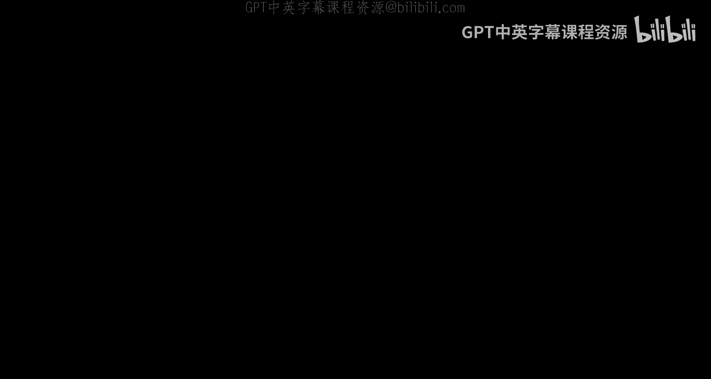
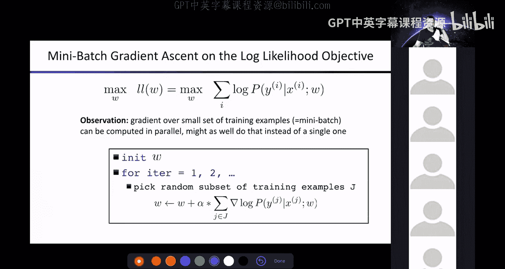

# 4.1：优化与神经网络 🧠

在本节课中，我们将要学习优化的核心概念，特别是如何利用微积分工具来寻找机器学习模型（如逻辑回归）的最佳参数。我们将从简单的线性分类器回顾开始，逐步深入到梯度下降这一关键优化算法。

## 回顾：从分类器到优化问题

上一节我们介绍了简单的线性分类器和逻辑回归模型。本节中我们来看看如何为这些模型找到最佳的权重参数。

我们讨论了二元分类器和多元分类器。对于多元分类，我们使用Softmax函数将激活值转换为概率分布。这为我们提供了一个原则性的方法来评估决策边界的好坏。

我们的核心目标是找到一组权重参数 **w**，使得训练数据的对数似然概率最大化。这定义了一个需要被最大化的函数 **G(w)**。

## 优化挑战：连续空间 vs. 离散空间

在人工智能课程中，我们处理过约束满足问题（CSP）等离散优化，可以使用爬山法等技术。然而，机器学习中的权重参数 **w** 存在于连续空间中，有无穷多种可能的方向和长度。我们无法枚举所有邻近的 **w**，因此需要一种能提供“移动方向”信号的更优方法。

## 梯度下降的直观理解 🧗

想象你身处山中，目标是登上山顶。你无法看清周围，但有一个设备（如GPS）可以告诉你当前位置的海拔。为了找到上山的路，你可以向四周试探性地迈出一小步，测量每一步的海拔变化，然后选择海拔增加最多的方向前进。在数学上，这个“海拔变化率”就是函数的导数。

在一维情况下，权重 **w** 是一个标量。我们从初始值 **w₀** 开始，计算函数 **G** 在 **w₀** 处的导数。导数为正，意味着向右移动会增加函数值；导数为负，则向左移动。我们沿着导数指示的方向，以一定的步长（学习率 α）迭代更新 **w**，直到导数接近零，此时我们到达了一个局部最优点。

**更新公式（一维）**：
`w_new = w_old + α * (dG/dw)`

## 扩展到多维：梯度向量 🧭

当权重 **w** 是多维向量时（例如 **w = [w₁, w₂]**），情况类似，但我们需要决定在每个维度上移动多少。这时我们使用**梯度**（Gradient），它是一个向量，每个分量是函数 **G** 对相应权重分量的偏导数。

**梯度定义**：
`∇G(w) = [ ∂G/∂w₁, ∂G/∂w₂, ..., ∂G/∂w_n ]`

**更新公式（多维）**：
`w_new = w_old + α * ∇G(w_old)`

学习率 α 控制着更新的步幅。如果 α 太大，可能会越过最优点甚至发散；如果 α 太小，收敛速度会非常慢。通常，在远离最优点时可以使用较大的 α，在接近最优点时应减小 α 以精细调整。

## 为什么梯度方向是最速上升方向？📈

我们可能想知道，沿着梯度方向移动是否真的是函数值增加最快的方向。利用一阶泰勒展开，我们可以证明，在给定一个最大步长约束（ε）下，为了使函数值 **G(w+Δ)** 增加最多，移动向量 **Δ** 应该与梯度向量 **∇G(w)** 的方向完全一致。

**数学原理**：
我们希望最大化 `G(w+Δ) ≈ G(w) + ∇G(w)·Δ`，其中 `||Δ|| ≤ ε`。
两个向量的点积在其方向相同时最大。因此，最优的 **Δ** 是 `Δ = ε * (∇G(w) / ||∇G(w)||)`，即沿着梯度方向移动。

这严格证明了梯度方向确实是当前位置函数值上升最快的方向。

## 算法化：梯度上升/下降法 ⚙️

将上述数学原理转化为算法，就得到了梯度上升法（最大化函数）或梯度下降法（最小化函数）。对于我们的对数似然最大化问题，我们使用梯度上升法。

以下是算法的通用步骤：
1.  初始化权重向量 **w**。
2.  循环直到收敛：
    a. 计算当前 **w** 处目标函数 **G(w)** 的梯度 `∇G(w)`。
    b. 按照公式更新权重：`w = w + α * ∇G(w)`。
    c. （可选）根据策略调整学习率 α。
3.  返回最终的权重 **w**。

对于机器学习，我们的目标函数 **G(w)** 就是训练数据的对数似然函数。将这个特定的函数代入上述通用框架，我们就能找到逻辑回归等模型的最佳参数。

## 总结与展望

本节课中我们一起学习了优化的核心思想。我们从离散优化与连续优化的区别讲起，直观地理解了梯度作为“方向指南”的作用，并严格证明了梯度方向是最速上升方向，最后将其形式化为梯度上升/下降算法。

这个算法是通用的，但应用于具体的机器学习模型（如逻辑回归）时，我们还需要考虑一些具体细节，例如如何高效地计算梯度（特别是对于大规模数据），以及如何选择和处理训练样本。这些将是后续课程的重点。

希望你能享受这个周末，我们下次课将继续深入这些细节。请注意安全。