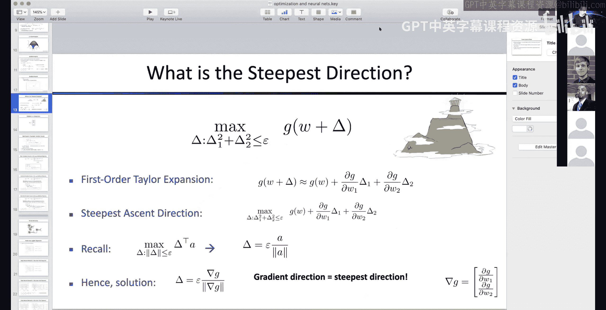
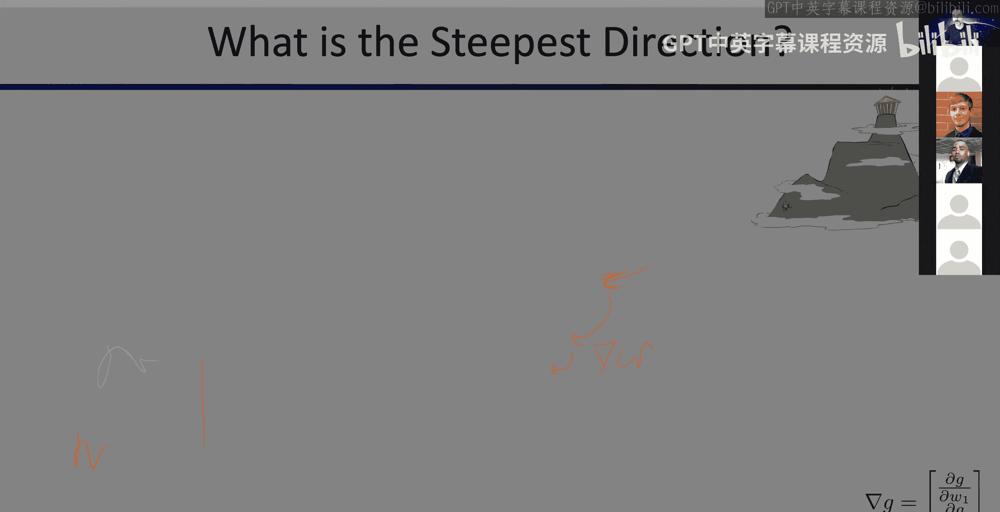

# 4.2：优化与神经网络 🧠

在本节课中，我们将要学习梯度下降/上升优化算法，并了解如何将其从简单的逻辑回归模型扩展到深度神经网络。我们将探讨算法的原理、实现细节以及神经网络的核心概念。

## 梯度上升算法回顾

上一节我们介绍了梯度上升算法。本节中，我们来看看其背后的数学原理。

梯度上升是一种用于寻找函数最优参数的迭代方法。在分类问题中，我们的目标是找到一组权重参数，使得模型能基于训练数据给出良好的分类结果。

该算法从一个随机的权重初始化开始。在权重空间（例如，由W1和W2两个维度构成的空间）中，我们从某点出发，沿着梯度的方向移动。这是一个迭代过程：在每一步，我们计算当前点的梯度，然后根据梯度找到权重空间中的下一个点。我们重复此过程，直到收敛到某个点，我们称之为“最优解”。

## 为什么梯度方向是最优方向？

现在，我们来探讨为什么沿着梯度方向移动是一个合理且最优的选择。

假设我们有一个目标函数 **G(W)**，并且对权重的变化量 **Δ** 有一个约束（例如，其范数固定）。我们希望找到能使 **G** 增加最多的 **Δ**。

根据一阶泰勒展开，函数的变化可以近似为：
**G(W + Δ) ≈ G(W) + Δ₁ * ∂G/∂W₁ + Δ₂ * ∂G/∂W₂**

我们希望最大化这个变化量。在给定 **Δ** 的约束下，最大化内积 **Δ · ∇G(W)** 的方法是让 **Δ** 与梯度 **∇G(W)** 的方向完全一致。因此，梯度方向就是在约束下使函数值增长最快的方向。这从理论上证明了梯度上升（或下降）算法在每一步都选择了正确的移动方向。

对于更高维度（N维）的情况，方法是相同的。梯度是一个N维向量，我们可以遵循相同的迭代过程。

## 梯度上升算法流程

以下是梯度上升算法的标准步骤：

1.  **初始化权重**：随机初始化权重向量 **W**。
2.  **迭代更新**：进入循环，直到满足停止条件。
    *   计算当前权重 **W** 下目标函数 **G(W)** 的梯度 **∇G(W)**。
    *   按照以下规则更新权重：**W_new = W_old + α * ∇G(W_old)**
        *   其中 **α** 是学习率，通常是一个很小的正数。

学习率 **α** 的选择很重要。它可以是一个固定值，也可以在训练过程中动态调整。通常，随着我们接近最优解，学习率会逐渐减小，以防止在最优值附近震荡。一个经验法则是，学习率的大小大约为目标函数值的1%。

在分类问题中，我们的目标函数 **G(W)** 是给定输入和权重时，标签的对数似然。我们希望最大化整个训练集 **D** 上的对数似然总和：
**∑ log P(Y_i | X_i, W)**

使用对数似然主要是为了数学上的便利，它能使梯度计算和优化过程更简单。

## 随机梯度上升

在实际应用中，训练集可能非常庞大。逐样本计算整个数据集的梯度计算量很大。

随机梯度上升是标准梯度上升的一个变体。其核心思想是：在每次迭代中，我们不使用全部训练样本来计算精确梯度，而是随机选取一小批（Mini-batch）样本，用它们来估计梯度。这个估计是有噪声的，但它仍然提供了有用的更新方向。

更新过程如下：
1.  从初始权重 **W0** 开始。
2.  随机选择一批样本，用这批样本计算对数似然的梯度（这是一个对真实梯度的噪声估计）。
3.  根据这个噪声梯度估计更新权重，得到 **W1**。
4.  重复步骤2和3，每次选择不同的随机批次。

批次大小的选择是一个权衡：
*   **大批次**：梯度估计更准确，但每次迭代计算更慢，需要更多计算资源。
*   **小批次**：梯度估计噪声大，但每次迭代计算更快。

批次大小可以根据可用的计算资源（如GPU核心数）进行调整，范围可以从1（随机梯度下降）到整个训练集大小（批量梯度下降）。

## 从逻辑回归到神经网络

我们已经学会了如何优化多类逻辑回归模型。现在，我们将其扩展到神经网络。

逻辑回归的核心在于：我们有一组给定的特征向量，通过权重计算激活值 **Z**，再通过Softmax函数将其转换为类别概率分布。学习过程就是寻找能最大化训练数据似然的权重。

**Z = W · X** （点积）
**P(Y=k | X, W) = softmax(Z)_k**

在传统机器学习中，特征 **X** 需要人工设计或通过编写程序从原始数据（如图像像素）中提取。这需要领域知识。

神经网络的突破性思想是：**我们能否也自动学习这些特征表示？** 答案是肯定的。

神经网络可以看作是逻辑回归的堆叠和扩展。我们不再使用手工设计的特征，而是构建多个“层”，每一层都执行类似逻辑回归的变换，但其输入是前一层的输出。

## 神经网络的前向传播

在一个神经网络层中，计算第 **k** 层第 **i** 个神经元的激活值 **Z_i^(k)** 的公式如下：

**Z_i^(k) = g( ∑_j W_ij^(k) * a_j^(k-1) )**

其中：
*   **a_j^(k-1)** 是前一层的第 **j** 个神经元的激活值（对于第一层，就是输入 **X**）。
*   **W_ij^(k)** 是连接前一层的神经元 **j** 到当前层神经元 **i** 的权重。
*   **g(·)** 是一个非线性激活函数。
*   求和后，结果通过激活函数 **g** 产生当前神经元的激活值。

每一层都有不同数量的神经元（节点）。权重的大小决定了连接的重要性。

## 非线性激活函数的重要性

非线性激活函数 **g(·)** 至关重要。如果没有它，整个网络的变换将保持线性组合。无论堆叠多少层，最终效果都等价于一个单层线性模型。如果数据不是线性可分的，这样的模型将无法正确分类。

常用的非线性激活函数包括：
*   **Sigmoid**: **g(z) = 1 / (1 + e^{-z})**，将输出压缩到(0,1)之间。
*   **Hyperbolic Tangent (tanh)**: **g(z) = tanh(z)**，将输出压缩到(-1,1)之间，以0为中心。
*   **ReLU (Rectified Linear Unit)**: **g(z) = max(0, z)**，这是最常用的激活函数之一。

ReLU之所以流行，是因为其计算非常简单（无需指数运算），且能缓解深度网络中的“梯度消失”问题。其梯度计算也很简单：输入为正时梯度为1，为负时梯度为0。激活函数的选择没有绝对规则，通常基于实验（试错）和具体任务来决定。

## 神经网络的万能近似定理

一个重要的理论保证是**万能近似定理**。该定理指出，一个至少包含一个隐藏层的前馈神经网络，只要隐藏层拥有足够多的神经元，就可以以任意精度近似任何连续函数。

需要注意的是，这个定理只证明了“存在性”，并没有告诉我们具体需要多少个神经元，也没有提供找到这个网络的方法。因此，它在实践中更多是一个理论安慰。

## 实践与模型选择

理解理论后，实践中的模型设计（如层数、每层神经元数、激活函数选择）至关重要。这通常是一个探索过程：
1.  **从简单开始**：尝试一个浅层网络。
2.  **增加复杂度**：如果欠拟合，增加层数或神经元数。
3.  **调整激活函数**：ReLU通常是默认选择，但可以尝试Sigmoid或tanh。
4.  **正则化**：使用如Dropout、L2正则化来防止过拟合。
5.  **批次大小与学习率**：调整这些超参数以稳定和加速训练。

这个过程本身可以被自动化，即“神经架构搜索”，这是一个活跃的研究领域。

## 总结

本节课中我们一起学习了：
1.  **梯度上升/下降算法**的原理及其数学证明，理解了为什么梯度方向是最速上升方向。
2.  **随机梯度上升**的动机与实现，它通过使用小批次样本来平衡计算效率和梯度估计精度。
3.  如何将**多类逻辑回归**自然地扩展到**神经网络**。关键区别在于神经网络能够自动学习特征表示，而无需人工设计。
4.  神经网络的**前向传播**计算方式，以及**非线性激活函数**的核心作用。
5.  神经网络强大的理论保证——**万能近似定理**，以及实践中通过试错和调整超参数来设计有效模型的流程。

通过结合优化算法和灵活的模型结构，神经网络为我们提供了构建强大机器学习系统的基石。