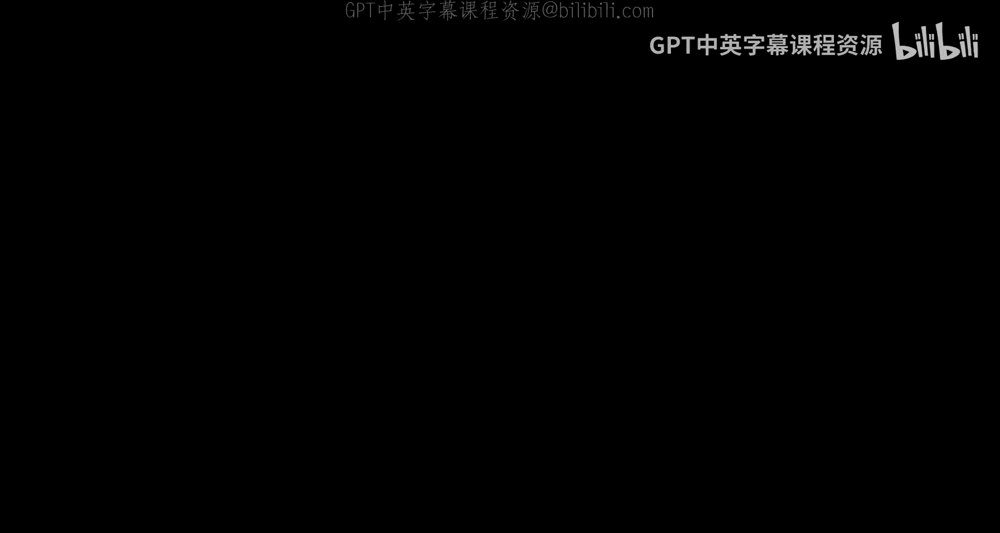
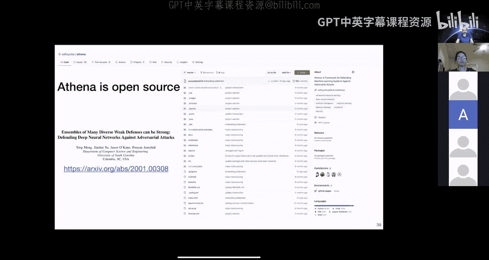
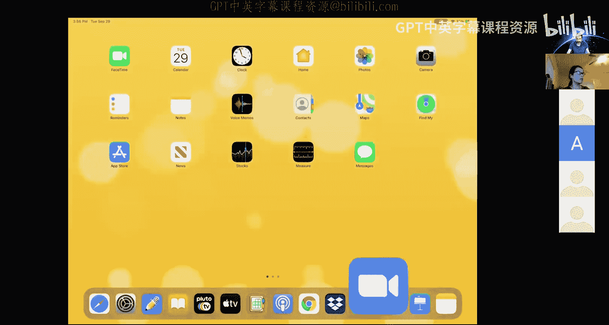
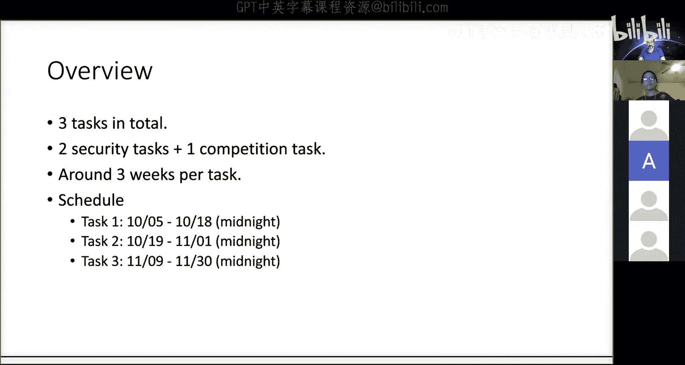

# 5.2：Athena 集成防御框架概述与项目介绍

在本节课中，我们将学习一个名为 Athena 的对抗性机器学习防御框架。该框架的核心思想是，将许多**多样化**的**弱防御**集成起来，可以形成一个强大的防御系统。我们将了解其工作原理、评估结果，并详细介绍本课程的项目安排。

---

## 项目周介绍与安排

大家好。本周我们将重点转向项目介绍。本周是项目周。

计划是首先为大家提供一个高层次的项目描述。虽然大家已经通过提前分享的论文了解了更多细节，但我和Yin撰写了一份项目描述，并已分享在GitHub上。我们计划首先带大家浏览项目概述，请务必提出问题，因为充分理解方法和细节非常重要。

此外，计划在周四由Yin带领大家了解一些代码和框架的实现细节，以便大家更好地理解如何开始和着手这个项目。

在开始之前，大家有任何问题吗？希望我的声音清晰。好的，没有问题。我确实有一个问题，我还没有看到任务的截止日期，不知道是还没有确定吗？这是一个很好的问题。Yin将在今天或周四与大家分享截止日期。是的，我将在今天演示后分享每个任务的截止日期。

还有其他问题吗？好的，我们开始。

---

## Athena：基于多样化弱防御集成的强大防御

今天，我很高兴介绍我们在Athena上的工作，这是一个由许多**多样化**的**弱防御**组成的集成防御框架。其中，**多样性**和**多个弱防御**是这个防御框架构建的两个最重要方面。

这项工作是多位优秀研究者合作的成果，由我的学生Yin（也是本课程的助教）主导，Jianhai也为此项目提供了大量帮助。我们最初与Jason合作启动了这个项目，最近Forrest等人也加入了这项努力。我也在其中扮演了非常积极的角色。

几周前，我在Google做了这个报告，因此我将使用相同的幻灯片。

---

### 对抗性示例与安全背景

这部分内容涉及机器学习的安全性。具体来说，是关于深度学习的对抗性安全，但广义上，对抗性机器学习这一主题不仅限于深度学习系统，而是适用于任何机器学习系统。由于许多深度学习系统已部署在现实场景中，展示它们可能被攻击和防御的事实使其变得更加具体和有趣，因此我们将讨论的场景主要围绕深度学习。

我们讨论过对抗性示例。我不会在此花费太多时间，但为了让大家再次理解，我们讨论过，通常当我们谈论对抗性示例时，我们有一个特定的输入（例如图像，但不限于图像）。然后，我们基于两个方面生成一些扰动：首先是输入本身，其次是输入的正确标签以及从模型中获取的信息（主要是损失函数的梯度）。

直观地说，这种优化沿着某个方向移动，如果有人添加了小的扰动，就可以改变模型做出的决策，从而欺骗它。直观地，我们讨论分类器。你已经对分类器和决策边界有了一些直觉。具体来说，在线性分类器中，我们有一些样本。基于这些样本，你构建了一个决策边界。这里发生的是，你有一个这样的样本，为了欺骗模型，你想添加一些扰动，以改变决策边界，从而将该样本分类为负例。技巧是通过移动样本来越过决策边界以欺骗模型。

人们已经证明，即使通过翻转一定角度，也可以欺骗模型。还有人尝试使用3D打印机来证明这不必是数字图像，也可以是物理物体。例如，你可以打印出这个扰动，使其在右侧被识别。还有一些其他出色的工作表明，你也可以3D打印这些物品，以进行识别或欺骗语音识别系统。对于强化学习和自然语言处理也是如此，这是相同的思想。

这可能非常重要，因为如果我们在实践中部署这样的系统，比如自动驾驶汽车，如果有人能欺骗这些模型，那将非常危险。

---

### 对抗性示例的来源与形式化

我们现在讨论这些对抗性示例来源的一些直觉。基本上，这是你已经掌握的关于分类器和机器学习模型的基础知识。

通常，我们从一些数据D开始，其中一些数据可能属于不同的类别。例如，我们有三个类别的样本：橙子、棕榈树和黑猩猩。然后我们有一个模型（例如神经网络），你知道这些神经网络由一些权重值参数化。这些是模型的参数。

训练模型后，你可以选择一个输入样本及其真实标签。我们尝试模型的一个版本（用参数θ1表示），看看得到什么。这个版本的模型将样本分类为“enre”，这显然是错误的。我们可能想重新训练模型或添加更多样本，然后尝试不同的模型，看看预测是否被纠正。在这个例子中，是的，它将样本分类为橙子。这意味着这个模型足够好。

更抽象地说，整体方法是找到一些最优参数θ*，以最小化期望损失L。这个损失是模型相对于来自特定分布D的样本的期望误差。我们需要插入这些最优参数来计算损失。这本质上是一个搜索问题，我们需要找到最优参数，以最小化来自该分布的所有样本的期望损失。

更具体地说，尽管训练的目的是找到最小化损失的参数（我们已经广泛讨论过梯度下降算法可以为我们找到这些参数），但另一方面，你可以将其视为一场博弈，其中对手的目标完全相反。对手试图找到一些小的扰动，在另一方面最大化损失。这是对手的关键目标。你可以将其视为一种博弈情境，双方有不同的目标。

大家对此有任何问题吗？我假设这些内容大家应该已经很熟悉了。这就是为什么我们特意为大家建立这些基础，以便大家此时能够进行项目。

---

### Athena框架的核心思想：输入变换

我将具体讨论Athena，也就是你们要做的这个框架。它基于**输入变换**的直觉，即我们想以某种方式对输入样本进行一些更改。

为了让大家理解它为何有效，使用输入变换作为防御机制的想法在这项工作之前就已经存在。关键思想是：假设对手找到了一些小的扰动，可以改变这个输入。你可以看到添加了一些噪声。这些扰动可以欺骗这个模型，使其以一定的置信度将样本分类为“9”。之前，模型以相对较高的置信度认为输入是“7”，现在模型认为它是“9”，但置信度一般。

这种变换的作用是改变输入中的噪声。需要讨论的是，这些扰动不是随机的。相反，它们来自一个特定的优化公式，旨在最大化损失。因此，这不是随机的扰动，随机扰动无效。这些是非常精心设计的扰动。在这种旋转情况下，这种变换基本上打乱了这些噪声。因此，我们预计这些噪声（扰动）不会像以前那样有效。这就是为什么在大多数情况下，像这样的变换（具体来说是几何变换，如旋转）可以改变分类器的决策，使其现在以相对中等的置信度认为它是“7”。

这就是变换最初起作用的关键思想。人们之前已经展示过这一点。但这项工作的关键见解在于许多变换或许多弱防御的**互补性**方面。

在这里，你可以看到不同的对抗性攻击（不同的名称）。在每一行，你可以看到不同的变换，例如压缩、去噪、滤波、几何变换、形态学变换等。让我们看看我们得到了什么。这是对正在发生的事情的一些经验性理解。

如果你注意到某些变换，比如压缩，能够相当正确地恢复标签。你可以看到，这些攻击能够在所有情况下欺骗这个模型。在这个FGSM案例中，模型认为它是9,9,9,8,9,2,9,9,9。在所有情况下，未防御的模型都被欺骗了。但在这里，压缩能够在除“单像素”攻击生成的那些样本之外的所有情况下恢复真实标签。

但其他一些变换，比如几何变换，效果就不那么有效。它能够恢复一些，但对其他一些攻击无效。如果你看这里，我们有一些不同的变换。有趣的部分是，例如，在这种情况下，“去噪”能够相对较好地恢复，特别是能够恢复这个“单像素”攻击生成的样本，而压缩无法恢复。所以你可以看到，一些变换是互补的。

基于此，我们已经看到防御的有效性因攻击而异，并且它们有相互补充的趋势。你可以按列查看。基于这种直觉，大约两年前项目开始时，我们想，也许如果我们把一些这样的变换放在一起，创建一个弱防御的集成（在这种情况下是相同的变换，但我们基于变换训练模型，稍后我会描述如何做），那么这可能是一个强大的防御，因为我们没有假设任何关于攻击的特定信息。

我们没有基于对攻击的预先假设来构建这个防御。当我们希望在现实世界中部署这种防御时，这一点很重要，因为在网络安全中，如果我们考虑某些假设，这通常无法泛化，总有一天会出现一种与以往攻击行为完全不同的新攻击，这可能会改变一切。

---

### 数量、质量与多样性的重要性

这是关于见解，但更具体地说，我们研究了弱防御的数量和质量。在这张图中，你可以看到我们增加了弱防御的数量。在特定轴上，每个点显示了防御模型的测试准确率。蓝线显示了我们在最坏情况下选择这些弱防御的情况（即我们以非常糟糕的方式选择它们，选择了最差的）。这是最佳情况，我们非常仔细地选择了它们。这是随机情况，我们基本上从池中随机选择。

我们观察到，确实，随着良好防御数量的增加，无论怎样，测试准确率都会提高，即使在最坏情况下也是如此。但质量也很重要。你可以看到最坏情况和最佳情况之间存在相当大的差距。因此，弱防御的质量和数量都很重要。

最重要的是，**多样性**是超级重要的。在这种情况下，我们衡量了来自特定攻击（如“单像素”攻击）的防御的错误率，并将其与两种不同的防御进行比较：一种是基线防御PGD-ADT（这是文献中最好的防御之一，基于对抗训练，已被证明非常有效）；另一种是Athena的某个版本，但在这个版本中，为了比较多样性的重要性，我们选择了一个同质的集成模型（即由相同变换的变体组成的集成）。我们看到多样性很重要。多样性的集成样本的错误率远低于同质集成以及最先进的基线防御。随着弱防御数量的增加，这个差距也趋于增大。

大家对此有任何问题吗？因为这很重要。我已经展示了数量、质量以及多样性对于构建这种对抗性防御的重要性。

---

### Athena的架构：弱防御与集成策略

让我们稍微讨论一下架构，特别是我们所说的“弱防御”是什么意思。弱防御只是我们在变换输入上训练的模型的名称。

其工作方式是：我们有一些测试样本。我们使用变换，例如翻转。我们翻转训练集中的所有样本，然后将其输入分类器（可以是神经网络，但不一定是，可以是任何分类器）。然后你构建一个能够分类翻转图像的分类器。对几何变换等其他变换也是如此。你基于变换后的图像构建不同的分类器。

关键原因是，有人可能会问，为什么不使用原始模型？你可以使用，但通常当你翻转或对输入样本进行一些更改时，如果你尝试用原始模型对样本进行分类，也许即使这种变换也可能欺骗模型，这不是我们想要做的。我们不想欺骗自己，我们想要一种能够阻止对抗性示例的机制。

这是设计时的情况。现在这是在部署时防御的工作方式。请确保充分理解这一点，因为它非常重要。在部署时，我们使用几个这样的弱防御，这就是我们所说的**集成**。我们将几个弱防御放在一起。一旦有输入进入这个防御，会发生的是：它在内部被不同的弱防御进行不同的变换。然后每个变换生成一些标签。正如我们预期的那样，其中一些可能不会产生正确的标签，这实际上是预期的。然后我们有一个集成策略来决定最终标签。

集成策略可以是多数投票，即在这种情况下哪个标签占多数。你可以想出其他集成策略。如果你了解集成机器学习，你可以考虑许多不同类型。在我们的框架中，我们已经实现了一些。例如，对从每个模型获得的概率分布进行平均。如果这些是神经网络，每个都会在softmax之后产生一个概率分布。每个都给你一些概率分布。你通过最大化这个概率分布来获得标签。我们就是这样做的。然后，你可以平均所有这些概率，产生一个最终的概率分布，然后基于这个最终的概率分布决定标签，这可能与多数投票不同。或者你可能想在输入到softmax之前获取激活值，并对这些激活值取平均。这是另一种集成策略。或者你可以使用内部层而不是最后一层，也许你想选择内部层来决定，或者随机选择层。每种都可能是潜在的集成策略。你甚至可以基于过去的行为学习集成策略。所有这些都有可能。

在这个项目中，我们非常期待大家能想出一些有趣甚至扩展这些集成策略的方法。如果你能想出来，你可以获得加分。

---

### 评估与威胁模型

一些评估结果。理解这一点很重要。在网络安全研究或任何评估中，你基本上需要考虑一个特定的场景。这非常重要。这些场景被称为**威胁模型**。

威胁模型是指我们需要考虑对手对模型了解多少的情况。对手对模型内部、防御以及几乎任何事情的了解程度，以及在这种设置下的灵活性。

为了清楚起见，我们在四种不同的假设或威胁模型下进行了评估，在项目中我们也需要做同样的事情。

*   **零知识**：对手不知道有任何防御措施，不知道弱防御或集成策略，但肯定知道模型的参数。
*   **黑盒攻击**：对手知道存在防御，但不知道分类器的内部结构或防御的任何内部信息，只知道有防御存在。
*   **灰盒**：攻击者几乎知道一切，只是不知道集成策略。
*   **白盒**：知道一切。

这就是我们讨论的假设类型。

一些结果。我们使用FGSM作为攻击之一，使用特定类型的神经网络架构ResNet，数据是CIFAR-10。在这种情况下，如果对手知道关于这个ResNet模型的一切，你可以看到一些错误率结果。这里展示了具有不同集成策略的Athena实例化结果：多数投票、前两名多数投票、输出平均和随机防御。Yin会解释，例如，前两名多数投票是指当我们选择前两个标签并基于此决定时；输出平均是指我们对概率分布或逻辑值（logits）取平均。逻辑值基本上是softmax之前的层激活值。技术上，我们可以对任何激活层的任何输出取平均。你知道，当我们谈论神经网络时，每一层都有一些与层k相关的Z向量。如果你想，你可以使用这些向量中的任何一个。但越接近神经网络末端，可能包含的信息越多，更有意义。对于这些结果，我们使用了逻辑值，即通过softmax之前的层激活值。

基线我们已经知道PGD-ADT（对抗训练）和随机平滑是一种经过认证的防御，也是一种强大的防御。经过认证的防御是指那种你有保证的防御，即无论对手做什么，都无法使防御的错误率超过某个阈值。所以你有一些关于它的认证。

结果还显示，无论扰动类型如何，这种经过认证的防御的有效性将保持不变。结果和这条粉线显示了未防御模型的性能。例如，在这种情况下，你可以看到，对于这个扰动（这是攻击者的参数，表示攻击者有多强大），未防御模型的错误率相当高，大约80%。这些防御的错误率也不那么令人印象深刻。但这是我们防御的错误率，你可以看到大多数这些集成策略表现得相当好，甚至与这些最先进的防御机制相比也是如此。这要归功于多样性和这些变换的质量。

我们在不同类型的零知识攻击中也观察到了类似的情况，结果相似，不想深入细节。

---

### 黑盒攻击场景

让我们继续讨论黑盒场景威胁模型。再次澄清，黑盒只知道模型的存在，但对目标模型一无所知。

我们尝试了两种不同的黑盒攻击。第一种是基于可转移性的方法。在这种情况下，对手显然可以近似你的模型。它可以创建一个替代模型来模拟实际模型。这很容易。你可以开始训练一个新模型，给你不知道的模型一些输入，获得一些输出，使用这些输入输出来训练一个新模型（新架构、新内部结构等），然后这个新模型将是一个子模型。然后你可以使用这个子模型，用你之前知道的相同方法（如FGSM）发起对抗性示例，然后希望这些对抗性示例能够转移到实际模型上。“转移”意味着它们可以欺骗目标模型。清楚了吗？

所以，基本上使用一些样本来构建一个模型来模拟这个目标模型。为了真正创建对抗性示例，你需要一个模型，因为你需要计算损失函数。希望您为此模型创建的对抗性示例也能转移回这里。这就是它的工作方式。

这里有一些结果。在Y轴上，你可以看到一些可转移率。在X轴上，你可以看到不同的预算。预算表示对手使用了多少样本来创建你的模型。1K意味着使用1000个样本输入到实际模型，获取输出，并使用相同的样本来构建模拟模型。

有趣的结果是，与未使用Athena的模型相比，当我们使用Athena时，我们能够降低可转移率，这意味着防御降低了对手基于模拟模型生成的示例的可转移性。这是我们想要达到的目标，也是我们从Athena中得到的结果。每个点显示了不同ε值的不同场景。这是针对BIM攻击的，但我们在不同攻击的研究中也看到了相同的情况。

除了这种基于可转移性的场景，我们还测试了一些基于优化的黑盒攻击，特别是“HopSkipJump”，这是2020年出现的一种非常新的攻击。我们再次使用ResNet和CIFAR-10进行了测试，不同的预算水平。这是对抗性示例与原始示例之间的距离。

你可以看到，当我们部署Athena来防御模型时，HopSkipJump需要扰动示例更多才能欺骗模型。这对对手来说很糟糕。看看这个例子，对手能够用这个例子欺骗模型。但是，在Athena部署的情况下，对手需要用这个例子欺骗模型。看看这个，任何人都能看到这是一张失真的图像，这不是真实的。这里有更多的例子。所以基本上，这意味着为了欺骗模型，对手需要扰动更多，这很糟糕，因为任何检测机制都可以识别出来自对手的输入。这不是对手想要的。

对此有任何问题吗？

---

### 白盒攻击场景与扩展性

让我们继续讨论白盒场景。这基本上是攻击者几乎了解模型和防御的一切的情况。显然，在这种情况下，任何防御都没有机会，因为攻击者几乎知道一切。因此，我们预计即使是防御模型也会出现高错误率，这正是我们得到的结果。

这是Athena的性能，意味着错误率随着最大归一化相似度的增加而增加。这是扰动图像和正常图像之间的差异，在所有示例上取平均。你可以看到，随着这个值的增加，防御模型的错误率也随之增加。所以错误率相当高，这是我们预期看到的。

但当我们看例子时，我提到这并不容易。例如，我们做的一个测试是使用检测机制。你可以看到，在这里，随着对手强度的增加，准确率会大幅下降。但我们训练了一个检测机制，并能够在甚至输入到系统之前，就将这些示例标记为对抗性示例。从例子中可以明显看出，这些显然来自对抗性攻击。因此，通过后检测和防御机制的混合，我们能够构建一个相对较好的防御机制，在不同对手强度下保持准确率。

除此之外，它还带来了一些成本。生成一个示例所需的时间随着强度的增加而增加。这意味着，如果它想生成大量示例，需要很长时间。当我们谈论实时场景时，对手没有足够的时间实时欺骗系统，所以时间很重要，因为对手没有太多时间生成这些示例，在短时间内不可能在某些场景下生成。

此外，Athena再次回到我们没有对攻击者做任何假设的情况。它也很通用，意味着我们可以改变讨论的ResNet架构。但我们可以改变架构类型。分类器类型可以改为SVM或随机森林，我们能够在某种程度上得到类似的结果，但有一些细微差别。例如，我们将架构更改为带有FGSM的ResNet和CIFAR-10数据集。再次，不同的集成策略。顺便说一下，每个点代表其中一个弱防御的性能。结果或多或少相似，程度不同。

对于不同类型的攻击，我们也尝试了SVM模型。对于SVM，在某些情况下，未防御模型和防御模型之间的差异很小，所以基本上在某些场景下，它没有像以前那样显示出好处，但仍然比未防御模型好一点。这表明它在不同类型的分类器中具有相当的通用性，并不非常特定于深度神经网络，可以扩展到其他类型的分类。

---

### 成本与总结

另外，显然它带来了成本