# 5.3：Athena框架演示与课程项目概述 🎯

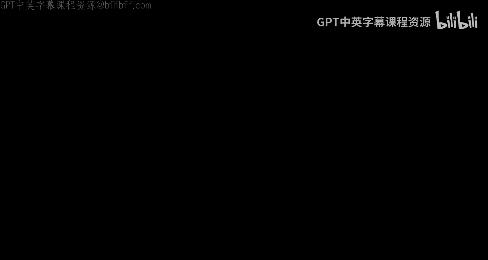

在本节课中，我们将一起学习USC《机器学习系统》课程中关于Athena框架的演示，并详细了解课程项目的具体要求。我们将从项目概述开始，逐步深入到任务细节、代码结构以及如何开始你的项目。

## 项目概述与要求 📋

首先，我们来了解项目的整体框架和基本要求。本项目围绕对抗性机器学习展开，你将有机会深入探索攻击与防御策略。

### 项目核心要求

以下是项目的基本要求，请务必仔细阅读。

*   **任务结构**：项目分为三个主要任务。任务一和任务二各有三周时间完成，任务三为交叉评估与分析。
*   **额外加分**：对于任务一和任务二，任何Athena框架未实现的新方法，只要被成功实施并分析，都可以获得额外加分。
*   **报告撰写**：报告需要以科学的方式进行撰写。对于你实施的新方法，需要进行简明扼要的介绍，说明其工作原理，并附上核心公式或伪代码。
*   **结果对比**：你需要将你的方法（无论是攻击还是防御）与课程提供的基线进行对比。基线包括我们生成的对抗样本、Athena的原始版本以及PGD训练模型。

**重要提示**：我们更关注你从结果中获得的**洞察**，而非结果本身的好坏。即使你的方法效果不佳，只要你能深入分析原因，并提出有见地的解释，同样可以获得高分。

## 任务二：深入探索与选项详解 🛠️

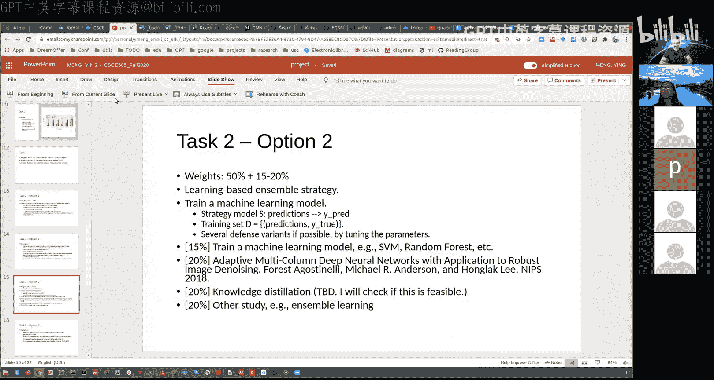

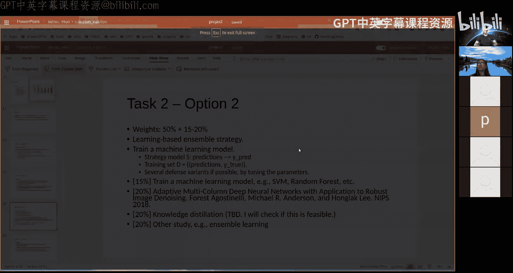

上一节我们介绍了项目的整体要求，本节中我们来看看任务二的具体选项。任务二提供了四个不同的方向，每个小组需要选择其中一个并在Piazza上声明。

### 任务二选项列表

以下是任务二的四个选项及其简要说明。

*   **选项一：白盒攻击者任务**：在此选项中，你需要在白盒威胁模型下生成对抗样本。攻击者知晓Athena框架的一切细节，包括所有弱防御和集成策略。你可以使用我们提供的两种基于优化的攻击方法，也可以尝试新的攻击方法以获得加分。
*   **选项二：基于学习的集成策略**：当前Athena使用固定的集成策略（如多数投票）。此选项要求你训练一个机器学习模型，该模型以弱防御的输出作为输入，并生成最终的预测标签。这是一个更具创造性的挑战。
*   **选项三：概率化Athena**：当前Athena的弱防御是确定的CNN模型。此选项要求你尝试构建概率化的分类器（例如贝叶斯神经网络）作为弱防御，然后构建集成模型。
*   **选项四：混合集成**：当前Athena仅使用CNN模型构建集成。此选项我们将提供SVM和CNN模型。你需要设计策略从一个大的模型池中选择一个子集来构建集成防御。

### 关于“基于学习的集成策略”的进一步说明

这个选项可能有些抽象，让我们进一步解释其目标。在Athena中，集成策略是固定的。我们希望通过监督学习，从训练数据中学习出一个更好的集成策略。

**核心思想**：每个弱防御都会输出一个概率分布。集成器的目标就是利用这N个概率分布信息，生成一个最终的输出概率分布。在抽象层面上，这可以看作是一个**加权平均**问题。学习型集成策略的任务就是：`学习最优的权重向量 w = [w1, w2, ..., wn]`，使得加权后的概率分布能做出最佳决策。

你可以查阅集成学习（Ensemble Learning）的相关文献，寻找灵感。首先，你需要确定如何形式化这个学习问题，然后选择一种现有的集成方法进行尝试和应用。无论结果好坏，只要过程清晰、分析深入，都值得在报告中详细阐述。

## 评估、实验与代码框架 💻

在明确了任务选项后，我们需要了解如何评估我们的方法，以及项目提供的代码框架如何帮助我们快速上手。

### 评估要求

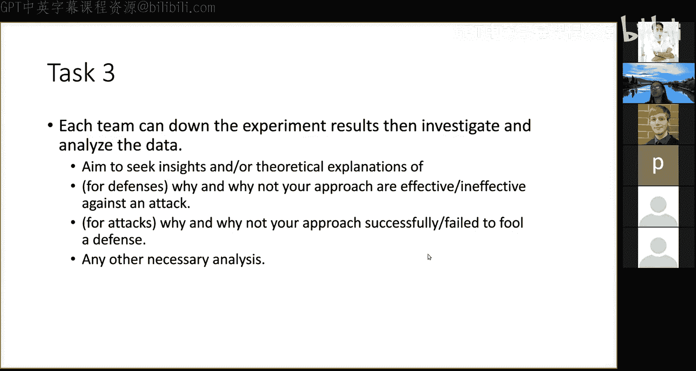

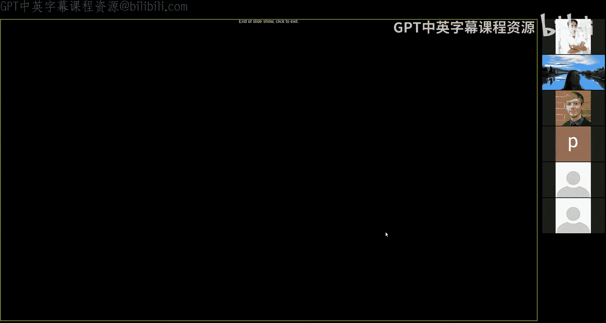

对于你构建的任何防御或生成的对抗样本，我们期望你创建多个变体进行评估。

*   **对于防御**：例如，你可以改变集成防御中弱防御的数量（如3个、10个），观察集成规模对防御效果的影响。
*   **对比基线**：你需要使用生成的对抗样本和提供的基线对抗样本来评估你的防御方法，并与两个基线模型（原始模型、PGD训练模型）进行对比。
*   **数据集说明**：项目主要基于MNIST数据集。虽然鼓励在CIFAR-10上尝试，但请注意其更大的计算开销。如果使用CIFAR-10的子集，请确保采样均衡，避免引入偏差。

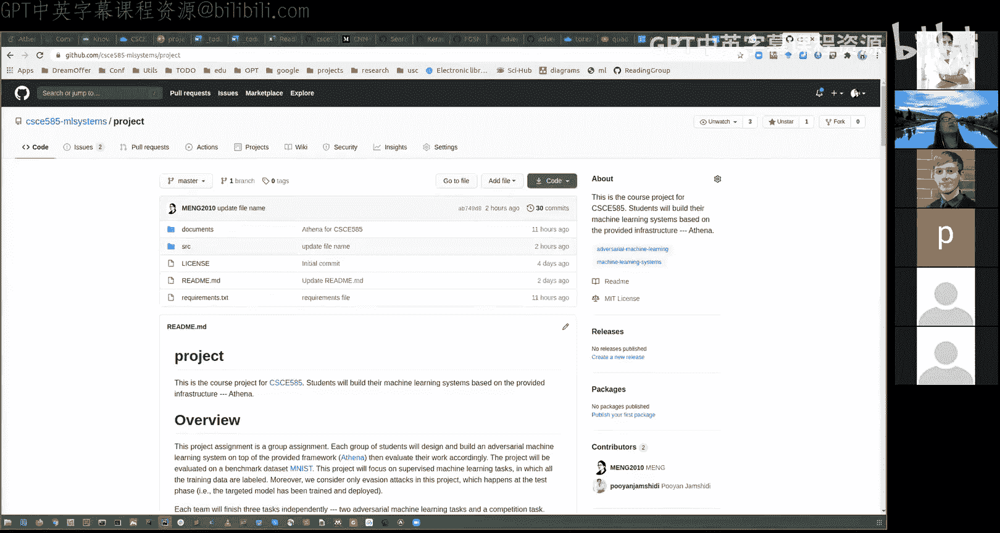

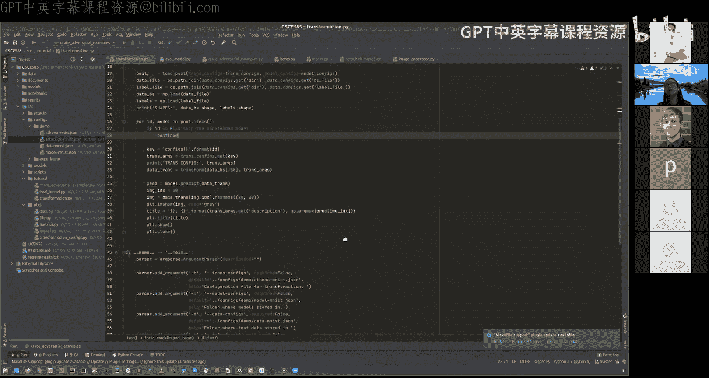

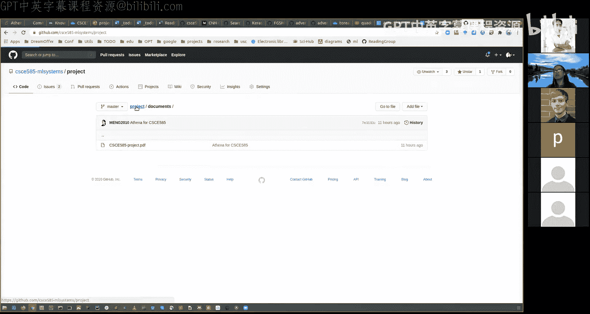

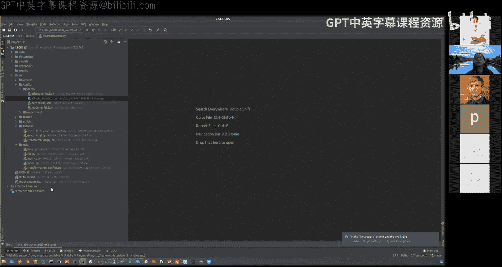

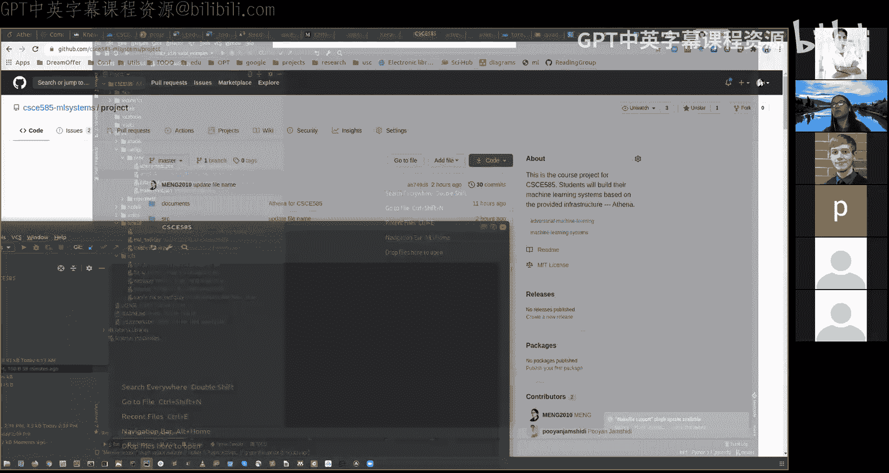

### 代码框架导览

项目代码已发布在GitHub仓库中。整个框架基于PyTorch构建。以下是核心目录和模块的简要介绍。

*   **`utils/`**：工具函数目录，包含数据加载、结果保存（JSON/CSV）和错误率计算等实用功能。
*   **`models/`**：模型定义目录，这是最重要的部分。
    *   `weak_defense.py`：定义了弱防御的包装类，可以将TensorFlow/Keras或PyTorch模型包装成Athena可用的弱防御。
    *   `athena.py`：定义了集成模型（`Ensemble`类）。构建集成时需要提供一个弱防御列表和集成策略。
*   **`attacks/`**：攻击方法目录，实现了如FGSM等攻击算法。主要入口是`generate`函数。
*   **`config/`**：配置文件目录，以JSON格式定义了Athena的弱防御配置、数据路径和模型路径。
*   **`scripts/`**：实验脚本目录，你可以在这里编写训练、攻击生成等实验代码。

### 快速开始示例

以下是如何使用该框架进行关键操作的核心代码片段。

**1. 加载弱防御池并构建集成：**
```python
# 加载配置
config = load_from_json(‘config/athena-mnist.json‘)
# 加载弱防御池
pool = load_pool(config)
# 第一个是未防御的原始模型，将其取出
undefended_model = pool.pop(0)
# 用剩余的弱防御构建集成，使用“平均概率”策略
ensemble_model = Ensemble(classifiers=pool, strategy=‘avg_prob‘)
```

**2. 生成对抗样本：**
```python
# 定义攻击配置（例如FGSM）
attack_config = {‘type‘: ‘FGSM‘, ‘eps‘: 0.3}
# 在零知识威胁模型下攻击原始模型
ae_zero_knowledge = generate(model=undefended_model, data_loader=test_loader, attack_args=attack_config)
# 在白盒威胁模型下攻击集成模型
ae_white_box = generate(model=ensemble_model, data_loader=test_loader, attack_args=attack_config)
```
如你所见，通过更换`generate`函数中的目标模型，你可以轻松地在不同威胁模型下生成对抗样本，这对应了任务一和任务二（选项一）的核心工作。

## 任务三、协作与总结 📝

最后，我们来了解项目收尾阶段的任务以及团队协作的注意事项。

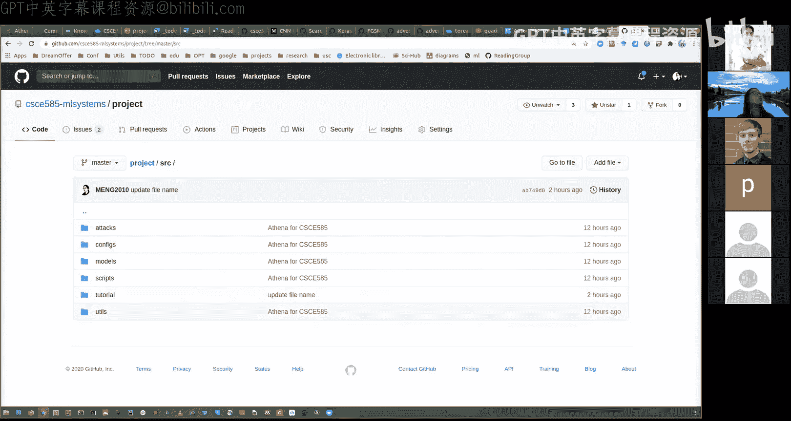

### 任务三：交叉评估与分析

任务三将在所有小组提交任务一和任务二的结果后开始。助教将运行一个交叉评估脚本，评估所有小组生成的对抗样本（AEs）和防御模型。评估结果将公开发布。

你的任务是基于这些交叉评估的结果进行深入分析。例如，尝试解释为什么某个小组生成的对抗样本能够成功欺骗另一个小组构建的防御。这部分主要是分析和报告撰写工作。

### 团队协作与提交

请使用GitHub进行团队协作和代码管理。

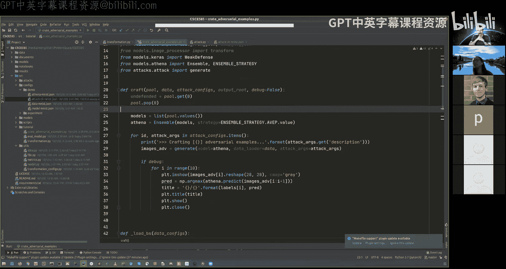

*   **仓库管理**：在团队确定后，你们将被添加到课程组织，并可以创建自己的项目仓库。请频繁提交代码。
*   **问题跟踪**：利用GitHub的Issue和Projects功能来管理项目任务和进度，这非常有助于团队协作。
*   **沟通**：如有关于项目描述的澄清或改进建议，请在GitHub仓库中创建Issue。关于课程的一般性问题，则使用Piazza。

## 课程总结 🎓

本节课中我们一起学习了CSCE585课程项目的完整概览。我们详细解读了项目的三个核心任务，特别是任务二中四个富有挑战性的选项。我们熟悉了Athena对抗性机器学习框架的代码结构，并了解了如何利用它快速开始攻击与防御实验。最后，我们明确了项目评估标准、团队协作方式以及报告撰写的要点。

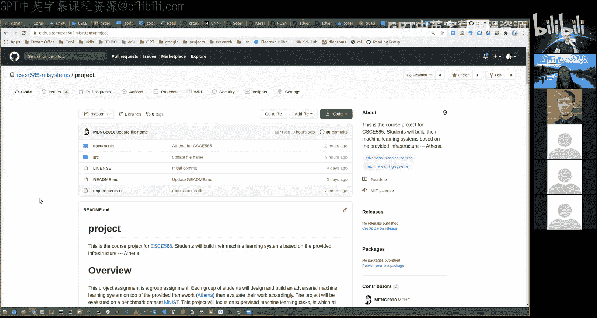

记住，本项目鼓励创造性和深入的分析。不要过于担心分数，而是专注于探索对抗性机器学习这一激动人心的领域，尝试带来令人惊喜的发现。祝你们项目顺利！