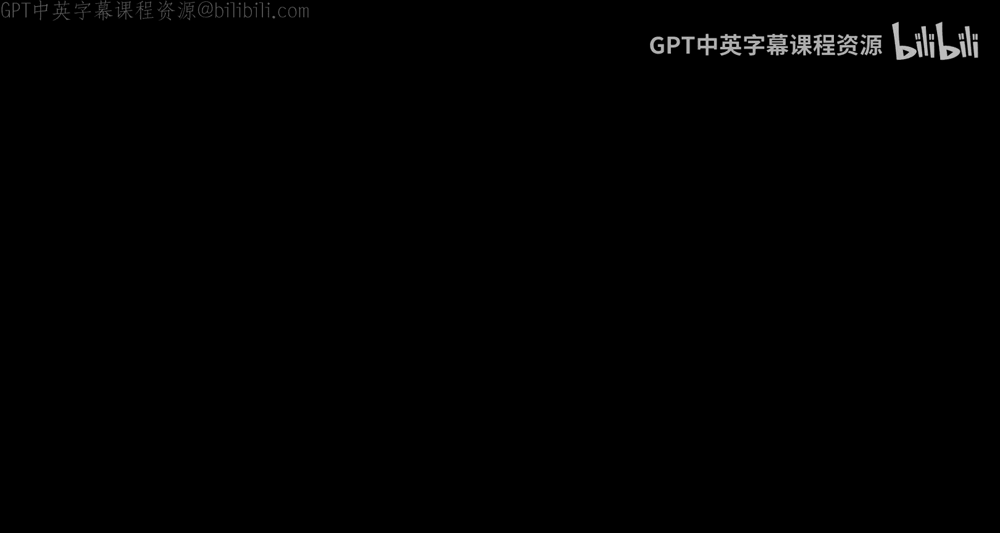
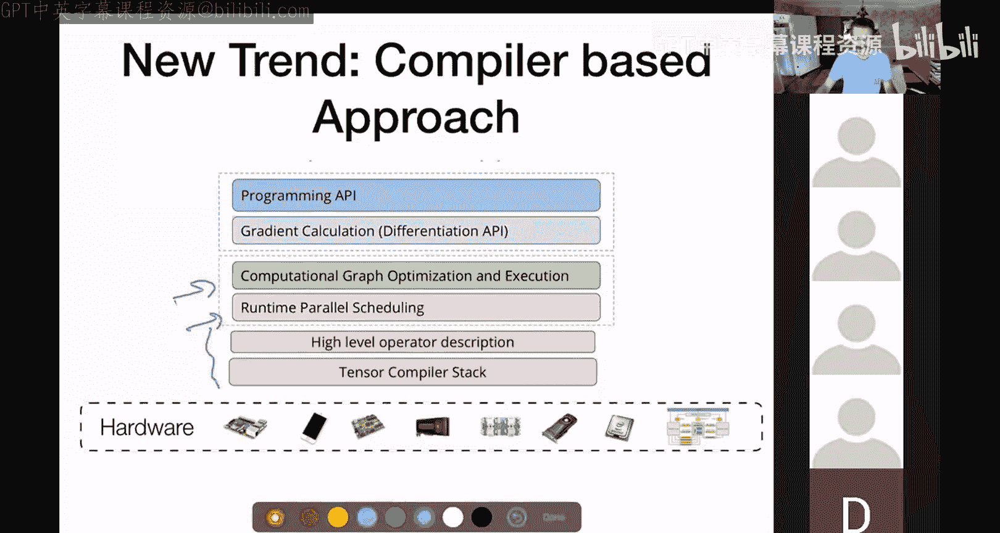

# 6.3：机器学习系统栈 🏗️



在本节课中，我们将要学习机器学习系统的整体架构，即“系统栈”。我们将从计算图的概念出发，逐步向下探索系统层和硬件层的重要性，了解整个栈如何协同工作以高效地训练和部署机器学习模型。

---

## 从计算图到系统栈

上一节我们介绍了机器学习框架（如 TensorFlow）提供的 API 层，并深入讨论了所有主流框架共有的核心概念：**计算图**。我们了解了计算图对于机器学习的重要性，特别是在高效计算梯度以进行反向传播和参数优化方面的优势。

本节中，我们来看看计算图之下的系统层和硬件层，以获得对机器学习系统栈的高层次概览和直观理解。

---

## 计算图回顾与代码对应

计算图的核心思想是将计算过程表示为有向无环图。图中的节点代表变量或操作，边代表数据流。

以下是一个简单的逻辑回归模型在 TensorFlow 中的代码片段及其对应的计算图概念：

```python
# TensorFlow 代码示例
import tensorflow as tf

# 定义变量（对应计算图中的叶子节点）
X = tf.placeholder(tf.float32, shape=[None, 784])  # 输入
W = tf.Variable(tf.zeros([784, 10]))              # 权重参数
b = tf.Variable(tf.zeros([10]))                   # 偏置参数

# 定义操作（对应计算图中的中间节点和边）
logits = tf.matmul(X, W) + b
Y_pred = tf.nn.softmax(logits)

# 定义损失函数
Y_true = tf.placeholder(tf.float32, shape=[None, 10])
cross_entropy = -tf.reduce_mean(Y_true * tf.log(Y_pred))

# 自动计算梯度（框架自动构建反向计算图）
grads = tf.gradients(cross_entropy, [W, b])

# 定义参数更新操作
learning_rate = 0.01
update_W = W.assign(W - learning_rate * grads[0])
update_b = b.assign(b - learning_rate * grads[1])
```

这段代码声明了一个计算图。`X`、`W`、`b`、`Y_true` 是输入/变量节点。`tf.matmul`、`tf.nn.softmax`、`tf.log`、`tf.reduce_mean` 等是操作节点。`tf.gradients` 会自动构建计算损失函数相对于 `W` 和 `b` 梯度的子图。整个计算过程采用**惰性求值**，只有在 `session.run()` 被调用时，指定的部分计算图才会真正执行。

---

## 系统层的优化机会

将计算表示为图结构，为系统层面带来了多种优化可能性。这些优化对于大规模模型和部署至关重要。

以下是几种关键的系统级优化：

1.  **并行执行**：计算图可以清晰地展示操作之间的依赖关系。没有依赖关系的操作可以并行执行，从而加速计算。
    *   **示例**：在计算 `B = A + 1` 和 `C = A * 2` 时，`B` 和 `C` 都只依赖于 `A`，彼此独立，因此可以同时计算。

2.  **图简化**：编译器或图优化工具可以分析计算图，移除无效代码（死代码消除）、合并重复操作或简化计算步骤，生成更高效但等价的图。

3.  **内存规划**：对于大型计算图，高效地管理张量的内存分配和释放是关键。系统可以分析张量的生命周期，复用内存，减少总体内存占用。

4.  **操作符放置**：在异构计算环境（如多GPU、CPU+GPU、分布式集群）中，系统需要决定将每个计算操作放在哪个设备上执行，以最小化通信开销并最大化计算吞吐量。

---

## 硬件抽象与编译器方法

传统的机器学习栈需要为每种硬件（如 CPU 的 MKL 库、NVIDIA GPU 的 CUDA、Google TPU 的专用库）编写特定的底层代码，这导致了碎片化和高昂的移植成本。

现代的趋势是引入一个**编译器中间层**。这个层的目标是将优化后的高级计算图，编译成能在多种硬件后端上高效执行的低级代码。

其优势在于：
*   **可移植性**：当新的硬件出现时，只需为该编译器添加一个新的后端，上层代码和优化即可复用。
*   **统一优化**：许多硬件无关的优化（如图简化、算子融合）可以在这一层统一完成。
*   **性能**：编译器可以进行深入的、针对特定硬件的代码生成和优化。

---

## 总结

本节课中我们一起学习了机器学习系统栈的完整视图。

1.  我们从顶层的**编程接口和计算图**开始，理解了它如何抽象计算并自动求导。
2.  然后，我们探讨了**系统层**如何利用计算图进行并行化、内存优化、图简化等操作，这是提升效率的关键。
3.  最后，我们了解了底层的**硬件抽象和编译器层**，它负责将优化后的计算图高效地映射到各种硬件（CPU、GPU、TPU等）上执行。



这个分层架构使得机器学习开发变得高效且可扩展：研究人员可以在顶层快速建模和实验，而系统工程师可以在下层不断优化性能和可部署性。理解这个栈的每一层及其相互作用，是构建和优化现代机器学习系统的基础。