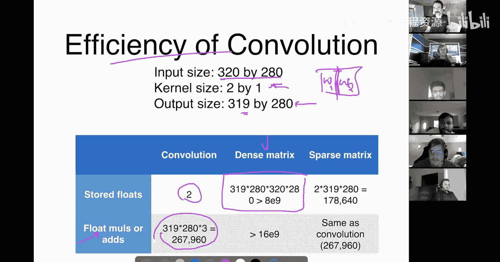

# 7.1：卷积神经网络 🧠


在本节课中，我们将要学习一种特殊且非常流行的神经网络架构——卷积神经网络。我们将重点理解其背后的两个核心概念，并探讨它们为何在系统与硬件层面具有重要的优化意义。

## 概述

卷积神经网络之所以重要，是因为它们在实践中被广泛部署。理解其核心概念，有助于我们把握在系统和硬件层面进行优化的机会，例如内存优化、模型压缩以及在资源受限平台上的高效部署。

## 卷积神经网络的两个核心概念

卷积神经网络主要基于两个关键思想：**稀疏连接**和**参数共享**。这两个概念使其能够高效处理大规模的、结构化的输入数据（如图像、语音、视频）。

### 稀疏连接

上一节我们提到了神经网络，在传统的全连接深度神经网络中，每个输入单元都连接到下一层的所有神经元。

**代码描述：**
对于一个有5个输入的层，其输出 `S5` 的计算可能如下：
```
S5 = w1*x1 + w2*x2 + w3*x3 + w4*x4 + w5*x5
```
可以看到，输入 `x3` 影响了所有输出单元的值。

然而，在卷积神经网络中，我们采用了稀疏连接。这意味着每个输入单元只影响下一层中有限数量的神经元，而不是全部。

**原因：**
这种设计极大地减少了需要存储和计算的参数量，从而提升了效率。同时，在数据量相同的情况下，学习更少的参数通常能获得更高的统计置信度。

**过渡：**
理解了稀疏连接如何减少连接数量后，我们来看看它是如何通过“感受野”的概念来保证网络仍能“看到”完整输入的。

#### 感受野

你可能会问，稀疏连接是否会导致某些输入信息被忽略？在单层网络中，确实如此。但在深层架构中，通过叠加多个隐藏层，高层神经元能够间接“看到”更广阔的输入区域，这个区域就是它的“感受野”。随着网络加深，感受野会不断扩大，最终使高层神经元能够整合整个输入空间的信息。

### 参数共享

参数共享是卷积神经网络的另一个核心思想。在全连接网络中，每条连接都有其独立的权重参数需要学习。

**公式描述：**
全连接层中，权重矩阵 `W` 的每个元素 `W_ij` 通常是独立且不同的。

但在卷积操作中，我们使用一个称为“卷积核”或“滤波器”的小型权重矩阵，在输入数据上滑动。这个卷积核的参数在整个滑动过程中是共享的。

**原因：**
1.  **极大减少参数量**：无论输入多大，一个卷积核只对应一组参数（例如一个3x3的核只有9个参数）。
2.  **提升泛化能力**：用相同的数据学习更少的参数，模型学到的特征更具统计鲁棒性。
3.  **引入平移不变性**：相同的特征检测器（卷积核）扫描整个图像，使得无论目标出现在图像中的哪个位置，都能被识别出来。

**过渡：**
现在，让我们具体看看实现稀疏连接和参数共享的关键数学操作——卷积。

## 卷积操作

卷积可以看作是全连接网络中矩阵乘法的一种替代。引入这个新操作后，网络训练过程（如最大似然估计、反向传播）保持不变，只是前向传播的计算方式发生了改变。

### 什么是卷积？

想象你有一张大的输入图像（一个网格）和一个小得多的卷积核（另一个网格）。卷积操作就是将这个卷积核像“窗口”一样滑过整个输入图像。

**计算过程：**
在每一个位置，将卷积核覆盖的输入区域与卷积核的对应元素相乘，然后将所有乘积结果求和，得到一个输出值。接着滑动窗口，重复此过程，最终生成一个新的输出网格，这个输出通常被称为“特征图”。

**示例：**
假设输入网格为 `[A, B, C; D, E, F; G, H, I]`，卷积核为 `[W, X; Y, Z]`。
在左上角位置，输出 `O1 = A*W + B*X + D*Y + E*Z`。
将核向右滑动一格，输出 `O2 = B*W + C*X + E*Y + F*Z`，依此类推。

### 多通道与特征图

对于彩色图像（RGB三通道），输入可以看作三个叠加的网格。卷积核也会具有相应的深度。每个卷积核会产生一个二维的特征图。如果我们希望网络学习多种不同的特征（如边缘、纹理），就可以使用多个不同的卷积核，从而产生多个特征图（通道）。通常，网络越深，特征图的通道数会越多，学习到的特征也越高级。

**过渡：**
了解了前向传播的卷积操作后，我们简要回顾一下训练中至关重要的反向传播在卷积网络中是如何进行的。

## 反向传播与卷积

在全连接网络中，反向传播涉及矩阵乘法和矩阵转置。在卷积网络中，原理完全相同，只是将矩阵乘法替换为卷积运算。具体而言：
*   **前向传播**：使用卷积操作。
*   **反向传播（误差传递）**：使用一种称为“转置卷积”的操作（本质也是卷积）将误差从输出层传回输入层。
*   **权重梯度计算**：同样利用卷积操作来计算每个卷积核参数的梯度，以便通过随机梯度下降法进行更新。
框架（如TensorFlow、PyTorch）会自动处理这些复杂的计算。

## 效率对比示例

让我们直观感受一下卷积网络在参数效率上的优势。

考虑一个320x280的输入图像。如果我们使用一个2x1的卷积核，我们需要存储和学习的参数是多少？仅仅是卷积核的2个权重（w1, w2）。

**思考：**
如果使用一个等效的全连接层（假设输出特征图大小约为319x280），需要多少参数？那将需要 `(320*280) * (319*280)` 数量级的参数，这是一个天文数字。卷积网络的稀疏连接和参数共享使得处理大规模图像成为可能。

## 总结



本节课中，我们一起学习了卷积神经网络的基础：
1.  **核心思想**：**稀疏连接**减少了神经元间的连接数量；**参数共享**（通过卷积核）极大地降低了参数量。
2.  **关键操作**：**卷积**是滑动滤波器以提取局部特征的过程，它是构建CNN的基础。
3.  **主要优势**：这些特性带来了计算和存储的高效性、更好的参数统计学习效率，以及固有的平移不变性，使CNN特别适合处理图像等网格化结构数据。
理解这些概念是后续探讨CNN在系统优化、硬件加速及模型压缩等方面应用的重要基础。