# 7.3：ATHENA框架任务一完整演示教程 🧪


在本教程中，我们将学习如何使用ATHENA框架完成第一个任务。我们将涵盖从准备数据、生成对抗样本到评估防御模型效果的完整流程。整个过程将通过Jupyter Notebook进行演示。

---

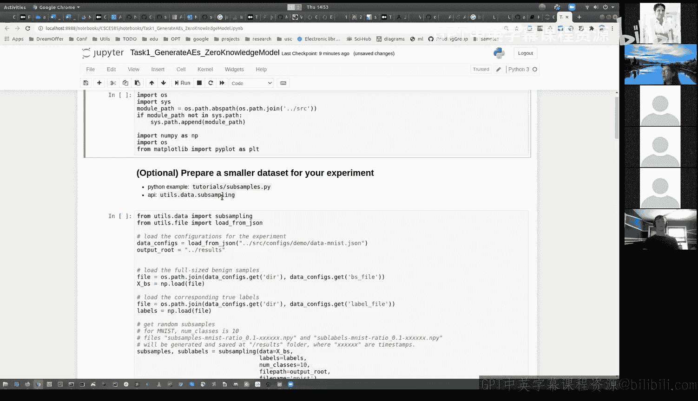

## 环境准备与数据导入

首先，确保你已经激活了正确的Python环境。在命令行中输入以下命令以启动Jupyter Notebook：

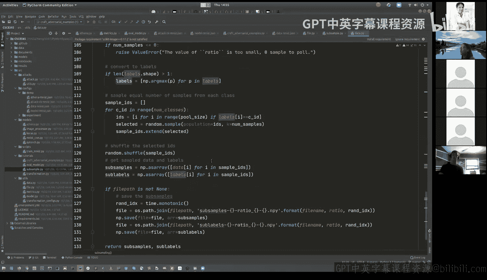

```bash
jupyter notebook
```

启动后，在浏览器中打开Notebook。本教程将使用为任务一准备的Notebook文件。

以下是开始前需要导入的必要包：

```python
import numpy as np
import torch
import matplotlib.pyplot as plt
# ... 其他必要的导入
```

---

## 数据子采样（可选步骤）

考虑到某些攻击方法可能耗时较长，你可以选择生成一个较小的数据集用于实验。这是一个可选步骤。

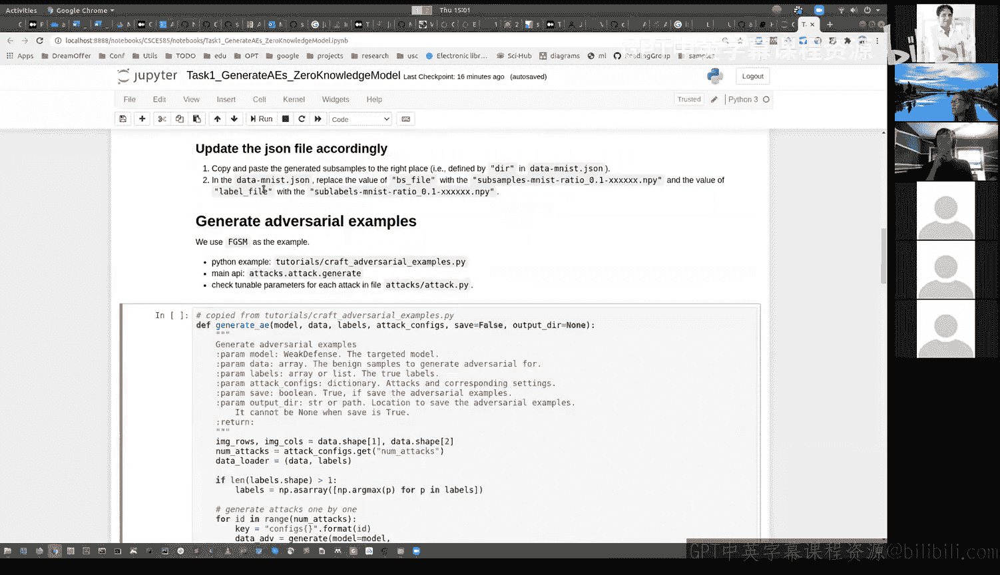

我提供了一个名为 `subsampling` 的API来帮助你完成这个操作。该API可以从原始数据中按类别均匀地采样，并保存采样后的数据和对应的标签。

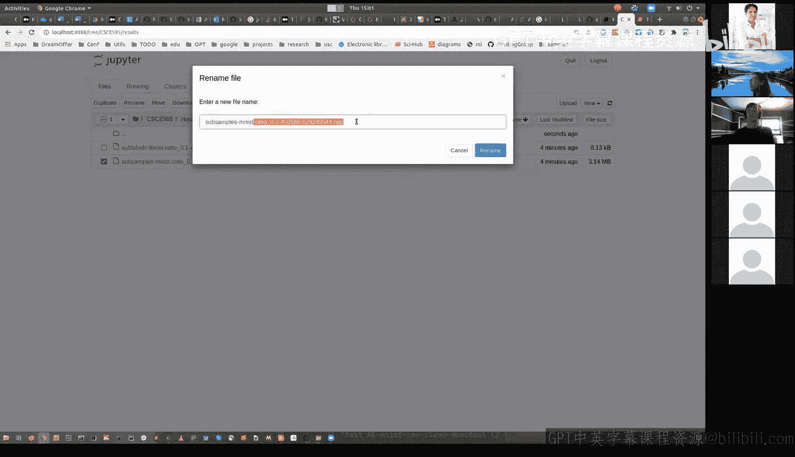

以下是该API的核心调用方式：

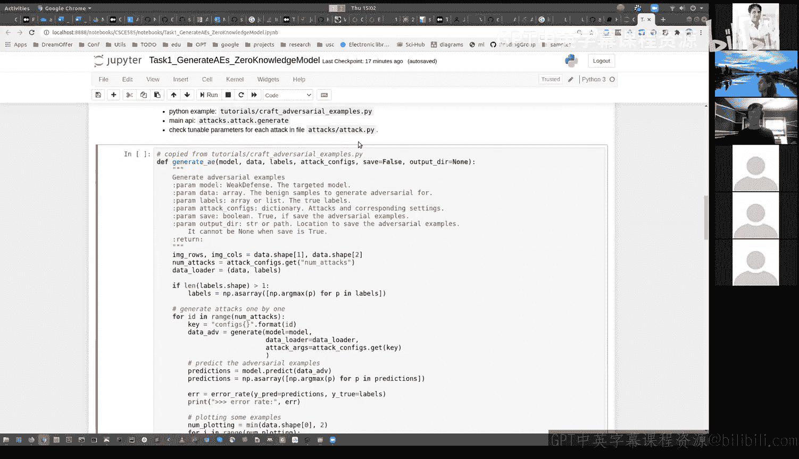

```python
# 假设 be_sample 是原始数据，labels 是对应的标签
subsampling(be_sample, labels, num_classes=10, ratio=0.1, output_path='results', file_name='subsample')
```

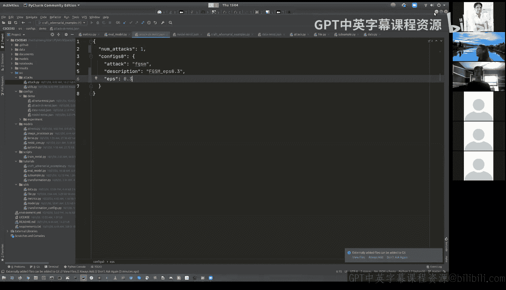

**参数说明：**
*   `be_sample`: 原始数据样本。
*   `labels`: 对应的真实标签。
*   `num_classes`: 类别数量。对于MNIST数据集，这个值始终是10。
*   `ratio`: 采样比例，默认为10%。
*   `output_path`: 输出文件的保存路径。
*   `file_name`: 输出文件的前缀。

运行成功后，你会在指定的 `output_path` 下看到生成的文件，文件名会带有 `subsample` 前缀和采样比例。

**重要提示：** Git通常不允许上传空文件夹。因此，你需要手动创建 `results` 文件夹（或你指定的其他输出文件夹），否则代码可能会因路径不存在而报错。

---

## 配置对抗样本生成

生成对抗样本前，我们需要加载实验配置。这些配置通常保存在一个JSON文件中（例如 `data_analyst.json`）。

如果你使用了子采样数据，需要将生成的子样本文件路径更新到这个JSON配置文件中。具体做法是，将子样本文件复制到配置指定的位置，并替换JSON文件中对应的文件名和标签路径。

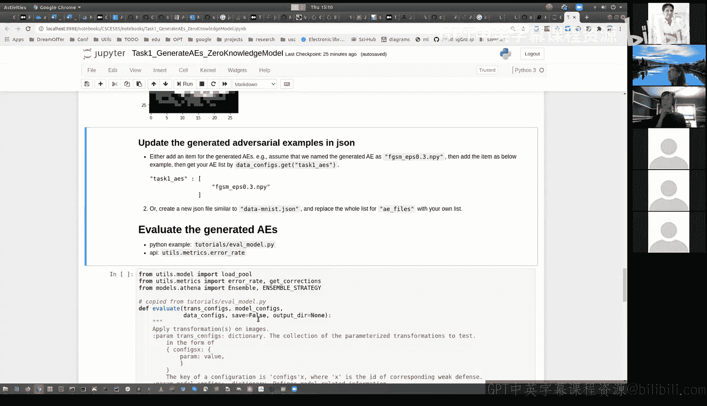

更新后的配置将用于加载目标模型和待攻击的良性样本。

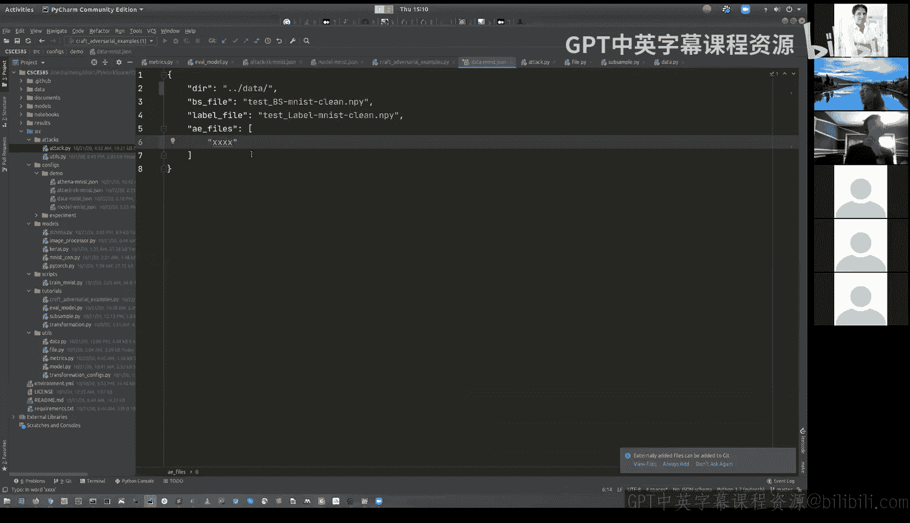

---

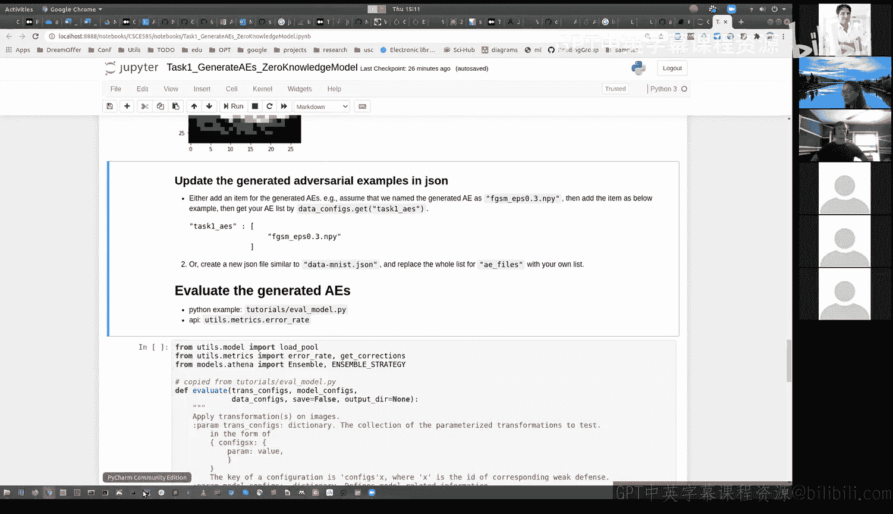

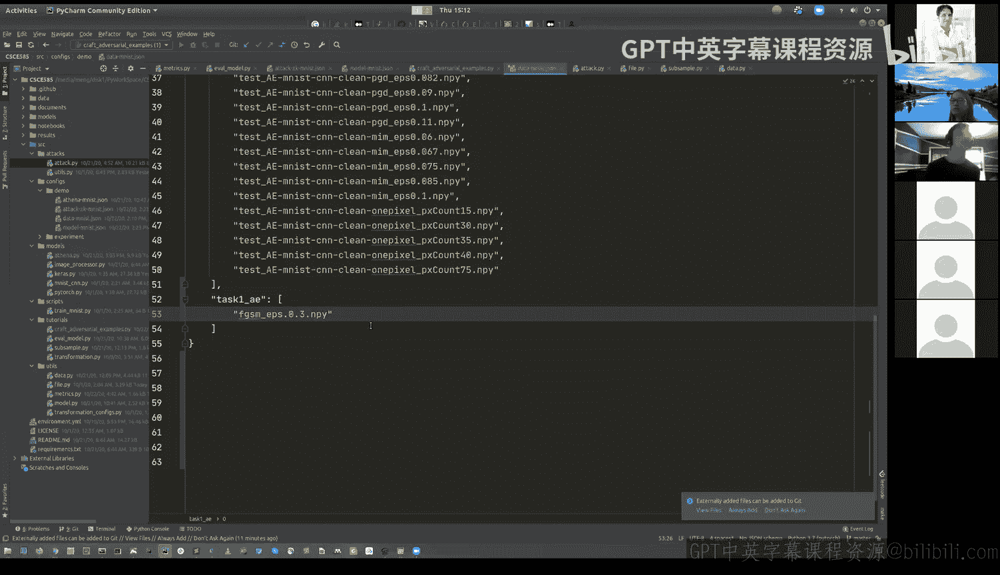

## 执行对抗攻击

现在，我们可以开始生成对抗样本了。核心是调用 `generate_adversarial_examples` 这个API。

```python
# 伪代码示例
from attacks import generate_adversarial_examples

# 加载目标模型、数据和攻击配置
target_model = load_model(...)
benign_data, true_labels = load_data(...)
attack_configs = load_attack_configs(...) # 从JSON文件加载

# 生成对抗样本
adversarial_examples, success_rate = generate_adversarial_examples(
    model=target_model,
    data=benign_data,
    labels=true_labels,
    attacks=attack_configs,
    save_results=True,
    save_path='path/to/save/AEs'
)
```

**攻击参数调优：** 不同的攻击方法（如FGSM、C&W）有可调参数。你可以在对应的攻击函数文件（例如 `attacks/fgsm.py`）中查看和修改这些参数。在 `attack_configs` 中指定你想要的攻击方法和参数。

生成过程中，代码会遍历配置中的所有攻击方法，对每个良性样本生成对应的对抗样本，并使用目标模型进行预测，计算攻击成功率（即错误率）。

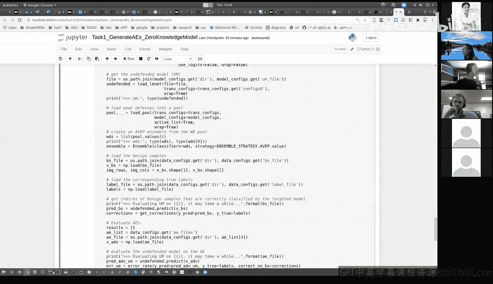

你还可以选择可视化生成的对抗样本以进行调试：

```python
# 示例：绘制前5个对抗样本
for i in range(5):
    plt.subplot(1, 5, i+1)
    plt.imshow(adversarial_examples[i].squeeze(), cmap='gray')
    plt.title(f'True: {true_labels[i]}, Pred: {preds[i]}')
    plt.axis('off')
plt.show()
```

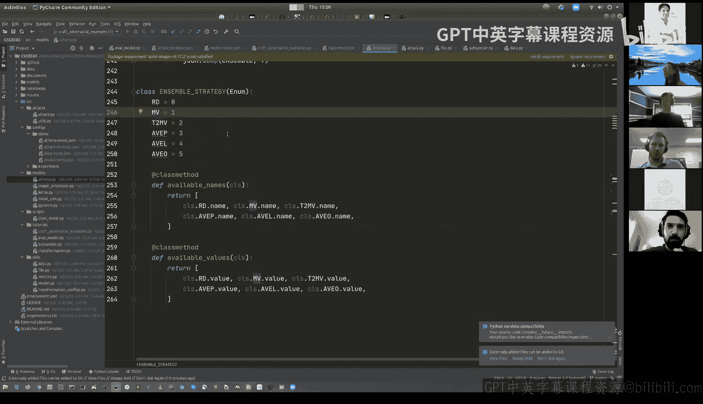

---

## 保存与记录对抗样本

生成对抗样本后，你需要记录它们以便后续评估。有两种方式：

1.  **更新主JSON文件**：在你使用的 `data_analyst.json` 文件中，添加一个新的键值对来存储你的对抗样本路径。
    ```json
    {
        ... // 其他配置
        "task1_AEs": {
            "data_path": "path/to/your/generated/AEs.npy",
            "label_path": "path/to/the/corresponding/labels.npy"
        }
    }
    ```
2.  **创建新的JSON文件**：创建一个全新的配置文件来管理你的对抗样本，这样不会影响原始配置结构。

无论选择哪种方式，确保在后续评估代码中能正确加载到这些对抗样本。

---

## 评估对抗样本

最后一步是评估生成的对抗样本在不同防御模型下的效果。我们将评估三个模型：
1.  无防御的原始模型（`undefended model`）。
2.  由多个弱防御模型组成的集成模型（`ATHENA ensemble`）。
3.  经过PGD对抗训练的基础模型（`PGD adversarially trained model`）。

评估的核心是计算对抗样本的“错误率”。根据定义，我们需要先排除那些**原始模型本身就已经分类错误**的良性样本，因为对抗样本对它们的“欺骗”不是由扰动引起的。

以下是评估流程的关键代码：

```python
from evaluation import error_rate
from ensemble import create_ensemble

# 1. 加载模型
baseline_model = load_pgd_trained_model(...)
undefended_model = load_target_model(...) # 与生成AE时是同一个模型

# 2. 创建集成防御
# 首先加载多个弱防御模型
weak_defenses = [load_wd1(...), load_wd2(...), load_wd3(...)]
# 创建集成，例如使用概率平均策略
athena_ensemble = create_ensemble(classifiers=weak_defenses, strategy='averaging_probability')

# 3. 加载良性样本和对抗样本
benign_data, true_labels = load_benign_data(...)
adv_examples = load_adv_examples(...)

# 4. 找出被原始模型正确分类的样本索引
correct_indices = get_correctly_classified_indices(undefended_model, benign_data, true_labels)

# 5. 评估对抗样本在原始模型上的错误率
undefended_preds = undefended_model.predict(adv_examples)
error_undefended = error_rate(undefended_preds, true_labels, correct_indices)

# 6. 评估对抗样本在集成模型上的错误率
ensemble_preds = athena_ensemble.predict(adv_examples)
error_ensemble = error_rate(ensemble_preds, true_labels, correct_indices)

# 7. 评估对抗样本在PGD训练模型上的错误率
baseline_preds = baseline_model.predict(adv_examples)
error_baseline = error_rate(baseline_preds, true_labels, correct_indices)

print(f"原始模型错误率: {error_undefended:.2%}")
print(f"集成模型错误率: {error_ensemble:.2%}")
print(f"PGD训练模型错误率: {error_baseline:.2%}")
```

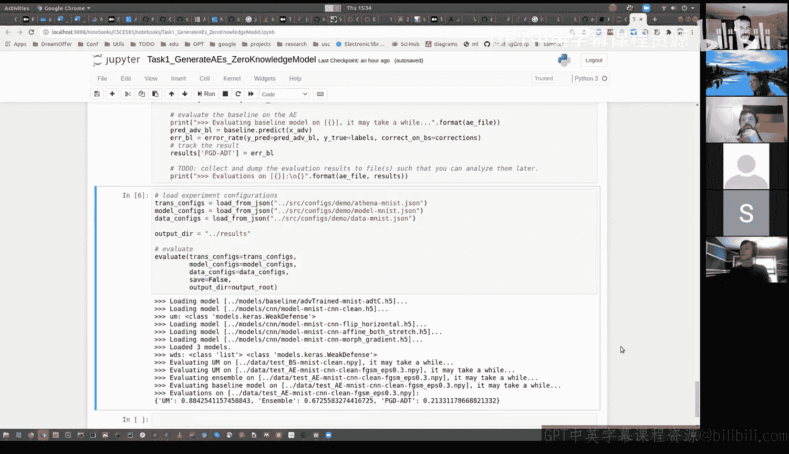

**结果解读：**
假设你得到类似 `原始模型: 88%`, `集成模型: 67%`, `PGD模型: 21%` 的结果。这表明：
*   对抗样本对原始模型非常有效（88%的成功率）。
*   由三个弱防御构成的集成模型提供了一定的防御能力，将错误率从88%降低到67%。
*   PGD对抗训练模型提供了更强的防御，将错误率大幅降低到21%。

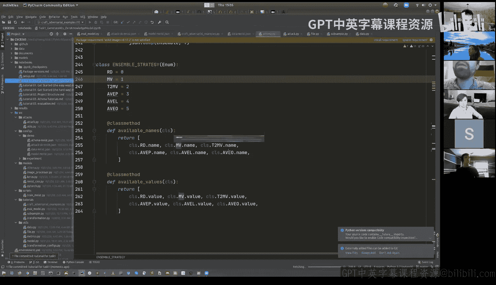

这体现了防御强度、模型复杂度和计算开销之间的权衡。ATHENA框架的灵活性在于，你可以自由选择集成中弱防御的数量、类型和集成策略，从而探索这个权衡空间。

---

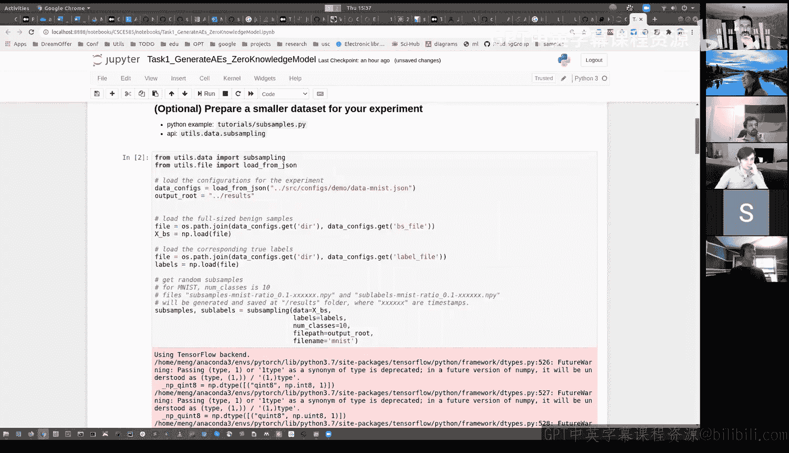

## 实验设计与探索建议

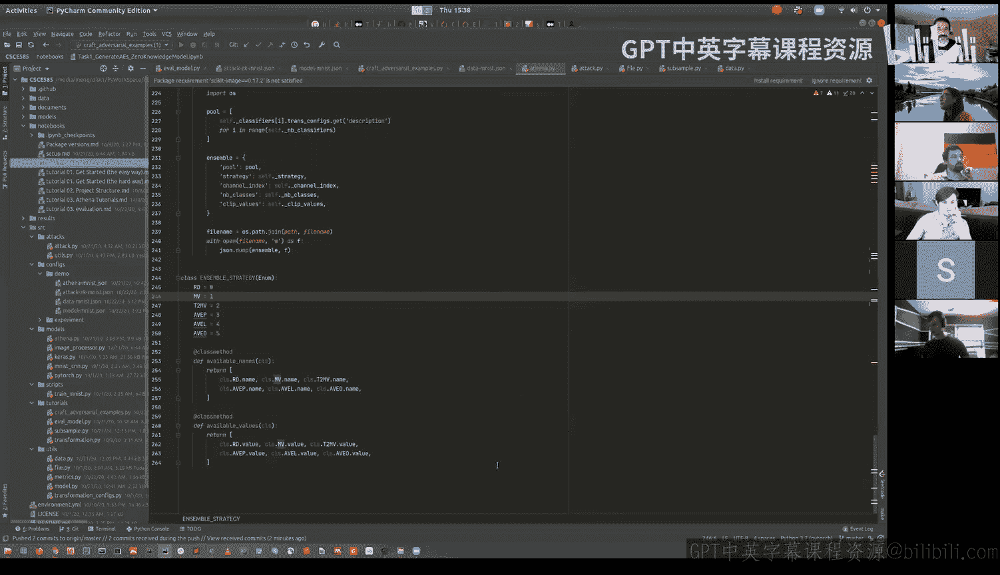

你的任务不仅仅是运行上述流程。ATHENA框架提供了巨大的探索空间：

*   **集成规模**：尝试使用不同数量的弱防御模型（例如5个、10个、20个）构建集成，观察防御效果和开销的变化。
*   **弱防御类型**：框架提供了超过70种变换对应的弱防御。尝试组合不同类型的弱防御，观察哪种组合最有效。
*   **集成策略**：除了概率平均（`averaging_probability`），还可以尝试多数投票（`majority_voting`）等策略。
*   **自定义探索**：你甚至可以探索框架之外的新变换，并训练对应的弱防御模型。

建议与你的团队成员一起进行头脑风暴，设计一个有趣的实验方案，旨在发现集成防御中不同因素（如规模、多样性、策略）如何影响其鲁棒性和效率。你的报告应该着重阐述这些设计选择背后的思考以及有趣的发现。

---

## 总结

本节课中，我们一起学习了使用ATHENA框架完成第一个任务的完整流程：
1.  **环境与数据准备**：启动环境，可选地进行数据子采样。
2.  **对抗样本生成**：配置攻击参数，针对目标模型生成对抗样本。
3.  **对抗样本评估**：评估这些对抗样本在原始模型、自定义集成模型和基准防御模型上的效果。

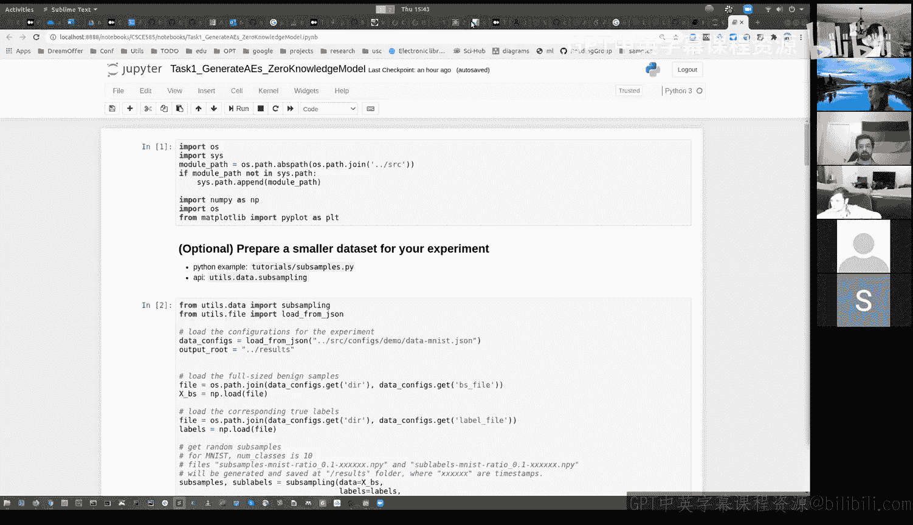

关键在于理解，ATHENA是一个灵活的框架，你的主要工作是设计并执行实验，探索如何通过组合简单的弱防御来构建有效的集成防御系统，并分析其性能与成本的权衡。请充分利用这个框架进行探索和学习。