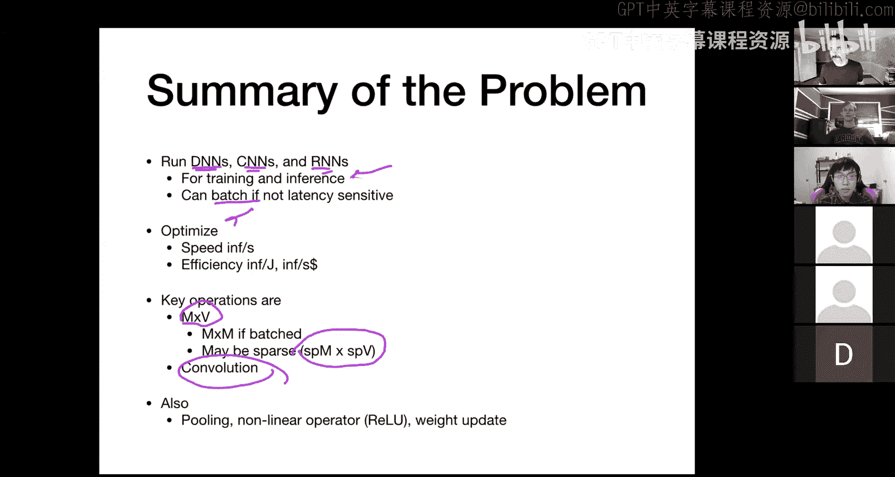

# 8.1：机器学习硬件 🖥️


在本节课中，我们将要学习机器学习系统的硬件层。我们将探讨不同硬件平台的特点，理解训练与推理在硬件层面的核心差异，并分析常见神经网络模型（如全连接网络、卷积网络）的计算特性与效率瓶颈。

---

## 概述

在之前的课程中，我们讨论了机器学习系统的软件栈，包括编程API和计算图系统层。本节课，我们将目光转向底层硬件。理解硬件对于构建高效的机器学习系统至关重要。我们将重点关注硬件面临的关键问题，以及当前该领域令人兴奋的研究进展。

---

## 硬件平台的多样性

如今，我们有多种多样的异构硬件平台。这些平台在宏观架构、内存、计算能力和功耗等方面存在差异。

以下是几种典型的硬件示例：
*   **小型嵌入式硬件**：例如树莓派等，体积小，功耗低。
*   **专用加速器**：例如谷歌的TPU，专为机器学习计算设计。
*   **图形处理器**：例如NVIDIA的GPU，广泛用于训练和推理。
*   **车载计算平台**：例如NVIDIA的Drive AGX Xavier，用于自动驾驶汽车。

尽管硬件形态各异，但我们需要理解其背后的通用原理和关键挑战。

---

## 核心挑战：性能与能效

机器学习硬件的主要目标可以归结为两点：**运行得更快**和**运行得更高效**。

**运行得更快**意味着提高吞吐量，例如每秒能完成更多的推理次数。

**运行得更高效**则主要关注能效，这对于部署在电池供电设备上的推理任务尤为重要。能效通常用 **推理次数/焦耳** 来衡量。我们也可以从成本角度考虑，即 **每秒推理次数/美元**。

---

## 训练与推理的差异

理解训练和推理在计算上的区别对硬件设计至关重要。

**推理** 只涉及神经网络的前向传播路径。

**训练** 则包含三个核心操作的循环：
1.  **前向传播**：计算网络输出和损失。
2.  **反向传播**：计算损失相对于各权重的梯度。
3.  **参数更新**：根据梯度更新网络权重。

用伪代码可以表示为：
```python
for epoch in range(num_epochs):
    for batch in data_loader:
        # 1. 前向传播
        output = model(batch.input)
        loss = loss_function(output, batch.label)
        # 2. 反向传播
        loss.backward()
        # 3. 参数更新
        optimizer.step()
        optimizer.zero_grad()
```

---

## 全连接网络的计算特性

上一节我们介绍了训练与推理的基本流程，本节我们来看看不同神经网络模型的计算特性。首先分析全连接网络。

一个全连接层的基本操作是矩阵-向量乘法：`输出激活 = 权重矩阵 × 输入激活`。

如果输入层有 `X` 个单元，输出层有 `Y` 个单元，那么权重矩阵的大小为 `X × Y`。当 `X` 和 `Y` 都很大时（例如各4000），权重数量将达到1600万，这使得矩阵乘法成为非常昂贵的操作。

更关键的是，这些权重通常存储在RAM中。从RAM中读取大量数据是耗能的操作。并且，在进入下一层时，需要从RAM中加载一组完全不同的新权重，这导致了低效的重复内存访问。

**批处理的优势**：在训练时，我们可以将多个输入样本组成一个批次。这样，权重只需从内存中加载一次，就可以用于计算整个批次，从而显著提高了内存访问效率。然而在推理时，输入通常是逐个到达的，无法进行批处理。

---

## 激活与权重的稀疏性

在全连接网络中，激活值和权重矩阵通常具有稀疏性，这为提高计算效率提供了机会。

**激活值的稀疏性**：源于ReLU等激活函数。ReLU函数定义为 `f(x) = max(0, x)`，它会使所有负值激活变为零。因此，激活向量中往往包含大量零元素。

**权重的稀疏性**：在训练后，许多权重值会接近于零。通过模型剪枝技术，我们可以将这些小权重设为零，从而获得一个稀疏的权重矩阵。

于是，核心的矩阵乘法操作可以变为 **稀疏矩阵 × 稀疏向量** 的乘法，这比稠密矩阵乘法要高效得多。但需要注意的是，对于不同的输入图像，激活向量中零的位置会发生变化，而权重矩阵中零的位置在剪枝后是固定的。

---

## 卷积网络的计算特性

接下来，我们分析卷积神经网络的计算特性。CNN通过卷积核在输入特征图上滑动来提取特征。

与全连接层相比，CNN的核心优势在于**参数共享**。一个卷积核的参数量远小于全连接层的权重矩阵，这减少了对内存带宽的压力。

然而，CNN需要进行大量的**算术运算**。为了计算输出特征图上的一个点，卷积核需要在输入的一片区域上进行多次乘加运算。其计算量可以用以下嵌套循环表示：
```
for 输出通道 j in range(J):
    for 输入通道 k in range(K):
        for 输出位置 (x, y) in output_map:
            for 卷积核位置 (u, v) in kernel:
                output[x, y, j] += input[x+u, y+v, k] * weight[u, v, k, j]
```
尽管单次乘加运算开销很小，但巨大的循环次数使得总体计算量非常可观。

此外，CNN中还有池化、ReLU等操作，这些操作计算开销相对较低。

---

## 训练中的内存限制

在训练深度CNN时，我们还会面临**内存限制**。网络权重、中间激活值、梯度等都需要存储在内存中。

当使用较大批量进行训练时，需要存储的中间数据量会急剧增加。因此，**训练时的批量大小往往受限于GPU或加速器的可用内存容量**。这是一个在实际系统设计中必须权衡的关键因素。

---

## 端到端系统视角

最后，我们需要从端到端系统的视角来看待效率问题。一个完整的机器学习流水线包括多个阶段：
1.  从磁盘加载（可能压缩的）数据。
2.  数据解码与预处理。
3.  模型前向/反向传播计算。
4.  结果输出。

如果只优化模型计算部分，而数据加载或预处理成为瓶颈，那么整体性能仍无法提升。因此，构建高效的机器学习系统需要全局优化整个流水线。

---

## 总结



本节课我们一起学习了机器学习硬件的基础知识。我们探讨了异构硬件平台，明确了追求更高性能和更高能效的核心目标，并区分了训练与推理的不同计算需求。我们深入分析了全连接网络和卷积网络的计算与内存访问模式，理解了稀疏性带来的优化机会以及训练中的内存限制。最后，我们认识到必须从端到端系统的角度进行优化，才能构建真正高效的机器学习系统。