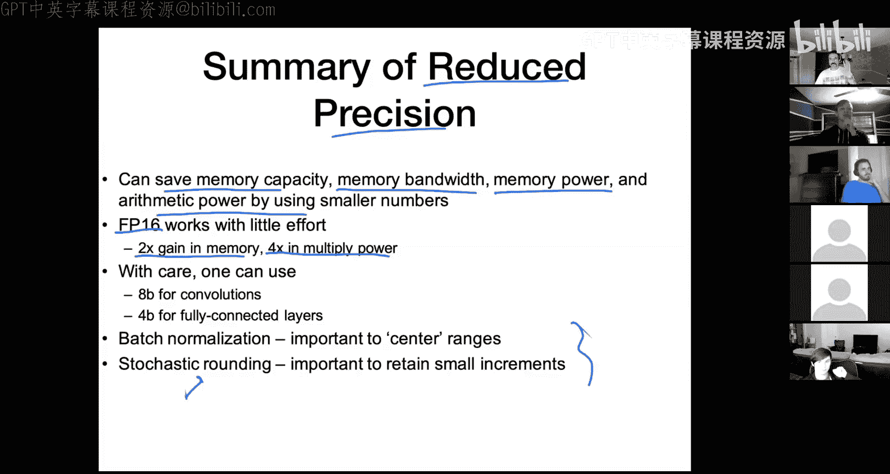

# 8.3：机器学习硬件

在本节课中，我们将继续讨论硬件层，重点探讨**降低精度**在机器学习系统中的应用。我们将了解如何通过使用更低精度的数值表示（如整数或半精度浮点数）来存储权重和激活值，从而节省存储空间和能耗，同时确保模型精度不受显著影响。

## 概述

上一节我们介绍了硬件加速的基本概念，本节中我们来看看**数值精度**对机器学习系统性能与能耗的影响。使用低精度表示是模型压缩与量化的基础，能在保证准确性的前提下，显著提升能效和存储效率。

## 为何精度很重要

在计算机中，数值并非以数学上的绝对精度存储。不同的数值表示方法（如浮点数、整数）提供了不同的精度范围和存储成本。

*   **浮点数**：例如32位浮点数（FP32），使用部分比特表示指数、尾数和符号，能表示约70个数量级的数值范围，但精度会随数值大小变化。
*   **整数**：例如32位整数（INT32），表示的是固定间隔的离散值，在整个表示范围内具有一致的绝对精度，但能表示的数值范围远小于浮点数。

编程语言（如Python、C++）提供了不同精度数值类型的API。核心在于：**更低的精度意味着更小的表示范围和/或更低的数值分辨率**。

## 不同操作的能耗成本

执行神经网络计算主要涉及三种操作：**内存读取**、**乘法**和**加法**。它们的相对能耗成本差异巨大：

以下是不同精度下各类操作的近似能耗（单位：皮焦耳）：
*   **32位浮点乘法**：3.7 pJ
*   **16位浮点乘法**：1.1 pJ
*   **8位整数乘法**：0.2 pJ
*   **32位浮点加法**：0.9 pJ
*   **16位浮点加法**：0.4 pJ
*   **32位整数加法**：0.1 pJ
*   **8位整数加法**：0.03 pJ
*   **片上SRAM读取**：5 pJ
*   **片外DRAM读取**：640 pJ

**关键观察**：
1.  **乘法比加法耗能多得多**。
2.  **降低精度能大幅减少计算能耗**（例如，从FP32乘法转到INT8乘法，能耗降低超过15倍）。
3.  **内存访问（尤其是片外DRAM访问）是能耗最高的操作**，比计算操作高出数个数量级。因此，减少数据（特别是权重）从片外内存的读取至关重要。

芯片设计还需考虑**面积成本**，更高精度的计算单元通常需要更大的芯片面积。

## 混合精度推理策略

考虑到不同操作的能耗以及权重与激活值数量的巨大差异，**混合精度**策略在实践中非常有效。

在一个全连接层的前向传播（推理）中，核心操作是：
`输出激活值 = ∑ (权重 * 输入激活值)`

一个高效的混合精度方案可能是：
1.  **权重存储为4位整数**：因为权重数量极多（例如数百万个），将其以最低精度存储在片外DRAM中，能极大减少内存带宽占用和读取能耗。
2.  **激活值存储为16位浮点**：激活值数量相对较少，可以使用较高精度。
3.  **计算时**：将4位权重重整（解码）为16位，与16位激活值进行16位乘法。
4.  **累加时**：使用24位或32位精度累加多个乘积结果，以避免在大量加法中丢失精度。最终输出可能再量化为16位用于下一层。

**这种设计合理的原因**：
*   **权重**：数量庞大，是内存访问的瓶颈，故采用最低精度存储。
*   **激活值**：数量相对少，对精度更敏感，且是层间传递的数据，故采用较高精度。
*   **累加器**：加法能耗相对较低，使用更高精度可防止累积误差，且不影响整体能耗瓶颈（瓶颈在于乘法）。

## 训练中的低精度挑战与技巧

在训练的反向传播阶段，需要更新权重：`权重更新量 = 学习率 * 梯度`。

**挑战**：训练后期，梯度值和学习率都会变得非常小。在低精度表示下，两个极小值的乘积可能被**舍入为零**，导致权重无法更新，训练停滞。

**解决方案**：**随机舍入**
*   **常规舍入**：将数值舍入到最接近的可表示值。
*   **随机舍入**：以一个概率将数值向上或向下舍入。例如，一个值更接近0，则以高概率舍入到0，低概率舍入到1。这确保了权重更新的期望值是无偏的，能够收敛到正确的值。
`P(舍入到1) = 值 / 步长`, `P(舍入到0) = 1 - P(舍入到1)`

**批归一化**的作用：它对一个批次内的激活值进行归一化，使其分布集中在相近的范围内。这避免了因不同样本激活值动态范围差异过大，在低精度下被差异化处理而引入偏差，有利于稳定低精度训练。

## 精度与性能的权衡

降低精度需要在**模型准确性**和**能效/存储收益**之间进行权衡。

*   将权重从FP32降至INT16通常能带来显著的能耗降低，且精度损失可忽略。
*   降至INT8可能带来更大的能效提升，但需要仔细评估精度损失是否在可接受范围内。
*   通过使用**混合精度训练**（如FP16/FP32混合）和**随机舍入**等技术，可以在低精度下实现与全精度训练相似的收敛性和最终精度。

## 总结

本节课中我们一起学习了硬件中**数值精度**的关键作用。我们了解到：
1.  **降低精度**（量化）是节省存储空间和计算能耗的有效手段。
2.  内存访问，尤其是片外访问，是系统能耗的主要来源。
3.  **混合精度**策略能根据数据特性和操作类型优化能效。
4.  在**训练中**应用低精度需要克服梯度消失等挑战，**随机舍入**和**批归一化**是重要的辅助技术。
这些概念是模型压缩与量化的基础，对于在资源受限的边缘设备上部署高效的机器学习系统至关重要。