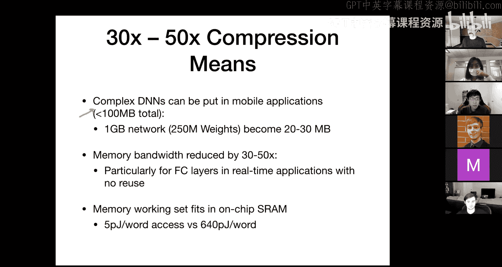

# 9.1：模型压缩（剪枝与量化）📉

在本节课中，我们将要学习模型压缩技术，这是机器学习系统栈中硬件层相关内容的延续。核心目标是探讨如何利用数学原理或现代硬件架构的洞察，来压缩深度神经网络，从而减少其存储空间和计算量，使其更高效。

上一节我们讨论了硬件层的基础，本节中我们来看看如何通过剪枝和量化这两种主要方法来优化模型。

## 概述

模型压缩旨在减少神经网络的大小和计算量。大型模型拥有大量权重参数，无论是全连接层还是卷积层，它们都涉及大量计算。通过压缩，我们可以在保持模型性能的同时，显著降低其存储需求和推理时的计算开销，这对于降低能耗、提升推理速度以及适应移动设备等资源受限环境至关重要。

## 剪枝 (Pruning) ✂️

剪枝的基本思想是移除神经网络中不重要的连接或神经元。你可以将神经网络想象成一棵树，剪枝就是剪掉一些树枝。具体来说，可以剪枝权重（突触），也可以剪枝神经元。

其背后的直觉是，许多权重值非常接近于零，这些“微弱”的连接对激活值的影响很小。因此，保留它们需要付出存储和计算成本，但收益甚微。剪枝掉这些连接可以大幅减少模型参数。

以下是剪枝方法通常遵循的三步流程：

1.  **训练网络**：首先，正常训练一个完整的神经网络。
2.  **剪枝连接**：根据设定的阈值（例如，将绝对值小于某个值的权重置零），剪枝掉不重要的连接。
3.  **重新训练**：在固定已剪枝权重为零的前提下，重新训练网络，以恢复因剪枝可能损失的精度。

如果一次性剪枝过多权重，精度会显著下降。通过重新训练，甚至可以进行迭代式剪枝（即多次“剪枝-重训练”循环），从而在剪枝掉极高比例（如90%）权重的情况下，仍能保持与原模型相近的精度。

以下是一些经典论文中的实验结果：
*   在AlexNet上，全连接层可剪枝约90%的权重，卷积层可剪枝约三分之二的权重。
*   在VGG网络上，总体可移除约93%的权重。
*   对于LSTM等循环神经网络，同样可以在剪枝90%权重后通过重训练保持精度。

剪枝不仅能减小模型尺寸，还能加速推理。实验表明，在CPU上，剪枝后的模型可获得约3倍加速；若部署在GPU上，结合剪枝可获得高达48倍于原始CPU版本的加速。

## 量化 (Quantization) 🔢

量化关注的是权重的数值表示形式。其核心思想是使用更少的比特数（例如，用8位整数代替32位浮点数）来表示权重和激活值，从而减少存储空间和计算开销。

标准的量化方法是**均匀量化**，即将数值范围均匀分割。例如，用4比特（可表示16个值）均匀地表示一个区间内的数字。

然而，更高效的方法是**训练后量化**。观察剪枝后权重的分布，通常会呈现双峰或多峰形态，权重值集中在几个特定的区间。如果使用均匀量化，许多量化级别会浪费在权重分布稀疏或没有权重的区域。

训练后量化的关键思想是进行**非均匀量化**，将有限的比特数（即有限的量化级别）更集中地分配到权重实际分布的区间。这通常通过聚类算法（如K-Means）来实现：

1.  给定权重张量和目标比特数 `b`（对应 `2^b` 个聚类中心）。
2.  对这些权重运行K-Means聚类，得到 `2^b` 个聚类中心。
3.  每个权重值用其所属聚类中心的索引（即量化后的值）表示，存储时只需保存 `b` 比特的索引和 `2^b` 个聚类中心值（码本）。
4.  可以进一步对量化后的模型进行微调，以提升精度。

实验表明，对于卷积层，通常需要多于4比特的表示来维持较好精度；而对于全连接层，使用2-4比特量化通常能在精度损失很小的情况下大幅压缩模型。

## 结合剪枝与量化 ⚡

单独使用剪枝或量化都能有效压缩模型，但将两者结合能产生更好的效果。

典型的流程是：先对模型进行迭代式剪枝和重训练，在保持精度的前提下大幅减少参数数量；然后对剪枝后的模型进行训练后量化，进一步降低每个参数的存储开销。

研究结果显示，通过结合剪枝与量化，可以将像VGG这样的大型模型（原始约500MB）压缩到仅约11MB（约原大小的2%），同时几乎不损失Top-1和Top-5分类精度。这种程度的压缩对于将模型部署到移动应用、嵌入式设备或存在存储、带宽限制的场景具有革命性意义。

## 总结

本节课我们一起学习了模型压缩的两大核心技术：剪枝和量化。
*   **剪枝**通过移除冗余的连接或神经元来减少参数数量。
*   **量化**通过降低权重数值的表示精度来减少存储和计算开销。
*   将**两者结合**可以最大程度地压缩模型，在极小精度损失下实现模型尺寸的急剧缩减。

模型压缩对于构建高效、低功耗、可部署在资源受限环境中的机器学习系统至关重要，是连接算法创新与实际应用落地的重要桥梁。