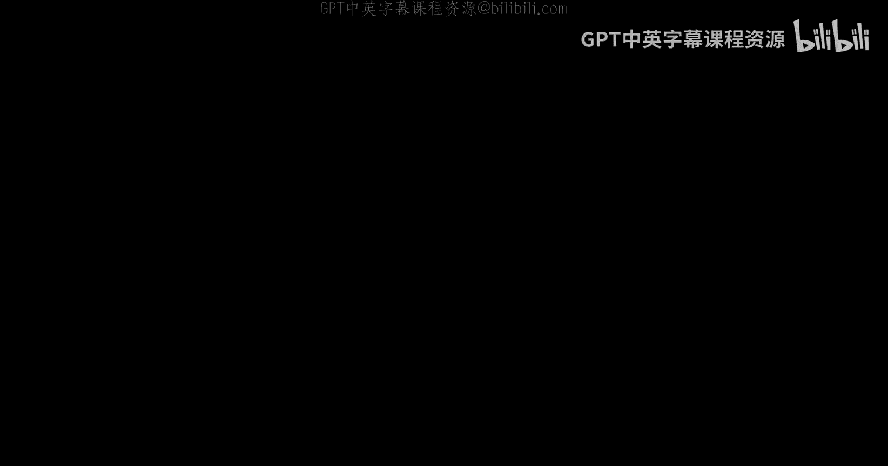
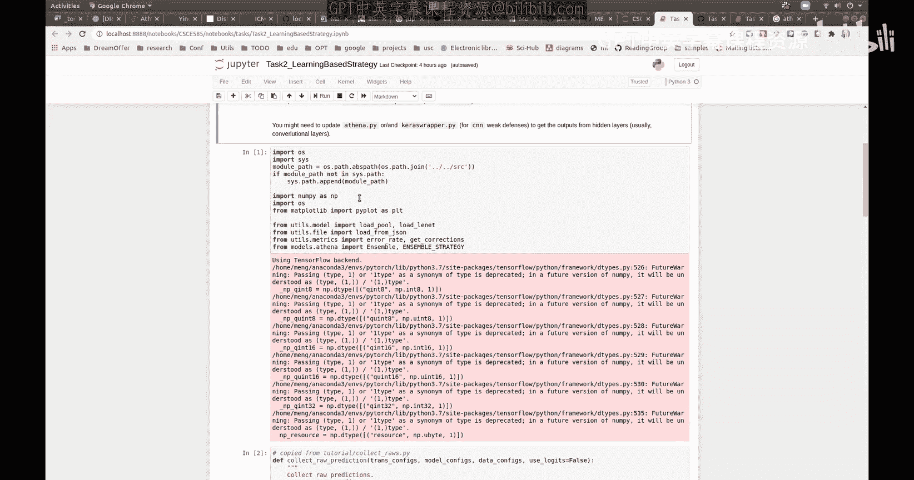
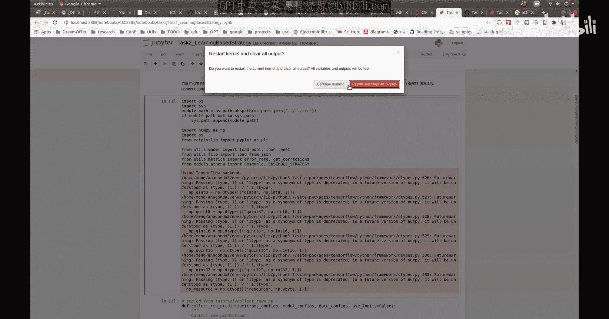
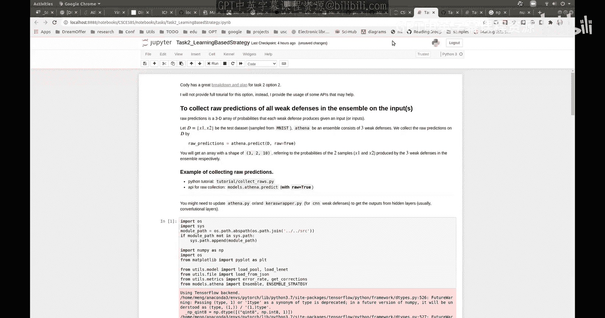

# 9.2：基于学习的策略教程 🧠



在本教程中，我们将学习如何为ATHEAN集成系统实现一个基于学习的策略。具体来说，我们将探讨如何收集弱防御模型的原始预测，并将其整理成适合训练一个回归模型的数据集，该模型将学习如何为每个输入样本选择最佳的弱防御模型。

---

## 概述

上一节我们介绍了任务的基本概念。本节中，我们将详细讲解如何利用API收集数据，并准备用于训练策略模型的数据集。核心在于理解原始预测数据的结构，并进行正确的维度转换。

## 数据收集与API使用

我们提供了一个API来收集集成系统中各个弱防御模型对输入数据的原始预测。这些预测以概率或逻辑值的形式返回。

以下是收集原始预测的核心代码示例：

```python
# 假设我们已经加载了一个名为`athena`的集成模型和一个测试数据集`test_data`
raw_predictions = athena.predict(test_data, raw=True)
```

此函数返回一个三维数组，其形状为 `(num_weak_defenses, num_samples, num_classes)`。例如，如果集成使用了3个弱防御模型，在2个样本（图像）上进行10分类任务，那么数组形状将是 `(3, 2, 10)`。

## 数据格式转换

然而，对于训练策略模型，我们通常期望的数据格式是：对于每一个输入样本，都能看到所有弱防御模型对其的预测。这意味着我们需要交换数组的第一维和第二维。





以下是进行维度转换的方法：

```python
# 将形状从 (弱防御数, 样本数, 类别数) 转换为 (样本数, 弱防御数, 类别数)
transposed_predictions = np.transpose(raw_predictions, (1, 0, 2))
```

转换后，`transposed_predictions[0]` 将包含第一个样本的所有弱防御模型的预测，这正是我们构建训练数据表所需的形式。

## 训练与测试数据分离的重要说明

一个关键的注意事项是：**绝不能使用最终的测试集来训练你的策略模型**。测试集在训练阶段必须是未知的，否则会导致模型过拟合，无法评估其真实性能。

以下是关于数据划分的建议：

*   如果你计划使用对抗样本（AEs）来训练策略模型，必须先将可用的对抗样本划分为训练集和验证集。
*   例如，如果有10K个对抗样本，你可以使用8K个作为训练数据，保留2K个用于后续测试模型性能。
*   在训练集上拟合你的回归模型，然后在未见过的验证集上评估它。

## 可选：收集逻辑值

除了概率，你可能还想获取模型在Softmax层之前的原始输出（即逻辑值）。这可以通过在加载模型池时设置参数来实现。

以下是收集逻辑值预测的示例：

```python
# 在加载弱防御模型池时，设置 use_logits=True
# ... 加载模型池的代码 ...
raw_logits = athena.predict(test_data, raw=True)
# 后续的转置操作与概率值相同
```

逻辑值可能包含比概率更丰富的信息，有时对训练策略模型更有帮助。

## 总结



本节课中我们一起学习了如何为ATHEAN的基于学习策略任务准备数据。我们介绍了如何使用提供的API收集弱防御模型的原始预测，如何通过转置操作将数据转换成更合适的格式，以及强调了将训练数据与测试数据严格分离的重要性。这些步骤是构建一个能够学习如何为不同输入选择最佳防御模型的基础。