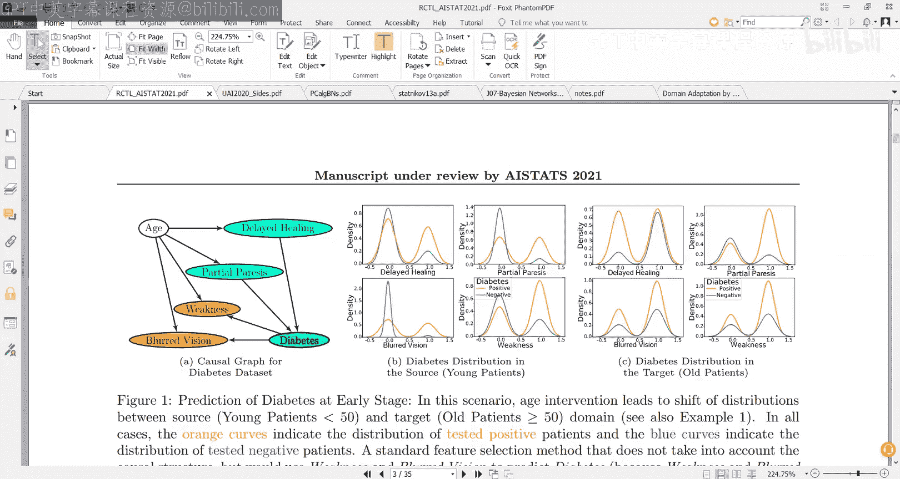

# 9.4：鲁棒因果迁移学习 👨‍🏫

在本节课中，我们将学习如何利用因果推断的思想，使机器学习模型在面对数据分布变化时，依然能保持鲁棒的预测性能。我们将从一个简单的例子出发，逐步理解核心概念，并最终介绍一种名为“鲁棒因果迁移学习”的方法。

## 概述

传统的机器学习模型通常在训练数据和测试数据来自相同分布的假设下工作。然而，在实际应用中，模型常常需要部署到与训练环境不同的新环境中，这被称为“域偏移”或“分布偏移”。本节课将探讨如何通过识别“因果不变特征”，使模型在源域和目标域之间实现鲁棒的迁移学习。

## 动机：为什么需要鲁棒性？

上一节我们概述了课程目标，本节中我们来看看一个具体的动机示例。

想象一个分类任务：区分奶牛和骆驼。我们有一个训练数据集，其中大部分骆驼的背景是沙漠，而奶牛是绿色的草地。一个传统的机器学习模型可能会很快学会将“沙漠背景”与“骆驼”关联，将“绿色背景”与“奶牛”关联。

然而，当这个模型被部署到一个新环境时，测试数据可能包含背景是草地的骆驼，或者背景是沙漠的奶牛。由于模型过度依赖背景（一个非因果的、会变化的特征），它很可能会在新环境中分类失败。

这个简单的故事可以推广到许多现实世界的问题。存在一些“上下文变量”，它们在训练环境和测试环境之间的分布会发生偏移。如果模型的学习依赖于这些变量，其性能就会下降。

## 核心概念：因果图与d-分离

为了形式化地解决这个问题，我们需要一些关于因果图和d-分离的背景知识。

一个**因果图**（或**有向无环图，DAG**）是一个没有有向环的图。图中的有向边具有因果解释，例如，边 `X -> Y` 表示 `X` 是 `Y` 的原因。

**d-分离**是判断图中两个变量集在给定第三个变量集时是否条件独立的一种标准。理解d-分离需要了解三种基本连接方式：

以下是三种基本连接方式及其d-分离性质：

1.  **链式连接（Serial Connection）**：`A -> B -> C`
    *   如果**观测**了中间变量 `B`，则 `A` 和 `C` 被d-分离（即独立）。
    *   如果**未观测** `B`，则 `A` 和 `C` 通常是相关的。

2.  **分叉连接（Diverging Connection）**：`B <- A -> C`
    *   如果**观测**了共同原因 `A`，则 `B` 和 `C` 被d-分离。
    *   如果**未观测** `A`，则 `B` 和 `C` 通常是相关的。

3.  **对撞连接（Colliding Connection）**：`B -> A <- C`
    *   如果**观测**了对撞点 `A`，则 `B` 和 `C` 变得相关（即d-连接）。
    *   如果**未观测** `A`，则 `B` 和 `C` 被d-分离（即边际独立）。

理解这些连接方式后，我们可以分析之前的抽象例子。假设我们想预测变量 `X2`，并且存在一个上下文变量 `C1`，其分布在环境间会偏移。连接 `C1 -> X1 -> X2` 是一个链式连接，观测 `X1` 会阻断 `C1` 对 `X2` 的影响。而连接 `C1 -> X3 <- X2` 是一个对撞连接，**观测** `X3` 会**打开** `C1` 到 `X2` 的路径。因此，如果使用 `X3` 来预测 `X2`，上下文变量 `C1` 的分布偏移就会通过这条打开的路径直接影响预测，导致性能下降。这解释了为什么使用 `X1` 比使用 `X3` 更好。

## 实例：糖尿病诊断

让我们看一个更贴近现实的例子：糖尿病诊断。

我们收集了患者数据，包括年龄、伤口愈合延迟、局部麻痹、虚弱和视力模糊等症状。我们知道，所有这些症状都受年龄影响。同时，糖尿病会导致虚弱和视力模糊，而这两种症状又可能引起局部麻痹和愈合延迟。

假设真实的因果图如课程所示。我们按年龄（以50岁为界）将数据分为“年轻”和“年老”两个环境。可以观察到，几乎所有变量（包括糖尿病本身）的分布在两个环境间都存在显著偏移。

在这种情况下应该怎么做？根据因果图分析，我们**不应该**使用“虚弱”和“视力模糊”这两个变量来跨环境预测糖尿病。因为使用它们（即对其条件化）会打开“年龄”到“糖尿病”的路径（它们是对撞连接中的对撞点）。年龄分布在环境间的偏移会通过这条路径影响预测。

更好的选择是使用“局部麻痹”和“愈合延迟”。首先，它们是糖尿病的**结果**（因果效应）。其次，使用它们不会打开年龄到糖尿病的路径（它们是链式连接的中间变量），从而阻断了年龄分布偏移的直接干扰。实验结果表明，使用全部四个症状的均方误差为0.29，而仅使用这两个“因果不变特征”的均方误差降至0.2。

## 问题定义与假设

我们的核心任务是：给定数据集，找出那些能够使预测在源环境和目标环境之间保持鲁棒的**因果不变特征**。

然而，我们通常并不知道真实的因果模型。因此，我们希望开发一种方法，即使在不已知因果图的情况下也能找到这些特征。为此，我们需要一些假设：

以下是该方法依赖的核心假设：

*   **马尔可夫性（Markov Condition）**：在因果图中，d-分离意味着数据中的条件独立性。
*   **忠诚性（Faithfulness）**：数据中的条件独立性必然由因果图中的d-分离导致。（即图与数据没有意外的独立性）
*   **无直接因果假设**：上下文变量（C）与目标变量（T）之间没有直接的因果边。这是一个当前工作的局限性。
*   **允许未观测混杂因子**：我们**不假设**因果充分性。数据中可能存在未观测的共同原因（混杂因子），这通过使用**有向无环混合图（ADMG）** 来建模，该图允许双向边 `<->` 表示未观测的混杂。

## 解决方案：利用马尔可夫毯

在ADMG中，我们证明了一个关键结论：要找到因果不变特征，只需关注目标变量 `T` 的**马尔可夫毯**。

**马尔可夫毯**是图中能使目标变量与图中所有其他变量条件独立的最小变量集合。在DAG中，它包含 `T` 的父节点、子节点以及子节点的其他父节点（共亲）。

在允许双向边的ADMG中，马尔可夫毯被推广为：所有与 `T` 之间存在**对撞路径**的变量集合。（单条边也被视为对撞路径）。

聚焦于马尔可夫毯有两个主要优势：
1.  **缩小搜索空间**：无需在全变量集中搜索，提高了算法的可扩展性。
2.  **理论保证**：我们证明了，要找到能d-分离上下文变量与目标变量的特征集，只需在马尔可夫毯的子集中寻找即可。

此外，另一个重要贡献是，我们证明了传统的马尔可夫毯学习算法（原本为DAG设计）可以直接应用于ADMG而无需修改，这非常实用。

## RCTL算法流程

基于以上理论，我们提出了**鲁棒因果迁移学习（RCTL）** 算法。其流程非常简单直接：

以下是RCTL算法的核心步骤：

1.  **学习马尔可夫毯**：从数据中学习目标变量 `T` 的马尔可夫毯 `MB(T)`。
2.  **搜索分离集**：在 `MB(T)` 中寻找一个最小的变量子集 `S`，使得在给定 `S` 的条件下，上下文变量 `C` 与目标变量 `T` 独立（即 `C ⊥ T | S`）。
3.  **输出与预测**：如果找到这样的集合 `S`，则使用 `S` 中的特征在目标环境中进行预测；如果找不到，则算法报告失败。

## 实验评估

我们在合成数据集和真实数据集上评估了RCTL算法的性能。

在合成数据中，我们从一个已知的因果图生成数据，并在源和目标环境中对上下文变量施加分布偏移。结果表明，与其他迁移学习或特征选择方法相比，RCTL在预测均方误差上表现更优，且具有可扩展性。

在真实的糖尿病数据集上，我们按年龄划分环境，使用RCTL预测糖尿病。结果同样显示，RCTL能够取得更好的预测性能，这验证了该方法在未知真实因果模型时的实用性。

## 总结与未来方向

本节课中我们一起学习了如何将因果推断用于鲁棒迁移学习。

我们从一个经典的域适应问题出发，解释了为什么依赖非因果的关联特征会导致模型在分布偏移下失效。通过引入因果图、d-分离和马尔可夫毯的概念，我们形式化了“因果不变特征”的思想。接着，我们介绍了RCTL算法，它能够在未知因果图的情况下，高效地寻找这类特征，从而提升模型在新环境中的鲁棒性。

当前工作存在一些局限性，例如假设上下文变量与目标变量无直接因果边。未来的研究方向包括放松这些假设，以及探索如何将因果推理更广泛地应用于提升机器学习系统的稳健性和可解释性。