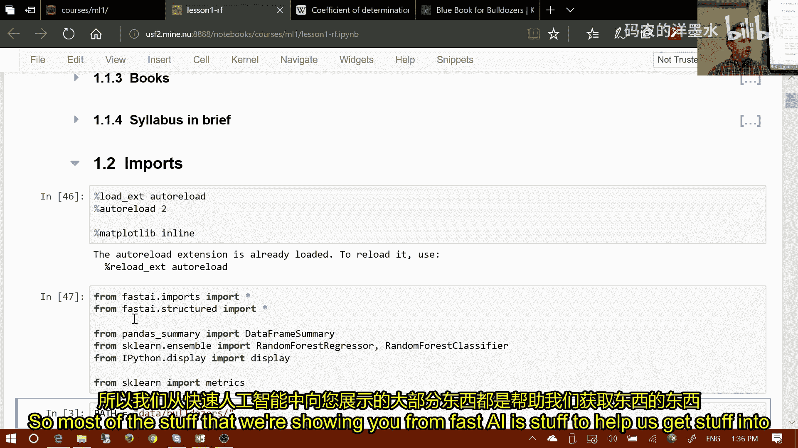
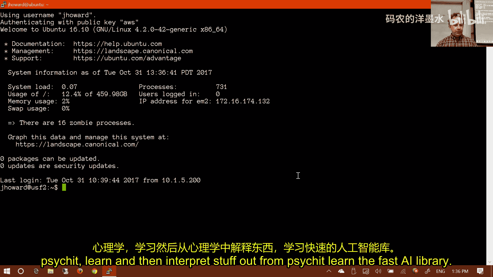

# 002：随机森林深度解析 🚀

在本节课中，我们将深入学习随机森林算法。到目前为止，我们只了解到存在一种叫做随机森林的方法，它在某些数据集上表现非常出色，且无需太多调整。但我们还不清楚它具体是如何工作的，如果效果不佳该怎么办，它的优缺点是什么，以及我们可以调整哪些参数。接下来，我们将探讨所有这些内容。之后，我们将学习如何解释随机森林的结果，不仅是为了获得预测，更是为了以模型驱动的方式深入理解我们的数据。这就是我们接下来的学习方向。

## 回顾与准备 📚

首先，我们来回顾一下目前的学习进度。我们了解到有一个名为Fast AI的库，它是一个“高度固执己见”的库。这意味着我们投入了大量时间研究如何获得最先进的结果，然后将这些技术打包成代码，以便大家也能使用这些先进技术。在可能的情况下，我们会在现有代码（如Scikit-learn）的基础上进行封装或提供额外功能。因此，我们展示的许多Fast AI内容，都是为了帮助我们将数据输入Scikit-learn，并从中解释结果。

在我们的环境中，笔记本位于Fast AI仓库的`courses/ml1`目录下。这里有一个指向父目录的符号链接，该目录包含了一系列模块。如果你想在自己的代码中使用Fast AI库，有几种方法：可以将你的笔记本或脚本放在与`ml1`或`dl1`相同的目录下，通过符号链接导入；也可以复制这个目录到其他地方使用；或者像我们一样，从你需要使用的地方创建一个符号链接。

## 数据准备与评估指标 📊

我们的数据来自“蓝皮书推土机价格预测”竞赛，存储在`data/bulldozers`目录中。我们能够读取CSV文件，唯一需要做的就是指定哪些列是日期列。完成这一步后，我们就可以查看数据的前几行。

理解项目的评估指标至关重要。对于Kaggle竞赛，他们会告知评估指标。在这个案例中，评估指标是**均方根对数误差**。其公式为：

\[
RMSLE = \sqrt{\frac{1}{n} \sum_{i=1}^{n} (\log(y_i + 1) - \log(\hat{y}_i + 1))^2}
\]

如果我们用`log(actuals)`替换`actuals`，用`log(predictions)`替换`predictions`，那么这就等同于**均方根误差**。因此，我们所做的就是用`sale price`的对数替换`sale price`本身。这样，当我们优化RMSE时，实际上就是在优化对数价格的RMSE。

## 数据预处理与建模 🔧

我们需要将所有列转换为数值。首先，处理日期列：我们移除了原始日期列，取而代之的是添加了一系列新列，例如：该日期是否是一个季度的开始、是否是一年的结束、自1970年1月1日以来的天数、年份、月份、星期几等。这些全部都是数值。

接着，我们使用`train_cats`函数将所有字符串列替换为**类别**类型。这样做之后，数据看起来仍然是字符串，但数据类型实际上已变为`category`。这是一个Pandas类，你可以通过`.cat.`访问其属性，例如`.cat.categories`可以获取所有可能的类别列表。然后，我们可以使用`.cat.codes`来获取对应的数字编码。为了实际使用这些数据，我们需要将所有类别列替换为它们的编码值（加1，因为未知类别原本是-1，我们希望它是0）。我们使用`proc_df`函数来完成这个转换。

`proc_df`函数还做了另一件事：对于存在缺失值的连续列，用中位数填充缺失值，并添加一个名为`{column_name}_na`的布尔列，指示该条目是否缺失。

完成这些后，我们调用`RandomForestRegressor`并计算`.score`，得到了一个**R²**分数0.98。

## 理解R²分数 📈

R²分数衡量了模型解释数据方差的能力。其公式为：

\[
R^2 = 1 - \frac{SS_{res}}{SS_{tot}}
\]

其中：
*   \( SS_{tot} = \sum (y_i - \bar{y})^2 \) 是总平方和（朴素均值模型的误差）。
*   \( SS_{res} = \sum (y_i - \hat{y}_i)^2 \) 是残差平方和（我们模型的误差）。

简单来说，R²是比较我们的模型与仅预测均值的朴素模型之间的表现。如果我们的模型和朴素模型一样好，则R²为0。如果我们的模型完美预测，则R²为1。但R²的值域可以小于1，甚至为负。负的R²意味着你的模型比简单预测均值还要差。

在我们的案例中，R²为0.98，表明模型在训练集上拟合得非常好。然而，这可能是**过拟合**的迹象——模型在训练数据上表现完美，但在未见过的数据上可能表现糟糕。

## 验证集的重要性 🛡️

因此，我们总是需要一个**验证集**。创建验证集是机器学习项目建模过程中最重要的一步。我们需要一个数据集，模型在该数据集上的分数能够代表其在真实世界（如Kaggle排行榜或生产环境）中的表现。

对于这个有时间序列属性的竞赛，测试集包含了训练集之后日期的数据。为了模拟这种情况，我们的验证集也应该是一个独立的时间段。我们取数据集的最后12,000行作为验证集，其余部分作为训练集。

当我们用验证集评估模型时，发现训练集R²为0.982，而验证集R²仅为0.887。这表明存在明显的过拟合。尽管如此，其对数价格的RMSE仍然能使我们在竞赛中进入前25%。所以，虽然过拟合，但结果并不差。

## 决策树基础 🌳

为了理解随机森林，我们先从它的基础组件——**决策树**开始。我们构建了一棵深度为3、没有随机性（`bootstrap=False`）的小决策树。这棵树的R²只有0.4，虽然不好，但我们可以将其可视化。

一棵树由一系列**二元分裂**构成。在根节点，我们有20,000个样本。算法会尝试每个变量以及该变量的每个可能分割点，计算分裂后两个子组的**加权平均均方误差**。它选择能最大程度降低这个误差的变量和分割点进行分裂。然后，在每个子节点上重复这个过程，直到达到预设的深度限制，或者每个叶节点只包含一个样本。

## 从树到森林：Bagging 🌲➡️🌳🌳🌳

单棵决策树容易过拟合。**Bagging**是一种通过组合多个模型来减少方差、提高泛化能力的技术。其核心思想是：训练多个略有差异、预测结果互不相关的模型，然后取它们的平均值。这样，各个模型的随机误差会相互抵消，留下真正的数据关系。

**随机森林**就是对决策树进行Bagging。具体做法是：
1.  从原始数据集中进行**有放回抽样**，生成多个不同的子数据集。
2.  在每个子数据集上训练一棵深度决策树（允许过拟合）。
3.  对于新的预测，让每棵树独立预测，然后取所有树预测结果的平均值。

通过增加树的数量，模型的性能会提升并逐渐趋于稳定。在实践中，你可以使用尽可能多的树，只要时间允许。

## 关键超参数调优 ⚙️

我们学习了几种调整随机森林性能的超参数：

1.  **`n_estimators`**：森林中树的数量。越多越好，但会带来计算成本。通常可以先使用较少的树（如20-30棵）进行快速实验，最终确定方案后再使用大量树。

2.  **`min_samples_leaf`**：叶节点所需的最小样本数。设置这个值可以阻止树生长得过深，有助于防止过拟合，使每棵树泛化得更好，同时训练更快。常用值如1, 3, 5, 10, 25。

3.  **`max_features`**：每次分裂时随机考虑的特征数量。这增加了树之间的差异性，是提升模型性能的关键。可以设置为固定比例（如0.5）、`'sqrt'`（特征数的平方根）或`'log2'`（特征数的对数）。

4.  **`oob_score`**：袋外分数。由于每棵树只使用了约63.2%的样本进行训练，剩余的36.8%的样本（袋外样本）可以用于验证该棵树。计算所有树的袋外预测的平均值，可以得到一个无需单独划分验证集就能估算模型泛化性能的指标。这对于小数据集或快速评估非常有用。

5.  **`set_rf_samples`**：设置每棵树训练时使用的样本数量。对于超大数据集，可以使用此方法让每棵树只在一个子集上训练，从而大幅加快训练速度，同时通过增加树的数量来保证模型看到足够多的数据。

## 实践与总结 🏆

通过一些简单的超参数调整（例如，设置`min_samples_leaf=3`和`max_features=0.5`），我们成功地将验证集R²从0.898提升到了0.906，对应的RMSE也下降了。根据历史排行榜估算，这个成绩大约能进入该Kaggle竞赛的前20名。

随机森林的强大之处在于其**稳健性和易用性**。即使不做精细调参，它通常也能给出不错的结果。它对数据预处理的要求相对宽松（例如，无需对类别变量进行独热编码，简单的整数编码即可），并且能自动捕捉变量间的复杂交互关系。

本节课中，我们一起深入学习了随机森林的工作原理、如何构建决策树、Bagging如何通过组合多棵树来提升模型性能，以及几个关键超参数的调优方法。我们还强调了使用验证集和袋外分数来评估模型泛化能力的重要性。

在接下来的课程中，我们将学习如何解释训练好的随机森林模型，从而更深入地理解数据，并进一步改进模型。请大家在本周积极实验，尝试查看单棵树的结构、绘制误差曲线、编写自己的评估函数，以加深对随机森林和数据本身的理解。