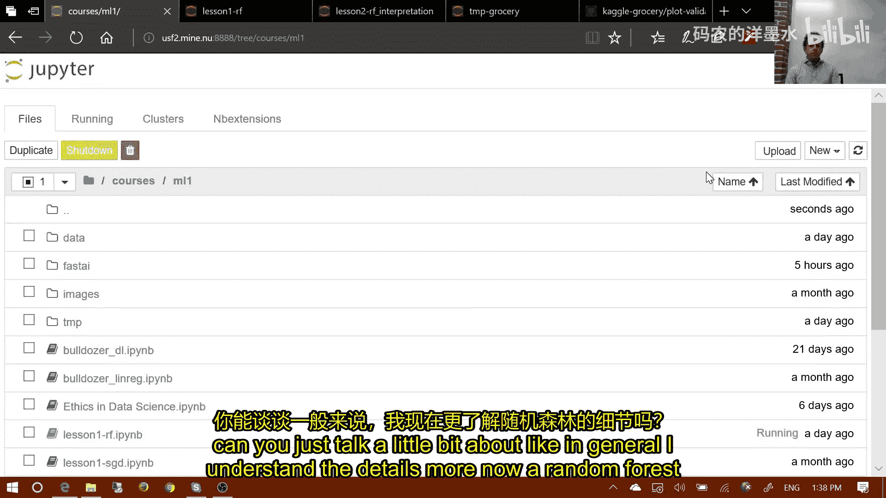
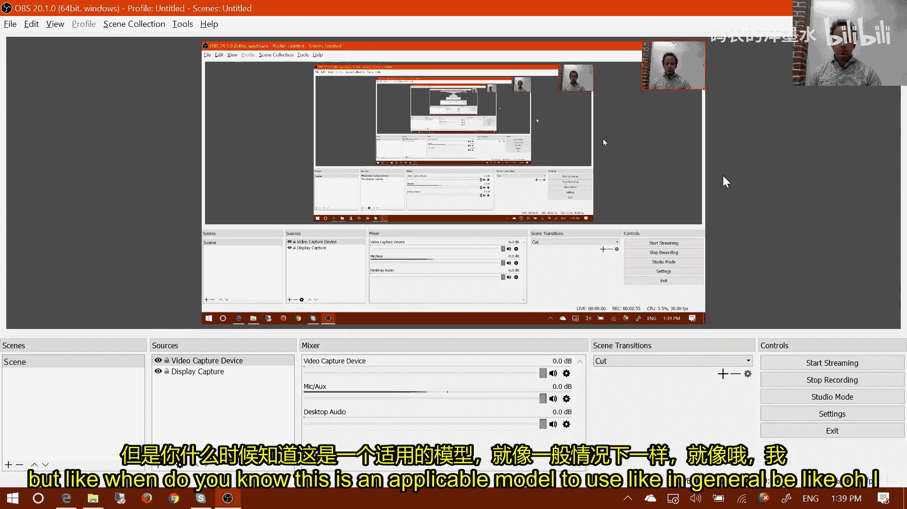
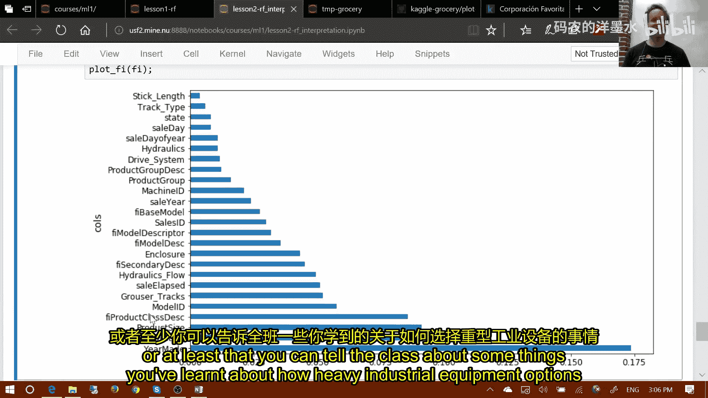

# 003：性能、验证与模型解释 🧠






在本节课中，我们将学习如何评估和解释机器学习模型。我们将重点关注随机森林模型，学习如何衡量其性能、验证其有效性，并深入理解模型从数据中学到了什么。这对于构建可靠且可解释的模型至关重要。

上一节我们介绍了随机森林的基本概念及其调优方法。本节中，我们将探讨如何评估模型性能，并学习如何解释模型以更好地理解数据。

## 模型性能与验证 📊

为了实践这些概念，我们需要一个Jupyter Notebook环境。你可以选择在本地安装Anaconda，使用AWS，或者直接使用crestle.com或Paperspace.com等已配置好的在线环境。

假设你已经搭建好环境，并有机会在本周练习运行随机森林。需要指出的是，在我们进行任何超参数调整之前，模型的默认设置通常已经能为从Kaggle获取的真实数据集提供相当不错的结果。

但有时，调优是完全必要的。不过，很多时候，即使不做太多调整，模型也能表现良好。

今天，我们将学习一些我认为比单纯构建一个高预测性能的模型更重要的事情：学习如何解释模型，以发现它揭示了数据的哪些信息，从而通过机器学习更深入地理解数据。

这与常见的说法——随机森林等模型是隐藏意义的“黑箱”——恰恰相反。事实上，随机森林使我们能够比传统方法更深入、更快速地理解数据。

我们还将学习如何处理比默认设置能导入的更大的数据集。具体来说，我们将查看一个超过1亿行的数据集，即当前的Kaggle杂货销售预测竞赛。

## 竞赛数据概览 🛒

在深入模型解释之前，我们先来看看这个大型数据集。本次竞赛是“杂货销售预测”。

以下是该问题的关键信息：
*   **预测目标（因变量）**：在接下来两周内，每家商店、每种商品每天的销售数量。
*   **可用信息（自变量）**：
    *   过去几年的历史销售数据（按日期、商店、商品）。
    *   商店的元数据（如位置、类别）。
    *   商品的元数据（如类别）。
    *   日期的元数据（如油价）。
*   **数据结构**：这是一个典型的“星型模式”关系型数据集。中心是交易表（`train.csv`），记录了日期、商店ID、商品ID和销售数量。其他元数据表可以连接到这个中心表上。

## 处理大型数据集 🚀

处理大型数据集时，不能简单地使用默认方式读取CSV文件，否则可能会耗尽内存。以下是关键步骤：

1.  **指定数据类型**：在读取CSV时，手动为每列指定最节省内存的数据类型（如`int8`, `int32`）。
2.  **处理布尔值和缺失值**：将对象类型转换为布尔类型，并用`False`填充缺失值（需先通过探索性数据分析确认合理性）。
3.  **使用高效格式**：将处理好的数据保存为Feather格式，这种格式读写速度极快，因为它与内存中的数据格式几乎相同。
4.  **数据采样**：在初始探索和模型调试阶段，使用随机样本（例如通过Unix的`shuf`命令）来快速迭代，而不是直接处理全部数据。

以下是读取和处理大型数据集的核心代码示例：

```python
# 定义列数据类型以节省内存
types = {'store_nbr': 'int8', 'item_nbr': 'int32', 'unit_sales': 'float32', 'onpromotion': 'object'}

# 读取CSV
df = pd.read_csv('train.csv', dtype=types, parse_dates=['date'])

# 处理‘onpromotion’列：填充缺失值，转换布尔类型
df['onpromotion'].fillna(False, inplace=True)
df['onpromotion'] = df['onpromotion'].map({'True': True, 'False': False})
df['onpromotion'] = df['onpromotion'].astype('bool')

# 保存为Feather格式以便快速后续读取
df.to_feather('tmp/groceries')
```

## 构建初始随机森林模型 🌲

对于这个预测问题，我们可以构建一个随机森林回归模型。流程与之前类似，但需要注意几点以适应大数据集：

*   **设置`set_rf_samples`**：不要用全部1.2亿条记录训练每棵树，这太慢。可以先用一个较小的样本量（如100万）进行快速实验。
*   **避免使用`oob_score`**：当使用`set_rf_samples`时，计算袋外分数会用到其他大量数据，仍然很慢。更好的方法是手动创建一个验证集。
*   **数据转换优化**：将数据框提前转换为浮点数数组（`np.array(df, dtype=np.float32)`），可以避免模型内部重复转换，节省时间。
*   **性能剖析**：使用`%prun`魔法命令分析代码运行时间，找出瓶颈并进行优化。

以下是核心建模代码：

```python
# 设置每棵树的样本数
set_rf_samples(1_000_000)

# 将数据转换为数组以加速
X = np.array(trn, dtype=np.float32)

# 初始化并训练随机森林回归器
m = RandomForestRegressor(n_estimators=20, min_samples_leaf=3, max_features=0.5, n_jobs=-1)
m.fit(X, y_train)

# 在验证集上预测并评估
preds = m.predict(np.array(val, dtype=np.float32))
rmse = math.sqrt(mean_squared_error(y_val, preds))
```

## 验证集构建的重要性 🎯

构建一个可靠的验证集对于模型开发至关重要。验证集应该尽可能模拟测试集（或未来生产环境）的数据特性。

对于时间序列数据（如本次销售预测），一个关键原则是：**验证集的时间段应在训练集之后，并且其时间特征（如星期几、是否节假日、是否发薪日）应与测试集相似**。

你可以通过以下方法校准验证集：
1.  构建几个不同复杂度的模型。
2.  在验证集和测试集（通过提交到Kaggle）上分别计算这些模型的分数。
3.  绘制散点图，X轴为测试集分数（领导板分数），Y轴为验证集分数。
4.  如果验证集是好的，这些点应该大致呈一条直线。这样，你就可以信任验证集上的分数变化能反映模型在测试集上的相对表现。

## 模型解释：超越黑箱 🔍

现在，进入本节课的核心——模型解释。我们将学习三种从随机森林中提取洞见的方法。

### 1. 预测置信度 📈

随机森林由多棵树组成。对于一个数据点，每棵树都会给出一个预测。这些预测值的**标准差**可以衡量模型对该预测的置信度。

*   **标准差小**：所有树的预测很接近，模型对该数据点很自信（可能因为训练集中类似样本多）。
*   **标准差大**：不同树的预测差异大，模型对该数据点不确定（可能因为它是罕见或独特的样本）。

计算预测标准差的方法如下：

```python
# 并行获取每棵树对验证集的预测
preds_per_tree = parallel_trees(m, lambda t: t.predict(X_val), n_jobs=-1)
# 将结果堆叠起来
all_preds = np.stack(preds_per_tree)
# 计算每个样本的预测均值和标准差
pred_mean = all_preds.mean(axis=0)
pred_std = all_preds.std(axis=0)
```

你可以将置信度（标准差）与预测值一起分析，例如按类别分组查看平均置信度，或在生产系统中对低置信度的预测采取更谨慎的策略。

### 2. 特征重要性 🥇

这是最常用且最重要的解释工具。它能告诉我们数据集中哪些列（特征）对预测结果最有影响力。

**计算方法（排列重要性）**：
1.  在原始数据上计算模型的性能分数（如R²）。
2.  对于每一个特征列，将其值随机打乱（破坏该特征与目标值的关系）。
3.  用打乱后的数据再次通过模型计算性能分数。
4.  该特征的重要性就是原始分数与打乱后分数下降的幅度。下降越多，特征越重要。

**Fast.ai库提供了简便的函数**：

```python
fi = rf_feat_importance(m, df_trn)
fi.plot('cols', 'imp', figsize=(10,6), legend=False)
```

特征重要性图几乎总是显示：少数几个特征至关重要，而大多数特征贡献甚微。这能指导你的后续工作：
*   **深入理解重要特征**：与业务方沟通，研究数据字典，绘制这些特征与目标值的关系图（如`YearMade`与价格的关系图）。
*   **发现数据问题**：有时重要特征可能揭示了数据泄露（例如，某些信息在预测时实际不可用）或共线性问题。
*   **简化模型**：可以移除重要性极低的特征，这通常不会降低模型精度，甚至可能因减少噪声而略有提升，同时使模型更简洁、训练更快。

### 3. 部分依赖分析 📉

除了重要性，我们还想知道一个特征如何影响预测。例如，“制造年份”越大，预测价格是越高还是越低？部分依赖图可以显示在保持其他特征平均值不变的情况下，某个特征值变化对预测结果的边际效应。

（注：虽然视频中未详细展开代码，但这是重要的解释性工具。可以使用`sklearn.inspection`模块的`PartialDependenceDisplay`或相关库来绘制。）

## 总结与课后任务 ✅

本节课中我们一起学习了：
1.  **处理大型数据集**的技巧，包括指定数据类型、使用Feather格式和采样策略。
2.  **构建可靠验证集**的重要性，特别是在时间序列问题中，验证集应模拟测试集的时间特性。
3.  **模型解释的核心方法**：
    *   利用多棵树预测的**标准差**来评估**预测置信度**。
    *   通过**排列重要性**计算**特征重要性**，识别关键驱动因素并指导后续分析和特征工程。
    *   简介了**部分依赖分析**，用于理解单个特征对预测的具体影响模式。



**课后任务**：
对于推土机价格预测数据集，请尝试：
1.  运行代码，生成特征重要性图。
2.  深入研究排名前5-10的重要特征（如`YearMade`, `Coupler_System`）。
3.  针对每个重要特征：
    *   了解它的业务含义。
    *   绘制其与目标值（销售价格）的关系图（散点图、箱线图等）。
    *   检查数据质量（是否有噪声、异常编码、高基数分类变量如何处理）。
    *   思考是否可以从中提取更有信息的新特征（例如，从`ProductClassDesc`中解析出层级信息）。
4.  目标是获得关于数据的更深刻洞见，并尝试通过你的发现来改进模型性能。