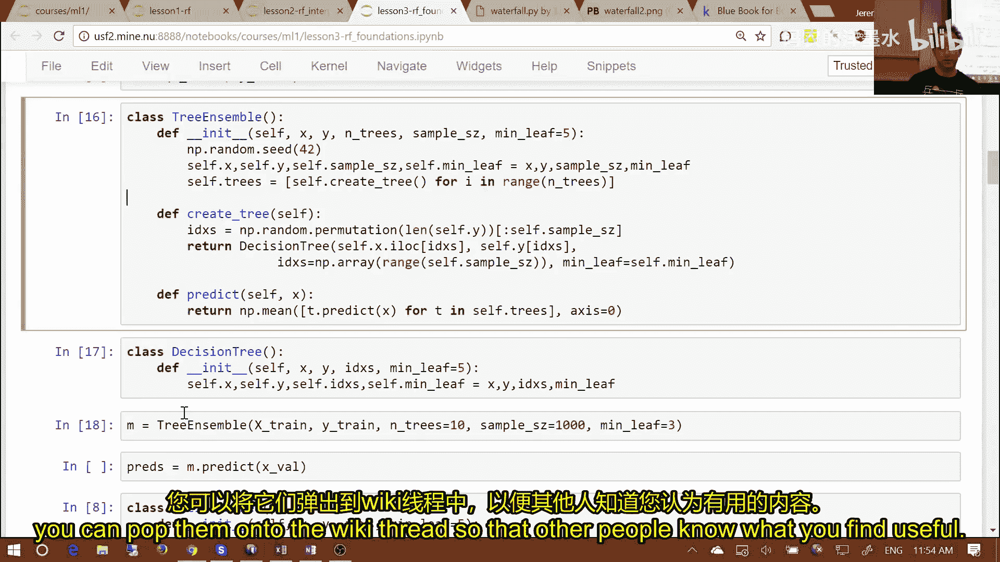

# 005：外推与随机森林

## 概述

在本节课中，我们将要学习机器学习中关于泛化能力评估的核心概念，包括训练集、验证集、测试集以及OOB（袋外）误差。我们还将深入探讨决策树解释器的工作原理，并开始动手构建我们自己的随机森林模型。课程内容将涵盖如何正确评估模型性能、处理时间序列数据中的外推问题，以及使用面向对象编程（OOP）方法实现机器学习算法。

---

## 回顾：泛化与数据集划分

上一节我们介绍了机器学习的基本目标。与许多其他领域不同，机器学习关注的核心是模型的**泛化能力**，即模型在未见过的数据上的表现。为了评估这种能力，我们需要对数据进行恰当的划分。

### 数据集划分的目的

我们有一个包含多行数据的数据集，以及一个因变量。机器学习的目标是构建一个能够准确预测新数据的模型，而不仅仅是完美拟合已有数据。例如，一个能完美区分5张猫和5张狗图片的模型，如果无法正确分类新的猫狗图片，就说明它没有学会区分猫狗的本质特征，而是记住了训练样本的特定细节。这就是**泛化失败**。

### 标准划分方法

最常见的评估泛化能力的方法是随机抽取一部分数据作为**测试集**，剩余数据作为**训练集**。模型在训练集上构建，最终在测试集上评估其性能。

然而，这里存在一个问题：如果模型在测试集上表现不佳，我们可能会返回调整超参数或进行数据增强，然后再次测试。反复尝试后，我们可能偶然找到一个在特定测试集上表现良好的模型，但这并不意味着它真正具有泛化能力。我们可能只是**过拟合**了这一个测试集。

为了解决这个问题，我们通常采用两层划分：

1.  **训练集**：用于构建模型。
2.  **验证集**：用于在模型开发过程中评估和调整模型，选择超参数。
3.  **测试集**：在项目最终阶段，用于对选定模型进行最终、无偏的评估。

通过这种方式，验证集帮助我们避免在测试集上进行“数据窥探”，确保最终评估的公正性。

---

## 随机森林的OOB误差

对于随机森林模型，我们有一个技巧可以避免单独划分验证集，即使用**OOB（袋外）误差**。

### OOB误差的原理

在训练随机森林的每一棵树时，我们使用自助采样法（bootstrap）从训练集中有放回地抽取样本。平均而言，每次采样大约有37%的原始样本不会被抽中，这些样本称为该树的**袋外样本**。

OOB误差的计算方法是：对于数据集中每一行，找出所有没有使用该行进行训练的树，用这些树对该行进行预测，然后对所有预测结果取平均，作为该行的最终OOB预测。最后，计算所有行的OOB预测误差。

### OOB误差与验证集分数的比较

OOB分数在概念上类似于验证集分数，但**平均而言，OOB分数会略差一些**。原因在于：验证集预测使用了森林中**所有**的树，而OOB预测对于每一行只使用了森林中**一个子集**的树（即那些该行未被抽中的树）。使用更少的树进行预测，平均准确度自然会稍低一些。

尽管如此，OOB误差通常足够接近，可以作为模型泛化能力的一个有用估计，尤其是在数据划分的早期阶段。

---

## 验证集构建的注意事项

使用随机抽样创建验证集是最简单的情况，但并非总是适用。

### 时间序列数据

对于涉及时间序列或预测的问题，我们不能简单地随机抽取验证集，因为这会破坏数据的时间顺序。模型的目标是预测未来，因此验证集必须代表“未来”的数据。

正确的做法是：将数据按时间排序，**用最近一段时间的数据作为验证集**，用更早的数据作为训练集。这样，我们测试的是模型对“未来”事件的预测能力，这才是实际应用中所关心的。

### 处理时间依赖性的策略

如果模型在训练集和OOB上表现良好，但在时间序列验证集上表现不佳，说明模型未能捕捉时间趋势。此时可以尝试：
*   仅使用最近的数据进行训练。
*   在随机森林中为每条数据赋予权重，使近期数据有更高概率被选中。

一个实用的工作流程是：
1.  在训练集上构建多个不同配置的模型（例如，使用全部数据、仅用近期数据、使用不同特征集等）。
2.  在验证集上评估这些模型，得到一系列（验证集分数，测试集分数）点对。
3.  绘制这些点对。如果验证集是有效的，那么验证集分数的提升应该与测试集分数的提升呈正相关关系（大致呈一条直线）。如果不是，则需要调整验证集的构建方式（例如，尝试不同时间窗口），直到找到能有效指示测试集性能的验证集。

**构建一个能真实反映生产环境情况的测试集，是机器学习项目中最关键的步骤之一。** 一个糟糕的测试集会让你误以为模型表现良好，从而导致在生产环境中部署失败。

---


## 交叉验证

交叉验证是另一种评估技术，但需要谨慎使用。

### 交叉验证的步骤
1.  将数据随机打乱。
2.  将数据平均分成k份（例如5份）。
3.  进行k轮训练和验证：每一轮，将其中一份作为验证集，其余k-1份作为训练集。
4.  计算k轮验证分数的平均值作为最终评估指标。

### 交叉验证的优缺点

**优点**：
*   在小数据集上能更充分地利用数据。
*   可以得到k个模型，可用于集成。

**缺点**：
*   **计算成本高**：需要训练k个模型。
*   **可能不适用**：对于时间序列等非独立同分布数据，随机打乱会破坏数据的内在结构，使得交叉验证的结果不具有参考价值。此时，基于时间顺序的验证集划分更为合适。

因此，在数据量充足且问题不涉及强时间依赖时，简单的单次验证集划分通常是更高效、更直接的选择。

---

## 决策树与随机森林解释

理解模型为何做出特定预测至关重要。对于随机森林，我们可以使用`treeinterpreter`库来分解预测结果。

### 单棵决策树的解释

考虑一棵决策树，其根节点包含了所有训练样本因变量的平均值。随着我们在树上向下遍历，根据特征进行分裂，每个节点代表了满足之前所有分裂条件的样本子集的平均值。

对于一个具体的预测，我们可以追踪从根节点到最终叶节点的路径。路径上每个分裂点带来的因变量平均值的变化，就是该特征对最终预测的“贡献”。最终预测值等于根节点的平均值加上路径上所有特征贡献的总和。

### 瀑布图

这种贡献可以直观地表示为**瀑布图**。瀑布图从左到右显示了起始值（全体平均值），然后依次增加或减少每个特征的贡献，最终到达预测值。蓝色条表示正向贡献，红色条表示负向贡献。

### 随机森林的解释

对于随机森林，`treeinterpreter`对森林中所有树的贡献进行平均。对于一条数据，它可以输出：
*   `bias`：森林中所有树的根节点平均值（即训练集全局平均值）。
*   `contributions`：一个列表，包含每个特征对预测的平均贡献（正值表示提升预测，负值表示降低预测）。
*   `prediction`：`bias`与所有`contributions`之和，即模型的最终预测值。

这种方法使得复杂的随机森林模型变得高度可解释，我们可以清楚地看到是哪些特征及其取值导致了特定的预测结果。

---

## 处理外推问题

随机森林在处理**外推**（预测训练数据范围之外的情况）时存在挑战，尤其是在时间序列中。

### 问题描述

随机森林通过查找历史数据的平均值来进行预测。如果数据具有时间趋势（例如，价格随时间上涨），而模型没有显式的时间特征，那么当预测未来时间点时，它只能给出历史上相似条件的平均价格，无法捕捉趋势性的增长。

### 识别时间依赖性特征

一个有用的技巧是：将训练集和验证集合并，创建一个新的二元因变量，例如`is_valid`（验证集为1，训练集为0）。然后训练一个随机森林来预测这个新变量。

*   如果模型能够完美预测（AUC接近1），说明验证集和训练集在特征分布上有显著差异，很可能是因为存在强时间依赖的特征。
*   通过检查这个模型的**特征重要性**，我们可以找出哪些特征与时间高度相关（例如，序列ID、日期、设备年龄等）。

### 优化策略

找到时间依赖性特征后，我们可以尝试：
1.  **移除或替换**：直接移除这些特征，看是否还有其他特征能提供相似的预测能力但不依赖于时间。
2.  **比较验证集与OOB**：在移除某些时间特征后，如果模型在时间验证集上的性能提升，而OOB误差变化不大或也提升，说明我们找到了更适用于外推的、时间无关的特征组合。

通过迭代这个过程，我们可以构建一个在时间维度上泛化能力更强的模型。

---

## 动手构建随机森林（上）

最后，我们开始探讨如何从零开始实现随机森林，并引入了面向对象编程（OOP）的概念。

### 顶层设计：树集合

我们采用**自顶向下**的设计方法。首先，我们设想已经有一个可用的随机森林类`TreeEnsemble`。

```python
# 目标使用方式
m = TreeEnsemble(x_train, y_train, n_trees=10, sample_sz=1000, min_leaf=3)
preds = m.predict(x_valid)
```

### 构造函数

`TreeEnsemble`的构造函数（`__init__`）需要接收必要的参数并将其存储为对象属性（`self.xxx`）。

```python
class TreeEnsemble():
    def __init__(self, x, y, n_trees, sample_sz, min_leaf=5):
        np.random.seed(42) # 设置随机种子以保证结果可复现
        self.x, self.y, self.n_trees, self.sample_sz, self.min_leaf = x, y, n_trees, sample_sz, min_leaf
        self.trees = [self.create_tree() for i in range(n_trees)]
```

### 预测方法

随机森林的预测是所有树预测的平均值。

```python
    def predict(self, x):
        # 对每棵树进行预测，然后对结果取平均
        tree_predictions = np.array([t.predict(x) for t in self.trees])
        return tree_predictions.mean(axis=0)
```

### 创建单棵树

`create_tree`方法负责创建单棵决策树。它需要从数据中随机抽取一个子样本（这里我们使用无放回抽样）。

```python
    def create_tree(self):
        # 生成随机索引来进行子采样
        idxs = np.random.permutation(len(self.y))[:self.sample_sz]
        return DecisionTree(self.x.iloc[idxs], self.y[idxs], idxs=np.array(range(self.sample_sz)), min_leaf=self.min_leaf)
```

### 决策树类的框架

`DecisionTree`类将包含构建真实决策树的逻辑。在顶层设计中，我们暂时只定义其框架。

```python
class DecisionTree():
    def __init__(self, x, y, idxs, min_leaf=5):
        self.x, self.y, self.idxs, self.min_leaf = x, y, idxs, min_leaf
        self.n, self.c = len(idxs), x.shape[1]
        self.val = np.mean(y[idxs]) # 当前节点（或叶节点）的预测值
        self.score = float('inf') # 用于后续分裂
        self.find_varsplit() # 后续需要实现的方法：寻找最佳分裂点

    def predict(self, x):
        # 后续需要实现：遍历树并对输入x进行预测
        return np.array([self.predict_row(xi) for xi in x])
```

### 面向对象编程（OOP）要点

*   `self`：Python类中每个方法的第一个参数，代表对象实例本身。用于访问和存储该对象的属性和方法。
*   `__init__`：构造函数，在创建对象时自动调用。
*   **属性**：通过`self.attribute_name`存储和访问的数据。
*   **方法**：定义在类中的函数，可通过`object.method()`调用。

OOP允许我们将数据和相关操作封装在一起，使代码结构更清晰，更易于管理和扩展。在实现机器学习算法时，这是一种非常有效的组织代码的方式。

---

## 总结



本节课我们一起学习了机器学习模型评估的核心流程。我们深入探讨了训练集、验证集和测试集的正确使用方法，理解了OOB误差的原理与局限，并特别强调了在时间序列数据中构建验证集的重要性。我们还学习了如何使用`treeinterpreter`来解释随机森林的预测，并介绍了处理时间外推问题的实用技巧。最后，我们开始了从零实现随机森林的旅程，初步了解了如何用面向对象编程的思想来组织代码。在接下来的课程中，我们将深入实现决策树的分裂逻辑，完成我们的随机森林模型。