# 006：数据产品与实时编码 🚀

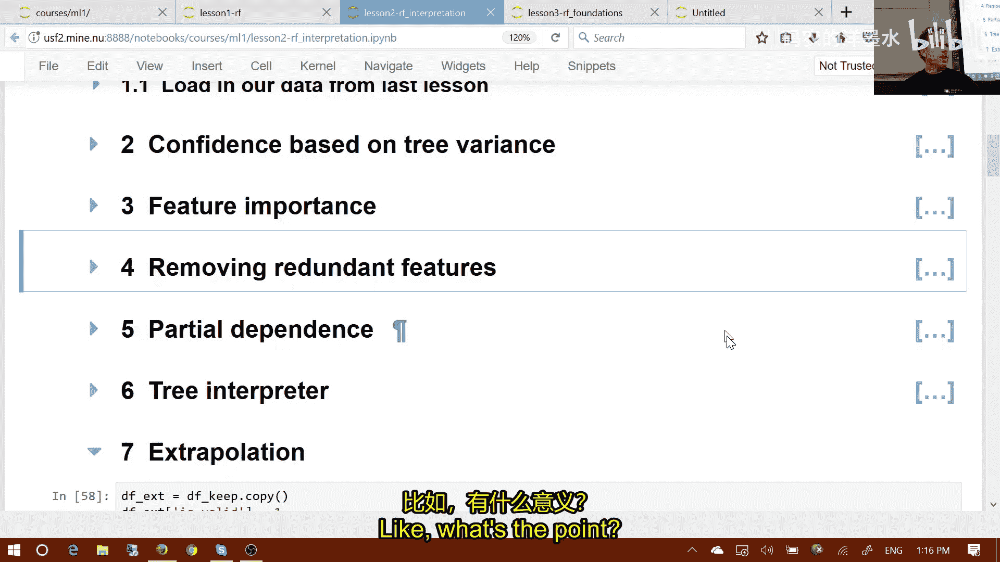


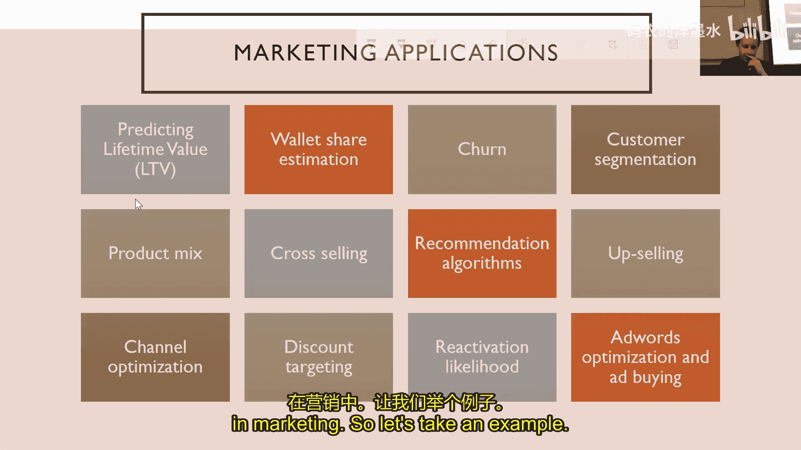

在本节课中，我们将探讨机器学习模型的实际应用，特别是如何将预测模型转化为能够创造商业价值的数据产品。我们将重点介绍一个名为“驱动链”的框架，并讨论模型可解释性在业务决策中的关键作用。

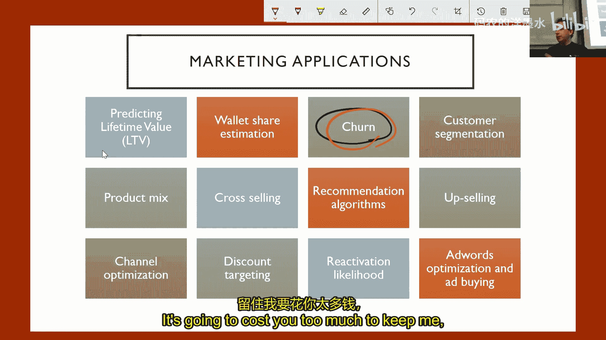

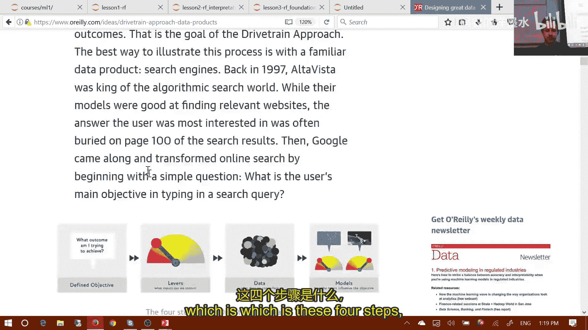

---

## 为什么需要机器学习？🤔

上一节我们介绍了多种随机森林的可解释性技术。一个常见的问题是：这些技术真的能帮助我在Kaggle上获得更好的分数吗？我的回答是：不一定。因此，我们需要更深入地思考：我们为什么要做机器学习？它的意义是什么？

为了回答这个问题，我将展示一些机器学习在商业中的实际应用案例。这些案例要么是我亲身参与过的，要么是我直接了解到的同行的工作。它们都不是假设性的，而是真实世界中的应用。

我将这些应用分为两类：**横向应用**和**纵向应用**。
*   **横向应用**指的是在不同类型业务中通用的应用。
*   **纵向应用**指的是在特定业务、供应链或流程内部的应用。

一个典型的横向应用例子是**市场营销**。几乎每家公司都需要向客户销售更多产品，因此都会进行营销活动。

---

## 驱动链方法：从目标到模型 🛠️

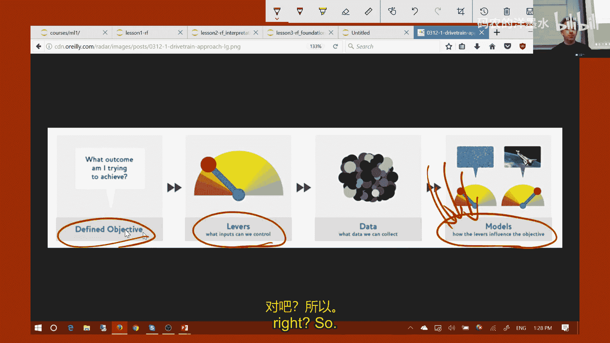

为了将机器学习项目转化为真正有用的东西，我使用一个名为“驱动链”的框架。这个框架包含四个步骤：

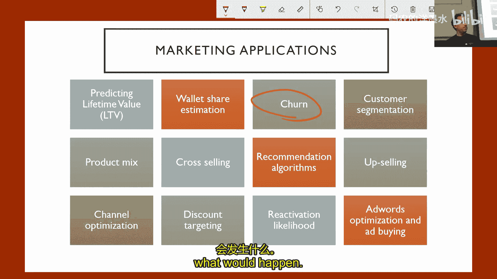

1.  **目标**：首先要明确你想要实现什么。这不是指获得高的AUC分数，而是指直接的商业目标，例如“卖出更多书”、“减少下月流失的客户数量”或“更早地检测出肺癌”。

2.  **杠杆**：杠杆是组织为了推动目标实现而可以采取的具体行动。例如，为了减少客户流失，公司可以打电话、发邮件、提供激励措施或调整产品价格。**构建模型本身从来不是一个杠杆**，但它可以帮助你更好地使用杠杆。

3.  **数据**：在做出决策时，组织拥有或可以收集哪些数据来帮助设置杠杆以实现目标？这里需要考虑实际操作中的约束条件。

4.  **模型**：这里的模型不是指预测模型，而是指**仿真模型**。它将多个预测模型与业务逻辑结合起来，模拟不同杠杆设置对最终目标的影响。

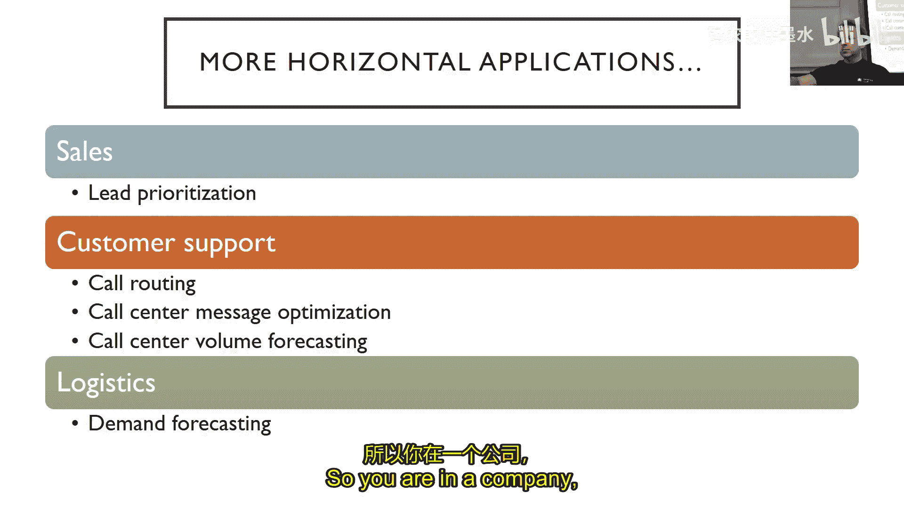

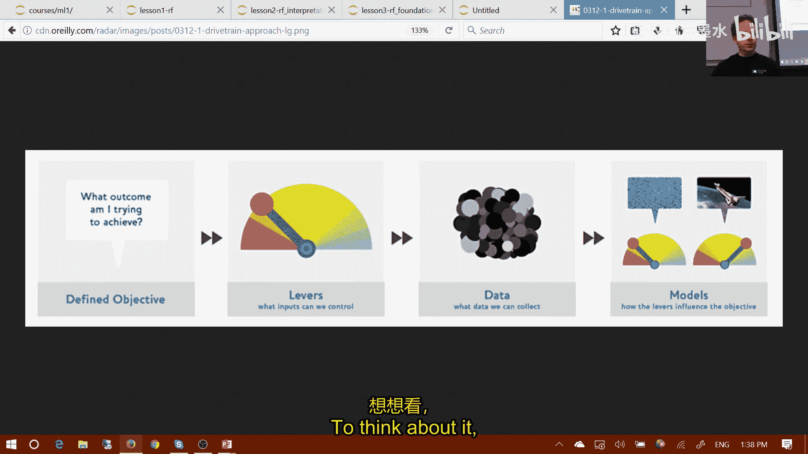

以下是驱动链方法的可视化表示：

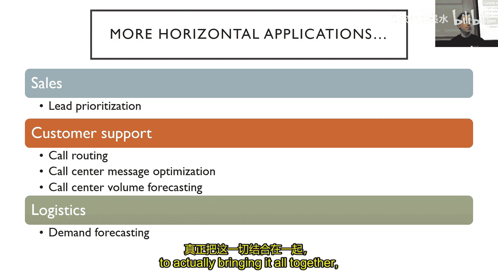


在实践中，你通常更关心仿真模型的结果，而不是单个预测模型本身。大多数公司目前并没有有效地做到这一点。

---

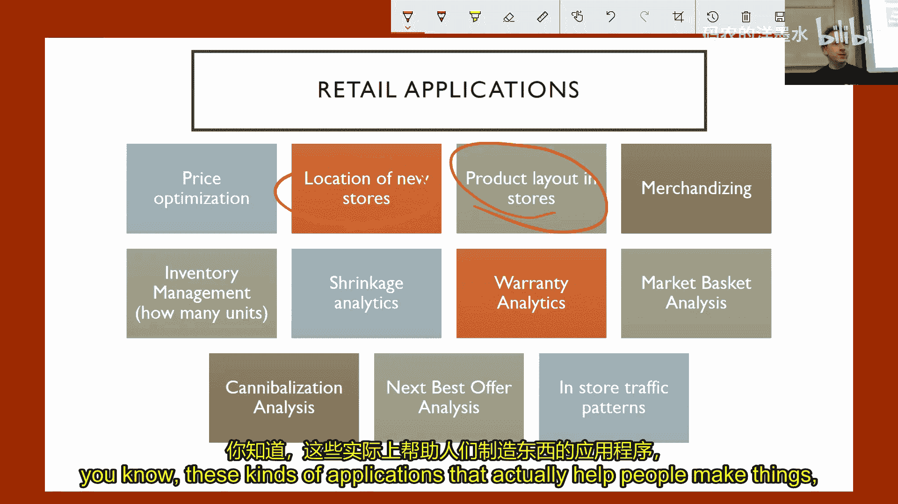

## 案例研究：客户流失建模 📉

让我们以**客户流失建模**为例。假设我们为一家大型电信公司工作，目标是预测哪些客户即将离开。

仅仅构建一个高预测性的模型，指出“Jeremy Howard下个月几乎肯定会离开”可能帮助不大，因为那时可能为时已晚，挽留成本过高。

我们需要运用驱动链方法来思考：
*   **目标**：减少下个月流失的客户数量。
*   **杠杆**：我们可以给客户打电话、发送关怀邮件、提供特殊折扣或免费礼品。
*   **数据**：在决定是否联系客户时，我们拥有哪些数据（例如，客户居住地、上月通话记录、联系客服次数）？
*   **模型**：我们需要一个仿真模型来评估不同行动（如打电话 vs. 发折扣券）对特定客户留存概率的影响，并计算其成本和收益。

这样，我们就能从“预测谁会离开”转变为“决定采取什么行动来改变结果”。

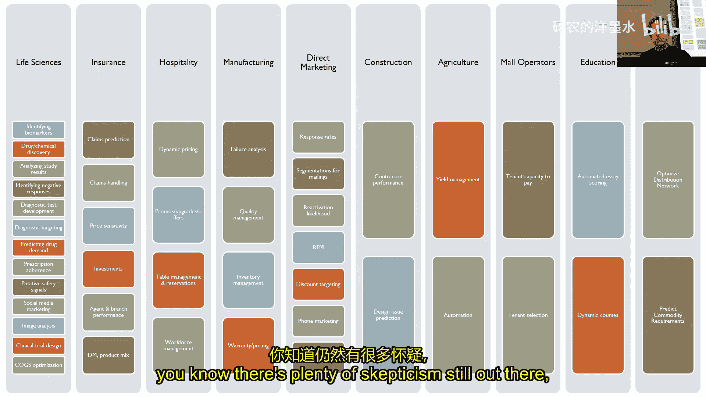

---

## 预测模型 vs. 优化模型 ⚖️

大多数机器学习项目止步于预测模型。但更有价值的是构建**优化模型**或**仿真模型**。

例如，亚马逊的推荐系统。如果我读完了道格拉斯·亚当斯的所有书，系统再推荐我购买他的合集是无效的，因为这不会改变我的购买行为。一个优化模型会模拟：如果向Jeremy展示特里·普拉切特的书（他从未买过），他购买的概率会增加多少？这种模型关注的是**反事实**——即如果不采取行动会发生什么，从而最大化地改变用户行为。

在客户流失的例子中，如果模型预测我（Jeremy）很可能离开，公司需要仿真模型来评估“打电话给我”这个行动是会改善情况，还是反而会激怒我立即取消服务。

---

## 可解释性的核心作用 🔍

当我们以这种方式思考问题时，会发现大多数应用的核心并不完全是预测模型，而是**解释**和**理解**。

我们可以将随机森林的特征重要性与可用的业务杠杆结合起来：
*   特征重要性告诉我们哪些因素是结果的重要驱动因素。
*   杠杆告诉我们组织可以改变哪些事情。
*   两者的交集就是**我们可以拉动且真正重要的杠杆**。

然后，我们可以使用**部分依赖图**来构建仿真模型，回答“如果我们改变了那个因素，会发生什么？”。

---

## 横向与纵向应用实例 📊

除了市场营销，机器学习还有许多其他横向和纵向应用。

**横向应用（跨行业）**：
*   欺诈检测
*   人力资源（员工流失分析）
*   销售线索优先级排序
*   制造业故障分析

**纵向应用（特定领域）**：
*   **医疗保健**：再入院风险预测。预测模型本身有帮助，但结合树解释器，我们可以知道高风险是因为“缺少近期心电图”，从而采取“做一次心电图”的针对性措施，而不是简单地“让病人多住院两周”。
*   **零售**：店铺选址、商品陈列优化。
*   **航空**：航班调度与登机口管理，预测延误及其连锁影响。

这些应用大多不是为了完全自动化决策，而是为了向人类决策者（从战略制定者到一线客服）提供更好的信息，帮助他们做出更明智的决策。

---

## 随机森林可解释性技术回顾 🌲

现在，让我们回顾一下学过的随机森林可解释性技术，并思考它们如何服务于上述目标。

以下是主要技术及其要点：


### 基于树方差的置信度
*   **它告诉我们什么**：对单个预测值的置信度（即森林中各棵树预测结果的方差）。
*   **为何有用**：在需要承担高风险的决策中（如信贷审批），我们不仅关心平均预测值，还关心预测的稳定性。低置信度的预测可能需要人工复核或更保守的决策。
*   **如何计算**：对于单个观测值，计算随机森林中所有树对其预测值的方差或标准差。


### 特征重要性
*   **它告诉我们什么**：每个特征对模型整体预测能力的贡献度。
*   **为何有用**：识别最关键的影响因素，从而指导数据收集、流程改进或与业务方沟通。有时能发现数据泄露问题（如特征重要性极高的字段实际上在目标发生后才被填写）。
*   **如何计算**：打乱某个特征列的所有值（破坏其与目标的关系），然后使用训练好的模型重新预测，观察模型性能（如R²、RMSE）下降的程度。下降越多，该特征越重要。

### 部分依赖图
*   **它告诉我们什么**：在保持其他所有特征不变的情况下，某个特征与预测目标之间的平均关系。
*   **为何有用**：避免被单变量图表误导，揭示“其他条件不变”时特征与目标的真实关系。这对于理解杠杆作用至关重要——如果改变X，Y会如何变化？
*   **如何计算**：将数据集中某个特征的所有值统一替换为一个特定值（如1960），用训练好的模型进行预测，得到平均预测值。对所有可能取值重复此过程，绘制出关系曲线。

### 树解释器
*   **它告诉我们什么**：对于**单个观测值**，每个特征对其最终预测值的贡献是多少。
*   **为何有用**：提供个案层面的解释。例如，向客户解释保费上涨的原因（“因为您搬到了事故率更高的邮编区”），或向医生解释某病人再入院风险高的具体原因。
*   **如何计算**：追踪该观测值在决策树中的路径。从所有样本的平均值（偏差）开始，每经过一个基于特征的节点，根据分支调整预测值。将所有调整值（贡献）列出，其总和即为最终预测值。可以用瀑布图直观展示。

---

## 外推问题与实时编码演示 💻

随机森林的一个关键局限性是它**不擅长外推**（预测训练数据范围之外的情况）。它本质上是对训练集中相似样本取平均。

我们通过一个简单的合成数据实验来演示这一点：

```python
import numpy as np
import matplotlib.pyplot as plt
from sklearn.ensemble import RandomForestRegressor

# 创建合成数据：简单的线性关系加噪声
x = np.linspace(0, 10, 50)
y = x + np.random.uniform(-0.2, 0.2, x.shape)

# 分割数据：前40个点训练，后10个点测试（模拟时间序列外推）
X_train, X_val = x[:40, None], x[40:, None] # 使用 None 增加一个维度，将向量变为矩阵
y_train, y_val = y[:40], y[40:]

# 训练随机森林
m = RandomForestRegressor(n_estimators=20, min_samples_leaf=3)
m.fit(X_train, y_train)

# 绘制训练集预测效果
plt.scatter(X_train, y_train, label='Train Data')
plt.scatter(X_train, m.predict(X_train), label='Train Pred')
plt.legend()
plt.show()

# 绘制测试集（外推）预测效果
plt.scatter(X_train, y_train, label='Train Data')
plt.scatter(X_val, y_val, label='Val Data (True)')
plt.scatter(X_val, m.predict(X_val), label='Val Pred')
plt.legend()
plt.show()
```

运行代码会发现，模型在训练集上拟合良好，但在测试集（外推区域）的预测几乎是一条水平线，因为它无法预测从未见过的更高值。它只能输出训练集中相似X值对应Y的平均值。

**如何应对外推问题？**
1.  **避免不必要的时间依赖性**：在特征工程中谨慎处理时间变量。
2.  **使用能够外推的模型**：如神经网络（可以学习函数形式）或专门的时间序列模型（如ARIMA）。
3.  **去趋势后建模**：先用时间序列技术去除数据中的趋势和季节性，然后用随机森林等模型预测残差。
4.  **使用梯度提升机**：GBM通过序列化的小树拟合残差，能更好地处理具有强趋势的数据，但它同样无法可靠地进行范围外的外推。

---

## 总结 🎯

本节课我们一起学习了：

1.  **机器学习的商业目标**：不仅仅是构建高精度模型，更是要解决实际的商业问题，创造价值。
2.  **驱动链框架**：一个将机器学习项目转化为数据产品的系统性方法，包括明确**目标**、识别**杠杆**、评估**数据**和构建**仿真模型**。
3.  **模型可解释性的核心价值**：特征重要性、部分依赖图、树解释器等技术帮助我们理解模型、与业务方沟通、识别 actionable 的杠杆，并构建更有效的仿真模型。
4.  **丰富的应用场景**：机器学习广泛应用于市场营销、金融、医疗、零售、航空等各个领域，其价值在于赋能人类决策。
5.  **随机森林的局限性**：不擅长外推，在涉及时间序列或预测未知范围数据时需要特别小心，并考虑结合其他技术。

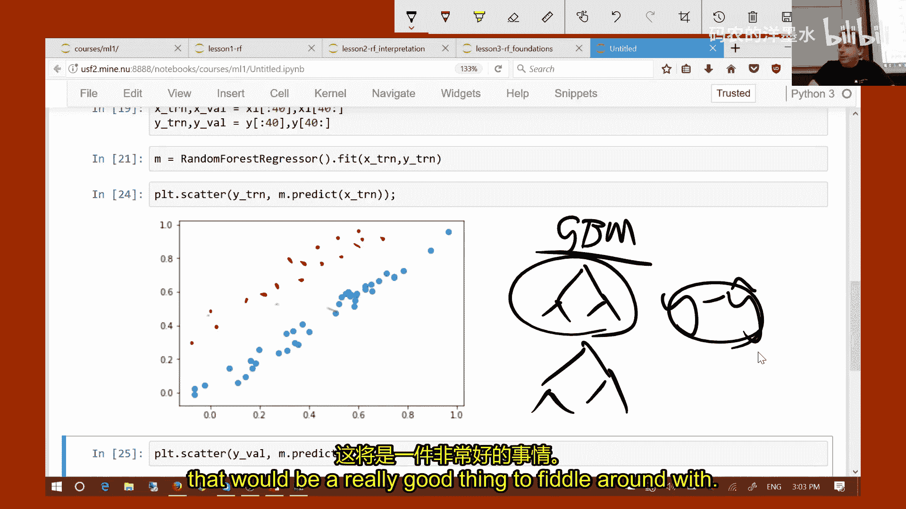

记住，优秀的数据科学家不仅需要精通模型构建，还需要深刻理解战略背景，并能够通过可解释的模型架起技术与业务之间的桥梁。