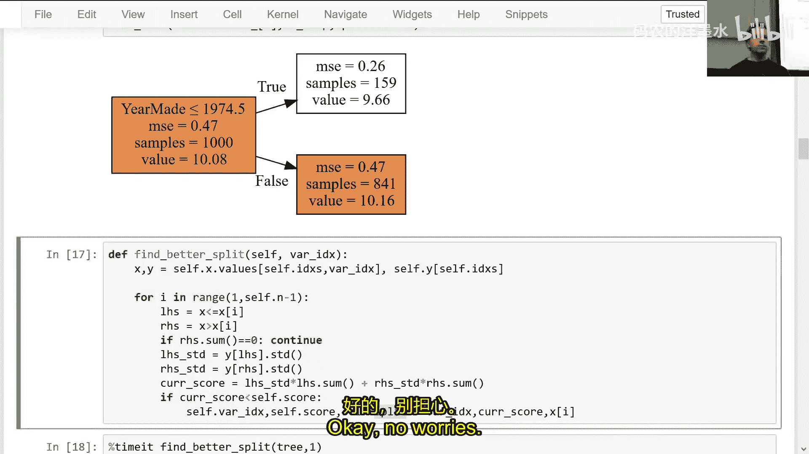
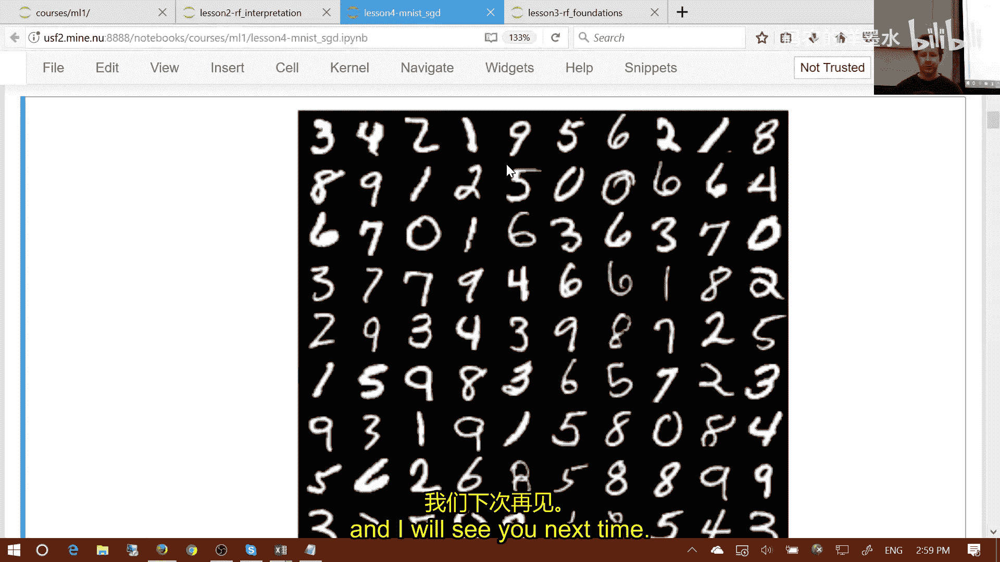

# 007：随机森林与梯度下降 🎯

在本节课中，我们将学习随机森林的构建，并探讨梯度下降的基本概念。我们将从零开始构建一个随机森林，并讨论一些实际应用中的关键问题，如验证集大小的确定、处理不平衡数据集等。最后，我们将简要介绍神经网络的基本概念，为后续课程打下基础。

---

## 随机森林的构建 🛠️

上一节我们介绍了随机森林的基本概念，本节中我们将从零开始构建一个随机森林。首先，我们需要创建一个树集成（Tree Ensemble），其中包含多棵决策树。

### 树集成（Tree Ensemble）

以下是树集成的基本结构：

```python
class TreeEnsemble:
    def __init__(self, x, y, n_trees, sample_size, min_leaf=5):
        self.x = x
        self.y = y
        self.n_trees = n_trees
        self.sample_size = sample_size
        self.min_leaf = min_leaf
        self.trees = [self.create_tree() for _ in range(n_trees)]

    def create_tree(self):
        idxs = np.random.permutation(len(self.y))[:self.sample_size]
        return DecisionTree(self.x.iloc[idxs], self.y[idxs], self.min_leaf)

    def predict(self, x):
        return np.mean([t.predict(x) for t in self.trees], axis=0)
```

### 决策树（Decision Tree）

接下来，我们需要实现决策树类。决策树的核心是找到最佳的分裂点。

```python
class DecisionTree:
    def __init__(self, x, y, min_leaf=5, idxs=None):
        self.x = x
        self.y = y
        self.min_leaf = min_leaf
        self.idxs = idxs if idxs is not None else np.arange(len(y))
        self.val = np.mean(y[self.idxs])
        self.score = float('inf')
        self.find_varsplit()

    def find_varsplit(self):
        for i in range(self.x.shape[1]):
            self.find_better_split(i)
        if self.score == float('inf'):
            return
        x = self.split_col
        lhs = x <= self.split
        rhs = x > self.split
        self.lhs = DecisionTree(self.x, self.y, self.min_leaf, self.idxs[lhs])
        self.rhs = DecisionTree(self.x, self.y, self.min_leaf, self.idxs[rhs])

    def find_better_split(self, var_idx):
        x = self.x.values[self.idxs, var_idx]
        y = self.y[self.idxs]
        sort_idx = np.argsort(x)
        x_sorted = x[sort_idx]
        y_sorted = y[sort_idx]
        n = len(y)
        for i in range(1, n - 1):
            if x_sorted[i] == x_sorted[i + 1]:
                continue
            lhs = y_sorted[:i]
            rhs = y_sorted[i:]
            score = self.calc_score(lhs, rhs)
            if score < self.score:
                self.var_idx = var_idx
                self.score = score
                self.split = x_sorted[i]

    def calc_score(self, lhs, rhs):
        lhs_std = np.std(lhs)
        rhs_std = np.std(rhs)
        return lhs_std * len(lhs) + rhs_std * len(rhs)
```

### 预测方法

最后，我们需要为决策树添加预测方法：

```python
def predict(self, x):
    if self.score == float('inf'):
        return self.val
    if x[self.var_idx] <= self.split:
        return self.lhs.predict(x)
    else:
        return self.rhs.predict(x)
```

---

## 验证集大小的确定 📊

在构建模型时，验证集的大小是一个关键问题。验证集的大小取决于我们需要多准确地知道模型的性能。

### 二项分布与标准误差

如果我们有一个二项分布，其均值为 **np**，标准差为 **√(np(1-p))**。标准误差（即均值的标准差）为 **√(np(1-p))/√n**。

以下是计算验证集大小的步骤：

1. 确定模型在验证集上的准确率 **p**。
2. 计算标准误差 **SE = √(p(1-p)/n)**。
3. 根据业务需求，确定可接受的误差范围。

例如，如果验证集大小为2000，准确率为99.4%，则错误样本数为12。如果准确率下降到99.2%，则错误样本数增加到16。虽然差异看似微小，但在某些场景下（如欺诈检测），这可能意味着成本增加25%。

### 经验法则

一个经验法则是，每个类别的样本数应至少为22。这是因为当样本数达到22时，t分布近似于正态分布，结果更加稳定。

---

## 处理不平衡数据集 ⚖️

当数据集中某些类别的样本数较少时，我们需要采取特殊措施。

以下是处理不平衡数据集的常用方法：

- **过采样（Oversampling）**：复制少数类样本，使其与多数类样本数量相等。
- **类别权重（Class Weight）**：在训练时，为少数类样本分配更高的权重。
- **分层抽样（Stratified Sampling）**：在每次抽样时，确保少数类样本被选中的概率更高。

研究表明，过采样少数类样本通常是处理不平衡数据集的最佳方法。

---

## 随机森林的优化 🚀

随机森林的性能可以通过优化算法进一步提升。例如，我们可以使用Cython将Python代码编译为C代码，从而显著提高运行速度。

### Cython示例

以下是一个简单的Cython示例：

```python
%load_ext Cython

%%cython
def fib_cython(int n):
    cdef int a = 0, b = 1, i
    for i in range(n):
        a, b = b, a + b
    return a
```

通过添加类型声明，Cython可以进一步优化代码性能。

---




## 神经网络简介 🧠

随机森林属于决策树集成方法，而神经网络是另一类强大的机器学习技术。神经网络可以处理结构化数据和非结构化数据（如图像、音频、文本），并具有更强的表达能力。

### 神经网络的优势

- **可扩展性**：神经网络可以通过增加层数和参数来处理复杂问题。
- **泛化能力**：神经网络能够从数据中学习复杂的非线性关系。
- **灵活性**：神经网络可以应用于各种任务，如分类、回归、生成模型等。

在接下来的课程中，我们将深入探讨神经网络的基本原理和应用。

---

## 总结 📝

本节课中，我们一起学习了如何从零开始构建随机森林，并讨论了验证集大小的确定、不平衡数据集的处理方法以及随机森林的优化技巧。最后，我们简要介绍了神经网络的基本概念。通过本节课的学习，你应该能够理解随机森林的工作原理，并掌握其在实际应用中的关键技巧。



在接下来的课程中，我们将进一步探讨梯度下降和神经网络，为更复杂的机器学习任务打下基础。祝你学习愉快！😊