# 008：逻辑回归 🧠


在本节课中，我们将要学习逻辑回归，这是神经网络的基础构建模块。我们将从使用高级库构建一个简单的模型开始，然后逐步深入，最终从零开始实现我们自己的逻辑回归模型。通过这个过程，你将理解神经网络背后的核心数学原理。

---

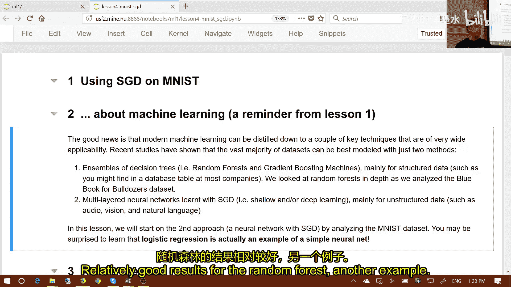

## 从决策树到神经网络 🌳➡️🧠

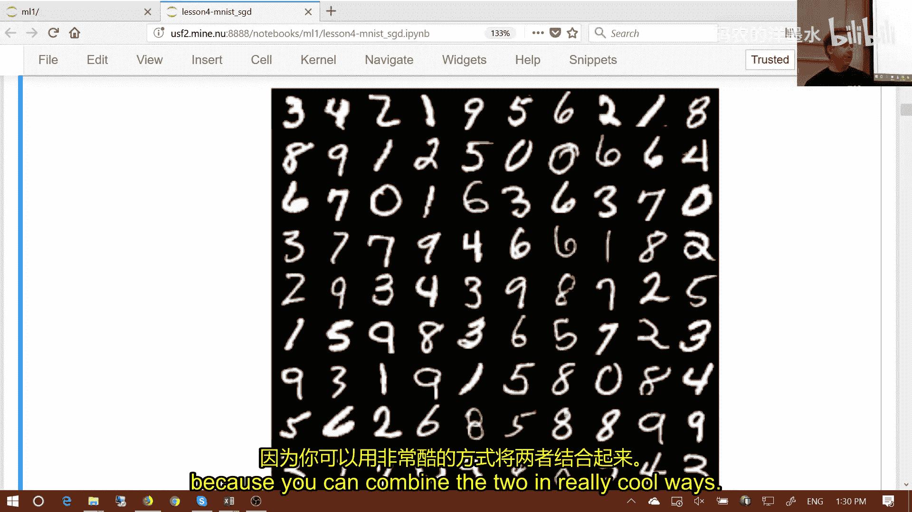

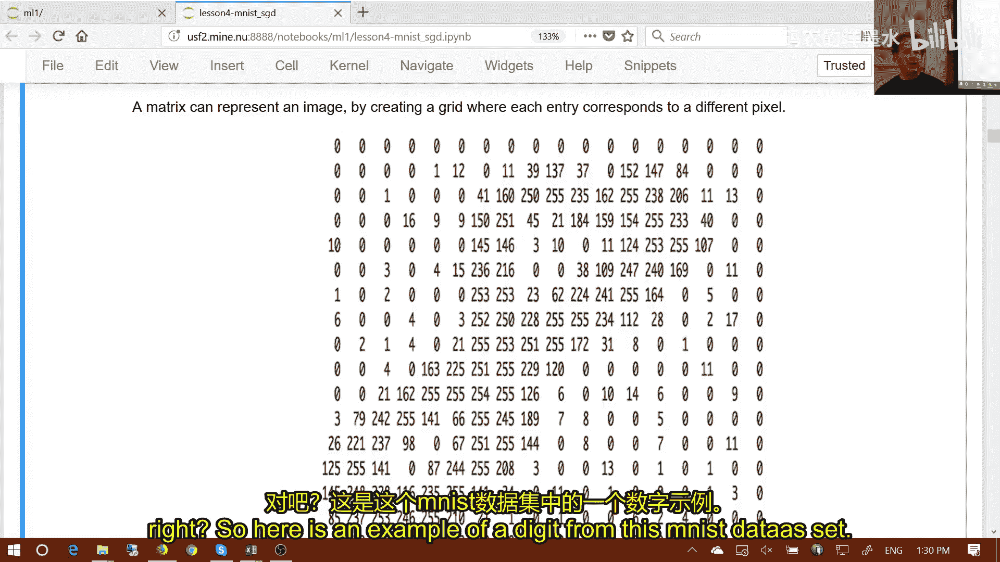

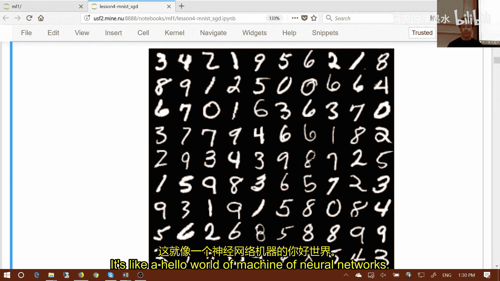

上一节我们介绍了决策树集成方法（如随机森林）的局限性。本节中我们来看看为什么我们需要转向神经网络。

随机森林和决策树本质上是执行一种“最近邻”操作。它们通过返回一系列其他数据点的平均值来进行预测。这种方法存在一些限制：
*   **难以外推**：它们无法预测从未见过的数据点，例如将价格提高20%后的销量，或者明年的销售情况。
*   **计算能力有限**：它们只能进行大约 `log₂(N)` 次决策。对于需要多步计算才能捕捉的复杂关系（如时间序列），其建模能力有限。

虽然随机森林对非顺序的分类变量也能处理，但可能需要更多的分裂点，效率上并非最优。此外，对于像图像识别（如MNIST手写数字）这类任务，像素间的空间结构关系很重要，随机森林这种“巧妙的最近邻”方法效果并不理想。

神经网络则在这类任务上表现出色，无论是时间序列预测还是图像、语音识别。实际上，随机森林和神经网络结合起来，几乎可以覆盖我们遇到的大部分问题领域。

---

## 认识MNIST数据集 🔢

我们的任务是识别手写数字。我们将使用著名的MNIST数据集，它包含28x28像素的灰度图像，每个像素值在0到255之间（0为白色，255为黑色）。

以下是加载和准备数据的步骤：

```python
# 加载MNIST数据（假设数据已下载并解压）
def load_mnist():
    import gzip, pickle
    with gzip.open('mnist.pkl.gz', 'rb') as f:
        ((x_train, y_train), (x_valid, y_valid), _) = pickle.load(f, encoding='latin-1')
    return x_train, y_train, x_valid, y_valid

x_train, y_train, x_valid, y_valid = load_mnist()
```

数据被扁平化为长度为784（28*28）的一维数组。在深度学习中，我们经常需要改变张量的形状（即“重塑”）。

```python
# 查看训练数据的形状
print(x_train.shape)  # 输出: (50000, 784)
print(y_train.shape)  # 输出: (50000,)

# 将验证集的一个图像重塑回28x28以便显示
import numpy as np
sample_image = x_valid[0].reshape(28, 28)
```

**张量术语回顾**：
*   **向量 / 1D数组 / 一阶张量**：例如 `[1, 2, 3]`
*   **矩阵 / 2D数组 / 二阶张量**：例如 `[[1,2], [3,4]]`
*   对于更高维度，我们统称为 **N阶张量**。

---

## 数据标准化 📏

对于参数化模型（如神经网络），我们需要对输入数据进行标准化（减去均值并除以标准差），这有助于模型更有效地训练。这与随机森林不同，随机森林只关心特征的排序，不关心具体数值大小。

```python
# 使用训练集的统计量来标准化训练集和验证集
train_mean = x_train.mean()
train_std = x_train.std()

x_train = (x_train - train_mean) / train_std
x_valid = (x_valid - train_mean) / train_std  # 关键：使用训练集的均值和标准差
```

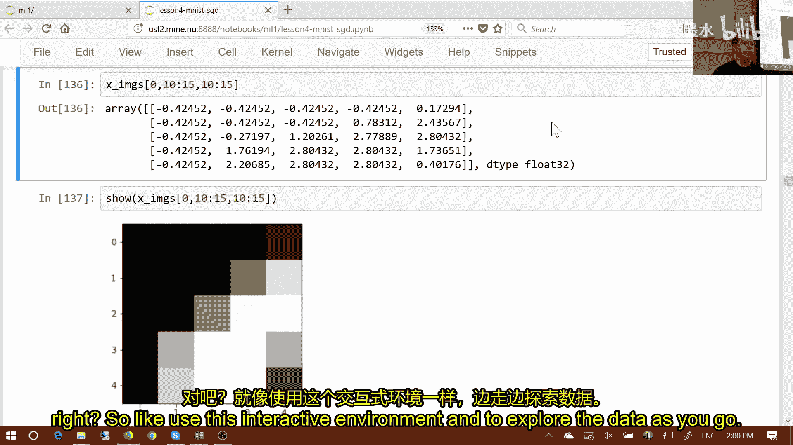

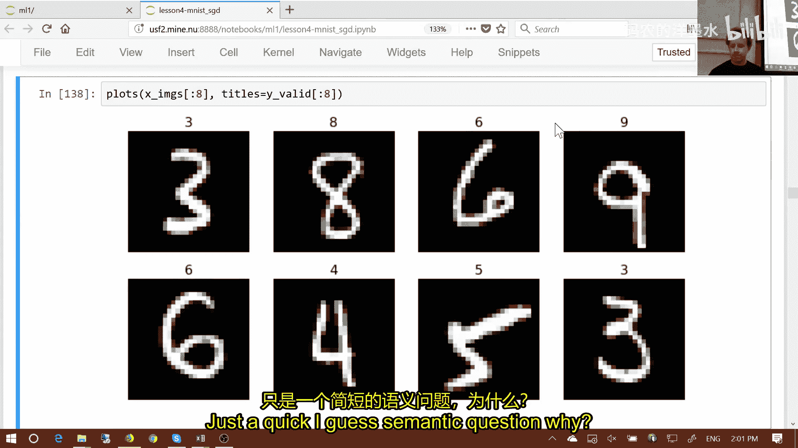

**重要原则**：任何应用于训练集的预处理变换（标准化、分类编码、缺失值填充），都必须以完全相同的方式应用于验证集和测试集，以确保数据含义的一致性。

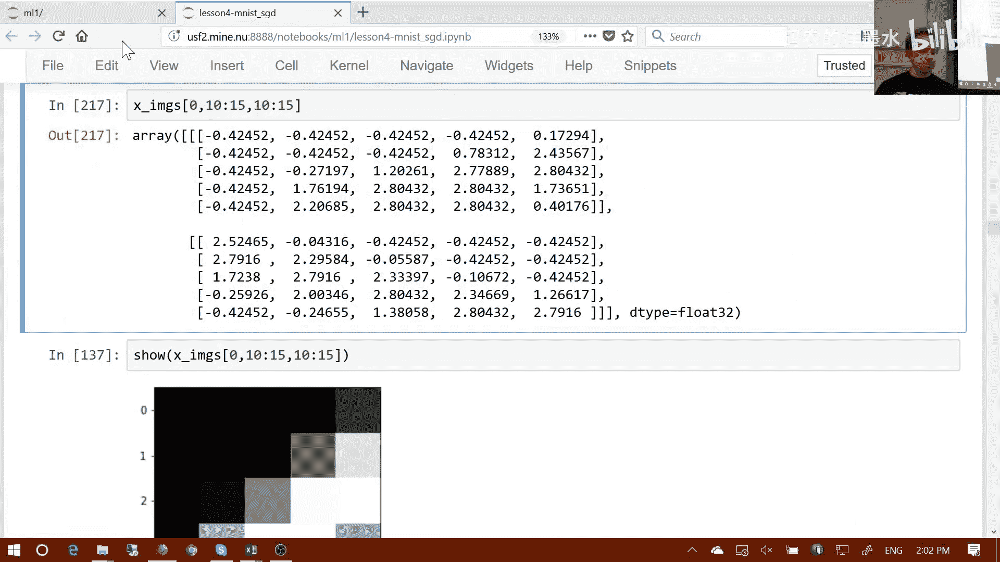

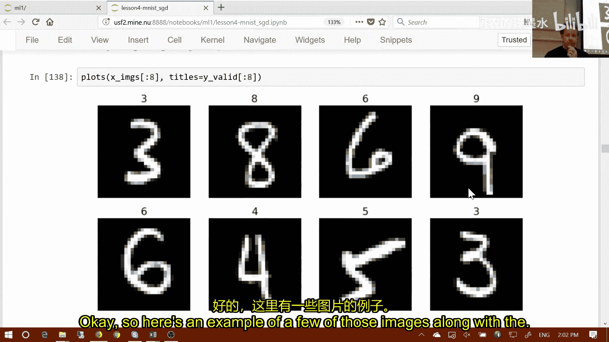

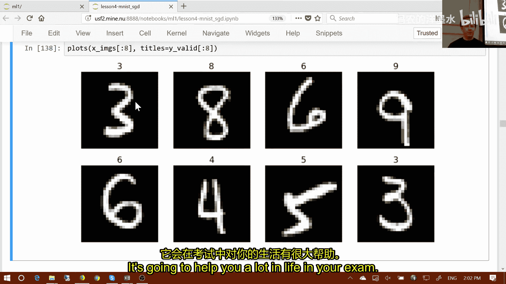

---

## 构建第一个神经网络（实为逻辑回归）⚙️

我们将使用PyTorch库来构建模型。PyTorch允许我们编写类似NumPy的代码，并能在GPU上高效运行，还能自动计算梯度。

首先，我们以“自上而下”的方式，使用高级组件快速构建一个模型：

```python
import torch.nn as nn

# 定义一个简单的神经网络（实际上是一个逻辑回归）
net = nn.Sequential(
    nn.Linear(28*28, 10),  # 线性层：输入784维，输出10维（10个数字类别）
    nn.LogSoftmax(dim=1)   # 非线性激活函数：LogSoftmax
).cuda()  # 将模型移至GPU
```

这个网络只有一层线性变换加一个激活函数，本质上就是一个**逻辑回归**模型。线性层执行 `y = Ax + b` 操作，其中 `A` 是权重矩阵，`b` 是偏置向量。

接下来，我们定义损失函数和优化器，并训练模型：


```python
from fastai import *
from fastai.vision import *

# 创建数据对象
data = ImageClassifierData.from_arrays('.', (x_train, y_train), (x_valid, y_valid))

# 定义损失函数（负对数似然损失，也称交叉熵损失）和优化器
loss_func = nn.NLLLoss()
optimizer = optim.Adam(net.parameters())

# 训练模型一个周期（epoch）
fit(net, data, n_epochs=1, crit=loss_func, opt=optimizer, metrics=[accuracy])
```

训练后，我们可以在验证集上进行预测并计算准确率：

```python
preds = net(torch.from_numpy(x_valid).cuda())  # 得到10000x10的概率矩阵
preds = preds.argmax(dim=1)                    # 取每行最大值的索引，即预测的数字
accuracy = (preds.cpu() == torch.from_numpy(y_valid)).float().mean()
print(f"准确率: {accuracy:.4f}")  # 输出大约为 0.918
```

我们得到了约91.8%的准确率。通过可视化一些预测错误的样本，我们可以直观理解模型的局限——它只是简单地将每个像素与每个数字的“平均模板”进行加权比较。

---

## 深入原理：从零实现逻辑回归 🔧

现在，我们抛开高级封装，自己实现逻辑回归的每一个部分。这将帮助我们理解背后的数学。

### 1. 理解损失函数：交叉熵

我们使用的损失函数是**负对数似然损失（NLL）**，对于二分类问题也称为**二元交叉熵**，对于多分类（如10个数字）则称为**分类交叉熵**。

**二元交叉熵公式**：
`Loss = -[y * log(p) + (1-y) * log(1-p)]`
其中 `y` 是真实标签（0或1），`p` 是模型预测为正类的概率。

对于多分类（如MNIST），我们使用**分类交叉熵**。它相当于对每个类别进行二元交叉熵计算，然后求和。在实践中，我们通常将标签进行**独热编码**，然后计算预测概率分布与真实分布之间的交叉熵。

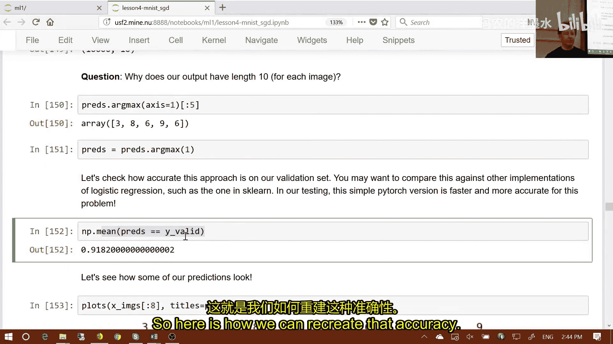

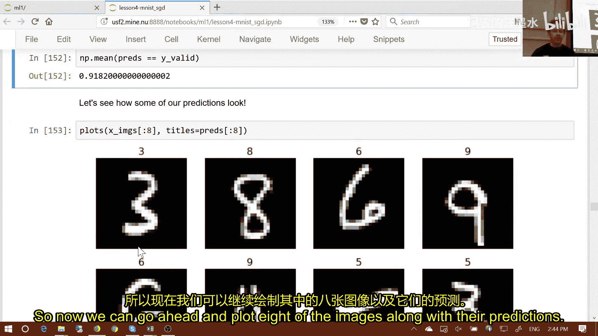

### 2. 手动定义模型层

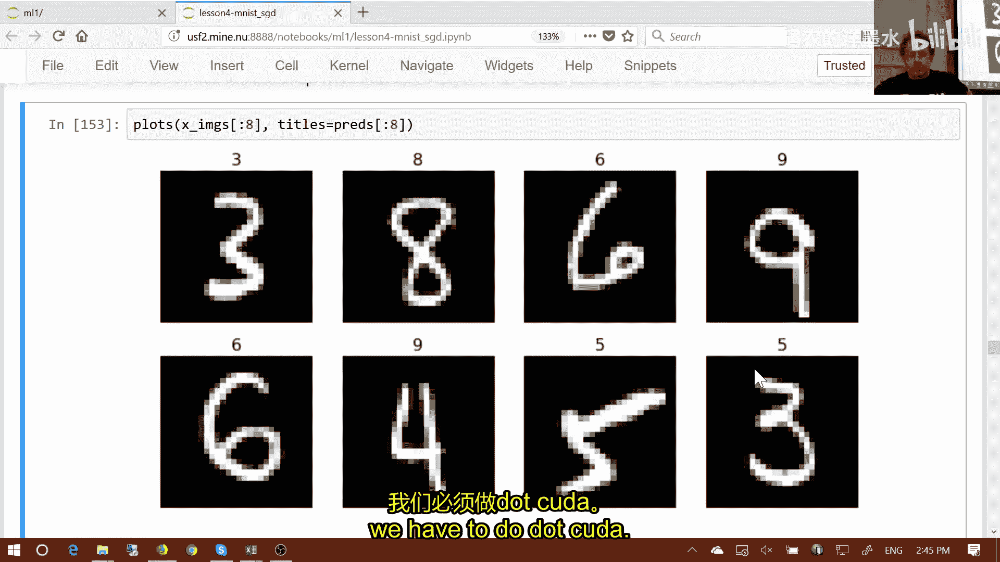

我们将创建一个PyTorch模块，手动定义权重矩阵、偏置向量和前向传播过程。

```python
import torch
import torch.nn as nn
import math

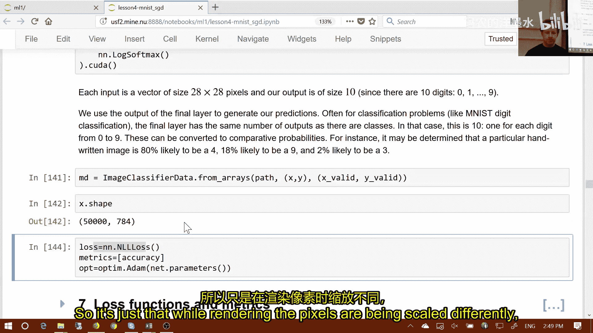

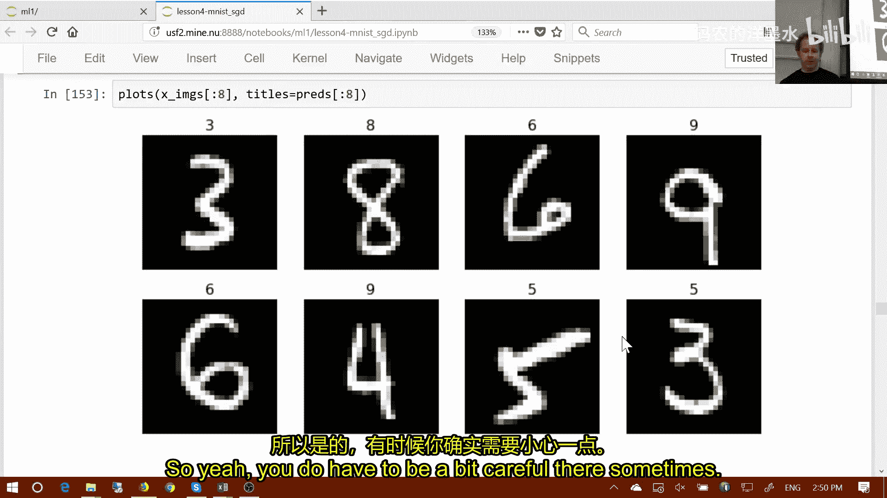

class LogisticRegression(nn.Module):
    def __init__(self):
        super().__init__()  # 必须首先初始化父类
        # 初始化权重矩阵 (784, 10) 和偏置向量 (10,)
        # 使用特定的初始化方法防止梯度爆炸/消失
        self.weights = nn.Parameter(torch.randn(28*28, 10) / math.sqrt(28*28))
        self.bias = nn.Parameter(torch.zeros(10))

    def forward(self, x):
        # x 的形状: [batch_size, 28, 28]
        x = x.view(-1, 28*28)          # 扁平化为 [batch_size, 784]
        x = torch.matmul(x, self.weights) + self.bias  # 线性变换: y = Ax + b
        x = torch.softmax(x, dim=1)    # Softmax激活函数，将输出转化为概率
        return x
```

**代码解析**：
*   `nn.Parameter`：告诉PyTorch这些张量是模型参数，需要在训练中更新。
*   `view`：PyTorch中重塑张量形状的方法，等同于NumPy的`reshape`。`-1`表示自动推断该维度大小。
*   `torch.matmul`：矩阵乘法。
*   `torch.softmax`：Softmax函数。公式为：对于向量 `z` 的每个元素 `z_i`，`softmax(z_i) = exp(z_i) / sum(exp(z))`。它能确保输出所有值之和为1，且每个值在0到1之间，适合解释为概率。

### 3. Softmax的作用

为什么需要Softmax？
1.  **输出概率化**：它将线性层的原始输出（logits）转换为概率分布。
2.  **放大差异**：由于使用了指数函数 `exp`，输入中较大的值在输出中会占据主导地位，使得预测结果更“明确”（一个概率接近1，其他接近0）。
3.  **匹配目标**：我们的标签是独热编码（一个位置为1，其余为0），Softmax的输出形式与之匹配，使得损失函数计算更直接。

现在，我们可以用这个自定义类替换之前的`nn.Sequential`模型，并应该能得到相似的训练结果。

---

## 总结与练习 📚

本节课中我们一起学习了逻辑回归，它是神经网络的基础。我们：
1.  回顾了从树模型转向神经网络的原因。
2.  学习了如何处理和标准化像MNIST这样的图像数据。
3.  使用PyTorch高级API快速构建并训练了一个逻辑回归模型，达到了约92%的准确率。
4.  深入原理，从零开始实现了逻辑回归模型，包括权重初始化、线性变换和Softmax激活函数。

**本周练习建议**：
*   尝试手动实现二元交叉熵和分类交叉熵损失函数，先用if语句版本，再尝试向量化版本。
*   使用`torch.randn`、`torch.matmul`等函数创建随机张量并进行操作，熟悉PyTorch张量运算。
*   查阅PyTorch官方教程，巩固张量重塑、切片、维度变换等操作。
*   思考：如果不在逻辑回归后使用Softmax，而使用其他函数（如Sigmoid），会怎样？

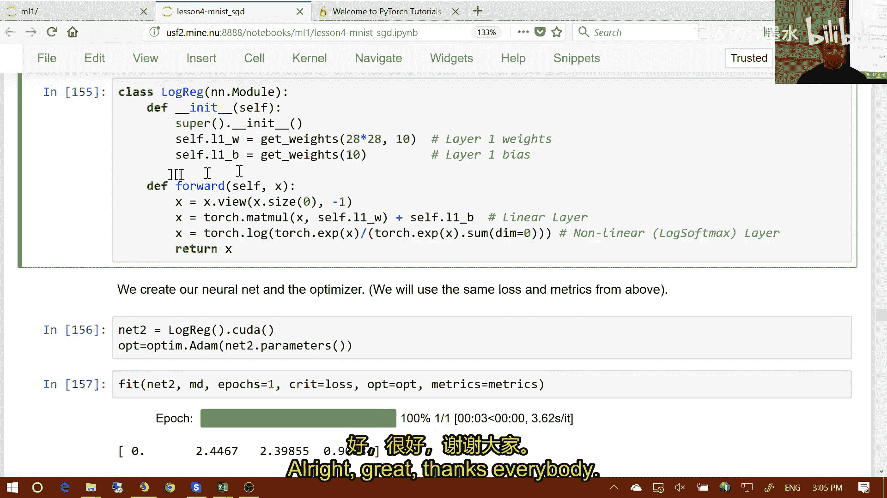

通过动手实践这些基础组件，你将为理解更复杂的深度神经网络打下坚实的基础。下次课我们将在此基础上，探索如何堆叠更多的层来构建真正的深度网络。