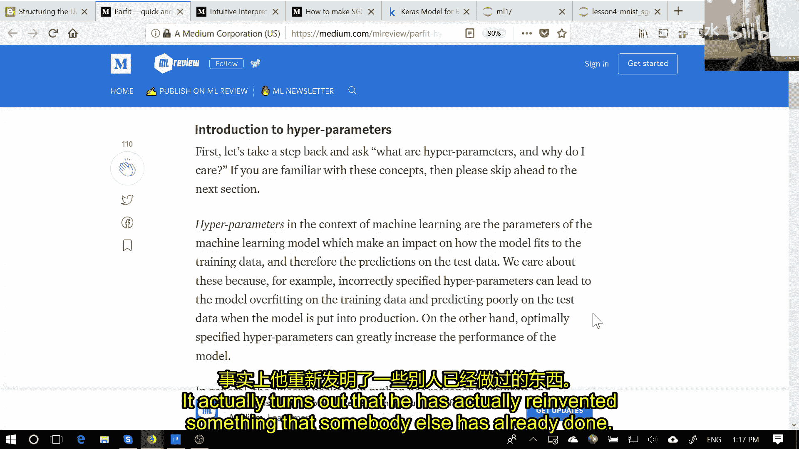
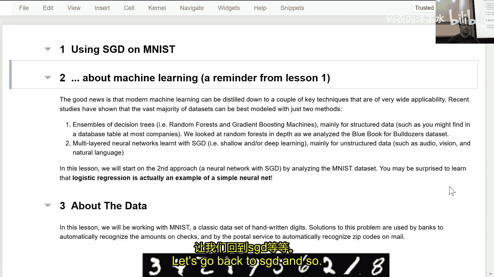
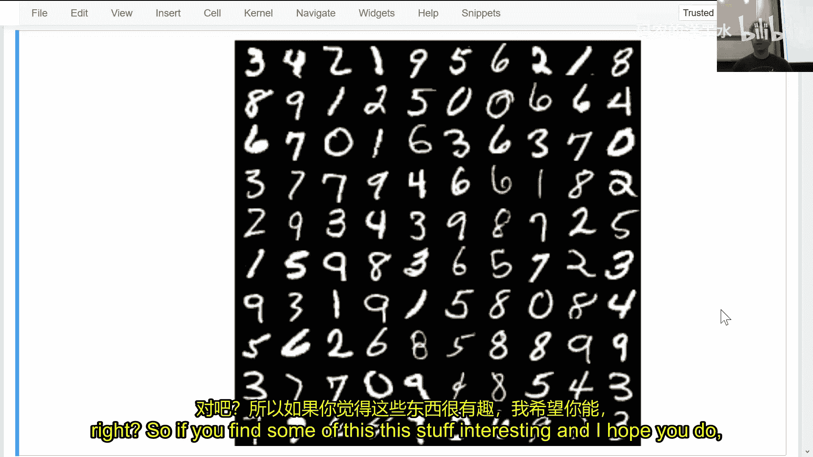
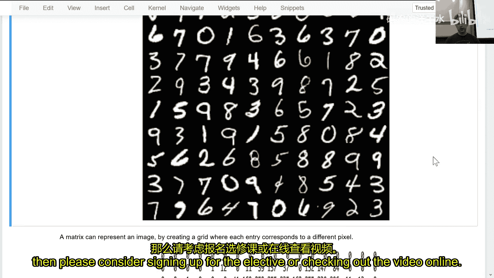
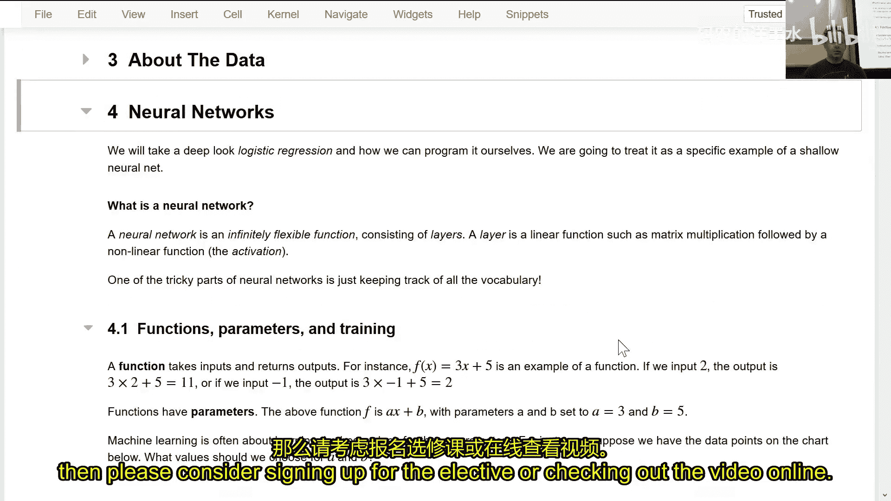
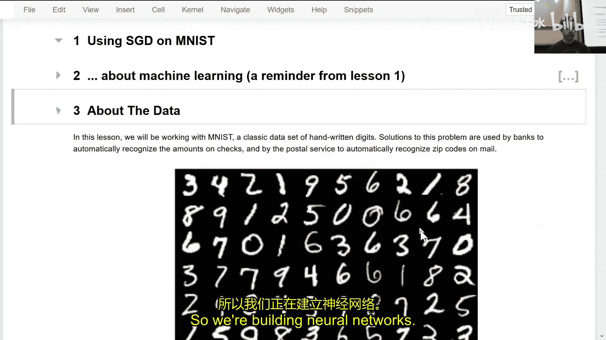
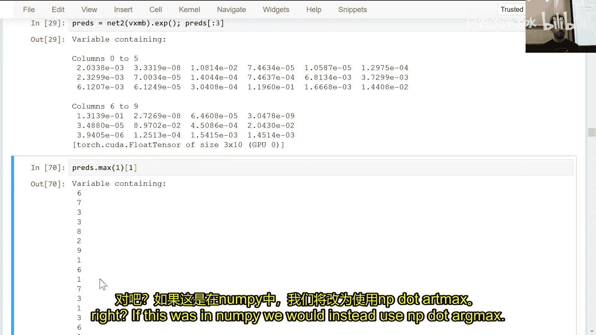
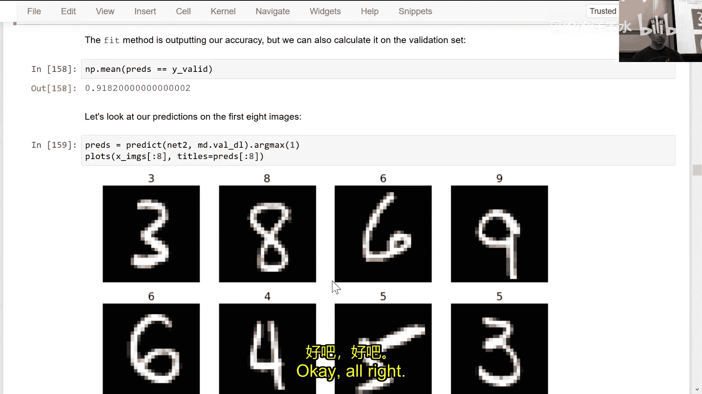
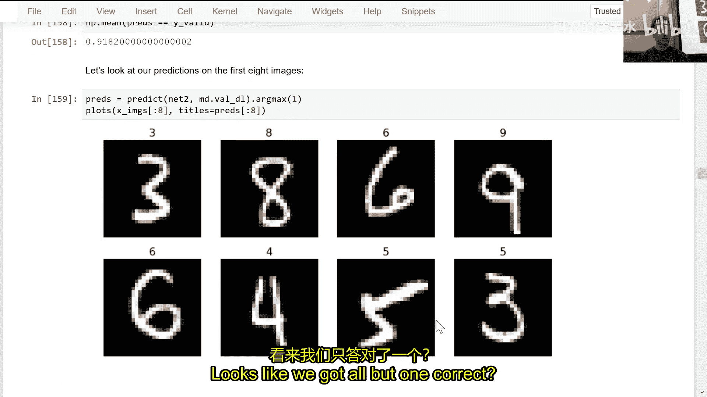
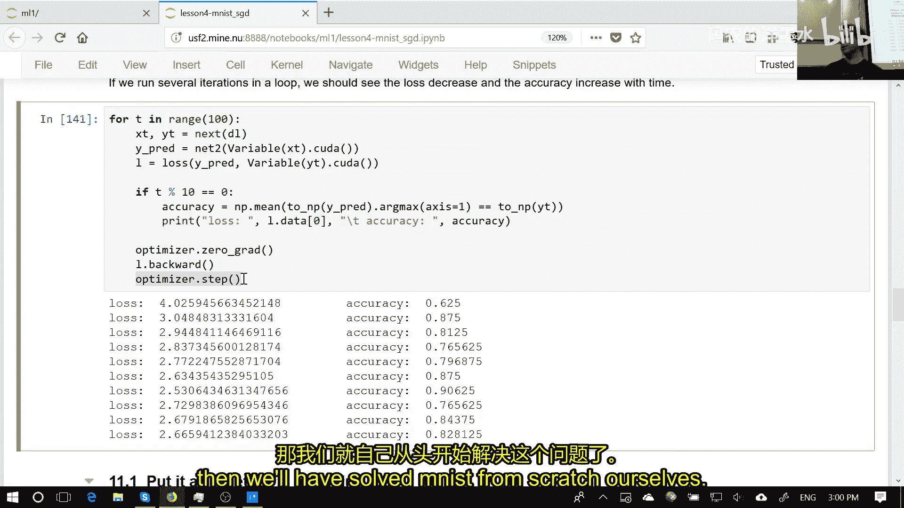

# 009：正则化

在本节课中，我们将回顾旧金山大学学生们在机器学习课程中构建的一些精彩项目，并深入探讨随机梯度下降（SGD）的内部工作原理，特别是如何从零开始构建一个逻辑回归模型。我们将逐步摆脱对高级库的依赖，理解其背后的核心机制。

## 学生项目展示





上一节我们介绍了课程背景，本节中我们来看看学生们在过去一周里完成的一些出色工作。其中许多项目已经在互联网上广泛传播。

以下是几个值得关注的示例：

*   **Tyler的可视化项目**：Tyler创建了一个合成数据集，其中自变量是X和Y坐标，因变量是颜色。他首先构建了一个决策树模型，并成功绘制了其决策边界。接着，他通过重采样生成了多棵树，并可视化展示了**装袋法（Bagging）** 和随机森林的平均效果。这个项目通过图像直观地解释了复杂的集成学习概念。
    
    
    

*   **Jason的Parfit库**：Jason创建了一个名为Parfit的新库，用于**并行化拟合多个模型以进行超参数选择**。该库提供了清晰的API，并采用了我们几周前学习的正确验证集技术。其代码简洁、文档完善，便于他人使用。



*   **Vannay的组合应用**：Vannay将Parfit库与上节课学习的加速SGD分类方法相结合，使用Parfit来寻找SGD逻辑回归的最佳参数。









*   **Prince的随机森林解读**：Prince总结并详细解释了随机森林的各种解读方法（如特征重要性、树解释器），并提供了从零实现的代码。他还展示了如何将树解释器的输出与另一位学生Chris构建的瀑布图包结合，进行可视化。
    

*   **Devveche的Kaggle内核**：Devveche在一个极具挑战性的Kaggle竞赛（检测冰山与船只）中，处理了难以可视化的双通道卫星雷达数据。他推导了雷达散射公式，并编写代码重建了3D冰山或船只图像，然后构建神经网络进行解读。
    
    
    

这些项目表明，将所学知识付诸实践并分享给社区，是巩固学习和获得反馈的极佳方式。

## 从零开始构建神经网络

现在，让我们回到SGD和神经网络的核心主题。我们将跟随一个笔记本，从使用高级库开始，逐步剥离它们，直到从零实现逻辑回归。

### 初始设置：使用库

我们的目标是构建一个神经网络来识别MNIST手写数字。数据已下载并进行了标准化处理（减去均值，除以标准差）。每个图像被展平为一个长度为784的向量。

以下是基本步骤：

1.  构建最简单的神经网络（即逻辑回归，无隐藏层）。
2.  使用PyTorch的`nn`库和fastai库进行训练。
3.  逐步摆脱这些库，自己实现所有组件。

初始模型使用PyTorch的`nn.Sequential`定义了一个线性层后接一个log-softmax层。训练后，准确率大约在91%-92%。

```python
# 使用PyTorch nn库的示例
model = nn.Sequential(nn.Linear(784, 10), nn.LogSoftmax(dim=1))
```

### 第一步：自定义网络模块

接下来，我们不使用`nn.Sequential`和`nn.Linear`，而是通过继承`nn.Module`类来从头定义我们的逻辑回归网络。

在`__init__`构造函数中，我们手动创建权重矩阵和偏置向量，并用`nn.Parameter`包装它们，以便PyTorch知道这些是需要优化的参数。

```python
class LogisticRegression(nn.Module):
    def __init__(self):
        super().__init__()
        self.l1_w = nn.Parameter(torch.randn(784, 10) / math.sqrt(784)) # 权重
        self.l1_b = nn.Parameter(torch.zeros(10)) # 偏置

    def forward(self, x):
        # 线性变换: x @ w + b
        x = x @ self.l1_w + self.l1_b
        # 激活函数: log-softmax
        return F.log_softmax(x, dim=1)
```

在`forward`方法中，我们定义了数据通过网络的前向传播过程：矩阵乘法（线性变换）后接log-softmax激活函数。softmax函数将输出转换为概率分布，其公式为：

\[
\text{softmax}(x_i) = \frac{e^{x_i}}{\sum_{j} e^{x_j}}
\]

log-softmax则在此基础上取对数，常用于数值稳定性。

实例化这个类并训练后，我们得到了与使用库相近的准确率。

### 前向传播与模块调用

在PyTorch中，继承自`nn.Module`的类实例可以像函数一样被调用，这实际上会触发其`forward`方法。这种设计使得网络、层和函数可以灵活地组合和互换。

```python
net2 = LogisticRegression().cuda() # 实例化并移至GPU
x_var = Variable(x_mini_batch).cuda() # 将数据包装为Variable并移至GPU
preds = net2(x_var) # 调用网络，执行前向传播
```

### 扩展：添加隐藏层







将逻辑回归扩展为具有一个隐藏层的神经网络非常简单。只需在`nn.Sequential`中添加更多的线性层和非线性激活函数（如ReLU）。

```python
# 具有一个隐藏层的神经网络
model = nn.Sequential(
    nn.Linear(784, 100), # 隐藏层
    nn.ReLU(),           # 非线性激活函数
    nn.Linear(100, 10),  # 输出层
    nn.LogSoftmax(dim=1)
)
```

通过添加一个具有100个单元的隐藏层和ReLU激活函数，模型在MNIST上的准确率提升到了约96%。ReLU函数的定义是：

\[
\text{ReLU}(x) = \max(0, x)
\]

### 核心概念：广播（Broadcasting）

为了后续从零实现矩阵乘法等操作，我们需要理解一个关键概念：**广播**。广播是NumPy和PyTorch中处理不同形状数组间运算的强大机制。

广播规则：从维度的尾部开始向前比较。两个维度兼容的条件是：
1.  它们相等。
2.  其中一个是1。
3.  其中一个不存在（可视为1）。

如果维度不兼容且不为1，则无法广播。

**示例**：
```python
import numpy as np
# 向量与标量相加（标量广播到向量）
a = np.array([10, 6, -4])
result = a + 1 # 结果: [11, 7, -3]

# 矩阵与向量相加（向量广播到矩阵的每一行）
M = np.array([[1,2,3], [4,5,6], [7,8,9]])
c = np.array([10, 20, 30])
result = M + c # c被广播为 [[10,20,30], [10,20,30], [10,20,30]]，然后相加
```

广播允许我们无需显式循环即可高效执行元素级运算，这对于利用现代CPU/GPU的并行计算能力至关重要。

### 手动实现训练循环

现在，我们的目标是摆脱`fit`函数，手动实现训练循环。这涉及以下步骤：

1.  **获取数据**：使用数据加载器（DataLoader）迭代获取小批量数据。
2.  **前向传播**：将数据输入网络，得到预测。
3.  **计算损失**：使用损失函数（如负对数似然损失）比较预测和真实标签。
4.  **反向传播**：调用`loss.backward()`自动计算所有参数相对于损失的梯度。
5.  **更新参数**：使用优化器（如SGD）根据梯度和学习率更新权重。

**梯度下降的核心思想**：我们通过计算损失函数关于参数的梯度（导数）来确定使损失下降最快的方向。然后沿该方向移动一小步（步长由学习率控制），反复迭代直至收敛。

更新公式（简化）为：
\[
w_{\text{new}} = w_{\text{old}} - \text{learning\_rate} \times \frac{\partial \text{Loss}}{\partial w}
\]

以下是手动训练循环的关键代码片段：

```python
# 假设 net2 是我们的模型，opt 是优化器，loss_func 是损失函数
for i in range(100):
    x, y = next(data_iterator) # 获取小批量
    x_var, y_var = Variable(x).cuda(), Variable(y).cuda() # 包装为Variable

    preds = net2(x_var) # 前向传播
    loss = loss_func(preds, y_var) # 计算损失

    opt.zero_grad() # 清零梯度
    loss.backward() # 反向传播，计算梯度
    opt.step() # 更新权重（优化器步骤）

    # 每隔10次迭代打印准确率
    if i % 10 == 0:
        acc = (preds.argmax(dim=1) == y_var).float().mean()
        print(f"Iter {i}: Loss={loss.data[0]:.4f}, Acc={acc.data[0]:.4f}")
```

### 反向传播与链式法则

反向传播是训练神经网络的核心算法，它本质上是**链式法则**的高效应用。对于一个由多个函数复合而成的网络（如 `loss(g(f(x)))`），其关于输入 `x` 的导数可以通过链式法则计算：

\[
\frac{d}{dx} \text{loss}(g(f(x))) = \frac{d \text{loss}}{dg} \cdot \frac{dg}{df} \cdot \frac{df}{dx}
\]

在神经网络中，每一层（线性变换、激活函数）都可以看作一个函数。反向传播从最终损失开始，逐层向后计算每个参数的梯度，并将这些梯度相乘（链式法则）。PyTorch的自动微分系统为我们自动完成了这一复杂过程。

## 总结

本节课中我们一起学习了以下内容：

1.  **欣赏了同学们将机器学习知识应用于实践的优秀项目**，包括模型可视化、新工具开发、技术整合与分享。
2.  **深入探讨了如何从零开始构建神经网络**，从使用高级库到逐步实现自己的网络模块、前向传播和训练循环。
3.  **掌握了广播（Broadcasting）这一关键概念**，它是高效进行数组运算和实现复杂操作（如自定义矩阵乘法）的基础。
4.  **理解了随机梯度下降（SGD）的基本训练流程**：前向传播、损失计算、反向传播（自动微分）和参数更新。
5.  **认识了反向传播的实质**，即利用链式法则计算复合函数梯度的高效算法。



通过本讲，我们揭开了机器学习库的一些神秘面纱，理解了模型训练背后的基本原理。在下一讲中，我们将继续深入，尝试实现自己的优化器，从而完全从零完成MNIST分类任务。