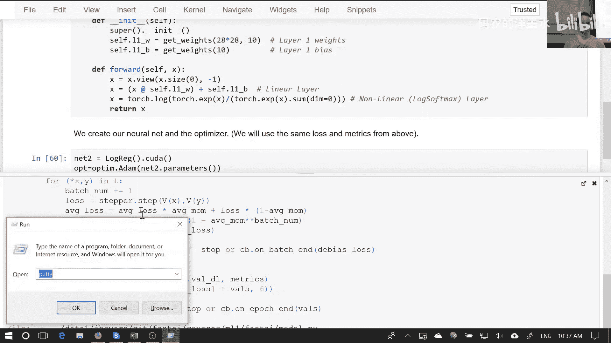
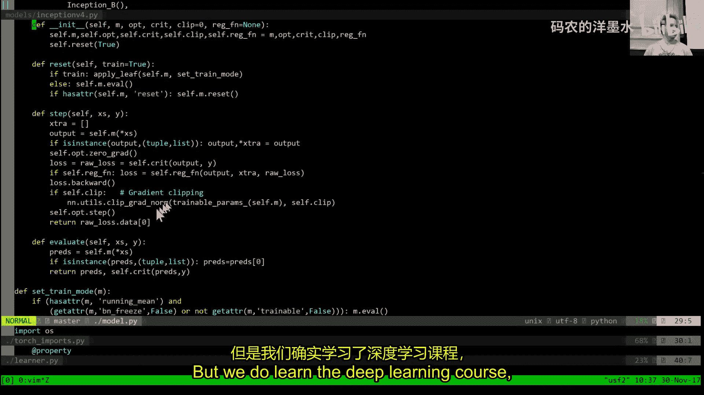

# 010：自然语言处理 📚

在本节课中，我们将学习自然语言处理的基础知识，特别是如何使用简单的线性模型（如逻辑回归）和“词袋”模型来处理文本分类任务。我们将从零开始构建一个模型，并理解其背后的数学原理。

---

## 概述

本节课我们将探索如何使用机器学习处理文本数据。我们将从构建一个简单的逻辑回归模型开始，逐步引入更复杂的概念，如正则化和特征工程。通过本课，你将学会如何将文本数据转换为模型可以理解的数值形式，并利用这些数据进行分类预测。

---

## 1. 文本数据预处理 📝

在自然语言处理中，我们首先需要将文本数据转换为数值形式。一种常见的方法是使用“词袋”模型，它忽略单词的顺序，只关注单词是否出现在文档中。

### 1.1 词袋模型

词袋模型将每个文档表示为一个向量，其中每个元素对应词汇表中的一个单词，值表示该单词在文档中出现的次数（或是否出现）。以下是创建词袋模型的步骤：

1. **构建词汇表**：收集所有文档中的唯一单词。
2. **生成特征向量**：对于每个文档，统计每个单词的出现次数，形成一个向量。

例如，假设我们有四个简单的电影评论：
- “This movie is good”
- “The movie is good”
- “This movie is bad”
- “The movie is bad”

词汇表为：`["this", "movie", "is", "good", "the", "bad"]`。每个评论可以表示为以下向量：
- “This movie is good”: `[1, 1, 1, 1, 0, 0]`
- “The movie is bad”: `[0, 1, 1, 0, 1, 1]`

### 1.2 使用 `CountVectorizer`

在实际应用中，我们可以使用 `scikit-learn` 的 `CountVectorizer` 来自动完成这一过程。以下是具体步骤：

```python
from sklearn.feature_extraction.text import CountVectorizer

# 初始化 CountVectorizer
vectorizer = CountVectorizer()

# 拟合训练数据并生成词袋矩阵
train_term_doc = vectorizer.fit_transform(train_texts)

# 使用相同的词汇表处理验证集
val_term_doc = vectorizer.transform(val_texts)
```

`CountVectorizer` 还支持 `ngram_range` 参数，可以生成二元组和三元组特征，从而捕捉更多上下文信息。

---

## 2. 朴素贝叶斯分类器 🧠

朴素贝叶斯是一种基于贝叶斯定理的分类方法，它假设特征之间相互独立。尽管这一假设在现实中很少成立，但朴素贝叶斯在某些任务中表现良好。

### 2.1 朴素贝叶斯的数学原理





朴素贝叶斯通过计算每个类别的条件概率来进行分类。对于文本分类任务，我们可以使用以下公式：

$$
P(\text{class} | \text{document}) \propto P(\text{class}) \times \prod_{i} P(\text{word}_i | \text{class})
$$

其中：
- $P(\text{class})$ 是类别的先验概率。
- $P(\text{word}_i | \text{class})$ 是给定类别下单词出现的条件概率。

为了避免零概率问题，我们通常使用拉普拉斯平滑，即在计数中添加一个小的常数（如1）。

### 2.2 实现朴素贝叶斯

以下是朴素贝叶斯的简单实现：

```python
import numpy as np

# 计算每个单词在正类和负类中的出现次数
positive_counts = train_term_doc[y_train == 1].sum(axis=0) + 1
negative_counts = train_term_doc[y_train == 0].sum(axis=0) + 1

# 计算条件概率
positive_probs = positive_counts / positive_counts.sum()
negative_probs = negative_counts / negative_counts.sum()

# 计算对数比率
log_ratios = np.log(positive_probs / negative_probs)

# 预测
predictions = (train_term_doc @ log_ratios.T) > 0
```

---

## 3. 逻辑回归模型 📈

逻辑回归是一种更灵活的线性模型，它通过优化损失函数来学习特征权重。与朴素贝叶斯不同，逻辑回归不需要特征独立的假设。

### 3.1 逻辑回归的数学原理

逻辑回归使用 sigmoid 函数将线性组合映射到概率：

$$
P(y=1 | x) = \sigma(w^T x + b) = \frac{1}{1 + e^{-(w^T x + b)}}
$$

其中：
- $w$ 是权重向量。
- $b$ 是偏置项。
- $\sigma$ 是 sigmoid 函数。

### 3.2 实现逻辑回归

我们可以使用 `scikit-learn` 的 `LogisticRegression` 来训练逻辑回归模型：

```python
from sklearn.linear_model import LogisticRegression

# 初始化逻辑回归模型
model = LogisticRegression(C=0.1, dual=True)

# 训练模型
model.fit(train_term_doc, y_train)

# 预测
predictions = model.predict(val_term_doc)
```

参数 `C` 控制正则化的强度，较小的 `C` 表示更强的正则化。`dual=True` 在特征数远大于样本数时可以提高计算效率。

---

## 4. 正则化与特征选择 🔧

正则化是防止过拟合的重要技术。在逻辑回归中，我们通常使用 L1 或 L2 正则化。

### 4.1 L1 与 L2 正则化

- **L1 正则化**：倾向于将某些权重压缩为零，从而实现特征选择。
- **L2 正则化**：倾向于让所有权重均匀减小，避免某些权重过大。

在 `scikit-learn` 中，可以通过设置 `penalty` 参数来选择正则化类型：

```python
# L1 正则化
model_l1 = LogisticRegression(penalty='l1', C=0.1)

# L2 正则化
model_l2 = LogisticRegression(penalty='l2', C=0.1)
```

### 4.2 特征选择

除了正则化，我们还可以通过限制特征数量来防止过拟合。例如，在 `CountVectorizer` 中设置 `max_features` 参数：

```python
vectorizer = CountVectorizer(max_features=800000, ngram_range=(1, 3))
```

---

## 5. 模型评估与优化 📊

在训练模型后，我们需要评估其性能并进行优化。

### 5.1 评估指标

常用的评估指标包括准确率、精确率、召回率和 F1 分数。对于文本分类任务，准确率通常是一个直观的指标：

```python
from sklearn.metrics import accuracy_score

accuracy = accuracy_score(y_val, predictions)
print(f"准确率: {accuracy}")
```

### 5.2 学习率调度

在训练神经网络时，学习率调度可以帮助模型更快收敛。例如，可以在训练后期降低学习率：

```python
# 降低学习率
optimizer.set_learning_rate(0.01)
```

---

## 总结

本节课中，我们一起学习了自然语言处理的基础知识。我们从词袋模型开始，逐步介绍了朴素贝叶斯和逻辑回归模型，并探讨了正则化和特征选择的重要性。通过这些方法，我们可以在文本分类任务中取得不错的效果。


在接下来的课程中，我们将进一步探索如何结合这些技术，构建更强大的深度学习模型，以应对更复杂的自然语言处理任务。