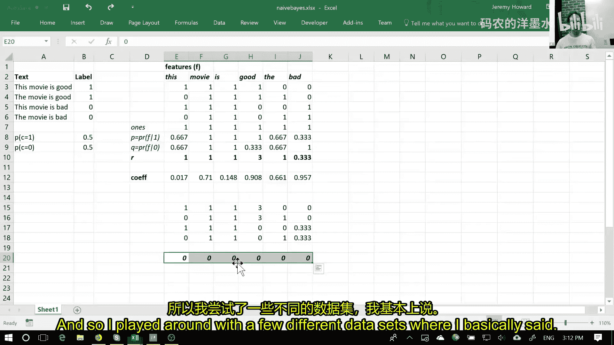
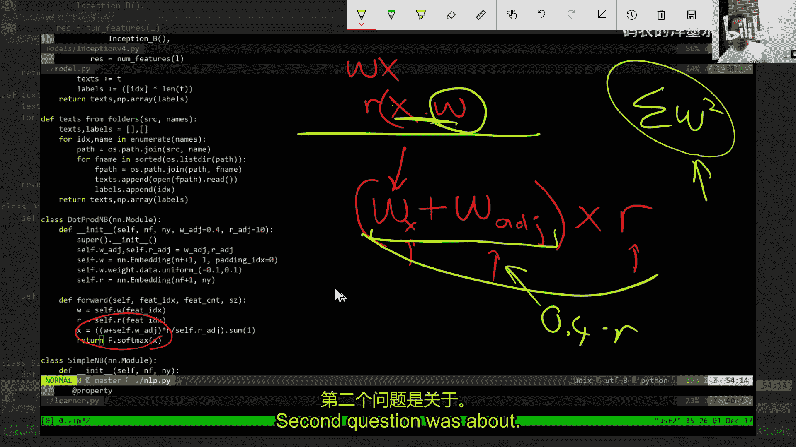
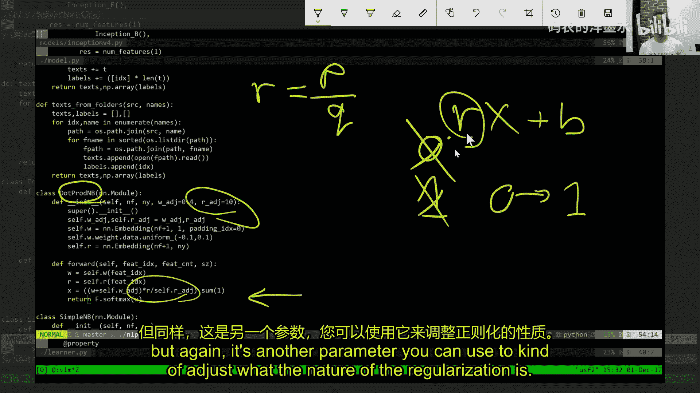
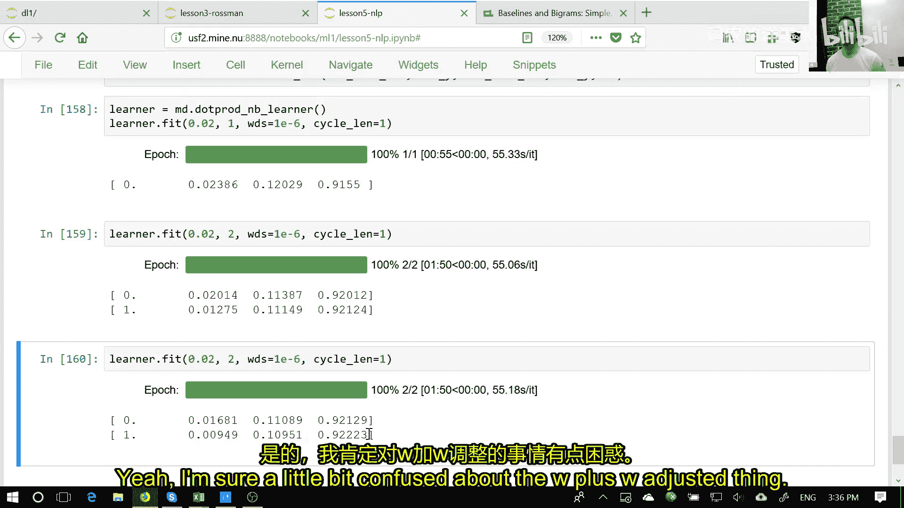
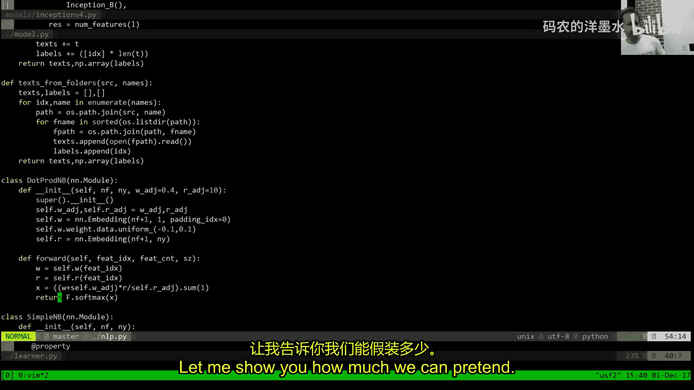
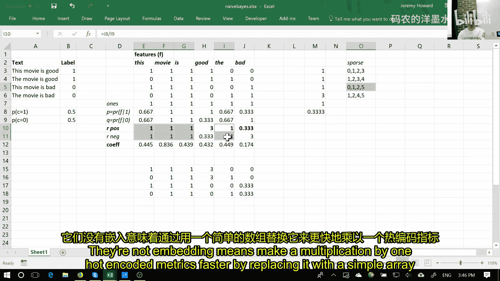
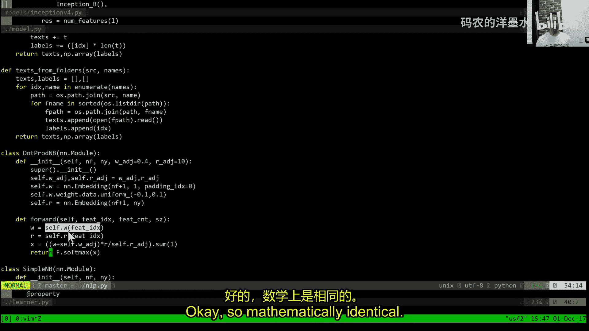
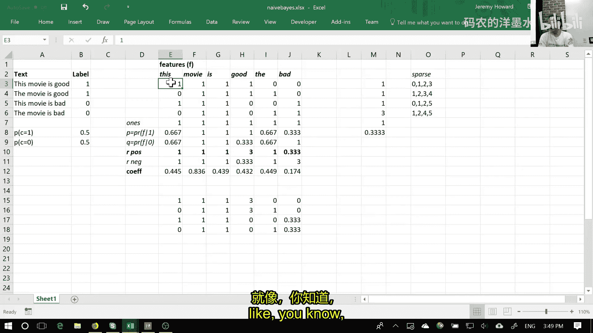
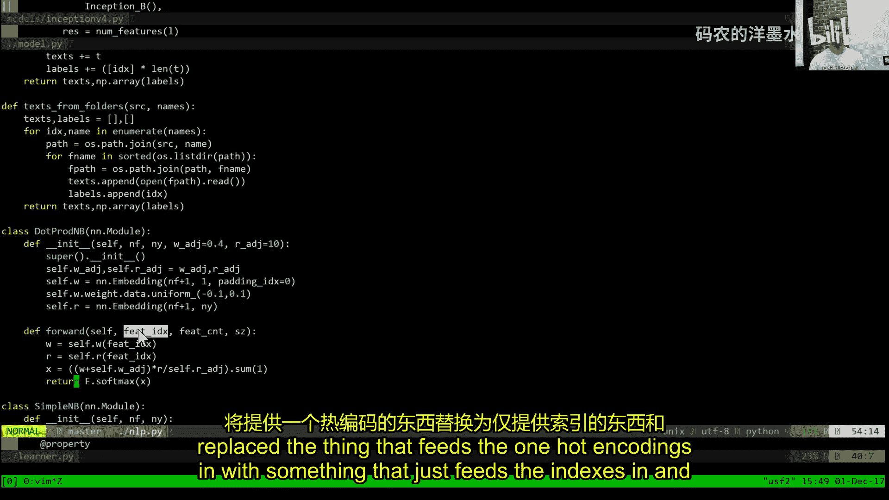
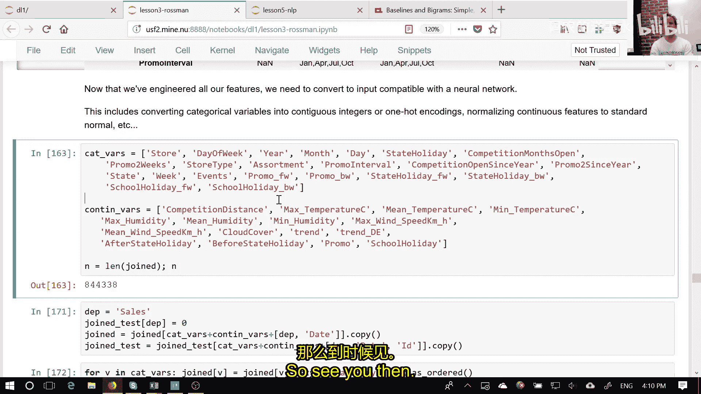

# 011：嵌入

在本节课中，我们将学习如何优化多层函数，回顾逻辑回归在自然语言处理中的应用，并深入探讨嵌入的概念。我们将从链式法则开始，逐步理解如何计算复杂函数的导数，并探讨如何将先验知识融入模型以提升性能。

## 回顾：使用SGD优化多层函数

上一节我们讨论了如何优化多层函数。本节中，我们来看看具体的数学原理。

我们有一些数据，然后对这些数据进行一系列操作。例如，首先将数据乘以一个权重矩阵，然后通过一个非线性激活函数（如softmax或sigmoid），最后计算损失函数（如交叉熵损失或均方根误差）。整个过程可以表示为一个标量输出。

**公式表示**：
设输入为 `x`，权重为 `W`，函数可以表示为：
`L = loss(activation(linear(x, W)))`

为了计算损失 `L` 关于权重 `W` 的导数，我们使用链式法则。将整个函数分解为多个函数的复合：
`L = h(u)`，其中 `u = g(v)`，`v = f(x, W)`

**链式法则**：
`dL/dW = (dh/du) * (dg/dv) * (df/dW)`

即使网络有多个线性层，计算原理也相同。我们只是将多个函数复合在一起，并使用链式法则一次性计算所有参数的导数。最终，导数是一个向量，其长度等于参数数量，表示每个权重的微小变化对损失的影响。

为了直观理解这些计算，建议手动使用PyTorch的 `.grad` 属性和 `.backward()` 方法，设置小型向量输入和输出，观察梯度的形状和变化。

## 从朴素贝叶斯到逻辑回归

在自然语言处理中，我们最初使用朴素贝叶斯方法。基本思想是将文档（如“this movie is good”）转换为词袋表示，记录每个词出现的次数。我们使用SKLearn的CountVectorizer生成词汇表和词袋表示，整个集合称为词项-文档矩阵。

我们可以计算正类评论中包含某个词的概率，以及负类评论中包含该词的概率，然后取两者的比值。如果比值大于1，则该词更常出现在正类评论中；如果小于1，则更常出现在负类评论中。

使用贝叶斯规则并取对数后，我们可以将各项对数相加，并与零比较。如果结果大于零，则预测文档为正类；如果小于零，则预测为负类。这就是朴素贝叶斯规则。

然而，朴素贝叶斯假设特征之间相互独立，这在实际中往往不成立。当我们实际计算概率比值并取对数后，发现这实际上是一个标准的权重矩阵乘积加上偏置项。因此，我们意识到可以通过逻辑回归来学习这些系数和偏置，而不是依赖理论计算。逻辑回归的公式如下：

**公式表示**：
`y = σ(W * x + b)`

通过从数据中学习参数，我们通常能获得更好的结果，特别是在加入正则化之后。

## 正则化与特征工程

正则化在防止过拟合方面起着关键作用。我们通常在损失函数中添加一个惩罚项。对于L2正则化，损失函数变为：

**公式表示**：
`L = loss(predictions, actuals) + λ * sum(W^2)`

L1正则化则使用权重的绝对值。我们主要关心损失函数的导数，因为它用于更新权重。L2正则化的导数简单，且在神经网络文献中常被称为“权重衰减”。

对于分类问题，我们使用交叉熵损失函数。二分类交叉熵的公式如下：


**公式表示**：
`L = -[y * log(ŷ) + (1 - y) * log(1 - ŷ)]`


多分类交叉熵是二分类的扩展。交叉熵损失函数具有简单的导数，并且与sigmoid或softmax激活函数结合时，表现良好。



在实践中，我们通常尝试不同的损失函数，选择在特定数据集上表现最好的那个。如果参加Kaggle竞赛，则应使用与竞赛评估指标相同的损失函数。

为了进一步提升模型性能，我们可以通过添加二元组和三元组来创建更多特征。即使使用完整的7000万特征，模型仍然表现良好且速度不会太慢。我们使用二元化词项-文档矩阵，并拟合逻辑回归模型，最终获得了90%的准确率。

## 融入先验知识：NBSVM模型




朴素贝叶斯模型中，我们为每个特征计算一个比值R。在NBSVM模型中，我们将词项-文档矩阵乘以R，然后使用这个变换后的矩阵作为逻辑回归的输入。这样，模型在正则化时，会倾向于使权重接近R，而不是零。

**代码表示**：
```python
# 假设X是词项-文档矩阵，R是朴素贝叶斯比值
X_transformed = X * R
# 使用X_transformed拟合逻辑回归模型
```



这种方法实际上是将朴素贝叶斯的先验知识融入了逻辑回归模型。正则化项现在惩罚的是权重与R的差异，而不是权重本身的大小。通过实验，我们发现添加一个常数（如0.4）到权重上，可以进一步提升模型性能：



**代码表示**：
```python
# 在权重上添加常数
adjusted_weights = W + 0.4
predictions = adjusted_weights * X_transformed
```

这种方法在多个数据集上表现良好，并且简单高效。通过融入先验知识，我们可以在保持模型简单性的同时获得更好的性能。



## 嵌入：高效的类别处理

在神经网络中，处理高基数类别变量时，我们可以使用嵌入层。嵌入层本质上是一个查找表，它将类别索引映射为稠密向量。数学上，这与使用独热编码矩阵乘以权重矩阵是等价的，但计算效率更高。



**代码表示**：
```python
import torch.nn as nn



# 创建一个嵌入层，num_embeddings为类别数，embedding_dim为输出维度
embedding_layer = nn.Embedding(num_embeddings, embedding_dim)
# 输入是类别索引的列表
output = embedding_layer(indices)
```





嵌入层允许我们处理大规模类别变量，而无需实际构建庞大的独热编码矩阵。在自然语言处理中，这尤其有用，因为词汇表可能非常庞大。

## 应用：罗斯曼销售额预测

我们将嵌入的概念应用于罗斯曼销售额预测竞赛。数据集中包含连续变量和类别变量。我们首先进行数据清洗和特征工程，然后构建一个神经网络模型。

以下是数据处理的关键步骤：

1. 合并多个表格，使用左连接确保数据完整性。
2. 添加日期元数据，如星期几、月份等。
3. 将某些连续变量（如竞争对手开店月数）转换为类别变量，以减少基数。

在神经网络中，我们为每个类别变量创建一个嵌入层，为连续变量创建普通的线性层。通过这种方式，模型可以同时处理不同类型的数据，并从中学习有效的表示。

**代码表示**：
```python
# 假设cat_vars是类别变量列表，cont_vars是连续变量列表
embeddings = [nn.Embedding(cat_size, emb_size) for cat_size in cat_sizes]
linear_continuous = nn.Linear(len(cont_vars), hidden_size)
```

通过这种结合嵌入和线性层的方法，我们可以在保持模型简单性的同时，处理复杂的现实世界数据。

## 总结

本节课我们一起学习了以下内容：

1. 使用链式法则计算多层函数的导数。
2. 从朴素贝叶斯过渡到逻辑回归，并通过学习参数提升模型性能。
3. 正则化的重要性及其在防止过拟合中的作用。
4. 交叉熵损失函数及其在分类问题中的应用。
5. 通过NBSVM模型将先验知识融入逻辑回归，进一步提升性能。
6. 嵌入的概念及其在处理高基数类别变量时的高效性。
7. 将嵌入应用于罗斯曼销售额预测竞赛，构建能够处理混合类型数据的神经网络。



通过这些技术，我们可以在各种机器学习任务中获得更好的结果，同时保持模型的简洁和高效。