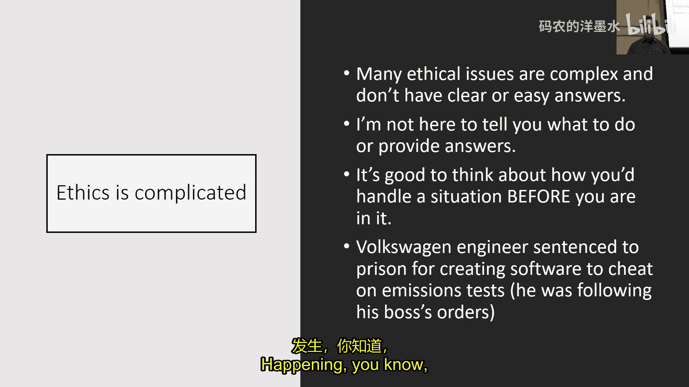
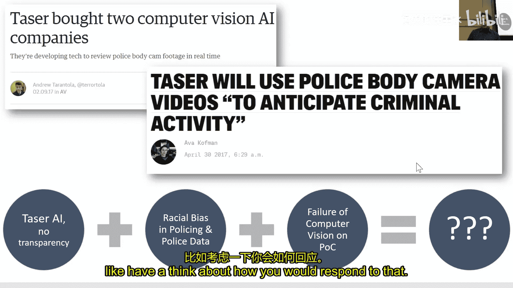
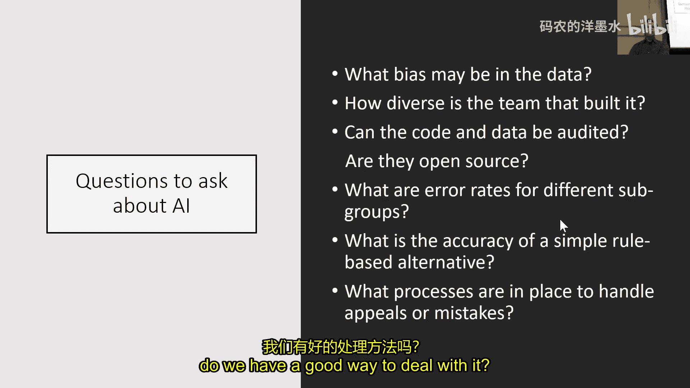

# 012：时间序列预测与结构化数据分析回顾

在本节课中，我们将完成罗斯曼销售预测案例的学习，回顾整个课程的核心概念，并探讨机器学习技术的伦理与社会影响。

## 罗斯曼案例：时间序列事件特征工程

上一节我们介绍了如何将“开业月份”等变量转换为分类变量以利用嵌入层的灵活性。本节中，我们来看看如何处理时间序列中的事件，并创建相关特征。

### 事件持续时间特征

在时间序列数据中，事件（如促销、节假日）的发生时间点本身很重要，但事件发生前后的时间段往往也包含有价值的信息。例如，在杂货销售预测中，节假日前后销量可能升高，而节假日期间可能降低。

因此，对于每个事件（如促销、州假日、学校假日），我们创建两个新特征：
*   **自上次事件发生以来的天数**
*   **距离下次事件发生的天数**

以下是实现此功能的函数核心思路：

```python
def get_elapsed(df, field):
    df = df.sort_values(['store', 'date'])  # 按商店和日期排序
    last_date = None
    last_store = 0
    res = []

    # 使用zip高效遍历多个NumPy数组
    for s, h, d in zip(df.store.values, df[field].values, df.date.values):
        if s != last_store:
            last_date = None  # 新商店，重置
        if h:  # 如果当前行是该事件
            last_date = d
        if last_date is not None:
            res.append((d - last_date).days)
        else:
            res.append(np.nan)  # 或一个极大/极小值
        last_store = s
    df[f'elapsed_{field}'] = res
    return df
```

**关键点**：
*   使用 `df.sort_values` 确保按时间和分组排序。
*   使用 `zip` 函数同时遍历多个列表（如商店ID、事件标志、日期），这比逐行迭代DataFrame快得多。
*   为每个商店独立计算持续时间。
*   对训练集和测试集都需要应用此处理。在笔记本中，可以通过先设置 `df = train_df` 运行相关单元格，再设置 `df = test_df` 重新运行的方式交互式处理。

### 滚动窗口函数

除了事件特征，时间序列分析中常用到滚动窗口函数（如移动平均）。Pandas的 `rolling` 方法可以高效实现。

```python
# 计算每个商店每周销量的7天滚动和
weekly_sales = df.groupby(['store'])['sales'].rolling(7, min_periods=1).sum()
```

**关键点**：
*   `rolling(window, min_periods)` 创建指定大小的窗口。
*   对于预测任务，通常需要使用“仅包含过去”的窗口（即设置 `center=False`，默认值）。
*   Pandas拥有强大且高度优化的时间序列API，值得深入学习。

## 数据预处理与模型构建

完成特征工程后，我们需要为神经网络准备数据。

### 分类变量与连续变量

*   **分类变量**（如星期几、商店类型）：转换为Pandas分类类型，并确保训练集和测试集的编码一致（使用 `apply_cats`）。它们将通过嵌入层处理。
*   **连续变量**（如温度、距离）：转换为浮点类型。对于神经网络，**归一化**至关重要，因为它能确保所有特征的梯度处于相近量级，有利于优化。

```python
# 使用proc_df处理数据框，包括归一化
df, y, nas, mapper = proc_df(df, 'sales', do_scale=True)
# mapper对象保存了用于归一化的均值和标准差，需用于测试集
```

**关键点**：
*   使用 `proc_df` 的 `do_scale=True` 参数对连续变量进行归一化（减去均值，除以标准差）。
*   必须使用训练集计算得到的 `mapper` 对测试集进行相同的归一化。
*   本竞赛评估指标是均方根百分比误差（RMSPE），对因变量取对数可以将比率差异转换为差值差异，更便于优化。

### 验证集划分与最终训练

对于时间序列问题，验证集通常应选取最近的时间段，而非随机抽样。

```python
# 按日期划分验证集（最后一段时间）
n_valid = int(len(df) * 0.1)  # 例如最后10%
n_trn = len(df) - n_valid
train_df, valid_df = df.iloc[:n_trn].copy(), df.iloc[n_trn:].copy()
```

当确定最终模型架构和超参数后，为了获得最佳性能，可以使用全部数据（包括之前的验证集）重新训练。此时，可以设置一个极小的验证集（如仅一行）以使代码正常运行，但需确保训练配置与之前验证过的最佳配置完全相同。

### 嵌入维度设定

为每个分类变量设定嵌入维度。一个经验法则是：嵌入维度取 `min(50, 类别数//2)`。例如，星期几有7类，则嵌入维度为 `min(50, 7//2) = 3`。

**关于过拟合**：在现代机器学习中，我们主要通过正则化（如Dropout、权重衰减）而非减少参数数量来控制过拟合。因此，初始设定时可以相对慷慨地设置参数数量。

### 模型训练与结果

构建并训练模型后，在罗斯曼竞赛中获得了约0.1的验证集误差。提交后，私人排行榜排名第5，但公开排行榜排名第340。这突显了**精心构建并信任自己的验证集远比依赖Kaggle公开排行榜更重要**，因为后者可能与最终私人排行榜的数据分布不同。

## 课程核心概念回顾

现在，让我们回顾本课程学到的两种主要建模方法。

### 决策树与基于梯度下降的模型


1.  **决策树方法**（随机森林、GBM）：
    *   可以直接使用**序数编码**的分类变量（即简单的整数标签）。
    *   不关心连续变量的尺度，因为它只关注排序。
    *   通过寻找最佳分割点来构建模型。


2.  **基于梯度下降的方法**（线性模型、神经网络）：
    *   分类变量通常需要**独热编码**或更高效的**嵌入层**。
    *   **必须对连续变量进行归一化**，以确保优化稳定。
    *   通过迭代更新参数来最小化损失函数。

**关键区别**：
*   对于线性模型，独热编码可能导致共线性问题（在解析解中），但使用SGD和少量正则化可以缓解。
*   嵌入层是独热编码与权重矩阵相乘的计算捷径，数学上等价，但效率更高。对于神经网络，嵌入层可以学习到更丰富的类别表示。



### 模型解释

*   **随机森林**：我们学习了特征重要性、偏依赖图、树解释器等工具。
*   **神经网络**：同样的思想可以迁移。例如，可以通过计算输出对输入的梯度来近似特征重要性，或通过修改输入值观察输出变化来创建类似偏依赖图的图表。这是一个有待探索的有趣领域。

**关于统计显著性**：在大数据时代，我们更应关注**实际显著性**（影响是否足够大）而非统计显著性。对于小数据集，可以使用**自助法**来估计置信区间。

## 机器学习伦理与社会影响 🌍

最后，我们探讨本课程最重要的部分：如何负责任地使用机器学习技术。

### 影响力与预测准确性

机器学习的目标不应仅仅是优化预测准确性，而应是**积极影响行为**。例如，推荐系统不应只推荐你很可能购买的商品，而应推荐能促使你产生新购买行为的商品。

### 现实中的伦理挑战

工程师可能无意中造成严重后果：
*   **历史教训**：IBM的打卡系统曾被纳粹用于管理集中营，协助了种族灭绝。
*   **当代案例**：Facebook的算法为了最大化用户参与度，可能加剧了缅甸罗兴亚人危机中的仇恨言论传播。其广告系统也曾被揭露允许基于种族的住房歧视。

### 偏见与反馈循环

*   **数据偏见导致算法偏见**：如果训练数据存在社会偏见（如种族、性别偏见），算法会学习并放大这些偏见。
    *   **图像软件**：面部美化应用让用户看起来更“白”；照片分类器将黑人错误标记为“大猩猩”。
    *   **自然语言处理**：词向量中固化着“父亲：医生 :: 母亲：护士”等性别刻板印象；谷歌翻译将土耳其语中性代词“o”根据上下文错误地译为“he”或“she”。
*   **反馈循环**：算法决策会影响现实，产生的新数据又反过来强化算法的原有偏见，形成恶性循环。
    *   **预测性警务**：如果历史逮捕数据存在种族偏见，算法会建议更多巡逻黑人社区，导致更多逮捕，从而“证明”该社区犯罪率更高。
    *   **社交媒体**：推荐系统会向用户推送越来越极端的内容，加剧观点极化。

### 量刑软件中的偏见

一些法院使用的再犯风险预测软件，被证明对非洲裔美国人存在系统性偏见：将他们错误标记为高风险的比例几乎是白人的两倍。这些软件甚至使用“你父亲是否曾被逮捕”等问题，这引发了关于“因出身而受罚”是否合理的深刻伦理质疑。

### 如何应对：关键问题清单



在开发数据产品时，请思考以下问题：
1.  **数据中可能存在什么偏见？**
2.  **开发团队是否多元？** 多元化的团队能发现更多潜在问题。
3.  **代码能否被审计？是否开源？**
4.  **不同群体间的错误率是否有差异？**
5.  **是否存在更简单、可解释性更强的规则？**
6.  **如果出现问题，是否有妥善的处理机制？**



### 行动与责任

*   **认识到你的价值**：掌握编程和机器学习技能的人才极度稀缺。这赋予了你选择工作环境和坚持伦理原则的资本。
*   **不要盲目服从**：历史上，只是“执行命令”的程序员也曾承担法律责任（如大众汽车排放作弊案）。
*   **提前思考，敢于发声**：在技术讨论中，要能识别伦理问题，并思考如何应对。如果环境有毒，离开是一个可行的选择。
*   **将伦理视为工程问题**：如何构建更公平、无偏见的模型，本身就是一个有价值的技术挑战和商业机会。


## 总结


本节课中，我们一起完成了罗斯曼时间序列预测案例，学习了事件特征工程和滚动窗口函数。随后，我们回顾了决策树与基于梯度下降的模型之间的核心区别。最后，我们深入探讨了机器学习伦理这一至关重要的话题，理解了数据偏见、算法反馈循环可能带来的社会危害，并思考了作为从业者应有的责任和行动方案。希望这些知识不仅能帮助你构建更有效的模型，也能引导你成为负责任的技术实践者。