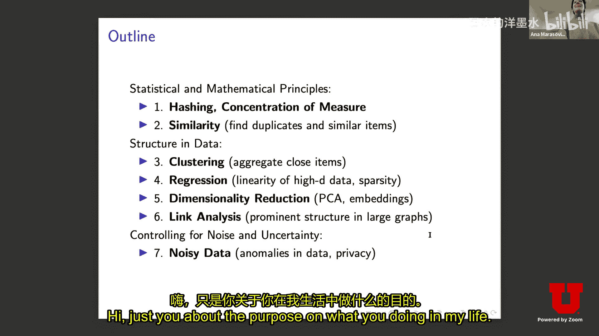
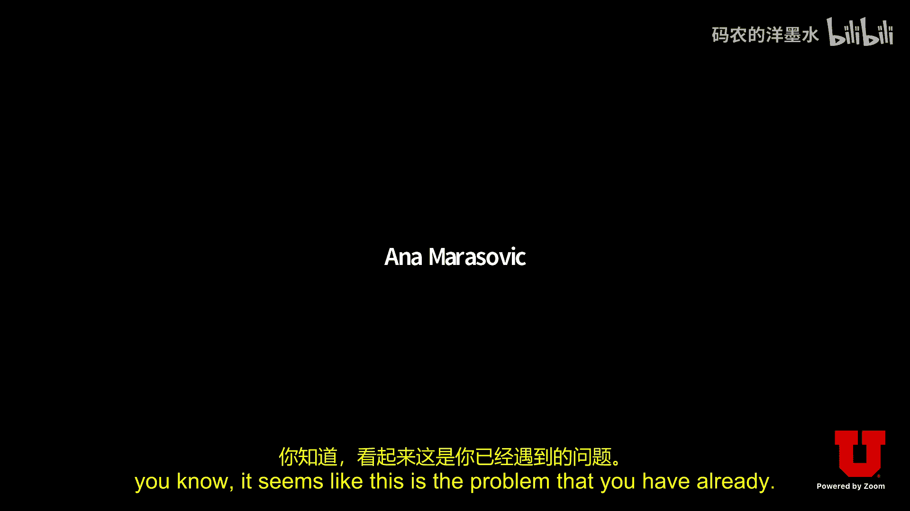

# 001：课程概述

在本节课中，我们将学习犹他大学CS6140数据挖掘课程的整体安排、课程目标、评估方式以及核心主题。课程由Anna Maravic教授主讲，旨在为学生提供处理大规模数据分析所需的理论基础和实践技能。

---

## 课程介绍与个人背景

欢迎来到数据挖掘课程。我是Anna Maravic教授，我将担任本课程的讲师。我对这门课程怀有特殊的情感，因为在我决定从事机器学习和自然语言处理研究之前，我的专业是纯数学，没有任何计算机科学背景。当时我选修了一门类似的课程，它为我打开了一个全新的世界，并激励我开始学习更多机器学习课程，最终成为了一名自然语言处理领域的研究者。我希望这门课程至少能激发部分同学的好奇心。

需要说明的是，本课程的大部分材料和幻灯片借鉴自Jeff Phillips教授，他是这门课程的原始设计者。

今天的课程不会涉及正式的教学内容，我们将主要介绍课程的后勤安排，大约需要50分钟。之后我们会稍作休息，然后简要概述本课程将要讨论的主题，让大家对课程内容有一个初步的了解。

---

## 课程后勤与资源

课程的后勤安排部分没有配套幻灯片，这与后续的正式讲座不同。这也是唯一一次使用幻灯片的讲座。从下周三开始，我将使用iPad书写，并将内容投影到屏幕上，以模拟使用白板的教学方式。

本课程将被录制并实时直播。你可以在名为“Ufo data science”的YouTube频道上观看直播或回放。然而，如果出现无法在5-10分钟内解决的技术故障，我将继续进行线下授课，届时将没有录制内容。因此，如果完全依赖录制内容来学习，将存在一定风险。你可以选择线下上课或在家观看直播。

我建议你尽量跟上讲座的进度。如果积压了太多视频内容，将很难跟上后续材料，完成作业也会非常困难。请选择最适合你的学习方式，但我推荐你至少与线下授课同步观看。

如果没有问题，我们将继续介绍相关信息。

---

## 课程网站与大纲

首先，你需要在Canvas页面找到课程大纲，其中包含了本课程所需的大部分信息。此外，还有一个与课程相关的网站。大纲和网站上的信息是互补的，你需要同时使用这两个资源来学习课程。

在网站上，你可以看到一些基本信息，包括我之前提到的YouTube频道链接、我的邮箱、办公时间等。办公时间安排在每次讲座之后，地点在本教室。由于讲座结束后10分钟有另一门课，我们无法长时间停留，但我和助教们会在另一个房间继续提供帮助。

以下是我们的助教团队：L today Jo、Summer、Behi、Han、Nate和Vinuta。他们几乎可以像我一样为你提供帮助，请在有需要时联系他们。稍后我会详细介绍如何找到我们以及如何与我们沟通。

再次强调，每个人的办公时间都列在网站上。部分办公时间将通过Zoom进行，例如周二下午4点到5点，以及周四中午12点到1点。这对于需要兼顾工作和学习，或主要依赖录制内容的同学可能很有帮助。

在网站上，你还可以找到课程安排表。表格中列出了每个日期的讲座主题、项目组成部分的详细信息，以及作业和考试的截止日期。我建议你主要依赖Canvas来查看确切的截止日期和时间，因为作业发布和提交都在Canvas上进行。但网站上的日程表可以帮助你了解重要日期的大致分布。

你可以看到，作业的布置非常有规律，总共有8次。请提前规划好这些重要日期。除了作业和项目，还需要记住的日期是3月1日的中期考试和5月3日的期末考试。这些考试都是线下进行的，请务必将其加入你的日程表。

让我们回到课程大纲。到目前为止有任何问题吗？

好的，我们继续。

---

## 先修知识与背景要求

已经有同学询问学习本课程前需要掌握哪些知识。对于研究生没有正式的课程要求，但对于本科生有正式的先修课要求：需要修读“数据分析基础”和一门“软件开发”类课程。

这是因为本课程假设你已经牢固掌握了线性代数和概率论的基础知识。如果你觉得需要复习这些内容，请自行回顾。我会在课程中指明相关教材的章节，其中涵盖了所有基础知识。如果你觉得有必要，我强烈建议你进行复习，因为我不会在课堂上详细讲解线性代数和概率论的每一个细节，我们将直接在此基础上学习更高级的技术。

CS3500（软件开发课程）作为先修要求的原因是，本课程包含编程作业，我们不会提供极其清晰的实现指令。这样设计的理念是模拟现实世界，在现实中你通常也不会得到非常明确的编程指示。如果你从未上过需要自主编程的课程，完成作业可能会更具挑战性，需要花费更多时间。

此外，本课程的学生背景多样，不仅有计算机科学专业的学生，还有数据科学、数学或其他领域的学生。有些同学可能从未上过严格的编程课程，这意味着对于计算机科学专业的同学可能很快完成的作业，对其他同学来说可能需要更多时间。如果你从未真正编程过，所需时间可能会更长。这是你在考虑作业时需要了解的背景信息。

我之前提到会指明教材中需要复习的章节。这些章节是《数据分析的数学基础》的第1、3章以及第2、5、7章的开头部分。这本书由Jeff Phillips教授编写，有在线免费版本。课程中的引用将指向这个在线版本，而非需要购买的纸质版。

也许我们可以打开看看它的样子。第1、2、3章涵盖了这些基础知识。但下周三，我们将讨论第2章中的部分内容，所以如果你需要复习，最好先关注第1和第3节。

让我返回看看是否遗漏了什么。是的，在本课程以往的版本中，对编程语言没有要求，但我强烈建议你使用Python。因为Python目前已成为数据挖掘、数据科学相关工作的主流编程语言，拥有大量优秀的库，并且可以轻松处理各种数据文件。如果你偏好其他编程语言，我不会强行阻止，但我们推荐在本课程中使用Python。

关于先修知识就介绍到这里。我提到过本课程学生背景多样，因此我们在作业中设置了额外的加分题，这些题目旨在吸引对特定主题感兴趣的同学。你可以在作业中寻找这些题目，看看是否有你感兴趣的内容。

此外，在项目部分，我们也会考虑到这种多样性。你可以在项目中灵活选择主题，展示你来自本专业的专长和知识。

到目前为止有任何问题吗？好的。

---

## 教材与参考资料

本课程主要基于三本教材。第一本是之前提到的《数据分析的数学基础》。此外，还有Jeff Phillips教授编写的讲义。我会使用这些讲义来备课，并可能添加一些注释。如果我添加了任何内容，一定会与你们分享。这些讲义可以在课程网站上找到，点击每节课的“笔记”链接即可获取。

这些讲义基本上是那本我们常提到的书（我简称为M4D）的一个不那么精致的版本，并且顺序与书的章节不同，因为讲座的顺序也与书不同。

另外两本教材是《挖掘海量数据集》和《数据科学基础》。前者包含较少的数学形式和证明，而后者则主要关注我们所讨论内容的证明。M4D则介于两者之间。

这些书都不是必须购买的，它们都有在线版本，你可以根据需要免费阅读。特别是如果你对证明更感兴趣，一定要看看《数据科学基础》这本书。本课程中会有一些证明，但不会太多，而这本书里有很多。

好的，我们继续。

---

## 沟通渠道与办公时间

我们将使用Canvas发布所有通知，并使用其讨论区功能解答关于作业、项目、课程材料或日程安排的任何问题。关于是在Canvas讨论区发帖还是给我发邮件，有一个简单的判断原则：首先，想想助教是否能回答这个问题，而不仅仅是讲师；其次，这个问题是涉及更多人，还是仅与你个人相关。如果你有个人紧急情况，应该给我发邮件。如果你有一个关于作业的问题，并且认为班上其他同学也可能有同样的问题，最好在讨论区发帖。这样我们只需回答一次，所有人都能看到答案，可以减少重复提问，让我们能处理其他尚未解决的问题。

Canvas讨论区是与我们沟通的首选方式，因为有更多的人可以查看，所以你的问题得到更快回答的几率更高。如果你只给我发邮件，我会尽力回复，但如果邮件太多，难免会有延迟。我们已经安排好每天都有专人检查Canvas讨论区，确保能及时回答你们的所有问题。

我们也将使用Canvas提交作业。作业和项目组成部分都将在Canvas上发布和提交，成绩也会通过Canvas沟通。所以，Canvas是处理大部分课程事务的地方。

重申一下，除非是个人紧急情况，否则请将任何问题发布在Canvas上。但请不要在讨论区发布任何作业答案。如果我们发现此类信息，会立即删除。

其他活动，如查看日程、课堂笔记和视频，将通过这个公开对外的网站进行。

如果你需要私下联系我，可以在课程大纲顶部找到我的邮箱。实际上，如果你在Canvas中点击“收件箱”，效果与发送邮件相同，可以节省你在不同应用间切换的十几秒时间。

除了发送邮件（我认为这是效率最低的联系方式），你还可以参加办公时间。如果你无法参加任何列出的办公时间，请给我们发邮件，我们可以另约时间见面。网站上列出了所有的办公时间，包括线下和Zoom办公时间，希望能满足大家的不同需求。

当然，你也可以在讲座结束后立即提问。如果问题简短，只需要5到10分钟的解答时间，可以在讲座后直接问我。但之后，我们会在MEB 3515房间安排每次讲座后的办公时间。

我们设计办公时间时考虑到作业总是在周三截止，因此在周一、周二和周三安排了更多的办公时间，假设你们在提交作业前需要更多帮助。但如果你开始得较早，周四也有办公时间可以提供帮助。

我个人不在周末或晚上工作，所以除非有重大例外情况，否则你在那些日子不会收到我的回复。助教可能会根据自己的情况回复，我不确定。但我们会在周五晚上和周一早上检查Canvas讨论区。

总之，我们真心希望为你们提供帮助。如果有任何方式我们可以帮助你，请告诉我们。我们愿意提供你成功完成课程所需的任何帮助。请充分利用这些办公时间，与我们交流。

关于这部分有任何问题吗？好的。

---

## 课程评估方式

接下来，我们来看看课程评估部分。

你的成绩将由三种方式评估。

首先，作业将占你总成绩的40%。总共有8次作业，大致涵盖课程前半部分和后半部分的主要主题。每次作业通常围绕一个主题，例如统计原理、哈希、LSH等。作业通常包含分析性问题，有时也会要求编程练习，首选语言是Python。

其次，有两次考试，各占10%，分别覆盖课程的前半部分和后半部分。考试是开卷的，你可以带一张纸的笔记，但不允许使用电脑或计算器。考试必须线下进行，除非有医疗紧急情况或与其他考试冲突，否则不能调整考试时间。如果有医疗紧急情况，我们需要医生或辅导员的证明文件。

最后，项目部分占总成绩的40%。这部分内容较多，我会详细说明。

实际上，我会为此打开项目页面，因为内容很多，请耐心听我讲完。首先，项目包含多个组成部分：项目提案、数据收集、中期报告、最终报告和海报展示。每个部分都有不同的分值，并且截止日期不同。请在Canvas上仔细查看每个项目组成部分的具体截止时间。

实际上，第一个截止的项目提案很快就到了，是1月25日。所以请记住，项目工作几乎立即开始。在还没有讨论所有主题的情况下思考项目做什么，可能有点奇怪。但另一种选择是把所有项目工作都放在最后两周，那对你们来说也不好。因此，我建议你先了解一下这些主题，看看哪些可能有趣，或者思考一些听起来模糊有趣的问题，然后来和我们讨论。告诉我们：“我听说过这个问题”、“我在思考这个问题”或者“我看到了这些数据，你觉得用本课程的哪些主题来探索比较好？”等等。欢迎来办公时间找我们讨论，我们很乐意帮助你。如果你想使用课程早期涵盖的技术，这也是可以的。

这里列出了一些贯穿整个学期的日期，但请认真查看这一列，了解本学期你需要完成多少工作。

项目团队规模应为2到3人，理想情况是3人。项目的规模也应与团队人数成比例。在你的提案中，应该能看出有足够三个人做的工作量。因此，在组建团队时，请考虑项目的规模以及每个人将负责什么。在一些报告中，你需要写明这些内容。

如果你希望单独完成项目，我们非常不鼓励这样做。但如果你有非常 compelling 的理由，例如，你已经在某个地方工作，可以访问一些无法共享的数据，并且你真的想用它来做项目，请与我们沟通。这应该是规则的例外情况。

如前所述，项目规模应与人数成比例。另外，你不能在不同课程的项目之间“一稿多投”。例如，你可能同时选修了机器学习课程和数据挖掘课程，想用一个项目应付两门课，这是不允许的。你提交给其他课程的项目应该是独立的。

如果你对此有疑问，请告诉我。

接下来是关于迟交的说明，我稍后在讲解迟交政策时会详细说明。

如果你认为评分有误，可以在收到成绩后的一周内申请重新评分。这适用于项目、作业和考试。我认为，你可以在项目中获得的额外加分仅来自项目展示。我之前提到，作业中有额外加分，项目展示中也有额外加分。这些构成了本课程所有可能的额外加分机会。请记住这一点。一旦最终成绩公布，就没有机会再获得额外加分，你的成绩就是最终成绩。

此外，项目的组成部分与本课程的其他部分一样，都遵循计算机学院的各项政策和指导方针，包括学术不端行为政策，这一点非常严肃。请仔细阅读，并尽量避免任何形式的作弊行为。

好的。

我不想现在读完所有这些内容，那可能会让你们都睡着。但也许针对即将到来的项目提案，这里列出了你们作为一个团队应该撰写的内容：准备一份100到200字的文档，概述你们的计划，说明团队成员、计划使用的数据及其来源、计划从数据中挖掘的结构、为什么这个问题有趣、有什么新意或者讲师能学到什么。试着现在就进入需要撰写这类内容的心态，想象一下回答这些要求中的每一项需要多少时间，然后实际将它们写进文档。

请尽量使用语法正确的句子。现在有很多好工具，比如Grammarly，你可以将其集成到LaTeX中，或者直接将文本放入Google文档，它会给出很多建议。我自己也不是英语母语者，我使用所有这些工具来使我的句子连贯。如果我看到大量的语法错误，我就知道你们甚至没有使用这些免费可用的工具，这会让我感到遗憾。我不会因此扣分，但阅读不连贯的文字并不愉快。

我不会逐一讲解其他内容，但也许我会提到，这里有一些包含潜在数据的链接，你们可以探索。我强烈推荐Kaggle，上面有很多可以查看和尝试的内容。看看这些资源，试着开始头脑风暴，思考可能使用什么数据以及研究什么问题。

最后我想提一下海报展示。我说过项目的组成部分之一是最终展示，这将以海报的形式进行。请举手示意，你们中是否有人以前制作过研究海报？

好的，有一些。那么，请所有见过研究海报的人举手？

好的，更多了。我想给你们看一张我上个月展示的海报。这是一个研究海报的例子，来自我的一篇论文。它看起来像这样：有一个巨大的标题，有一些关于问题动机的说明，试图说服人们为什么这个问题有趣。在这篇特定的论文中，我们收集了一些数据，所以海报有很大一部分用来解释我们如何收集数据以及关于这些数据的一些统计数据。然后，你有一些基线性能，以及一些关于这篇论文主要收获的文字。你可能会包含一个二维码，让人们可以轻松访问你的GitHub代码库和数据。这就是研究海报的一个例子。尽量留出足够的空白，文字尽可能少。图表总是比表格等更好。

这就是你们将要制作的东西。然后我们将举行一个大型的海报展示会，持续至少两个小时。你需要准备一个关于你项目的简短介绍，就像在研究会议上通常做的那样：你站在海报旁边，人们走过来，他们的注意力持续时间可能很短，你需要说服他们你的论文是最好的。所以你需要准备一个大约两到三分钟的简短介绍，这意味着你需要练习，直到你能流利地说出来。对于这门课，你不必练习到做梦都能说的程度，但它应该快速且连贯。目前大约有130名学生注册了这门课，如果你们都组成三人小组，那大约是40多个小组。如果每个人做两分钟的展示，光是听项目展示就需要80多分钟。不幸的是，时间有限，所以你确实需要练习。但这应该很有趣，你也会看到同学们做了什么。我认为这是学习如何将本课程学到的技术应用到有趣问题中的好方法，而且不仅仅是坐在教室里，你会四处走动，更加投入和积极。

好的。我们会处理所有这些事情，我们需要非常仔细的后勤安排，你们需要提交海报的初稿，我们会快速检查是否合理，然后告诉你“这是最终版本”，或者我们会告诉你“你应该修改这里”，然后你发送最终版本。我们会在4月24日之前打印所有这些海报并进行展示。这个时间线必须非常严格，否则所有海报都无法按时打印。

关于项目有任何问题吗？你会帮助我们组建小组，还是我们需要自己发邮件联系？

说实话，我之前没想过这个问题。我原本以为你们会自行安排，但现在你这么一问，我也意识到组建小组可能很困难。是的，让我再考虑一下，并在周三给出更具体的指示。

我可以想象这是可能的，所以我会询问以前的讲师，看看是否能得到这些信息。谢谢。

就我个人而言，对于数据量没有上限要求。通常有下限要求，比如如果你只有10个例子，那就不再是数据挖掘了，因为你可以手动分析数据。所以，关于上限，没有限制；关于下限，可能有。如果你认为你的数据非常有限，请与我沟通，我会告诉你是否足够大。如果你的数据太大，这可能是一个有趣的问题，但也可能难以产生任何结果。但你知道，尝试使用你能处理的最大数据是很容易的，然后发现“哦，我需要一年时间才能完成分析”，然后你可以向下采样，直到找到更合理的数据大小。

我推荐使用这些资源。是的，但现在也有很好的网络爬虫工具。例如，也许你想分析某种类型的音乐歌词，你实际上可以爬取这些歌词并自己收集数据。但我想强调，这些数据将是未标记的。你可能不会费力去标记数据，即请人为每个实例提供类别。原因是那样你无法收集很多实例，更难以使我们将要讨论的任何技术变得有用。

另外，我稍后会提到，在本课程中，我们不会专注于分类，即使用监督技术将事物分类到标签中，因为这太像机器学习课程中教授的内容了。我们不想教相同的东西，那不会是对你们时间或我们时间的最佳利用。

我们可以使用机器学习模型设置来对数据说些什么，然后你可以修复数据的某个子集。

是的，所以我会提到，我们根本不会讨论分类技术。因此，本课程不会提及任何这些监督机器学习技术。

我们不允许使用，比如说，神经网络来预测你的数据，因为这不是我们将在本课程中教授的任何内容。但是，如果你要应用分类器对数据做一些处理，然后根据该分类应用我们使用过的一些技术，那可能是允许的。但在任何你觉得可能没有使用我们在本课程中讨论的任何技术的场景中，请联系我。

我意识到，在我们讲完所有课程材料之前，我们就要开始项目了。我将在今天讲座的最后快速浏览一下，让你们了解这里将教授什么，这可能会让你们了解在项目中可能使用哪些技术。但是，是的，一旦你对将要使用的东西有了一些概念，与我们交谈是最好的主意。

是的。抱歉，我知道这不太具体。好的，我们继续。Maravic教授？是的。

---

## 课程政策

好的，这就是你们的评分方式。现在让我们来看看一些课程政策。我将讲解我制定的具体政策，然后还有一些大学政策，现在全部讲完是不合理的。每节课我会讲解其中一两条，这样就不会一次 overwhelming。

如前所述，你们的所有作业都将在Canvas上提交。

你可以在大纲底部找到所有作业的截止日期，并请注意时间。所有作业都将在周三讲座开始前（下午2:45）截止。

但项目组成部分的截止时间在给定日期的不同时间。

请不要假设所有东西都在下午2:45截止，只有作业是。

好的。所有东西都在Canvas上提交，请不要通过电子邮件提交任何东西。

我们建议你们使用LaTeX来撰写作业。请举手示意，让我了解一下你们中有多少人以前使用过LaTeX？

好的，相当一部分人用过，但仍有不少人没用过。基本上，LaTeX是一个工具，可以让你轻松地编写方程式。有一段时间，它是撰写任何与数学相关内容的必备工具。现在LaTeX已经很好地集成到Google文档、幻灯片等工具中，所以你可以在其他地方使用它。但我仍然认为最直接、最简单的方法就是直接使用它。以前人们会在本地编译他们的LaTeX源代码，现在大多数人只是使用Overleaf。这里我提供了一个Overleaf文档的例子，基本上是源代码，然后你得到了编译这个源代码的结果，就是这个PDF。当我们发布作业时，也会提供该作业的LaTeX源代码，这样你就可以把它放到Overleaf中，在那里编写，然后编译，比如这里会重新编译，然后你只需下载PDF，将PDF上传到Canvas。要将项目上传到Overleaf，你只需转到主页，新建项目，然后上传项目，将我们提供的包含文件的zip文件拖放到Overleaf中。

哦，像Jupyter笔记本。但并非所有内容都是编程练习。

是的，我不太清楚它如何适用于任何类型的作业，但你可以写Markdown，这与LaTeX非常相似，我认为对我来说没问题。你提交的是PDF，所以我的意思是，你可以打印Jupyter笔记本，我认为在Overleaf中做更容易。但只要可读，我其实不介意使用任何这些工具。我们想要避免的是手写作业，这很可能会是一场灾难，并导致各种问题。所以绝对不要那样做。但是，如果你使用Git、Overleaf、Stupor Notebooks，或者使用集成了LaTeX的Google文档来写作业，我认为对我们来说应该没问题。

如果我们字写得非常好，可以手写吗？你可以测试我。

我建议不要。我担心如果我同意一个确实字写得非常好的学生，那么其他字写得不好的人也这样做，我们就有麻烦了。

但是，你知道，习惯用LaTeX写这些东西是很好的练习，所以这是一个好机会。

是的，我们会使用GradeScope，但仅此而已。是的。

关于作业大小有什么要求吗？请。

是的，J说得很好。如果你们都使用我们发送的相同文件并填写它们，对我们评分来说也更容易，因为我们确切知道每个内容在哪里。是的，所以我们更倾向于你们按照我刚才展示的方式去做。但如果那确实会占用你们太多时间，我们也能应付一些用不同方式撰写的作业。

好的，你知道，Overleaf也是我想强调的，当你们进行任何类型的研究项目合作时都会用到它。它是主要工具，就像如果你决定做研究，这可能是你除了电子邮件之外，一生中看到最多的网页。

是的，你可以，这就是它如此吸引人的原因，因为多人可以同时在上面工作，这比Overleaf出现之前要好得多。我从未经历过那个时代，或者用Word，我肯定经历过，但我那时没做研究。人们告诉我，他们会有各种奇怪的版本控制问题，比如一个人写，然后另一个人的版本再在上面工作，那是一团糟。所以，是的，这很棒。

好的，你不需要使用Overleaf，你可以在本地编译东西。这意味着如果你使用MacBook，你需要使用像TeX Live这样的东西，然后通常需要下载包等等。而使用Overleaf，所有这些都为你做好了，所以开始使用它要容易得多。

好的，如前所述，作业、项目等所有内容都遵循计算机学院的各项政策和指导方针，包括学术不端行为政策，该政策采用“三振出局”原则。我相信，如果因学术不端行为收到两次警告，你将立即被禁止注册任何额外的计算机学院课程，从各自的学位项目中退学，并且不会被任何未来的计算机学院项目录取。所以这根本不值得。

好的，话虽如此，我能理解什么构成学术不端行为可能会令人困惑。比如，你能和同学讨论吗？你能从彼此那里得到帮助吗？当然可以，我们鼓励你们组成学习小组并讨论作业。但最终，在讨论结束后，你必须用自己的话独立完成作业。很明显，这些是不同的解决方案。我的意思是，解决方案可能非常相似，但执行和书写的方式会不同，这就是我们要找的。所以请与你的同学交流，这会让你的生活更好、更轻松，但当你实际撰写解决方案时，你必须独立完成。

好的，不要向其他学生或互联网索要或复制作业，也不要让其他学生抄袭你的作业。你还应该引用所有参考的来源，特别是在项目组成部分中，因为在那里你遵循他人建议的情况不那么明显。这反映了学术诚信，是你们在研究工作中极其重要的习惯。

好的，我已经提到过不允许“一稿多投”。现在关于迟交作业。

你必须在Canvas上的截止时间前提交作业。如果你迟交了，这种情况时有发生，你最多可以迟交两次作业（仅限作业，不包括项目），每次不超过24小时，且没有惩罚。所以你有两次机会可以迟交作业，不需要通知我们，也不会发生任何事情。然而，在那之后，如果你第三次或之后迟交作业，将受到以下惩罚：前24小时扣10分，24到48小时之间扣20%，48小时后我们不接受任何作业。

另外，如果你迟交了三次，但有些作业做得更好，或者你觉得更好，关于哪次作业会受到惩罚，没有商量的余地。前两次迟交被接受，之后每次迟交都会受到惩罚，就是这样。

好的。我想再次强调，这种无惩罚的迟交仅适用于作业。对于项目，如果你迟交，将立即进入惩罚区域：前24小时扣10%，接下来的24小时扣20%。原因是你将是一个团队，很难判断谁是第二次或第三次迟交。

好的。再次强调，项目并非总是在下午2:45截止，像作业那样。如果你迟交项目组成部分，意味着你团队中的每个人都迟交了，每个人都会受到惩罚或得零分，取决于你们迟交了多久。

好的。我提到过，对于考试，如果你有医疗紧急情况，在提供证明文件后，我们可能会给你另一个时间考试。作业将在截止日期前两周发布，因此不接受在不同时间提交作业的例外情况，特别是考虑到你有两次基本上可以免费迟交作业的机会。

如果有长期生病的情况，当然这不适用，你只需告诉我们。

关于迟交作业有任何问题吗？是的。

关于项目提案，我们是否应该为每个部分提交截止日期？你提到了一些关于时间减少的事情。

是的，我建议你尽快开始思考这个问题。你对将要做什么有一些想法。如果你非常确信你提出的想法是好的，就没有必要与我们交谈。让我回到项目提案，我们有这些组成部分：你的团队成员、计划使用的数据、将从数据中挖掘的结构、为什么你正在处理的问题有趣，以及有什么新意或者讲师能学到什么。如果你不清楚是否满足了这里的任何要求，请来办公时间，我们会给你建议，告诉你是否应该更改任何内容。也就是说，我不希望每个人都来问我们是否足够好。如果你提交了一份合理的文本，可能就足够好了。从那里，我们可以告诉你：“嘿，你通过提交这份文档完成了这个项目组成部分，但我们认为你应该在这个步骤上多下功夫。”所以我觉得在项目提案之后，我们会给你更多的反馈。所以不要过度思考这是否足够好。我们不想变得严格或不合理，只要当我们阅读文本时觉得合理，我们就不会扣分。

好的。如前所述，对于评分错误，你可以在收到分数后的一周内提出。作业和海报展示中有一些额外加分机会。一旦我们公布了最终成绩，就没有机会通过做额外工作来获得额外学分。最终成绩将在5月15日前公布，这是将数字成绩映射到字母成绩的标准方式。

好的，现在关于 accommodations，我们从大学政策开始，我将在每节课讲解其中一条，这样就不会 overwhelming。但我们会涵盖所有内容，以便你们理解这些政策。

关于课程后勤有任何问题吗？没有。

好的。

---

## 课程核心主题概述

接下来，我将快速浏览本课程将涵盖的主题。但在那之前，我会给你们两分钟的休息时间。我尽量在每节课都安排两到五分钟的休息，让你们 refresh 一下，希望你们能继续跟上。所以休息两分钟，然后我们还有大约20分钟的讲座内容。

关于评分，我们对所有人的评分标准是一样的。当人们组建项目团队时，无论是本科生还是研究生，我们会考虑项目的规模。所以我认为，本科生做强度稍低一点的项目部分是可以的。此外，还有所有这些你可以获得的额外加分，我觉得你不会有很大的风险失去好成绩。我们将持续检查我们的成绩分布是否与往年相似。如果我们发现由于某种原因，我们的本科生成绩比以前低，我们会考虑提供一些额外作业来获得加分，或者采取其他措施。我们正在考虑这些事情，但我们从所有人按相同标准评分开始，唯一的例外可能是本科生的项目规模稍小一些。这说得通吗？是的，现在本科生这边有很多人。是的，如果你觉得由于某种原因，你可能达不到期望的成绩，或者类似情况，你知道，再次告诉我们。只要我们听到有担忧，我们就会想办法解决。但课程设计得让本科生也能取得好成绩。

好的。让我们完成这第一讲，那么从什么是数据挖掘开始。

好的，我们继续。

---

## 什么是数据挖掘？

让我们从什么是数据挖掘开始。这绝对不是一个容易回答的问题。在不同的学术背景下，你可能会听到：在数据中寻找结构，或者是对大规模数据进行机器学习，或者是无监督学习（即从无标签的数据中学习），或者是大规模计算统计学。这些都是合理的答案，如果你在面试中被问到这个问题，你可能会使用其中任何一个。但在本课程中，我们希望你们学到的是如何进行数据分析。你可能会想，数据挖掘或数据分析对我来说是一样的。让我们试着更具体一些。

思考数据分析意味着你精通以下三个组成部分：

1.  **理解将混乱的原始数据转换为抽象表示的原则。** 让我们用一个例子：假设你是一个会议的程序主席，你想查看一篇提交的研究论文是否抄袭，是否与已发表的另一篇研究论文过于相似。你得到了这篇科学文章的原始文本，现在你必须以某种形式表示它，以便能够测量该论文与数据库中所有其他论文的相似度。所以第一步是将这个长字符串转换成我们实际可以用来计算相似度的东西。

2.  **一旦决定了表示方式，就需要找到相应的算法。** 假设你已经设法为整篇科学文章找到了某种向量表示，你想找到某种算法来告诉你，用这个向量表示的论文是否与数据库中存在的其他论文非常相似。所以你需要知道，给定这种表示对象的方式，我可以使用哪些算法。

3.  **理解算法的可扩展性并进行建模选择。** 不会有唯一的方法来解决这个问题，你会在这里和其他地方学到许多算法。然后你需要理解这些算法在大多数情况下的可扩展性。你可能会找到一个非常慢的算法来搜索你的一篇论文与数百万篇已存在论文的相似度，所以你需要考虑：“我需要快速完成这个，程序主席不能等几个月，他们需要立即完成这项工作。”其次，你需要接受这些算法与你以前见过的算法（比如排序）可能完全不同。在这里，你需要熟悉“误差”的概念。你知道你问题的理想解决方案是什么，但你要使用的算法会给出你想要的近似值。你需要考虑存在误差，并且需要知道多少误差是可接受的，或者如何思考什么是可接受的误差。再次考虑论文抄袭问题：如果你使用某种向量相似度来判断某些东西是否过于相似，你需要决定什么是“过于相似”，并且其中会存在误差。最后，我们这里有一个建模的组成部分。对你来说可能不太舒服的是，建模数据的方式不止一种。在本课程中，你将讨论的是，一旦你需要做出某些选择，有哪些最佳策略。我必须告诉你，这是做研究（比如作为博士生）时最难的部分之一。这些选择基本上是你为实现要解决的问题而做的主要事情。你必须做出很多选择，开始思考如何做出最佳选择是你真正需要的技能。当然，不仅仅是你决定成为博士生，如果你在一家公司解决问题，你也必须为该问题提供解决方案，并且经常需要处理这些建模选择。

好的。

思考所有这些的另一种方式是，你有这两个相互交织的目标。你在算法课程中学到的是如何使算法尽可能高效，而在统计学中，你有另一种目标，即想要建模事物。建模有时无法高效完成。思考数据挖掘的一种方式是将其置于两者之间。这不仅适用于数据挖掘，也是思考机器学习及相关领域（如深度学习）的一种方式。

每所大学都有数据挖掘课程，但教学方式不尽相同。本课程的教学方式侧重于处理超大规模数据的技术。我们想涵盖尽可能多的主题，所以当我浏览日历时，你看到了很多主题，其中一些我们进行了分组。你有不同的主题和许多话题，我们将关注近期的发展。

然而，本课程的设计也始终非常正式，并且在某种程度上是数学化的。我们希望你们熟悉这种数学符号来讨论所有这些事情。一些数据挖掘论文的写作方式确实需要你理解那种符号。并非每篇论文都如此，也许如果你将数据挖掘应用到文本等领域，你可能不需要所有这些数学符号，你可以用自己的话表达。但这是协作时一种非常高效的沟通方式。你可能用非常诗意的方式描述你的问题和解决方法，但通常与协作者沟通的最佳方式就是将其放入一些我们都可以以自己的方式思考的抽象对象中。

如前所述，不会有太多证明，会有一些证明。如果你真的想看到更多证明，请参考那本《数据科学基础》的书。

我们还将关注在实践中有用的内容，主要受大公司使用的内容驱动。例如，我们将讨论PageRank，这是谷歌搜索背后的驱动力。

最后，我们不会回避概率算法。我理解这在概念上可能有点难，但我们会立即尝试克服这一点。所以在下一讲中，我们将讨论其中的一些，实际上我们将讲解讨论概率算法和随机性所需的一些基础。第一次作业将全部关于这些内容，以真正让你处于思考这些东西的良好状态。我提到过，Python是首选的编程语言。在数学方面，如前所述，你需要牢固掌握线性代数和概率论。有时你听到这些主题，甚至可能成绩很好，但随着时间的推移你会忘记。我在讲座开始时提到过，我以前是数学专业的，但那已经是很久以前的事了，你会忘记一些东西。你只需要稍微复习一下，回到你上次听说这些东西的状态。所以，即使你觉得对所有这些都很舒服，打开我提到的教科书和你在这里看到的章节，看看你是否对这些主题没问题，这也没有坏处。

但是，是的，当我讲解内容时，我不会深入所有细节。

好的，这种分类至少是以前呈现数据挖掘的方式。所以你可以将数据挖掘视为你的数据以两种不同的形式呈现给你：有标签数据和无标签数据。对于有标签数据，每个实例都有一个标签，通常由标注员手动标记。例如，假设你想将科学论文分类到不同领域，以便在arXiv上自动分类。你可以从有人标记这些论文开始，然后你不仅得到论文，还得到相应的标签。另一种情况是你只得到没有相关标签的论文。如果你有标签，可以考虑两大类算法：回归和分类。回归是给定这些标签数据，你给出某种标量实数值；分类是你自动将示例标记为生物学论文或数学论文等。当我们谈论有标签数据时，我们谈论的是预测。而对于无标签数据，你可能会做类似在数据中寻找结构的事情。对于你想分组到不同领域的科学论文，你想找到对应于每个组的论文集合，你可能会使用降维或聚类等技术。它们的不同之处在于，你是得到连续输出还是得到离散的某种集合。

现在你可能已经暗示了数据挖掘和机器学习的异同。分类是机器学习课程中涵盖得很好的内容，我们在本课程中根本不会讨论分类。唯一的原因是，否则这两门课程之间会有巨大的重叠。我们不想说分类与数据挖掘无关，它是相关的，但我们将专注于本课程中的另一套技术，这样如果你选修数据挖掘和机器学习，你会获得比我们在这里也教分类多得多的知识。

所以它不在这里，但通常很重要。

最后，这是课程大纲。前两项都是关于统计和数学原理的。所以正如我所说，下周三我们将更深入地讲解思考概率算法和随机性所需的基础。我们将稍微讨论一下哈希和集中度量。你可能听说过一种哈希——哈希表，我们将讨论另一种类型——LSH。所以在下一讲中，你可能会为思考所有这些事情打下良好的基础。

然后，之后我们将专注于相似性。我想我已经至少提到了几个相似性相关的例子，比如检查两篇论文是否抄袭，我们用一些向量表示它们，也许我们想检查这两个向量的某种相似性，以判断这两篇论文是否过于相似，因此可疑。了解相似性是我们将要讨论的所有其他内容的基础。在之前的幻灯片中，我说我们将专注于回归、降维和聚类。拥有良好的相似性语言对于理解之后的所有这些主题至关重要。你已经见过一些相似性类型，比如欧几里得距离，但这不会是衡量相似性的唯一方式。回到我所说的关于做出最佳建模选择，衡量相似性的最佳方式也取决于你的问题和数据，你可能会做出不同的建模选择，决定哪种相似性最适合你自己的问题。

所以这可能与你以前见过的相似性类型（即欧几里得距离）略有不同。

除了聚类、回归和降维，我们还将讨论链接分析，这对于分析大型图（如社交网络图）或讨论PageRank时最有用。

最后，我们将稍微讨论一下控制噪声和不确定性。与作业中的数据不同，你的真实世界数据将是混乱的，你应该为此做好准备。你会在数据中发现一些异常值，你的第一步是首先识别这些异常值，然后决定如何处理它们。你可能会删除它们，因为你觉得“哦，这完全是垃圾，不知道是怎么回事。也许有人提交了一篇只有一个词重复了八页的论文，你不需要那个。”这是你可以对异常值做的一件事。另一件事是：也许它看起来像异常值，但可能你处理的数据中，比如，你正在做招聘决策，对于这份工作，主要是女性被录用，现在你看到一个男性，这并不是现实世界的异常，只是你的数据中有这一个异常值，你应该对这个异常值更加谨慎。你也可以利用噪声做一些非常酷的事情，比如确保隐私。可以将噪声添加到数据中，以防止人们从你数据中代表的人那里理解私人信息。所以我们也会稍微讨论一下差分隐私。

是的，我想在这里停下来。我本想更详细地介绍每一个主题，所以如果你打开这些幻灯片，会有更多信息。请随时与我讨论其中任何内容。

好的。关于我之前在服务器上工作过，以及服务器之间的所有信息，并与另一位研究员就这些数据合作过，是的，这非常完美。我们将讨论聚类，我们将讲解层次聚类和其他图聚类。所以，是的，这个项目完全符合你的想法。只是也要记住为你的项目找队友，看起来你已经对这个问题有了一些想法。

---

## 总结

在本节课中，我们一起学习了CS6140数据挖掘课程的总体框架。我们了解了课程的后勤安排、沟通渠道、评估方式（包括作业、考试和项目）以及核心主题。课程强调将原始数据转化为抽象表示、选择合适的算法并理解其可扩展性，同时注重数学基础和实际应用。我们还明确了课程不会涵盖监督分类技术，而是专注于相似性度量、聚类、降维、链接分析以及处理噪声和隐私等主题。希望本次概述能帮助你为接下来的学习做好准备。