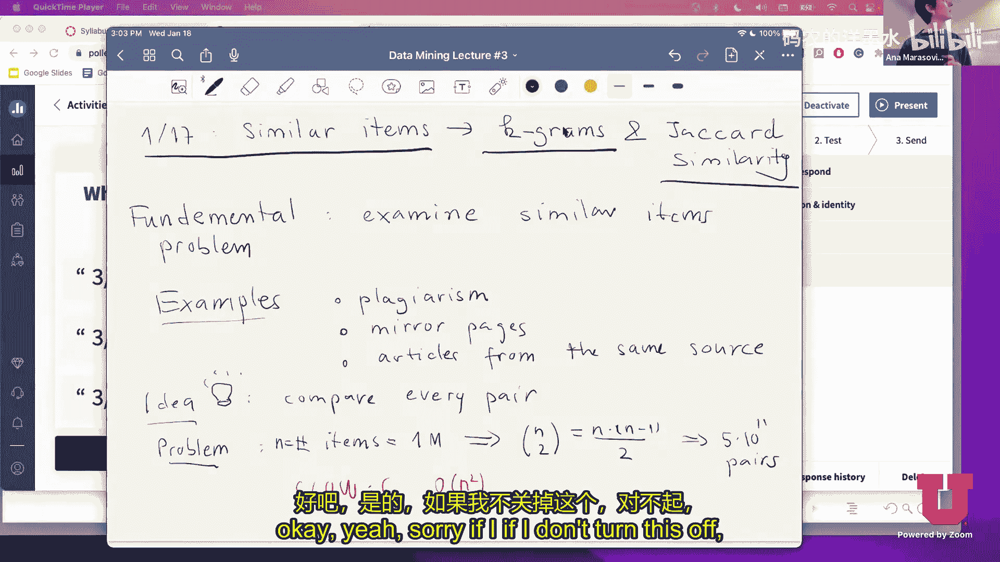

# 003：k-grams 与 Jaccard 相似性 📚

在本节课中，我们将学习数据挖掘中的一个基础问题：如何高效地查找或比较数据中的相似项。我们将从如何将文本文档表示为集合开始，然后学习如何使用 Jaccard 相似性来度量这些集合之间的相似度。

---

## 课程政策更新 📝

首先，我们回顾一下课程政策。今天涉及的是退课或撤销政策。学生可以在学期开始的前两周内退课，而不会受到任何处罚。在退课截止日期之后、课程中期之前，学生可以正式从一门或所有课程中撤销。成绩单上会记录“W”等级，并收取相应的学费。“W”等级不用于计算学生的GPA。关于完整学期、第一期和第二期课程的撤销截止日期，请参阅学术日历。

我想提一下与此相关的另一件事。在前两周无惩罚退课的政策下，我决定要求一些作业实际编写 Python 代码，特别是使用一些 Python 库。这应该不会太困难或超级复杂，但我认为在完成数据挖掘课程时了解这些库很重要。你们将学习它们的基本用法。这可能让你们有所顾虑。如果你们觉得这太难，可以考虑退课选项，但我真的相信这不会太复杂，你们需要自己决定。

这是我对课程大纲的一个修改。另一个修改是关于沟通方式的。发布第一次作业后，很明显有很多问题直接发送到我的收件箱，你们希望听到我的意见，而不是助教的意见。这对我来说很困难，因为我需要做研究，需要为大学服务，需要为研究社区服务等等。你们的消息与所有其他消息混在一起，我无法优先处理你们的消息或其他消息。因此，我们将改用 Piazza。Piazza 有一个有用的功能，我可以“认可”消息。如果你们看到我认可了助教的消息，就可以得出结论：我也会告诉你们同样的事情，无需直接联系我。当然，总会有需要直接联系我的个人情况。Piazza 提供了所有选项，让你们可以直接或间接联系教师，使事情变得私密或隐藏。我认为这对我来说会更容易一些，因此对你们也更好，因为你们会及时得到我的回复。

这两项更改尚未实施，一旦实施，我们将在 Canvas 上宣布。

---

## 回顾上节课内容 🔄

上一节课的讲义中，至少有几处内容不够清晰。首先是不清楚如何将多重哈希用于字符串。基本上，需要将字符串转换为整数，有方法可以做到这一点，但今天我们不会深入讨论，这将是你们要做的。

其次，我提到了一个关于哈希步骤数的经验法则，它来自一个等式。当时有同学问这个法则从哪里来，我没有给出答案。所以我在笔记中添加了如何从这个等式推导出这个经验法则概率的说明。这个推导基于独立性假设。

具体来说，从这个等式出发，你们需要使用二项式定理，并意识到当 N 很大时，1/N 很小，其二次方及更高次方项将非常小，因此可以进行近似。然后，利用当 k 很大时，k 选 2 可以近似为 k²/2 的事实。将这些结合起来，就得到了那个公式。

另外，关于调和数，我上次搞混了，没有正确设置 i 的范围。现在笔记中已经修正了。

还有一个问题是：给定 k 次购买，能否给出看到所有玩具的概率？上次我不知道如何推导。实际上，这是一个经过充分研究的问题。从我们见过的公式推导并不简单，需要一些努力。如果你们知道斯特林数，可以使用它来得到那个概率。我会在 Canvas 或 Piazza 上分享相关资料。

以上是关于上一讲的全部内容。包含这些修正的笔记已在网站上提供。

---

## 项目提案与作业提醒 📅

在开始新内容之前，我想提醒大家，项目提案的截止日期即将到来。要提交项目提案，你们需要组建团队。我们已经设定了组建团队的截止日期，我想是明天周四下午6点。如果到那时你们还没有组队，我们将随机分配。正如第一讲所说，必须有非常令人信服的理由才能单人成组，理想情况是三人一组。

我还带来了一些海报，让你们了解这门课程期望的项目类型。一般来说，我恳请你们不要在教室外等候，而是到我们为办公时间预订的房间来找我们。我知道你们可能只想快速问个问题然后回家，但这让我们很难回答所有问题。而且还有助教可以帮助回答问题。如果你们挤在人群里，就看不到他们了。所以，除非你们真的非常赶时间，否则请到那个房间去。我这么说是因为我把海报带到了那个房间，你们可以在那里更从容地查看。

最后，新的作业已经发布。这次作业你们有两周时间完成。我们将尽量保持提前两周发布作业的节奏，但根据我的日程安排，有时可能会有小的延迟，例如我出差时。所以这并不是一成不变的。

---

## 今日主题：寻找相似项 🔍

现在，我们终于可以开始新的课程内容了。今天你们将听到完成第一次作业第一个问题所需的一切知识。我相信在这次讲座之后，你们就可以开始处理第一个问题了。

今天以及接下来两讲的内容，将围绕数据挖掘的一个基本问题展开：在数据中查找或检查相似项。

**基本问题**是：寻找相似项。

**例子**包括：
*   **检测抄袭**：例如，作为会议组委会成员，我们会收到大量论文，需要检查这些论文是否与科学界已存在的某些论文过于相似。论文数量巨大，因此这是一个大池子里的相似性查找问题。
*   **网页镜像识别**：网络上不同的页面可能有镜像来分担负载，我们可能希望识别这些相似的页面。
*   **新闻文章溯源**：一家新闻媒体写了第一篇报道，然后其他媒体引用、改写片段，尤其是在翻译成另一种语言时。你们可能也想知道哪些文章来自同一来源。

这些只是一些例子，我相信你们能想到更多。这是一个非常普遍的问题。你们可能会想：我知道怎么做，我直接比较每一对就行了。如果两篇论文过于相似，我就说这篇论文抄袭了之前的那篇。这可能是你们完全合理的想法。

但当处理大数据时，问题就出现了。如果我们有 **N = 1,000,000** 个项目，那么就有 **N 选 2** 对，即 **N * (N-1) / 2** 对。对于一百万个项目，这已经是 **5 × 10¹¹** 对。基本上，如果你们每秒能比较一百万对，比较这么多对也需要五天。如果有一千万个项目，这将需要一年。显然，在处理大数据时，这种显而易见的方法是不可行的。我们不能这样做，因为我们有这个问题。

这三讲的重点就是看看我们如何能更有效地做到这一点，如何实际比较项目对，而不浪费这么多时间，并且有实际有用的应用。

我们将要学习的实际解决方案叫做 **局部敏感哈希**。我们将实际应用上一讲学到的哈希函数。当我们把学过的东西应用到一个非常现实的世界问题时，感觉非常好。

局部敏感哈希的思想是：假设你们有 N 个文档。你们将使用一堆哈希函数来哈希它们。然后你们会说，我的两个文档 D1 和 D2 是相似的，如果对于我使用的这些哈希函数中的某些，它们具有相同的哈希值。如果不存在这样的哈希函数，那么你们可以断定它们不相似。这将快得多。基本上，你们是随机地将它们放入桶中，如果它们没有落在同一个地方，你们就可以说它们不相似。正如你们在作业和上一讲中意识到的，为了实现碰撞，你们需要的试验次数比实际项目数要少。

这就是我们要学习的局部敏感哈希。但在实际能够做到这一点之前，我们需要一些技术。

---

## 课程路线图 🗺️

我们的路线图将如下所示：

1.  **今天**：我们将学习如何用集合表示文本文档。这里有两个文档，每个文档都将用某个集合表示。然后，我们将使用集合相似性来比较它们，具体来说是 **Jaccard 相似性**。然后我们可以说它们是相似还是不相似。这就是我们今天要讨论的内容：如何从文本到集合，以及如何使用 Jaccard 相似性来比较这些代表文本的集合。

2.  **下周一**：我们将讨论一个问题，即这里的集合实际上可能非常大，然后你们又会遇到问题。因此，我们将使用一种称为 **最小哈希** 的技术，用更小的集合来表示它，并近似 Jaccard 相似性。这就是我们下次要做的。

3.  **下周三**：我们将把 LSH 的思想与从最小哈希得到的结果结合起来。

这就是我们实现局部敏感哈希的方法。请将你们的思维设定为：我们分三步走，每讲一步。

---

## 从文档到集合 📄➡️📦

正如所说，今天我们将从文档到集合。由于我需要文本示例，我将使用一些幻灯片来讲解这部分。

我们将以这四个句子作为运行示例：
1.  I am Sam.
2.  Sam I am.
3.  I do not like green eggs and ham.
4.  I do not like them Sam I am.

首先，你们可以做一个非常常见的处理：定义词汇表。基本上，使用这四个句子中存在的所有单词，并且不重复。如果一个单词出现两次，你们只在这里放一次。然后每个单词用一个整数表示。通常我们按字母顺序排列并编号。这里没有任何哈希或复杂操作，这只是制作一个单词列表并给它们分配整数。

然后，你们可以生成一个向量，每个位置放入对应词汇在句子中出现的次数。这称为 **词袋** 表示。例如，单词 “am” 在第一个句子中出现一次，你们就在这里放数字1。然后 “and”, “do”, “green”, “ham” 没有出现在第一个句子中，所以你们全放零。接着到单词 “I”，它出现一次，放数字1，依此类推。这里唯一出现次数超过一次的是 “I”。这些就是词袋，一种超级简单的单词表示方法。

但这种方法有一个问题，有人能指出这里有什么问题或可以改进的地方吗？没错，我们这里有两个句子 “I am Sam” 和它的有趣版本 “Sam I am”。用这种词袋表示法，我们无法捕捉到这一点，它们完全相同。基本上，我们完全丢弃了关于句子的句法信息。例如，如果你们使用这些向量来判断文本是否正式，就不会有很好的表示，因为尽管第二个句子非常不正式，但用这个向量无法捕捉到。所以我们想做更聪明一点的事情，我们使用所谓的 **k-grams**，特别是这里我们将关注基于单词的 k-grams。

---

## 什么是 k-grams？🔤

k-grams 是指从每个句子中取出连续的 k 个单词序列。
*   如果 k=1，意味着取这个句子集合中的单个单词。我们有 “I”, “am”, “Sam” 等等。
*   然而，我们可以要求 2-grams，这意味着取两个单词的序列。我们会有 “I am”, “am Sam”, “Sam Sam”, “Sam I”, “I am”, “I do”, “do not” 等等。
*   在自然语言处理中，通常当有 1-grams 时，我们称之为 **unigrams**；2-grams 是 **bigrams**；3-grams 是 **trigrams**；从4开始，我们就只说 4-grams、5-grams 等等。如果你们遇到这些词，它们是非常标准的，我鼓励你们实际使用这些术语，这听起来更专业。

我们有了这些 k-grams。这里可能发生的情况是，我们犯了一些小的拼写错误，这在处理数据挖掘中的互联网文本数据时非常常见。例如，我们可能说 “This movie is awesome”，然后有人可能稍微拼错为 “This movie is awesomw”（因为键盘上 W 紧挨着 E）。如果你们使用基于单词的 k-grams，主要单词 “awesome” 将不会被捕捉到，基本上 “awesomw” 将与词汇表中的词非常不同。

另一个可以利用的想法是 **基于字符的 k-grams**，即寻找连续的 K 个字符序列。例如，如果 K=3，那么 “I am Sam.” 就会有 “I a”, “am”, “m S”, “Sa”, “am.” 等三元组。它们对于检查这类拼写错误非常有用，对于形态丰富的语言也很有用。

关于 k-grams 的顺序问题：如果你们混合单词并使用 unigrams，顺序无关紧要；但如果你们查看 bigrams 并且混合了单词，因为你们查看的是序列，那么顺序就有关系了，而这正是重点——捕捉事物出现方式的差异。

这些就是 k-grams，这是我们今天表示文本的方式，也就是我之前提到的集合表示。然后我们将对这个集合表示做一些处理。

在继续之前，我还想强调，你们可能知道一些分布式的或密集的向量单词表示，你们可能会想：你们是在糊弄我们吗？我知道我们现在用的是更简单的东西。你们是对的，如今在自然语言处理中，我们用具有连续值的向量表示单词，而不是我们这里用的整数计数的词袋向量。在我们完成 LSH 之后，我计划介绍这些向量表示。然而，我想强调的是，这种 k-grams 或 n-grams 集合至今仍然非常有用，因为文本有很多预处理任务。例如，我们想知道文本是用哪种语言写的，使用这种轻量级的 k-grams 方法比训练神经网络来预测语言要好得多。或者你们可能知道大语言模型，为了训练它们，我们抓取文本时也会使用 k-grams。所以，尽管现在有更高级的版本，但这些集合仍然非常重要。

---

## 建模选择 🤔

在构建这些东西时，我们做了几个建模选择。例如，我们从词汇表中排除了标点符号和句号。我们应该这样做吗？这取决于任务。例如，标点的使用对新闻文章非常重要，你们可能想要建模它；如果处理推文，它就不那么重要，你们可能直接丢弃。我未提及的一点是，这里什么进入了词汇表？我包含了除标点和句号之外的所有内容。但通常，我们会收集所有单词及其频率，然后根据某些计数来裁剪词汇表。例如，我们会说一个单词必须出现三次才能被包含在词汇表中，因为其他单词太奇怪了，我们不想从中得到任何信息。

另一个决定是是否将文本小写。如果有很多专有名词，你们可能不应该小写，因为大写首字母提供了信息，表明很多名字都是这样写的。所以，在处理计算文本时，总是需要做出很多建模决策。

---

## 集合相似性与 Jaccard 相似性 ⚖️

现在我们已经用集合表示了文档。今天课程的目标是定义集合之间的相似性，以便我们可以说这两个文本文档是相似或不相似的。

我们将使用的一个具体相似性度量称为 **Jaccard 相似性**。让我们看一个不涉及单词但涉及一些整数的玩具示例。

设 A = {0, 1, 2, 5, 6}
设 B = {0, 2, 3, 5, 7}

Jaccard 相似性公式如下（不仅限于此特定示例）：
`Jaccard(A, B) = |A ∩ B| / |A ∪ B|`

它等于两个集合交集的基数除以它们并集的基数。基本上，你们根据它们共享的项目数量相对于集合一和集合二中所有项目数量的多少来衡量它们的相似程度。

对于我们的具体 A 和 B 值：
*   交集 A ∩ B = {0, 2, 5}，基数为 3。
*   并集 A ∪ B = {0, 1, 2, 3, 5, 6, 7}，基数为 7。
*   因此，Jaccard 相似性 = 3 / 7 ≈ 0.4286。

如果我们想象一下，这些 A 和 B 是两个文档的表示，那么我们会这样使用 Jaccard 相似性，并说它们有 0.4286 的相似度。可能不明显的是，这里可以达到的最大值是 1，即交集中的所有内容实际上都在并集中。

---

## 广义集合相似性族 🧮

Jaccard 相似性不是我们可以使用的唯一度量，实际上有一整套相似性度量。存在一个广义的集合相似性公式。

公式如下：我们有参数 x, y, z, z‘，它们都大于或等于零。当我们取 A 和 B 的相似性时，它等于：
`S_{x,y,z,z'}(A, B) = (x * |A ∩ B| + y * |(A ∪ B)^c|) / (x * |A ∩ B| + y * |(A ∪ B)^c| + z * |A Δ B| + z' * |(A ∪ B)^c|)`

解释一下集合操作：
*   `A ∩ B` 是交集。
*   `(A ∪ B)^c` 是并集的补集，即全集中不在并集内的所有元素。
*   `A Δ B` 是对称差，即所有在 A 中但不在 B 中，以及在 B 中但不在 A 中的元素。基本上，从并集中丢弃交集部分。

分母看起来非常相似，但对称差前面是 z‘。唯一的区别就是这个 z’。

通过代入具体的参数值，我们可以得到五个具体的相似性公式示例：

1.  **Jaccard 相似性**：`S_{1,0,0,1}(A, B) = |A ∩ B| / |A ∪ B|`
2.  **Hamming 相似性**：`S_{1,1,0,1}(A, B) = (|A ∩ B| + |(A ∪ B)^c|) / N`，其中 N 是全集大小。
3.  **Sørensen-Dice 系数**：`S_{1,0,0,2}(A, B) = (2 * |A ∩ B|) / (|A| + |B|)`
4.  **S_{1,1,0,2} 相似性**：`S_{1,1,0,2}(A, B) = (|A ∩ B| + |(A ∪ B)^c|) / (N + |A ∩ B| - |A Δ B|)`
5.  **另一个相似性**：`S_{2,0,0,1}(A, B) = (2 * |A ∩ B|) / (2 * |A ∩ B| + |A Δ B|)`

如何在这些相似性度量中选择？这又是一个建模决策。根据具体问题，如果前人发现某个度量对你们的问题更好，你们就沿用那个。或者，特别是在机器学习中，我们通常有数据的训练集、开发集和测试集划分。你们可以在开发集上尝试所有这些度量，假设第五个在开发集上最好，那么你们就在测试集上报告使用第五个相似性度量的结果。

---

## 应用 Jaccard 相似性到文本示例 📝

回到我们 “I am Sam” 的例子，让我们尝试将 Jaccard 相似性应用到具体的文本示例中。

我们将选择基于单词的 bigrams（k=2）。每个文档用这些 bigrams 集合表示。
*   句子 “I am Sam”: 集合为 {“I am”, “am Sam”}
*   句子 “Sam I am”: 集合为 {“Sam I”, “I am”}

Jaccard 相似性公式为：`|交集| / |并集|`
*   对于第一句和第二句：交集为 {“I am”}，基数为1。并集为 {“I am”, “am Sam”, “Sam I”}，基数为3。相似性 = 1/3 ≈ 0.333。

这个相似度是合理的。如果我们回到词袋表示，并使用欧几里得距离作为相似性度量，我们会得到距离为0，因此相似性为1（完美相似）。这意味着这两者完全相似。因此，选择欧几里得距离或欧几里得相似性在这里并不是最佳选择，因为它无法体现它们并非完全相似的事实。而 Jaccard 相似性在使用 bigrams 时给出了这个信息，并且使用 bigrams 而不是 unigrams 来获取这些信息很重要。

对于 D1 和 D3，我们得到它们非常不相似，因为相似性为0。D1 和 D4 是 1/8，小于 0.333。这里我们得到的最高相似度是 0.333，这是直观的，因为我们可以看出 “I am Sam” 和 “Sam I am” 是这里最相似的文档对。至少对我来说，相对于其他相似性来看 Jaccard 相似性更容易解释。如果看绝对数字，最大值是1，当然如果得到0.9，可能就很接近了，但这再次取决于应用。我建议相对地看待这些值。

---

## 课堂练习 📱

我们将进行一个小练习。请计算在特定参数下的 Jaccard 相似性。我们将使用在线投票来提交答案。

**问题**：计算文档 D1 (“I am Sam.”) 和 D2 (“Sam I am.”) 之间的 Jaccard 相似性。使用基于字符的 trigrams（k=3），并包含句点。

**步骤**：
1.  为每个文档构建字符 trigrams 集合（包含空格和句点）。
2.  计算两个集合的交集和并集。
3.  应用公式：Jaccard = |交集| / |并集|。

（注：由于转录文本中的具体 trigrams 列表可能有误，且练习涉及实时互动，此处不提供具体计算过程和答案，但方法是明确的。）

---

## 总结与展望 🎯

本节课中，我们一起学习了数据挖掘中寻找相似项问题的第一步。

我们首先了解了如何将文本文档通过 k-grams（n-grams）转化为集合表示，这是一个关键的预处理步骤。接着，我们深入探讨了如何度量集合之间的相似性，重点介绍了 **Jaccard 相似性** 及其计算公式 `|A ∩ B| / |A ∪ B|`。我们还简要了解了其他广义的集合相似性度量。

现在，我们已经完成了实现高效相似性查找（局部敏感哈希）所需三步中的第一步：**将文本表示为集合，并度量集合相似性**。

在下节课中，我们将面对当这些集合过大时带来的新挑战，并学习 **最小哈希** 技术，它能帮助我们压缩集合表示并近似计算 Jaccard 相似性，为最终应用局部敏感哈希算法奠定基础。