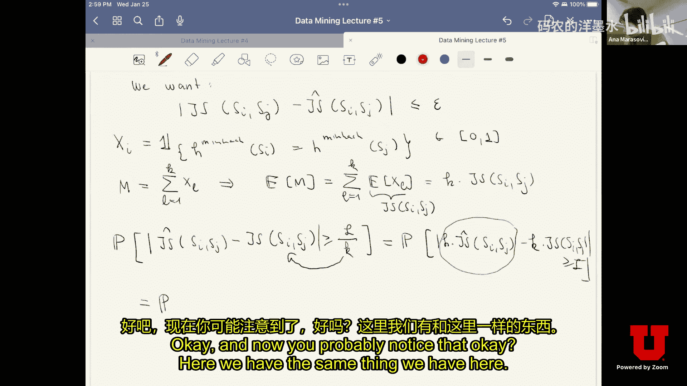

# 004：最小哈希与局部敏感哈希

在本节课中，我们将继续学习最小哈希技术，并深入探讨如何确定所需哈希函数的数量以获得可靠的杰卡德相似度估计。随后，我们将引入“局部敏感哈希”这一核心概念。

## 课程政策与公告

首先，我们来回顾今天的课程政策。该政策涉及课程材料的版权问题，规定课程内容仅供个人、非商业、教育和学术用途，禁止用于任何盈利目的。更多细节可查阅《学生权利与责任守则》中关于课堂内容使用和分发的章节。

此外，今天发布了一项公告：我们正在寻找一个两人小组，愿意接纳另一名同学加入其项目。如果您所在的小组符合条件，请在课后立即联系我或助教。我们非常感谢您的慷慨，这能帮助我们避免出现单人小组的情况。

今天还发布了第三份作业，截止日期为两周后。请合理安排时间，如果尚未开始第二份作业（一周后截止），建议现在开始，以免任务堆积。

## 确定哈希函数数量

上一讲我们提到，可以通过计算签名并比较两个集合签名的相同维度数量来估计杰卡德相似度。其中涉及一个关键参数 **k**，即我们使用的哈希函数数量。一个自然的问题是：为了获得良好的杰卡德相似度估计，我们应该使用多少个哈希函数？

为了回答这个问题，我们将引入一个更通用的框架，它不仅适用于当前场景，也适用于数据挖掘中通过聚合更多数据以获得更好估计的一般情况。这个框架被称为“概率近似正确”。

### 概率近似正确框架

PAC框架涉及几个关键变量：
*   **X̂**：一个随机变量，代表我们的估计值（例如，杰卡德相似度的估计）。
*   **E[X̂]**：该随机变量的期望值（例如，真实的杰卡德相似度）。
*   **δ**：失败概率，取值范围为0到1。例如，δ=0.1表示我们接受10%的失败情况。
*   **ε**：误差容忍度，一个大于0的数，用于衡量估计的“好坏”程度。

PAC框架的核心是建立如下形式的边界：
`P(|X̂ - E[X̂]| > ε) ≤ δ`
这意味着，估计值与真实值之差大于ε（即估计不佳）的概率应小于δ。等价地，也可以写作：
`P(|X̂ - E[X̂]| ≤ ε) ≥ 1 - δ`
这表示，在至少 (1-δ) 的情况下，我们的估计是“好”的（误差在ε以内）。

### 切比雪夫不等式与中心极限定理

通常，我们会结合切比雪夫不等式来应用PAC框架。其推导依赖于**中心极限定理**。该定理指出，如果我们有n个独立同分布的随机变量（均值为μ，方差为σ²），那么当n很大时，这些变量的样本均值将近似服从正态分布。形式化表示为：
`(1/n) * Σ_{i=1}^{n} X_i → N(μ, σ²/n)  (当 n → ∞)`

结合PAC框架和中心极限定理，我们可以得到切比雪夫界的一种形式。假设我们有独立同分布的随机变量`X_i`，且每个`X_i`都被限制在区间`[A_i, B_i]`内。定义`Δ_i = B_i - A_i`，并令`M = Σ_{i=1}^{n} X_i`（注意，这里不是样本均值，而是总和）。那么对于任意λ > 0，有：
`P(|M - E[M]| > λ) ≤ 2 * exp( -2λ² / Σ_{i=1}^{n} Δ_i² )`

### 应用于最小哈希

现在，我们将这个边界应用于最小哈希问题。我们的目标是估计两个集合`S_i`和`S_j`的杰卡德相似度`J(S_i, S_j)`。

首先，回顾我们如何定义随机变量。在上一讲中，我们定义了指示变量：
`X_l = I( minhash(S_i) = minhash(S_j) )`
这个变量在最小哈希值相等时取值为1，否则为0。显然，`X_l`的取值范围是`[0, 1]`。

我们使用k个不同的哈希函数，得到k个这样的随机变量`X_1, X_2, ..., X_k`。它们的和`M = Σ_{l=1}^{k} X_l`。我们知道，每个`X_l`的期望值`E[X_l]`就是杰卡德相似度`J(S_i, S_j)`。因此，`E[M] = k * J(S_i, S_j)`。

我们的估计量是`Ĵ = M / k`。我们希望`|Ĵ - J|`很小。

接下来，我们应用边界。设`Δ_l = 1 - 0 = 1`（因为每个`X_l`的边界是0和1）。那么`Σ Δ_l² = k`。

我们希望控制误差`|Ĵ - J| > ε`的概率。这等价于`|M - k*J| > kε`。在边界公式中，令`λ = kε`。

代入边界公式：
`P(|M - E[M]| > kε) ≤ 2 * exp( -2(kε)² / k ) = 2 * exp( -2kε² )`

这个不等式告诉我们，估计误差大于ε的概率随着哈希函数数量k的增加而呈指数级下降。因此，通过选择足够大的k，我们可以使这个概率（即失败概率δ）变得任意小。例如，如果我们希望以至少95%的置信度（δ=0.05）保证误差在ε=0.05以内，我们可以解方程：
`2 * exp(-2k*(0.05)²) ≤ 0.05`
来求解所需的k值。

## 总结

本节课中，我们一起学习了以下内容：
1.  我们回顾了课程政策，特别是关于版权的规定。
2.  我们提出了一个关键问题：在最小哈希中，需要多少个哈希函数(k)才能获得可靠的杰卡德相似度估计。
3.  我们引入了**概率近似正确**框架，它为我们提供了一种量化估计可靠性的通用方法。
4.  通过结合**中心极限定理**和**切比雪夫不等式**，我们推导出了一个概率边界。
5.  我们将这个边界应用于最小哈希的具体场景，证明了估计误差超过给定阈值ε的概率随哈希函数数量k的增加而指数下降，即 `P(|Ĵ - J| > ε) ≤ 2 * exp(-2kε²)`。这为我们根据所需的精度(ε)和置信度(δ)来选择k提供了理论依据。

下一节，我们将基于最小哈希构建高效的相似项查找方法——**局部敏感哈希**。